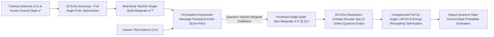

# Echo-QAOA: Constructive Spin-Echo Response Design and Per-Qubit Marginal Distillation for Variational Quantum Optimization

## Abstract

Solving constrained combinatorial optimization problems such as Maximum Weight Independent Set (MWIS) via the Quantum Approximate Optimization Algorithm (QAOA) requires navigating rugged $2p$-dimensional landscapes shaped by competing couplings $J$ and heterogeneous local fields $h$. Homogeneous annealing schedules lack site-specific phase resolution and require costly online circuit selection, whereas direct neural angle regression collapses under cross-branch jumping and an implicit-function curvature conflict between peak flatness and coordinate stability. We propose **Echo-QAOA**, exploiting global spin-flip parity conjugation to cancel quadratic couplings $H_J$ exactly within the unmodified QAOA ansatz, factorizing target probabilities into $O(kn)$ single-qubit responses and enabling a zero-measurement overlap decoder that transforms ill-conditioned angle regression into permutation-equivariant marginal distillation (**Echo-Prior**). Using Daubechies spectral factorization, we prove that arbitrary-order Flat-Top Echo responses are realizable with real angles, achieve $O(\delta^{2k})$ peak error tolerance, and remain strictly convex on zero-free intervals. Across 2,750 five-family benchmark and 5,120 cross-scale MWIS instances, **Echo-Prior-Flat** outperforms annealing initialization and 36 angle-regression models, expanding $P_{\mathrm{gs}}\ge 50\%$ coverage by $4.9\times$ with zero Stage-1 quantum measurements.

## 1 Introduction

The Quantum Approximate Optimization Algorithm (QAOA) prepares candidate states by alternating problem evolutions $U_C(\gamma)=e^{-i\gamma H_C}$ and transverse-field mixers $U_B(\beta)=e^{-i\beta\sum_i X_i}$ on near-term quantum processors (Blekos et al., 2024; Cerezo et al., 2021; Farhi et al., 2014; Preskill, 2018). Unlike field-free ($h=0$) MaxCut, penalty mappings of constrained problems such as Maximum Weight Independent Set (MWIS) into Ising form $E(s)=\frac12s^\top Js+h^\top s+C$ induce strong competition between couplings $J$ and heterogeneous local fields $h$ (Ebadi et al., 2022; Hadfield et al., 2019; Lucas, 2014; Pichler et al., 2018). Because hardware energy and parameter-shift gradient steps require thousands of projective shots (Harrigan et al., 2021; Mitarai et al., 2018; Pagano et al., 2020; Wierichs et al., 2022) while non-convex couplings induce exponentially many local traps (Anschuetz & Kiani, 2022; Bittel & Kliesch, 2021; McClean et al., 2018; Shaydulin et al., 2019; You & Wu, 2021), amortizing initialization from $(J,h)$ within the standard QAOA ansatz ($|+\rangle^{\otimes n}$ initial state and uniform mixer $U_B(\beta)$) is a central challenge.

Existing initialization methods follow two paradigms: heuristic homogeneous trajectories—Trotterized Quantum Annealing (TQA), layerwise interpolation (INTERP / FOURIER), and parameter concentration (Brandao et al., 2018; Crooks, 2018; Farhi et al., 2001; Galda et al., 2021; Kadowaki & Nishimori, 1998; Sack & Serbyn, 2021; Shaydulin et al., 2023; Zhou et al., 2020)—and direct neural angle regression (Neural QAOA) via MLPs, GNNs, or generative models (Amos, 2023; Amosy et al., 2024; Jain et al., 2022; Jiang et al., 2025; Liang et al., 2024; Meng et al., 2025). **However**, both break down under strong heterogeneous fields $h$: homogeneous schedules impose uniform phase envelopes across all qubits and require dozens of online measurements for step-size selection (Katial et al., 2025), whereas direct angle regression suffers from three pathologies—(1) _cross-branch discrete jumping_: beyond sign and periodic symmetries (Lotshaw et al., 2021; Shaydulin et al., 2021), zero-probability manifolds partition parameter space into competing branches, causing optimal angles to jump discontinuously as $(J,h)$ crosses branch intersections (Gould et al., 2021; Rupprecht et al., 2017; Zhang et al., 2019); (2) _an implicit-function curvature conflict_: flatter peaks improve tolerance to angle errors but inversely amplify the implicit-function sensitivity of optimal angle coordinates to instance perturbations (Section 4.1); and (3) _heterogeneity loss under graph pooling_: collapsing node embeddings into a global $2p$-D vector erases node-to-qubit field correspondences.

**Figure 1: Overview of Echo-QAOA constructive 1D spectral response design, per-qubit quantum teacher marginal distillation (Echo-Prior), zero-quantum-evaluation distribution-overlap decoding, and full-angle energy recoupling optimization.**

To break this bottleneck, our core insight is to **carve out an exact product submanifold with explicit single-qubit responses and interval convexity inside the standard QAOA circuit via parity decoupling, and use it as an analytical bridge to reformulate ill-conditioned global angle regression into well-conditioned node-level quantum marginal distillation**. Inspired by Spin Echo refocusing (Carr & Purcell, 1954; Hahn, 1950; Viola et al., 1999), we exploit the opposite parities of $H_J$ (even) and $H_h$ (odd) under the global spin flip $F=\prod_i X_i$ ($\beta=\pi/2$) to formulate **Echo-QAOA**: pairing anti-symmetric cost angles $(-g_j,g_j)$ with a $\pi/2$ flip cancels $H_J$ exactly, factorizing target probabilities into $O(kn)$ single-qubit responses. Isomorphic to polynomial synthesis in Quantum Signal Processing (Gilyén et al., 2019; Low & Chuang, 2017; Low et al., 2016), this yields **Flat-Top**, **Alternating-Phase**, and **Endpoint-Matched** 1D recipes, where Daubechies spectral factorization guarantees $O(\delta^{2k})$ error tolerance and strict convexity on zero-free intervals (Daubechies, 1988; Herrmann, 1971). Product factorization reduces the inner product between $2^n$-D distributions to $n$ single-qubit marginal terms, yielding an $O(Mnk)$ **1D distribution-overlap decoder** with **zero online quantum evaluations**. Building on this decoder, **Echo-Prior** uses a permutation-equivariant message-passing network (Gilmer et al., 2017; Karalias & Loukas, 2020; Schuetz et al., 2022; Xu et al., 2019) to distill single-qubit positive-spin marginals $\pi_i^{\mathrm T}\in[0,1]$ of multi-body teacher states (Hinton et al., 2015; Wainwright & Jordan, 2008) from raw $(J,h)$, decodes them into fault-tolerant Flat-Top starts, and releases all $2p$ angles in Stage 2 to reactivate $H_J$ entanglement (Figure 1). Our contributions are:

1. **Echo-Pair Parity Decoupling and Constructive 1D Recipes**: We prove exact $H_J$ cancellation and $O(kn)$ probability factorization for complete Echo pairs (Propositions 1–2); we formulate Flat-Top, Alternating-Phase, and Endpoint-Matched 1D recipes, proving via Daubechies spectral factorization that arbitrary-order Flat-Top responses admit real angles (Proposition 3), $O(\delta^{2k})$ error tolerance, and strict interval convexity (Proposition 4), alongside local-field boundaries and recoupling (Proposition 5; Section 3).
2. **Implicit-Function Diagnosis, Overlap Decoder, and Echo-Prior**: We prove the inverse curvature trade-off between peak flatness and coordinate stability alongside cross-branch jumping; we construct a zero-measurement 1D overlap decoder $S(a)$ and propose permutation-equivariant Per-Qubit Marginal Distillation (`Echo-Prior-Flat/End/Alt`), decoupling spin-marginal inference from non-convex angles (Section 4).
3. **2,750-Instance Benchmark, 36-Model Evaluation, and 5,120-Instance Cross-Scale Generalization**: Across 2,750 instances, Flat-Top Echo achieves the highest overall mean probability ($\mathbf{53.07}\%$), beating TQA by $+13.52\text{--}+17.03$ pp on MWIS and across all scales under uncapped convergence; on unseen MWIS instances, **Echo-Prior-Flat** achieves the highest cross-depth mean probability ($\mathbf{23.48}\%$) with zero Stage-1 measurements, expanding $P_{\mathrm{gs}}\ge 50\%$ coverage to $\mathbf{20.0}\%$ ($4.9\times$ GNN-TQA), beating all 36 angle-regression models and 1D pooled ablations, and generalizing zero-shot across $n\in\{6,8,10,12,14\}$ (5,120 instances) with $100\%$ Stage-1 noise immunity (Section 5).

## 2 Related Work

### 2.1 Constrained Ising Variational Optimization and Heuristic Trajectory Initialization

QAOA (Farhi et al., 2014) discretizes adiabatic evolution (Farhi et al., 2001; Kadowaki & Nishimori, 1998) into alternating parameterized circuits (Blekos et al., 2024; Cerezo et al., 2021; Preskill, 2018). Penalty mappings (Lucas, 2014) and constrained ansätze (Hadfield et al., 2019) map NP-hard problems like MWIS to Ising models with competing $J$ and heterogeneous fields $h$ across superconducting, trapped-ion, and Rydberg platforms (Ebadi et al., 2022; Harrigan et al., 2021; Pagano et al., 2020; Pichler et al., 2018). Direct $2p$-angle optimization faces barren plateaus (McClean et al., 2018), NP-hard landscapes (Bittel & Kliesch, 2021), local traps (Anschuetz & Kiani, 2022; You & Wu, 2021), and symmetries (Lotshaw et al., 2021; Shaydulin et al., 2021), making multi-start quasi-Newton search (Byrd et al., 1995; Shaydulin et al., 2019) with $O(p)$ parameter-shift gradients (Mitarai et al., 2018; Wierichs et al., 2022) costly. Heuristic schedules—interpolation/Fourier bases (Crooks, 2018; Zhou et al., 2020), counterdiabatic driving (Wurtz & Love, 2022; Yang et al., 2017), TQA (Sack & Serbyn, 2021), and parameter transfer (Brandao et al., 2018; Galda et al., 2021; Shaydulin et al., 2023)—impose uniform phase envelopes that fail under heterogeneous fields $h$ (Katial et al., 2025). Ansatz-modifying variants like Warm-Start QAOA (Egger et al., 2021; Tate et al., 2023), ma-QAOA (Herrman et al., 2022), and RQAOA (Bravyi et al., 2020) alter initial states or mixers $U_B(\beta)$, forfeiting native global-pulse compatibility. We preserve the unmodified QAOA ansatz, carving out an exact 1D product submanifold before recoupling all $2p$ angles (Dupont et al., 2022).

### 2.2 Spin Echo, Quantum Signal Processing, and Daubechies Wavelet Spectral Factorization

Intermediate $\pi$ flips that reverse linear phase evolution underpin NMR Spin Echo (Carr & Purcell, 1954; Hahn, 1950), dynamical decoupling (Viola et al., 1999), and composite pulses (Vandersypen & Chuang, 2005). In standard QAOA, $\beta=\pi/2$ implements the global spin flip $F=\prod_i X_i$ up to a global phase; pairing anti-symmetric cost angles $(-g_j,g_j)$ with $\beta=\pi/2$ cancels even-parity $H_J$ while doubling odd-parity $H_h$. Within the decoupled single-qubit subspace, synthesizing even-layer mixers $(\theta_1,\ldots,\theta_k)$ is isomorphic to polynomial spectral synthesis in QSP and QSVT (Gilyén et al., 2019; Low & Chuang, 2017; Low et al., 2016). Importing maximally flat filters and Daubechies' power-complementary spectral factorization (Daubechies, 1988; Herrmann, 1971), we embed two-channel orthogonal lattice elimination into complete Echo pairs to guarantee real-angle realizability, $O(\delta^{2k})$ flatness, and interval convexity.

### 2.3 Amortized Implicit-Function Trade-offs and Per-Qubit Marginal Distillation

For online initialization without target states, research has shifted from recurrent L2O controllers (Verdon et al., 2019) to direct angle prediction via MLPs, GNNs, or diffusion models (Amosy et al., 2024; Jain et al., 2022; Jiang et al., 2025; Liang et al., 2024; Meng et al., 2025). By implicit differentiation in amortized optimization (Amos, 2023; Gould et al., 2021), reducing peak curvature for error tolerance inversely amplifies coordinate sensitivity to instance perturbations, while zero-probability manifolds trigger cross-branch jumps; even with set losses (Rupprecht et al., 2017; Zhang et al., 2019), global graph pooling (Xu et al., 2019) erases node-level field biases. Inspired by graphical-model marginal inference (Wainwright & Jordan, 2008) and equivariant graph solvers (Gilmer et al., 2017; Karalias & Loukas, 2020; Loshchilov & Hutter, 2019; Schuetz et al., 2022), we pair Echo-QAOA's overlap decoder with knowledge distillation (Hinton et al., 2015) of a permutation-equivariant **Echo-Prior** network to bypass angle jumps.

## 3 Echo-QAOA: Operator Decoupling and Constructive 1D Response Theory

### 3.1 Ising Circuit Conventions with Local Fields and Exact Complete Echo-Pair Decoupling

Consider an $n$-spin Ising energy $E(s)=\frac12s^\top Js+h^\top s+C$ over $s\in\{-1,+1\}^n$, with symmetric zero-diagonal coupling $J\in\mathbb R^{n\times n}$, external field $h\in\mathbb R^n$, and offset $C\in\mathbb R$. Promoting spins to computational-basis operators decomposes $H_C=H_J+H_h+C$, where $H_J|s\rangle=(\frac12s^\top Js)|s\rangle$ and $H_h|s\rangle=(h^\top s)|s\rangle$ ($C$ adds only a global phase). In a depth-$p$ QAOA circuit (Farhi et al., 2014) with cost unitary $U_C(\gamma)=e^{-i\gamma H_C}$ and mixer $U_B(\beta)=e^{-i\beta\sum_{i=1}^n X_i}$, starting from $|+\rangle^{\otimes n}$ prepares $|\psi_p(\vartheta;J,h)\rangle=U_B(\beta_p)U_C(\gamma_p)\cdots U_B(\beta_1)U_C(\gamma_1)|+\rangle^{\otimes n}$, where $\vartheta=(\gamma_1,\ldots,\gamma_p,\beta_1,\ldots,\beta_p)$ satisfies $|\gamma_\ell|\le G, |\beta_\ell|\le\pi/2$.

While $H_J$ generates complex multi-body interference (Bravyi et al., 2020; Herrman et al., 2022), conjugating $H_J$ and $H_h$ by the **global spin-flip operator** $F=\prod_{i=1}^n X_i$ ($s\mapsto -s$) reveals opposite parities: $FH_JF=H_J$, $FH_hF=-H_h$, and $U_B(\pi/2)=(-i)^nF$. Inspired by Spin Echo refocusing (Carr & Purcell, 1954; Hahn, 1950; Vandersypen & Chuang, 2005; Viola et al., 1999), for positive even depths $p=2k$ ($k\ge 1$), we group adjacent layers into the $j$-th **complete Echo pair** ($j=1,\ldots,k$) with $(\gamma_{2j-1},\gamma_{2j})=(-g_j,g_j)$ and $(\beta_{2j-1},\beta_{2j})=(\pi/2,\theta_j)$.

**Proposition 1 (Complete Echo-Pair Decoupling).** _Up to a global phase, the composite unitary evolution operator of the $j$-th complete Echo pair, $E(g_j,\theta_j):=U_B(\theta_j)U_C(g_j)U_B(\pi/2)U_C(-g_j)$, satisfies identically $E(g_j,\theta_j)=U_B(\theta_j)e^{-2ig_jH_h}F$._

**Proof Sketch.** Using $U_B(\pi/2)\propto F$, $F^2=I$, $F(H_J+H_h+C)F=H_J-H_h+C$, and $[H_C,FH_CF]=0$ cancels $H_J$ and $C$ identically while doubling $-ig_jH_h$ across all $k$ pairs without weak-coupling approximations, preserving a strict product state from $|+\rangle^{\otimes n}$ (Appendix A.1). $\square$

### 3.2 Single-Qubit Amplitude Recursion, Multiplicative Probability Factorization, and 1D Parameter Families

By Proposition 1, the $2^n$-D evolution reduces to $n$ decoupled 2D recursions. In the basis $(|s_i=-1\rangle,|s_i=+1\rangle)$ with $u_i^{(0)}=\frac{1}{\sqrt{2}}\binom{1}{1}$ and single-qubit mixer $M(\theta)=\binom{\cos\theta\ \ -i\sin\theta}{-i\sin\theta\ \ \cos\theta}$, the state $u_i^{(j)}=\big(u_{i,-}^{(j)}, u_{i,+}^{(j)}\big)^\top$ updates via spin swap $X_i$, field phase $e^{\pm 2ig_jh_i}$, and mixing $M(\theta_j)$ as $\binom{u_{i,-}^{(j)}}{u_{i,+}^{(j)}}=M(\theta_j)\binom{e^{2ig_jh_i}u_{i,+}^{(j-1)}}{e^{-2ig_jh_i}u_{i,-}^{(j-1)}}$ ($j=1,\ldots,k$), yielding final magnetization $m_i=|u_{i,+}^{(k)}|^2-|u_{i,-}^{(k)}|^2\in[-1,1]$.

**Proposition 2 (Multiplicative Probability Factorization).** _Under a depth-$p=2k$ circuit of $k$ complete Echo pairs, the measurement probability of any target spin configuration $s^\star\in\{-1,+1\}^n$ factorizes as $P(s^\star)=\prod_{i=1}^n\frac{1+s_i^\star m_i}{2}$._

**Proof Sketch.** Product-state preservation makes qubit measurements independent with marginal $|u_{i,s_i^\star}^{(k)}|^2=(1+s_i^\star m_i)/2$ (Appendix A.1), reducing evaluation from $O(pn2^n)$ to $O(kn)$ time and $O(1)$ space. $\square$

For even depth $p=2k$ and recipe $v$, fixing cost ratios $(r_1,\ldots,r_k)$ and even-layer mixers $(\theta_1,\ldots,\theta_k)$ drives all cost amplitudes via a single scalar $a$ ($g_j=r_ja$) through the affine embedding $D_{v,k}(a)=(-r_1a,r_1a,\ldots,-r_ka,r_ka,\tfrac\pi2,\theta_1,\ldots,\tfrac\pi2,\theta_k)$ over $a\in\mathcal A_{v,k}=[-G/\max_j|r_j|,G/\max_j|r_j|]$, where $m_i(a)$ depends only on $\phi_i=4ah_i$ and $(r_j,\theta_j)_{j=1}^k$.

**Table 1: Comparison of parameter designs, single-qubit responses, and theoretical properties across the three constructive Echo recipes ($p=2k, k\ge 2$, where $\phi=4ah$ and $t=\sin\phi$).**

| Recipe Name                             | Cost Ratios $r_j$ & Even-Layer Mixers $\theta_j$                             | Magnetization $m_k(t)$ & Domain $\mathcal A_{v,k}$               | Core Algebraic and Analytical Properties                                                                                      |
| :-------------------------------------- | :--------------------------------------------------------------------------- | :--------------------------------------------------------------- | :---------------------------------------------------------------------------------------------------------------------------- |
| **Flat-Top Echo** (`Echo-Flat`)         | $r=(1,2,\ldots,2)$; $\theta_j$ via Daubechies spectral-factor elimination    | $2I_{(1+t)/2}(k,k)-1$, $a\in[-\frac{G}{2},\frac{G}{2}]$          | Vanishing derivatives up to order $k-1$ at $t=\pm 1$ with $O(\delta^{2k})$ error tolerance; strictly convex on zero-free intervals |
| **Alternating-Phase Echo** (`Echo-Alt`) | $r_j=(-1)^{k-j}$; $\theta_j=0\ (j<k)$, $\theta_k=\pi/4$                      | $\sin(k\phi)$, $a\in[-G,G]$                                      | Saturates cumulative phase bound $kG$ of zero-intermediate-mixer subfamily, expanding phase scanning frequency by $k\times$   |
| **Endpoint-Matched Echo** (`Echo-End`)  | $r=(1,2,\ldots,2)$; $\theta_j=(-1)^{k-j}B\ (j<k)$, $\theta_k=B/2$            | $\sin[(2k-1)\arcsin(ut)]$, $a\in[-\frac{G}{2},\frac{G}{2}]$      | Balances passband endpoints $m_k(\tau)=m_k(1)$ on $[\tau,1]$, providing a conditional analytical probability lower bound      |

### 3.3 Flat-Top Echo: High-Order Flat Response and Spectral-Factor Realizability

Because site fields $h_i$ are generally incommensurate, a single scalar $a$ cannot align every qubit at $\sin(4ah_i)=s_i^\star$. **Flat-Top Echo** adopts the dyadic ratio $r=(1,2,\ldots,2)$ ($a\in[-G/2,G/2]$ for $k\ge 2$) and shapes the single-qubit magnetization in $t=\sin(4ah)\in[-1,1]$ via the normalized symmetric Beta integral $m_k(t)=\int_0^t(1-z^2)^{k-1}\,dz/\int_0^1(1-z^2)^{k-1}\,dz$, with success factor $p_k(q)=(1+m_k(2q-1))/2=I_q(k,k)$ for $q=(1+t)/2\in[0,1]$ and $p_k(q)+p_k(1-q)=1$ (e.g., $m_2(t)=(3t-t^3)/2$ and $m_3(t)=(15t-10t^3+3t^5)/8$; Appendix A.2). Here $m_k(t)$ is an odd degree-$(2k-1)$ polynomial satisfying $m_k(\pm 1)=\pm 1$ with derivatives of order $1\ldots k-1$ vanishing at $t=\pm 1$.

**Proposition 3 (Constructive Realizability of Arbitrary-Order Flat-Top Responses).** _For any integer $k\ge 1$, there exist real angles $\theta_1,\ldots,\theta_k\in[-\pi/2,\pi/2)$ such that a $k$-pair complete Echo circuit with cost ratios $g=(a,2a,\ldots,2a)$ produces the exact single-qubit magnetization response $m_k(\sin(4ah))$._

**Construction and Proof Sketch.** Setting $\omega=4ah-\pi/2$ and $z=e^{i\omega}$ ($q=\cos^2(\omega/2)$), Daubechies' power-complementary spectral factorization (Daubechies, 1988; Herrmann, 1971) yields a real minimum-phase polynomial $H_k(z)=\sum_{r=0}^{2k-1}c_rz^r$ satisfying $|H_k(e^{i\omega})|^2/2=p_k(\cos^2(\omega/2))$ and $|H_k(z)|^2+|H_k(-z)|^2=2$. Pairing $H_j(z)$ with $H_j^\#(z)=z^{2j-1}H_j(-z^{-1})$, two-channel orthogonal lattice elimination from $j=k$ to $1$ cancels constant and linear terms at each step (divisible by $e^{2i\phi}=-z^2$) to extract unique real angles $\theta_j\in[-\pi/2,\pi/2)$ whose reverse recursion matches Section 3.2 (Appendix A.2). $\square$

Around peak alignment $s_i^\star\sin(4a_0h_i)=1$, a perturbation $a=a_0+\delta$ gives $1-s_i^\star\sin(4h_i(a_0+\delta))=8h_i^2\delta^2+O(\delta^4)$. Since $1-m_k(1-\varepsilon)=O(\varepsilon^k)$, single-qubit probability loss is suppressed to $O(\delta^{2k})$, widening each qubit's high-probability overlap window under incommensurate fields.

### 3.4 Strict Convexity of the Flat-Top Objective on Zero-Free Intervals

For target $s^\star$, let $w_i=4h_is_i^\star$ and define wrapped phase deviation $e_i(a)=\operatorname{wrap}_{(-\pi,\pi]}(aw_i-\pi/2)$. The negative log-probability loss of Flat-Top Echo decomposes into per-qubit phase losses $\mathcal L_k(a;x)=-\log P_{D_{\mathrm{flat},k}(a)}(s^\star)=\sum_{i=1}^n \ell_k(e_i(a))$, where $\ell_k(e):=-\log p_k((1+\cos e)/2)$.

**Proposition 4 (Strict Convexity on Zero-Free Intervals).** _The single-qubit phase loss $\ell_k(e)$ is strictly convex on $(-\pi,\pi)$. For any instance with at least one non-zero local field ($h_i\ne 0$), the global loss $\mathcal L_k(a;x)$ is strictly convex in $a$ on every open scalar interval free of zero-probability singularities, admitting at most one stationary point (its unique local minimum) per interval._

**Proof Sketch.** Writing $p_k((1+\cos e)/2)=\int_e^\pi\sin^{2k-1}v\,dv/\int_0^\pi\sin^{2k-1}v\,dv$ for $e\in[0,\pi)$, strict log-concavity of $\sin^{2k-1}v$ on $(0,\pi)$ implies a strictly decreasing Mills tail ratio $R(e)$, making $\ell_k'(e)=1/R(e)$ strictly increasing on $(-\pi,\pi)$. Within any open interval avoiding zero-probability breakpoints $a=(-\pi/2+2\pi z)/w_i$ ($z\in\mathbb Z, w_i\ne 0$), each $e_i(a)$ is strictly affine in $a$, preserving strict convexity under summation (Appendix A.3). $\square$

### 3.5 Alternating-Phase Echo: Cumulative Effective Phase Expansion

To maximize cumulative phase range under $|g_j|\le G$, **Alternating-Phase Echo** ($k\ge 2$) sets $g_j=(-1)^{k-j}a$, $\theta_j=0$ ($j<k$), and $\theta_k=\pi/4$. Because intermediate flips $F$ invert accumulated local-field phases ($A_j=g_j-A_{j-1}$), alternating signs accumulate constructively to $A_k=ka$, saturating the subfamily bound $|A_k|\le\sum_{j=1}^k|g_j|\le kG$ and yielding $m_i(a)=\sin(4kah_i)$ (Appendix A.1).

### 3.6 Endpoint-Matched Echo: Positive-Phase Passband Balancing and Recipe Comparison

Balancing flatness and oscillation, **Endpoint-Matched Echo** ($k\ge 2$) retains $g=(a,2a,\ldots,2a)$ ($a\in[-G/2,G/2]$) with alternating mixers $\theta_j=(-1)^{k-j}B$ ($j<k$) and $\theta_k=B/2$. Grouping adjacent pairs into coaxial Bloch rotations with $L=2k-1$, $u=\sin B$, and $t=\sin(4ah)$ (Low et al., 2016; Vandersypen & Chuang, 2005) (Appendix A.4) yields $m_k(t)=\sin[L\arcsin(ut)]$. For passband threshold $\tau\in(0,1)$, setting $u=\sin(\pi/L)/\sqrt{1+2\tau\cos(\pi/L)+\tau^2}$ and $B=\arcsin u$ enforces $m_k(\tau)=m_k(1)$, ensuring $P_{D_{\mathrm{end},k}(a)}(s^\star)\ge[(1+m_k(\tau))/2]^n$ when all $t_i=s_i^\star\sin(4ah_i)\in[\tau,1]$ (Table 1).

### 3.7 Theoretical Boundaries of Restricted Product Evolution and Motivation for Recoupling

Because complete Echo pairs cancel $H_J$ exactly, Stage-1 evolution is driven purely by $H_h$, establishing structural bounds that motivate Stage-2 full-angle recoupling.

**Proposition 5 (Local-Field-Driven Boundaries and Multiplicative Decay of Restricted Echo Evolution).** _Under the depth-$p=2k$ restricted Echo circuit $D_{v,k}(a)$, target probability obeys:_
_(1) **Zero-Field Upper Bound**: If $n_0$ qubits have $h_i=0$, then $P_{D_{v,k}(a)}(s^\star)\le 2^{-n_0}$ for all $a$ (reducing to $2^{-n}$ when $h=0$);_
_(2) **Dimensional Attenuation Bound**: If $q$ qubits have $s_i^\star m_i(a)\le\eta<1$ at scalar $a$, then $P_{D_{v,k}(a)}(s^\star)\le\big(\frac{1+\eta}{2}\big)^q$._

**Proof Sketch.** Qubits with $h_i=0$ accumulate trivial phase on $|+\rangle$, fixing $m_i(a)=0$ and factor $1/2$ in Proposition 2; qubits with $s_i^\star m_i(a)\le\eta$ contribute $\le(1+\eta)/2$ (Appendix A.1). $\square$

To resolve zero-field sites and frustrated couplings beyond product states, perturbing the $j$-th pair's cost angles along the symmetry-breaking direction to $(-g_j+\delta_j, g_j+\delta_j)$ yields $U_B(\theta_j)e^{-2i\delta_j H_J}e^{-2ig_j H_h}F$ (Appendix A.1), reactivating $H_J$ linearly with non-zero first-order gradients along $\delta_j=(\gamma_{2j-1}+\gamma_{2j})/2$. This establishes Echo-QAOA's **two-stage division of labor** (Dupont et al., 2022; Wurtz & Love, 2022; Yang et al., 2017): Stage 1 anchors a field-aligned starting point on the 1D Echo manifold in $O(kn)$ classical time; Stage 2 releases all $2p$ angles to restore entanglement.

### 3.8 1D Interval Derivative Root-Finding and Two-Stage Optimization Strategy

For offline teacher collection with known $s^\star$ (Appendix B.1), Stage 1 locates 1D candidates via: (1) deterministic bisection on $\mathcal L_k'(a;x)$ within each zero-free convex interval (Proposition 4) for Flat-Top Echo; (2) $O(kn)$ grid peak-finding with golden-section refinement for oscillatory recipes; and (3) spacing deduplication before Stage-2 L-BFGS-B refinement.

## 4 Per-Qubit Marginal Distillation Initialization via Distribution-Overlap Decoding

### 4.1 Local Sensitivity Trade-offs and Cross-Branch Jumping in Parameter Space

To design a cross-instance generator from $x=(J,h)$ to $\vartheta^\star(x)$ (Amos, 2023; Verdon et al., 2019), let $a_b^\star(x)\in I_b(x)$ be the unique interior stationary point ($\partial_a\mathcal L_k(a_b^\star(x);x)=0$) on a zero-free Flat-Top branch $I_b(x)$ with curvature $\partial_{aa}\mathcal L_k\ge\mu>0$ and $\|\partial_{ax}\mathcal L_k\|\le M$. By the implicit function theorem (Amos, 2023; Gould et al., 2021), label sensitivity satisfies $\nabla_xa_b^\star(x)=-(\partial_{aa}\mathcal L_k(a_b^\star;x))^{-1}\partial_{ax}\mathcal L_k(a_b^\star;x)$ (bounded by $M/\mu$), while under prediction error $\delta=\widehat a-a_b^\star$ the loss increases as $\Delta\mathcal L_k(\delta;x)=\frac12\mathcal L_k''(a_b^\star;x)\delta^2+o(\delta^2)$. This exposes an intrinsic **curvature conflict**: smaller curvature $\mathcal L_k''(a_b^\star;x)$ flattens the peak to tolerate larger errors $\delta$ ($O(\delta^{2k})$ at ideal alignment where $\mathcal L_k''=0$), but inversely amplifies the coordinate sensitivity bound $M/\mu$ to instance perturbations. Globally, zero-probability breakpoints partition $\mathcal A_{v,k}$ into competing branches $\{I_b(x)\}$; whenever two branches cross in loss value as $x$ varies, the global minimizer $a^\star(x)=a_{b^\star(x)}^\star(x)$ jumps discontinuously, while sign and periodic symmetries cause MSE regression to collapse toward zero-angle valleys (Appendix A.3). We therefore infer a unique, smooth **single-qubit positive-spin marginal prior** $\boldsymbol{\pi}=(\pi_1,\ldots,\pi_n)\in[0,1]^n$ in state space and project it analytically onto the Echo manifold.

### 4.2 1D Distribution-Overlap Decoding and Full-Angle Energy Recoupling

Given an estimated marginal prior $\boldsymbol{\pi}\in[0,1]^n$ defining the surrogate product distribution $P_{\pi}(s)=\prod_{i=1}^n\pi_i^{\mathbf1[s_i=+1]}(1-\pi_i)^{\mathbf1[s_i=-1]}$, Proposition 2 guarantees that the restricted Echo distribution $Q_a(s)$ at scalar $a$ is also a strict product distribution with $+1$ marginal $q_i(a)=(1+m_i(a))/2$. Consequently, the $2^n$-D **Distribution Overlap** $S(a)=\sum_{s\in\{-1,+1\}^n}P_{\pi}(s)Q_a(s)=\prod_{i=1}^n[\pi_iq_i(a)+(1-\pi_i)(1-q_i(a))]$ factorizes into $n$ single-qubit terms. Evaluating $S(a)$ on an $M$-point uniform grid $\mathcal A_M\subset\mathcal A_{v,k}$ selects $\widehat a=\arg\max_{a\in\mathcal A_M}S(a)$ and expands $\vartheta_0=D_{v,k}(\widehat a)$ in $O(Mnk)$ classical time with **strictly zero Stage-1 online quantum evaluations**. Stage 2 then minimizes the unsupervised quantum energy $\min_{\vartheta}\langle\psi_p(\vartheta;J,h)|\frac12s^\top Js+h^\top s|\psi_p(\vartheta;J,h)\rangle$ via bound-constrained L-BFGS-B (Byrd et al., 1995), driving all $2p$ angles off the anti-symmetric manifold to reactivate $H_J$ within the standard QAOA ansatz (Appendix B.1, D.2).

### 4.3 Offline Probability Teachers and Symmetry-Aware Multi-Branch Angle-Set Supervision

On the training set (with known unique $s^\star$), we run the three Echo recipes and three baselines (RI, TQA, INTERP) to form six offline teachers. Retaining candidates within $\alpha_{\mathrm{prob}}\in(0,1)$ of each pool's peak probability, we account for sign inversion ($\vartheta\mapsto -\vartheta$) and $\pi$-periodicity of mixers (Lotshaw et al., 2021; Shaydulin et al., 2021) via the **normalized symmetry-equivalent distance** $d^2(\vartheta,\vartheta')=\min_{\sigma\in\{\pm 1\}}\frac{1}{2p}\sum_{\ell=1}^p\big[(\frac{\gamma_\ell-\sigma\gamma'_\ell}{G})^2+(\frac{\operatorname{wrap}_{\pi}(\beta_\ell-\sigma\beta'_\ell)}{\pi/2})^2\big]$. Greedy filtering with separation $d^2>\delta_{\mathrm{sep}}^2$ yields up to $R$ separated branches $\mathcal T_q=\{\vartheta_{qr}^{\mathrm T}\}_{r=1}^{R_q}$ per instance $q$. Full-angle regression baselines (MLPs and GNNs) (Amosy et al., 2024; Jain et al., 2022; Liang et al., 2024) minimize the set loss $\mathcal L_q=\min_{\vartheta^{\mathrm T}\in\mathcal T_q}d^2(\widehat\vartheta_q,\vartheta^{\mathrm T})$ (Rupprecht et al., 2017; Zhang et al., 2019).

### 4.4 Permutation-Equivariant Per-Qubit Teacher Marginal Learning (Echo-Prior)

To bypass angle-space discontinuities while distilling multi-body entanglement biases, **Echo-Prior** extracts single-qubit positive-spin marginals $\pi_i^{\mathrm T}=\sum_{s}|\langle s|\psi_p(\vartheta^{\mathrm T};J,h)\rangle|^2\mathbf1[s_i=+1]\in[0,1]$ from the top teacher state $\vartheta^{\mathrm T}\in\mathcal T_q$ (Hinton et al., 2015). Receiving only standardized raw coefficients $(\tilde J,\tilde h)$, the encoder embeds $\boldsymbol z_i^{(0)}=\phi_{\mathrm{node}}(\tilde h_i)\in\mathbb R^W$ and executes $L$ message-passing rounds over non-zero edges $M_{ij}=\mathbf1[J_{ij}\ne 0]$ (Gilmer et al., 2017; Xu et al., 2019): $\boldsymbol a_i^{(\ell)}=\frac{1}{Z_{\mathrm{agg}}}\sum_{j=1}^n M_{ij}\,\phi_{\mathrm{msg}}^{(\ell)}(\boldsymbol z_i^{(\ell-1)},\boldsymbol z_j^{(\ell-1)},\tilde J_{ij})$ and $\boldsymbol z_i^{(\ell)}=\boldsymbol z_i^{(\ell-1)}+\phi_{\mathrm{upd}}^{(\ell)}(\boldsymbol z_i^{(\ell-1)},\boldsymbol a_i^{(\ell)})$ with fixed scale $Z_{\mathrm{agg}}$, outputting $\widehat\pi_i=\operatorname{sigmoid}(\phi_{\mathrm{head}}(\boldsymbol z_i^{(L)}))$ (Karalias & Loukas, 2020; Schuetz et al., 2022). Shared edge/node parameters and topological aggregation guarantee strict **permutation equivariance**. We minimize per-qubit binary cross-entropy $\mathcal L_{\mathrm{BCE}}=-\frac{1}{|B|n}\sum_{q\in B,i}[\pi_{qi}^{\mathrm T}\log\widehat\pi_{qi}+(1-\pi_{qi}^{\mathrm T})\log(1-\widehat\pi_{qi})]$ and decode $\widehat{\boldsymbol{\pi}}$ via $S(a)$ (**Echo-Prior-Flat/End/Alt**) followed by full-angle L-BFGS-B refinement (Appendix B.3).

## 5 Experiments

### 5.1 Experimental Setup and Evaluation Protocol

**Five-family offline benchmark.** We evaluate five problem families—fully connected `Dense Ising`, Hamiltonian-cycle `Sparse Ising`, 2D `Grid Ising`, single-spin-pinned `Pinned MaxCut`, and constrained `MWIS` with heterogeneous positive fields $h_i>0$ (protocols and uniqueness verification in Appendix C)—with 50 unique-ground-state instances per scale across $n\in\{6,\ldots,16\}$ (2,750 instances). Across $p\in\{6,8,10,12,14\}$, we compare `Echo-Flat`, `Echo-Alt`, `Echo-End`, `RI`, `TQA`, and `INTERP` under a 30.0 s wall-clock cap per task and uncapped convergence ($n\in\{6,8,10,12,14\}$, 1,024 instances/scale at $p=10$).

**MWIS online initialization, cross-scale transfer, and finite-shot robustness.** Centered at $n=10$ (4,096 train / 512 val / 1,024 test instances shared across $p\in\{8,10,12\}$) plus four cross-scale test sets at $n\in\{6,8,12,14\}$ (1,024 instances each; 5,120 total test instances), we compare `Echo-Prior-Flat/End/Alt` ($M=128$, $Z_{\mathrm{agg}}=9$, $0$ Stage-1 evaluations), 36 full-angle regression models (6 teachers $\times$ 2 backbones `GNN/MLP` $\times$ 3 depths), 1D pooled ablations (`Echo-GNN-Scalar/Grid`), and online heuristics (`TQA` and `RI (32)` with 32 evaluations, plus `RI (1)`), alongside finite-shot tests $N_{\mathrm{shots}}\in\{16,\ldots,4096\}$ at $n=10, p=10$. All experiments use `seed = 0`, withhold $s^\star$ online during L-BFGS-B minimization, verify true $P_{\mathrm{gs}}$ across dual engines, and report 4,000-replicate bootstrap 95% CIs (Appendix B.2–B.4).

### 5.2 Offline Probability Optimization with Known Target States

**Figure 2: Constructive initialization and probability optimization across the five-family benchmark (2,750 instances, $n=6\ldots 16, p\in\{6,8,10,12,14\}$).** (a) Violin plots, interquartile ranges, and mean markers of overall ground-state probability across five depths and all 2,750 instances; (b) Mean ground-state probability scaling curves across depths $p=6\ldots 14$ (with 95% CIs); (c) Per-instance paired probability differences (pp) of the three Echo recipes relative to TQA across the five families (550 instances per family).

**Table 2: Mean ground-state probabilities by problem family and overall across the five-family benchmark (550 instances per family, 2,750 total; unit: %). Superscripts and subscripts denote 95% bootstrap CI offsets (pp); row maxima are in bold.**

| Problem Family                 |           `Echo-Flat`            |            `Echo-Alt`            |       `Echo-End`        |           RI            |               TQA                |         INTERP          |
| :----------------------------- | :------------------------------: | :------------------------------: | :---------------------: | :---------------------: | :------------------------------: | :---------------------: |
| Dense Ising                    |     $56.17^{+2.39}_{-2.57}$      |     $51.27^{+2.59}_{-2.73}$      | $48.57^{+2.50}_{-2.58}$ | $20.16^{+1.78}_{-1.75}$ | $\mathbf{60.18}^{+1.83}_{-1.88}$ | $30.36^{+2.42}_{-2.43}$ |
| Sparse Ising                   |     $60.16^{+2.34}_{-2.45}$      |     $54.84^{+2.49}_{-2.68}$      | $53.02^{+2.44}_{-2.57}$ | $25.19^{+2.01}_{-2.05}$ | $\mathbf{62.33}^{+1.82}_{-1.90}$ | $30.84^{+2.39}_{-2.47}$ |
| Grid Ising                     |     $60.64^{+2.37}_{-2.44}$      |     $54.73^{+2.57}_{-2.60}$      | $53.74^{+2.50}_{-2.58}$ | $30.30^{+2.36}_{-2.38}$ | $\mathbf{62.69}^{+1.95}_{-1.91}$ | $33.82^{+2.51}_{-2.54}$ |
| MWIS                           |     $49.34^{+2.85}_{-2.93}$      | $\mathbf{50.09}^{+2.62}_{-2.75}$ | $46.59^{+2.63}_{-2.73}$ | $35.32^{+2.60}_{-2.65}$ |     $33.07^{+1.77}_{-1.79}$      | $31.64^{+2.36}_{-2.52}$ |
| Pinned MaxCut                  |     $39.06^{+2.21}_{-2.22}$      |     $32.63^{+2.21}_{-2.21}$      | $32.94^{+2.09}_{-2.08}$ | $20.70^{+1.80}_{-1.79}$ | $\mathbf{45.39}^{+1.95}_{-1.85}$ | $23.91^{+2.10}_{-2.12}$ |
| **Overall Mean (2,750 inst.)** | $\mathbf{53.07}^{+1.15}_{-1.18}$ |     $48.71^{+1.20}_{-1.20}$      | $46.97^{+1.14}_{-1.17}$ | $26.33^{+1.01}_{-0.98}$ |     $52.73^{+0.93}_{-0.95}$      | $30.11^{+1.07}_{-1.11}$ |

Figure 2 and Table 2 summarize the 2,750-instance benchmark. **Flat-Top Echo** (`Echo-Flat`) achieves the highest overall mean ground-state probability of $\mathbf{53.07}\%$, surpassing `TQA` ($52.73\%$), `Echo-Alt` ($48.71\%$), `Echo-End` ($46.97\%$), `INTERP` ($30.11\%$), and `RI` ($26.33\%$), confirming Section 3 across three regimes:

1. **Dominance on Heterogeneous Constrained `MWIS` and Full-Scale Uncapped Convergence**: On MWIS, where penalty terms induce strong heterogeneous positive fields ($h_i=Qd_i/4-v_i/2>0$), homogeneous `TQA` ($33.07\%$) and `INTERP` ($31.64\%$) fall below random `RI` ($35.32\%$). By canceling $H_J$ (Proposition 1) and shaping single-qubit responses, our Echo recipes reach $\mathbf{50.09}\%$ (`Echo-Alt`, $+17.03$ pp paired gain over `TQA`, $[+15.42, +18.60]$), $49.34\%$ (`Echo-Flat`, $+16.27$ pp), and $46.59\%$ (`Echo-End`, $+13.52$ pp). Under uncapped convergence across $n\in\{6,8,10,12,14\}$ ($p=10$), single-start `Echo-Flat (Top-1)` attains $\mathbf{94.37}\%, \mathbf{77.25}\%, \mathbf{53.08}\%, \mathbf{29.64}\%$, and $\mathbf{17.47}\%$, beating `TQA (Top-1)` ($59.88\%\text{--}17.23\%$) at every scale by $+34.49, +33.63, +21.56, +6.19$, and $+0.24$ pp (Propositions 3–4).
2. **Balanced Ising Families and Depth Scaling**: Across `Dense`, `Sparse`, and `Grid Ising`, `Echo-Flat` ranks first overall at every scale $n=6\ldots 11$ ($\mathbf{93.41}\%\text{--}\mathbf{51.27}\%$; Table D.1) and across depths $p=6,8,10,12$ (climbing monotonically from $\mathbf{37.95}\%$ to $\mathbf{60.89}\%$ and $63.62\%$ at $p=14$, whereas `INTERP` and `RI` degrade to $24.16\%$ and $24.13\%$; Figure 2b, Table D.2); only at $n\ge 12$ under the 30 s cap does $2^n$ overhead slightly favor `TQA`.
3. **Interior Zero-Field `Pinned MaxCut` Confirming Proposition 5**: With non-zero fields restricted to neighbors of pinned $s_0=+1$, Stage-1 Echo obeys the interior zero-field bound $2^{-n_0}$, favoring global-coupling `TQA` ($\mathbf{45.39}\%$); yet `Echo-Flat` reaches $39.06\%$ (beating `INTERP` and `RI` by $>15$ pp) by locking boundary fields in Stage 1 and reactivating interior $H_J$ in Stage 2 (Section 3.7).

### 5.3 Online Neural Initialization and Zero-Shot Cross-Scale Generalization

**Figure 3: Comparison of per-qubit quantum teacher distillation (Echo-Prior) and full-angle regression models on unseen MWIS test instances ($n=10$, 1,024 instances).** (a) Dumbbell plot of cross-depth initial (open circles) and post-L-BFGS-B final ground-state probability (filled circles), annotated with net energy-recoupling gains (pp); (b) Final mean probability scaling across $p=8,10,12$; (c) ECDFs of cross-depth mean final probability and high-probability coverage ($P_{\mathrm{gs}}\ge 50\%$); (d) Violin plots of per-instance paired net gains of Echo-Prior-Flat over MLP-TQA and GNN-TQA.

**Table 3: Initial $\rightarrow$ post-energy-optimization mean ground-state probabilities (%) on the MWIS test set ($n=10$, 1,024 instances) for per-qubit marginal distillation (Echo-Prior), full $2p$-angle regression (GNN, MLP), and online heuristics. Best values are in bold.**

| Paradigm & Backbone                       | Model Name          | Supervision Teacher & Decoding Mechanism               | Stage-1 Evals |                      $p = 8$                      |                     $p = 10$                      |                     $p = 12$                      | Cross-Depth Mean   |
| :---------------------------------------- | :------------------ | :----------------------------------------------------- | :-----------: | :-----------------------------------------------: | :-----------------------------------------------: | :-----------------------------------------------: | :----------------: |
| **Per-Qubit Echo Distillation** _(Ours)_  | **Echo-Prior-Flat** | Flat-Top teacher marginals + 128-pt 1D overlap         | $\mathbf{0}$  |     $6.00 \rightarrow 16.83^{+1.59}_{-1.62}$      | $6.26 \rightarrow \mathbf{24.00}^{+1.93}_{-1.99}$ | $6.68 \rightarrow \mathbf{29.60}^{+2.27}_{-2.26}$ | $\mathbf{23.48}\%$ |
|                                           | **Echo-Prior-End**  | Endpoint teacher marginals + 128-pt 1D overlap         |      $0$      |     $5.21 \rightarrow 13.90^{+1.35}_{-1.28}$      |     $5.22 \rightarrow 18.21^{+1.54}_{-1.52}$      |     $5.31 \rightarrow 23.72^{+1.81}_{-1.70}$      | $18.61\%$          |
|                                           | **Echo-Prior-Alt**  | Alternating teacher marginals + 128-pt 1D overlap      |      $0$      |      $3.46 \rightarrow 9.09^{+0.90}_{-0.85}$      |     $3.32 \rightarrow 14.16^{+1.26}_{-1.26}$      |     $3.30 \rightarrow 19.27^{+1.59}_{-1.61}$      | $14.18\%$          |
| **Full-Angle Regression** _(GNN)_         | **GNN-TQA**         | $2p$-D continuous annealing trajectory teacher (TQA)   |      $0$      | $9.27 \rightarrow \mathbf{17.33}^{+0.60}_{-0.60}$ |     $10.40 \rightarrow 22.45^{+0.70}_{-0.71}$     |     $9.95 \rightarrow 28.28^{+0.94}_{-0.97}$      | $22.68\%$          |
|                                           | **GNN-Flat**        | $2p$-D multi-branch Flat-Top Echo teacher              |      $0$      |      $0.09 \rightarrow 4.19^{+0.69}_{-0.62}$      |      $0.12 \rightarrow 7.04^{+1.00}_{-0.96}$      |     $0.11 \rightarrow 10.06^{+1.33}_{-1.22}$      | $7.10\%$           |
|                                           | **GNN-End**         | $2p$-D multi-branch Endpoint Echo teacher              |      $0$      |      $0.11 \rightarrow 4.86^{+0.71}_{-0.66}$      |      $0.10 \rightarrow 7.19^{+0.92}_{-0.89}$      |     $0.11 \rightarrow 10.86^{+1.24}_{-1.20}$      | $7.64\%$           |
|                                           | **GNN-Alt**         | $2p$-D multi-branch Alternating Echo teacher           |      $0$      |      $0.10 \rightarrow 4.97^{+0.71}_{-0.67}$      |      $0.10 \rightarrow 7.66^{+0.97}_{-0.94}$      |     $0.10 \rightarrow 11.08^{+1.23}_{-1.17}$      | $7.90\%$           |
|                                           | **GNN-RI**          | $2p$-D multi-start random local-minima teacher (RI)    |      $0$      |      $0.02 \rightarrow 7.99^{+0.30}_{-0.27}$      |      $0.09 \rightarrow 9.61^{+0.63}_{-0.60}$      |     $0.02 \rightarrow 14.25^{+0.61}_{-0.60}$      | $10.62\%$          |
|                                           | **GNN-INTERP**      | $2p$-D layerwise interpolation teacher (INTERP)        |      $0$      |      $0.10 \rightarrow 4.47^{+0.60}_{-0.57}$      |      $0.09 \rightarrow 7.12^{+0.86}_{-0.83}$      |      $0.11 \rightarrow 9.73^{+1.00}_{-0.96}$      | $7.10\%$           |
| **Full-Angle Regression** _(MLP)_         | **MLP-TQA**         | $2p$-D continuous annealing trajectory teacher (TQA)   |      $0$      |     $8.58 \rightarrow 17.24^{+0.61}_{-0.62}$      |     $9.08 \rightarrow 22.17^{+0.68}_{-0.67}$      |     $10.36 \rightarrow 28.25^{+0.93}_{-0.95}$     | $22.55\%$          |
|                                           | **MLP-Flat**        | $2p$-D multi-branch Flat-Top Echo teacher              |      $0$      |      $0.10 \rightarrow 4.52^{+0.71}_{-0.67}$      |      $0.11 \rightarrow 7.98^{+1.07}_{-1.01}$      |     $0.11 \rightarrow 11.73^{+1.37}_{-1.30}$      | $8.08\%$           |
|                                           | **MLP-End**         | $2p$-D multi-branch Endpoint Echo teacher              |      $0$      |      $0.11 \rightarrow 4.66^{+0.68}_{-0.66}$      |      $0.14 \rightarrow 8.07^{+1.03}_{-0.93}$      |     $0.09 \rightarrow 10.93^{+1.29}_{-1.22}$      | $7.89\%$           |
|                                           | **MLP-Alt**         | $2p$-D multi-branch Alternating Echo teacher           |      $0$      |      $0.10 \rightarrow 5.37^{+0.72}_{-0.68}$      |      $0.10 \rightarrow 7.83^{+1.02}_{-0.97}$      |     $0.10 \rightarrow 10.31^{+1.27}_{-1.25}$      | $7.83\%$           |
|                                           | **MLP-RI**          | $2p$-D multi-start random local-minima teacher (RI)    |      $0$      |      $0.20 \rightarrow 6.87^{+0.47}_{-0.44}$      |      $0.15 \rightarrow 9.84^{+0.66}_{-0.60}$      |     $0.13 \rightarrow 10.96^{+0.77}_{-0.76}$      | $9.22\%$           |
|                                           | **MLP-INTERP**      | $2p$-D layerwise interpolation teacher (INTERP)        |      $0$      |      $0.11 \rightarrow 3.88^{+0.56}_{-0.53}$      |      $0.10 \rightarrow 6.57^{+0.74}_{-0.76}$      |      $0.10 \rightarrow 9.59^{+0.99}_{-0.96}$      | $6.68\%$           |
| **Online Heuristics** _(Baselines)_       | **TQA**             | 32-pt step-size $\Delta t$ online quantum selection    |     $32$      |     $4.60 \rightarrow 17.05^{+0.56}_{-0.56}$      |     $6.81 \rightarrow 21.94^{+0.68}_{-0.68}$      |     $8.23 \rightarrow 28.27^{+0.92}_{-0.91}$      | $22.42\%$          |
|                                           | **RI (32)**         | 32-candidate random angles with online selection       |     $32$      |      $0.22 \rightarrow 6.47^{+0.62}_{-0.60}$      |      $0.20 \rightarrow 9.93^{+0.87}_{-0.81}$      |     $0.17 \rightarrow 12.81^{+1.02}_{-0.97}$      | $9.73\%$           |
|                                           | **RI (1)**          | Single-start random initialization                     |      $0$      |      $0.10 \rightarrow 3.84^{+0.60}_{-0.57}$      |      $0.10 \rightarrow 6.82^{+0.90}_{-0.87}$      |     $0.10 \rightarrow 10.42^{+1.23}_{-1.20}$      | $7.03\%$           |

Figure 3 and Table 3 evaluate unseen MWIS instances ($n=10$, 1,024 instances). **Echo-Prior-Flat** achieves the highest mean probability of $\mathbf{23.48}\%$ ($\mathbf{24.00}\%, \mathbf{29.60}\%$ at $p=10,12$) with zero Stage-1 evaluations—beating `GNN-TQA` ($22.68\%$), `MLP-TQA` ($22.55\%$), `TQA` ($22.42\%$), and `RI (32)` ($9.73\%$, **$+13.74$ pp**):

- **Cross-Branch Collapse of Angle Regression and $4.9\times$ High-Probability Coverage ($P_{\mathrm{gs}}\ge 50\%$)**: Full-angle models supervised by Echo teachers (`MLP/GNN-Flat/End/Alt`) collapse to initial probabilities of $0.09\%\text{--}0.14\%$ ($\approx 2^{-10}$) and $7.10\%\text{--}8.08\%$ after optimization despite symmetric set losses. Supervised by the same Flat-Top teacher, **Echo-Prior-Flat** boosts final probability by **$3.3\times$** to $\mathbf{23.48}\%$ ($+16.38$ pp over `GNN-Flat`, $[+14.67, +18.08]$), confirming Section 4.1. While `GNN-TQA` and `MLP-TQA` use auxiliary mean-field features to regress smooth ramps, they collapse toward a homogeneous average—achieving $P_{\mathrm{gs}}\ge 50\%$ on only **$4.1\%, 3.5\%$** of instances (`TQA`: **$3.6\%$**)—whereas **Echo-Prior-Flat** (raw $(J,h)$) expands $P_{\mathrm{gs}}\ge 50\%$ coverage to **$\mathbf{20.0}\%$** ($4.9\times$ `GNN-TQA`, Figure 3c) with fewer Stage-2 steps ($\mathbf{98.2}$ vs. $108.4, 118.3$).
- **Zero-Quantum-Selection Supremacy**: Online `TQA` and `RI (32)` expend 32 Stage-1 evaluations yet reach $22.42\%$ and $9.73\%$; **Echo-Prior-Flat** selects its start via classical overlap (**0 quantum evaluations**, Proposition 2), beating `TQA` by $+2.06, +1.33$ pp at $p=10,12$.
- **Offline-to-Online Rank Reversal Confirming $O(\delta^{2k})$ Tolerance**: While oscillatory `Echo-Alt` ($50.09\%$) slightly leads `Echo-Flat` ($49.34\%$) under dense offline scanning with known $s^\star$, online **Echo-Prior-Flat** ($\mathbf{23.48}\%$) beats **Echo-Prior-End** ($18.61\%$) and **Echo-Prior-Alt** ($14.18\%$) by $+4.87\text{--}+9.30$ pp, confirming Proposition 3's $O(\delta^{2k})$ peak flatness.
- **Bidirectional Zero-Shot Cross-Scale Generalization ($n\in\{6,8,10,12,14\}$, 5,120 Test Instances)**: Deploying the $n=10$ ($p=10$) **Echo-Prior-Flat** weights **zero-shot** across $n\in\{6,8,10,12,14\}$ (1,024 instances/scale) maintains **$90.01\%, 90.26\%, 87.16\%, 87.14\%, 85.11\%$** orientation accuracy; at $n=6,8,10$, it attains **$42.28\rightarrow \mathbf{71.69}^{+2.35}_{-2.47}\%$**, **$19.65\rightarrow \mathbf{48.74}^{+2.52}_{-2.48}\%$**, and **$6.26\rightarrow \mathbf{24.00}^{+1.93}_{-1.99}\%$**, beating 32-evaluation `TQA` ($45.19\%, 31.64\%, 21.94\%$) by **$\mathbf{+26.50}, \mathbf{+17.10}, \mathbf{+2.06}$ pp** ($9.50\%, 3.88\%$ at $n=12, 14$, Proposition 5).

### 5.4 Controlled 1D Manifold Readout Ablations and Finite-Shot Noise Robustness

**Table 4: Controlled ablation of neural output representations within the 1D Flat-Top Echo manifold on the MWIS test set ($n=10$, 1,024 instances; initial $\rightarrow$ post-optimization ground-state probability, unit: %).**

| Model Name          | Output Space, Pooling, and Supervision / Decoding Mechanism                        |                          $p = 8$                           |                          $p = 10$                          |                          $p = 12$                          |  Cross-Depth Mean  | Paired Gain of Echo-Prior-Flat ($p=8 / 10 / 12$, pp) |
| :------------------ | :--------------------------------------------------------------------------------- | :--------------------------------------------------------: | :--------------------------------------------------------: | :--------------------------------------------------------: | :----------------: | :--------------------------------------------------: |
| **Echo-GNN-Scalar** | Continuous scalar $a_{\mathrm{dec}}\in[-10\pi,10\pi]$ (mean pool + set loss)       |          $0.07 \rightarrow 5.12^{+0.75}_{-0.72}$           |          $0.10 \rightarrow 8.21^{+1.08}_{-0.98}$           |          $0.18 \rightarrow 12.02^{+1.40}_{-1.33}$          |      $8.45\%$      |            $+11.71\ /\ +15.80\ /\ +17.59$            |
| **Echo-GNN-Grid**   | $128$-way soft grid distribution (4th-moment pool + KL distillation)               |          $3.37 \rightarrow 11.63^{+1.35}_{-1.29}$          |          $3.27 \rightarrow 16.53^{+1.58}_{-1.63}$          |          $3.38 \rightarrow 22.55^{+1.91}_{-1.88}$          |     $16.90\%$      |             $+5.20\ /\ +7.47\ /\ +7.05$              |
| **Echo-Prior-Flat** | $n$-D single-qubit marginals (node-equivariant + analytical overlap decoding)      | $\mathbf{6.00} \rightarrow \mathbf{16.83}^{+1.59}_{-1.62}$ | $\mathbf{6.26} \rightarrow \mathbf{24.00}^{+1.93}_{-1.99}$ | $\mathbf{6.68} \rightarrow \mathbf{29.60}^{+2.27}_{-2.26}$ | $\mathbf{23.48}\%$ |                  Reference ($0.00$)                  |

**Table 5: End-to-end variational optimization ground-state probabilities (%) on the MWIS test set ($n=10, p=10$, 1,024 instances) under finite projective measurement shot noise and parameter-shift gradients ($40$ circuit evaluations per step). Parentheses indicate Stage-1 + Stage-2 circuit evaluations (16- and 32-step early stopping save $75.3\%$ and $50.6\%$ of total shots vs. 64-step TQA).**

| Shots per Evaluation $N_{\mathrm{shots}}$ | Echo-Prior-Flat (16 steps, $0+640$) | Echo-Prior-Flat (32 steps, $0+1280$) | Echo-Prior-Flat (64 steps, $0+2560$) | TQA (64 steps, $32+2560$) | Paired Gain of Echo-Prior-Flat (64 steps) vs. TQA (pp) |
| :---------------------------------------: | :---------------------------------: | :----------------------------------: | :----------------------------------: | :-----------------------: | :----------------------------------------------------: |
|                   $64$                    |       $14.55^{+1.54}_{-1.55}$       |       $17.76^{+1.71}_{-1.68}$        |   $\mathbf{19.67}^{+1.76}_{-1.76}$   |  $18.52^{+0.64}_{-0.63}$  |           $\mathbf{+1.15}\ ([-0.54, +2.88])$           |
|                   $256$                   |       $14.86^{+1.57}_{-1.57}$       |       $17.99^{+1.75}_{-1.72}$        |   $\mathbf{19.78}^{+1.81}_{-1.78}$   |  $18.93^{+0.64}_{-0.63}$  |           $\mathbf{+0.85}\ ([-0.87, +2.58])$           |
|                 $1{,}024$                 |       $14.97^{+1.58}_{-1.59}$       |       $18.18^{+1.74}_{-1.73}$        |   $\mathbf{19.96}^{+1.80}_{-1.77}$   |  $19.03^{+0.65}_{-0.64}$  |           $\mathbf{+0.93}\ ([-0.78, +2.68])$           |
|                 $4{,}096$                 |       $15.04^{+1.58}_{-1.59}$       |       $18.28^{+1.76}_{-1.74}$        |   $\mathbf{19.98}^{+1.81}_{-1.78}$   |  $19.11^{+0.65}_{-0.64}$  |           $\mathbf{+0.87}\ ([-0.84, +2.62])$           |
|       $\infty$ (Exact Statevector)        |                  —                  |                  —                   |   $\mathbf{24.00}^{+1.93}_{-1.99}$   |  $21.94^{+0.68}_{-0.68}$  |           $\mathbf{+2.06}\ ([+0.16, +3.97])$           |

**Graph-level vs. node-level readout within the 1D manifold.** Comparing three readout heads under identical raw $(J,h)$ inputs and GNN backbones (Table 4) isolates the representation gain: within the 1D manifold, continuous scalar regression (`Echo-GNN-Scalar`) collapses under branch jumping ($8.45\%$); soft-grid KL distillation (`Echo-GNN-Grid`) avoids coordinate interpolation ($16.90\%$), but graph pooling erases node-to-qubit correspondence and cannot resolve the $n$-fold product spectrum; node-equivariant marginals + overlap decoding (**Echo-Prior-Flat**) reaches **$\mathbf{23.48}\%$** ($+6.57$ pp, $[+5.18, +8.00]$).

**Immunity to Stage-1 Winner's Curse and shot-frugal optimization.** Under multinomial shot noise $\sigma_E/\sqrt{N_{\mathrm{shots}}}$, 32-candidate online `TQA` suffers severe Stage-1 "Winner's Curse": its true-best selection hit rate drops to **$36.86\%, 44.86\%, 51.02\%$** at $N_{\mathrm{shots}}=16, 32, 64$ ($61.00\%\text{--}78.20\%$ at $128\text{--}1024$), whereas `Echo-Prior-Flat` decodes classically (**0 measurements**, **$100\%$** immunity). In end-to-end parameter-shift optimization (Table 5), `Echo-Prior-Flat` with **32-step early stopping ($50.6\%$ shot savings)** reaches $17.76\%\text{--}18.28\%$, and at **64 steps** achieves the highest probability across all shot levels (**$\mathbf{19.67}\%\text{--}\mathbf{19.98}\%$**).

## 6 Discussion and Conclusion

**Decoupled synergy and scaling.** Embedding spin-echo parity decoupling (Propositions 1–2) and Daubechies spectral factorization (Propositions 3–4) into the standard QAOA ansatz yields a zero-measurement 1D overlap decoder that reformulates discontinuous angle regression into smooth node-level marginal distillation (**Echo-Prior**), projecting onto $O(\delta^{2k})$ fault-tolerant Flat-Top starts before Stage-2 recoupling restores entanglement (Appendix D.2). Proposition 5 shows that Stage-1 localization requires non-zero fields $H_h$ (motivating spin pinning when $h=0$) and obeys a single-scalar attenuation bound under incommensurate fields as $n$ grows, motivating commensurate depth scaling $p=2k$ alongside full-angle recoupling.

## References

Amos, B. (2023). Tutorial on amortized optimization. _Foundations and Trends in Machine Learning_, _16_(5), 592–732. https://doi.org/10.1561/2200000102

Amosy, O., Danzig, T., Lev, O., Porat, E., Chechik, G., & Makmal, A. (2024). Iteration-free quantum approximate optimization algorithm using neural networks. _Quantum Machine Intelligence_, _6_(2), 38. https://doi.org/10.1007/s42484-024-00159-y

Anschuetz, E. R., & Kiani, B. T. (2022). Quantum variational algorithms are swamped with traps. _Nature Communications_, _13_(1), 7760. https://doi.org/10.1038/s41467-022-35364-5

Bittel, L., & Kliesch, M. (2021). Training variational quantum algorithms is NP-hard. _Physical Review Letters_, _127_(12), 120502. https://doi.org/10.1103/physrevlett.127.120502

Blekos, K., Brand, D., Ceschini, A., Chou, C. H., Li, R. H., Pandya, K., & Summer, A. (2024). A review on quantum approximate optimization algorithm and its variants. _Physics Reports_, _1068_, 1–66. https://doi.org/10.1016/j.physrep.2024.03.002

Brandao, F. G. S. L., Broughton, M., Farhi, E., Gutmann, S., & Neven, H. (2018). For fixed control parameters the quantum approximate optimization algorithm's objective function value concentrates for typical instances. _arXiv_. https://doi.org/10.48550/arXiv.1812.04170

Bravyi, S., Kliesch, A., Koenig, R., & Tang, E. (2020). Obstacles to variational quantum optimization from symmetry protection. _Physical Review Letters_, _125_(26), 260505. https://doi.org/10.1103/physrevlett.125.260505

Byrd, R. H., Lu, P., Nocedal, J., & Zhu, C. (1995). A limited memory algorithm for bound constrained optimization. _SIAM Journal on Scientific Computing_, _16_(5), 1190–1208. https://doi.org/10.1137/0916069

Carr, H. Y., & Purcell, E. M. (1954). Effects of diffusion on free precession in nuclear magnetic resonance experiments. _Physical Review_, _94_(3), 630–638. https://doi.org/10.1103/physrev.94.630

Cerezo, M., Arrasmith, A., Babbush, R., Benjamin, S. C., Endo, S., Fujii, K., McClean, J. R., Mitarai, K., Yuan, X., Cincio, L., & Coles, P. J. (2021). Variational quantum algorithms. _Nature Reviews Physics_, _3_(9), 625–644. https://doi.org/10.1038/s42254-021-00348-9

Crooks, G. E. (2018). Performance of the quantum approximate optimization algorithm on the Maximum Cut problem. _arXiv_. https://doi.org/10.48550/arXiv.1811.08419

Daubechies, I. (1988). Orthonormal bases of compactly supported wavelets. _Communications on Pure and Applied Mathematics_, _41_(7), 909–996. https://doi.org/10.1002/cpa.3160410705

Dupont, M., Didier, N., Hodson, M. J., Moore, J. E., & Reagor, M. J. (2022). Entanglement perspective on the quantum approximate optimization algorithm. _Physical Review A_, _106_(2), 022423. https://doi.org/10.1103/physreva.106.022423

Ebadi, S., Keesling, A., Cain, M., Wang, T. T., Levine, H., Bluvstein, D., Semeghini, G., Omran, A., Liu, J. G., Samajdar, R., Luo, X. Z., Nash, B., Gao, X., Barak, B., Farhi, E., Sachdev, S., Gemelke, N., Zhou, L., Choi, S., ... Lukin, M. D. (2022). Quantum optimization of maximum independent set using Rydberg atom arrays. _Science_, _376_(6598), 1209–1215. https://doi.org/10.1126/science.abo6587

Egger, D. J., Mareček, J., & Woerner, S. (2021). Warm-starting quantum optimization. _Quantum_, _5_, 479. https://doi.org/10.22331/q-2021-06-17-479

Farhi, E., Goldstone, J., & Gutmann, S. (2014). A quantum approximate optimization algorithm. _arXiv_. https://doi.org/10.48550/arXiv.1411.4028

Farhi, E., Goldstone, J., Gutmann, S., Lapan, J., Lundgren, A., & Preda, D. (2001). A quantum adiabatic evolution algorithm applied to random instances of an NP-complete problem. _Science_, _292_(5516), 472–475. https://doi.org/10.1126/science.1057726

Galda, A., Liu, X., Lykov, D., Alexeev, Y., & Safro, I. (2021). Transferability of optimal QAOA parameters between random graphs. In _2021 IEEE International Conference on Quantum Computing and Engineering (QCE)_ (pp. 171–180). IEEE. https://doi.org/10.1109/qce52317.2021.00034

Gilmer, J., Schoenholz, S. S., Riley, P. F., Vinyals, O., & Dahl, G. E. (2017). Neural message passing for quantum chemistry. In _Proceedings of the 34th International Conference on Machine Learning (ICML)_ (Vol. 70, pp. 1263–1272). PMLR. https://doi.org/10.48550/arXiv.1704.01212

Gilyén, A., Su, Y., Low, G. H., & Wiebe, N. (2019). Quantum singular value transformation and beyond: Exponential improvements for quantum matrix arithmetics. In _Proceedings of the 51st Annual ACM SIGACT Symposium on Theory of Computing (STOC)_ (pp. 193–204). ACM. https://doi.org/10.1145/3313276.3316366

Gould, S., Hartley, R., & Campbell, D. J. (2021). Deep declarative networks. _IEEE Transactions on Pattern Analysis and Machine Intelligence_, _44_(8), 3988–4004. https://doi.org/10.1109/tpami.2021.3059462

Hadfield, S., Wang, Z., O'Gorman, B., Rieffel, E. G., Venturelli, D., & Biswas, R. (2019). From the quantum approximate optimization algorithm to a quantum alternating operator ansatz. _Algorithms_, _12_(2), 34. https://doi.org/10.3390/a12020034

Hahn, E. L. (1950). Spin echoes. _Physical Review_, _80_(4), 580–594. https://doi.org/10.1103/physrev.80.580

Harrigan, M. P., Sung, K. J., Neeley, M., Satzinger, K. J., Arute, F., Arya, K., Atalaya, J., Bardin, J. C., Barends, R., Boixo, S., Broughton, M., Buckley, B. B., Buell, D. A., Burkett, B., Bushnell, N., Chen, Y., Chen, Z., Chiaro, B., Collins, R., ... Babbush, R. (2021). Quantum approximate optimization of non-planar graph problems on a planar superconducting processor. _Nature Physics_, _17_(3), 332–336. https://doi.org/10.1038/s41567-020-01105-y

Herrman, R., Lotshaw, P. C., Ostrowski, J., Humble, T. S., & Siopsis, G. (2022). Multi-angle quantum approximate optimization algorithm. _Scientific Reports_, _12_(1), 6781. https://doi.org/10.1038/s41598-022-10555-8

Herrmann, O. (1971). On the approximation problem in nonrecursive digital filter design. _IEEE Transactions on Circuit Theory_, _18_(3), 411–413. https://doi.org/10.1109/tct.1971.1083275

Hinton, G., Vinyals, O., & Dean, J. (2015). Distilling the knowledge in a neural network. _arXiv_. https://doi.org/10.48550/arXiv.1503.02531

Jain, N., Coyle, B., Kashefi, E., & Kumar, N. (2022). Graph neural network initialisation of quantum approximate optimisation. _Quantum_, _6_, 861. https://doi.org/10.22331/q-2022-11-17-861

Jiang, L., Zhang, C., & Chen, F. (2025). QSeer: A quantum-inspired graph neural network for parameter initialization in quantum approximate optimization algorithm circuits. In _2025 IEEE International Conference on Quantum Computing and Engineering (QCE)_ (pp. 1496–1504). IEEE. https://doi.org/10.1109/qce65121.2025.00167

Kadowaki, T., & Nishimori, H. (1998). Quantum annealing in the transverse Ising model. _Physical Review E_, _58_(5), 5355–5363. https://doi.org/10.1103/physreve.58.5355

Karalias, N., & Loukas, A. (2020). Erdős goes neural: An unsupervised learning framework for combinatorial optimization on graphs. _Advances in Neural Information Processing Systems_, _33_, 6659–6672. https://doi.org/10.48550/arXiv.2006.10643

Katial, V., Smith-Miles, K., Hill, C., & Hollenberg, L. (2025). On the instance dependence of parameter initialization for the quantum approximate optimization algorithm: Insights via instance space analysis. _INFORMS Journal on Computing_, _37_(1), 146–171. https://doi.org/10.1287/ijoc.2024.0564

Liang, Z., Liu, G., Liu, Z., Cheng, J., Hao, T., Liu, K., Ren, H., Song, Z., Liu, J., Ye, F., & Shi, Y. (2024). Invited: Graph learning for parameter prediction of quantum approximate optimization algorithm. In _Proceedings of the 61st ACM/IEEE Design Automation Conference (DAC)_ (pp. 1–4). ACM. https://doi.org/10.1145/3649329.3663523

Loshchilov, I., & Hutter, F. (2019). Decoupled weight decay regularization. In _International Conference on Learning Representations (ICLR)_. https://doi.org/10.48550/arXiv.1711.05101

Lotshaw, P. C., Humble, T. S., Herrman, R., Ostrowski, J., & Siopsis, G. (2021). Empirical performance bounds for quantum approximate optimization. _Quantum Information Processing_, _20_(12), 403. https://doi.org/10.1007/s11128-021-03342-3

Low, G. H., & Chuang, I. L. (2017). Optimal Hamiltonian simulation by quantum signal processing. _Physical Review Letters_, _118_(1), 010501. https://doi.org/10.1103/physrevlett.118.010501

Low, G. H., Yoder, T. J., & Chuang, I. L. (2016). Methodology of resonant equiangular composite quantum gates. _Physical Review X_, _6_(4), 041067. https://doi.org/10.1103/physrevx.6.041067

Lucas, A. (2014). Ising formulations of many NP problems. _Frontiers in Physics_, _2_, 5. https://doi.org/10.3389/fphy.2014.00005

McClean, J. R., Boixo, S., Smelyanskiy, V. N., Babbush, R., & Neven, H. (2018). Barren plateaus in quantum neural network training landscapes. _Nature Communications_, _9_(1), 4812. https://doi.org/10.1038/s41467-018-07090-4

Meng, F., Zhou, X., Zhu, P., & Luo, Y. (2025). Conditional diffusion-based parameter generation for quantum approximate optimization algorithm. _EPJ Quantum Technology_, _12_(1), 100. https://doi.org/10.1140/epjqt/s40507-025-00397-4

Mitarai, K., Negoro, M., Kitagawa, M., & Fujii, K. (2018). Quantum circuit learning. _Physical Review A_, _98_(3), 032309. https://doi.org/10.1103/physreva.98.032309

Pagano, G., Bapat, A., Becker, P., Collins, K. S., De, A., Hess, P. W., Kaplan, H. B., Kyprianidis, A., Tan, W. L., Baldwin, C., Brady, L. T., Deshpande, A., Liu, F., Jordan, S., Gorshkov, A. V., & Monroe, C. (2020). Quantum approximate optimization of the long-range Ising model with a trapped-ion quantum simulator. _Proceedings of the National Academy of Sciences_, _117_(41), 25396–25401. https://doi.org/10.1073/pnas.2006373117

Pichler, H., Wang, S. T., Zhou, L., Choi, S., & Lukin, M. D. (2018). Quantum optimization for maximum independent set using Rydberg atom arrays. _arXiv_. https://doi.org/10.48550/arXiv.1808.10816

Preskill, J. (2018). Quantum computing in the NISQ era and beyond. _Quantum_, _2_, 79. https://doi.org/10.22331/q-2018-08-06-79

Rupprecht, C., Laina, I., DiPietro, R., Baust, M., Tombari, F., Navab, N., & Hager, G. D. (2017). Learning in an uncertain world: Representing ambiguity through multiple hypotheses. In _2017 IEEE International Conference on Computer Vision (ICCV)_ (pp. 3611–3620). IEEE. https://doi.org/10.1109/iccv.2017.388

Sack, S. H., & Serbyn, M. (2021). Quantum annealing initialization of the quantum approximate optimization algorithm. _Quantum_, _5_, 491. https://doi.org/10.22331/q-2021-07-01-491

Schuetz, M. J. A., Brubaker, J. K., & Katzgraber, H. G. (2022). Combinatorial optimization with physics-inspired graph neural networks. _Nature Machine Intelligence_, _4_(4), 367–377. https://doi.org/10.1038/s42256-022-00468-6

Shaydulin, R., Hadfield, S., Hogg, T., & Safro, I. (2021). Classical symmetries and the quantum approximate optimization algorithm. _Quantum Information Processing_, _20_(11), 359. https://doi.org/10.1007/s11128-021-03298-4

Shaydulin, R., Lotshaw, P. C., Larson, J., Ostrowski, J., & Humble, T. S. (2023). Parameter transfer for quantum approximate optimization of weighted MaxCut. _ACM Transactions on Quantum Computing_, _4_(3), 1–15. https://doi.org/10.1145/3584706

Shaydulin, R., Safro, I., & Larson, J. (2019). Multistart methods for quantum approximate optimization. In _2019 IEEE High Performance Extreme Computing Conference (HPEC)_ (pp. 1–8). IEEE. https://doi.org/10.1109/hpec.2019.8916288

Tate, R., Moondra, J., Gard, B., Mohler, G., & Gupta, S. (2023). Warm-started QAOA with custom mixers provably converges and computationally beats Goemans-Williamson's Max-Cut at low circuit depths. _Quantum_, _7_, 1121. https://doi.org/10.22331/q-2023-09-26-1121

Vandersypen, L. M. K., & Chuang, I. L. (2005). NMR techniques for quantum control and computation. _Reviews of Modern Physics_, _76_(4), 1037–1069. https://doi.org/10.1103/revmodphys.76.1037

Verdon, G., Broughton, M., McClean, J. R., Sung, K. J., Babbush, R., Jiang, Z., Neven, H., & Mohseni, M. (2019). Learning to learn with quantum neural networks via classical neural networks. _arXiv_. https://doi.org/10.48550/arXiv.1907.05415

Viola, L., Knill, E., & Lloyd, S. (1999). Dynamical decoupling of open quantum systems. _Physical Review Letters_, _82_(12), 2417–2421. https://doi.org/10.1103/physrevlett.82.2417

Wainwright, M. J., & Jordan, M. I. (2008). Graphical models, exponential families, and variational inference. _Foundations and Trends in Machine Learning_, _1_(1–2), 1–305. https://doi.org/10.1561/2200000001

Wierichs, D., Izaac, J., Wang, C., & Lin, C. Y. Y. (2022). General parameter-shift rules for quantum gradients. _Quantum_, _6_, 677. https://doi.org/10.22331/q-2022-03-30-677

Wurtz, J., & Love, P. J. (2022). Counterdiabaticity and the quantum approximate optimization algorithm. _Quantum_, _6_, 635. https://doi.org/10.22331/q-2022-01-27-635

Xu, K., Hu, W., Leskovec, J., & Jegelka, S. (2019). How powerful are graph neural networks? In _International Conference on Learning Representations (ICLR)_. https://doi.org/10.48550/arXiv.1810.00826

Yang, Z. C., Rahmani, A., Shabani, A., Neven, H., & Chamon, C. (2017). Optimizing variational quantum algorithms using Pontryagin's minimum principle. _Physical Review X_, _7_(2), 021027. https://doi.org/10.1103/physrevx.7.021027

You, X., & Wu, X. (2021). Exponentially many local minima in quantum neural networks. In _Proceedings of the 38th International Conference on Machine Learning (ICML)_ (Vol. 139, pp. 12144–12155). PMLR. https://doi.org/10.48550/arXiv.2110.02479

Zhang, Y., Hare, J., & Prügel-Bennett, A. (2019). Deep set prediction networks. _Advances in Neural Information Processing Systems_, _32_, 3212–3222. https://doi.org/10.48550/arXiv.1906.06565

Zhou, L., Wang, S. T., Choi, S., Pichler, H., & Lukin, M. D. (2020). Quantum approximate optimization algorithm: Performance, mechanism, and implementation on near-term devices. _Physical Review X_, _10_(2), 021067. https://doi.org/10.1103/physrevx.10.021067

---

## Appendix A Complete Proofs of Mathematical Propositions

### A.1 Complete Proofs of Propositions 1, 2, and 5, Alternating-Phase Recursion, and Recoupling Perturbation

**Proof of Proposition 1 (Complete Echo-Pair Decoupling).** Using $U_B(\pi/2)=(-i)^nF$ and the commutativity of the diagonal operators $H_C$ and $FH_CF$ ($[H_C, FH_CF]=0$), expanding the operator product of the $j$-th complete Echo pair in evolutionary order gives

$$
\begin{aligned}
E(g_j,\theta_j)
&=U_B(\theta_j)e^{-ig_jH_C}Fe^{ig_jH_C}\\
&=U_B(\theta_j)e^{-ig_jH_C}\big(Fe^{ig_jH_C}F\big)F\\
&=U_B(\theta_j)e^{-ig_j(H_J+H_h+C)}e^{ig_j(FH_JF+FH_hF+C)}F\\
&=U_B(\theta_j)e^{-2ig_jH_h}F.
\end{aligned}
$$

Thus, the quadratic coupling $H_J$ and constant $C$ cancel exactly under forward-backward parity conjugation. $\square$

**Proof of Proposition 2 (Multiplicative Probability Factorization).** Because the global output state remains strictly a product state $\bigotimes_{i=1}^n u_i^{(k)}$ under $k$ complete Echo pairs, computational-basis measurement events across qubits are mutually independent. Combining normalization $|u_{i,+}^{(k)}|^2+|u_{i,-}^{(k)}|^2=1$ with the magnetization definition $m_i=|u_{i,+}^{(k)}|^2-|u_{i,-}^{(k)}|^2$, the marginal probability of observing target spin $s_i^\star\in\{-1,+1\}$ on qubit $i$ is identically $(1+s_i^\star m_i)/2$, so the joint probability equals $\prod_{i=1}^n(1+s_i^\star m_i)/2$. $\square$

**Cumulative phase expansion of Alternating-Phase Echo (Section 3.5).** When the even-layer mixer angles of the first $k-1$ pairs are set to $\theta_j=0$, the global spin-flip operator $F$ between adjacent Echo pairs reverses the sign of the previously accumulated linear local-field phase, yielding the effective phase recursion $A_0=0$ and $A_j=g_j-A_{j-1}$. Substituting $g_j=(-1)^{k-j}a$ produces constructive in-phase accumulation $A_k=ka$, which the terminal mixer $\theta_k=\pi/4$ converts into $m_i(a)=\sin(4kah_i)$ and $P_{D_{\mathrm{alt},k}(a)}(s^\star)=\prod_{i=1}^n(1+s_i^\star\sin(4kah_i))/2$, saturating the subfamily bound $|A_k|=\big|\sum_{j=1}^k(-1)^{k-j}g_j\big|\le\sum_{j=1}^k|g_j|\le kG$.

**Proof of Proposition 5 and Symmetry-Breaking Recoupling (Section 3.7).** (1) For any qubit $i$ with $h_i=0$, its local-field phase factor is identically $e^{\pm 2ig_j h_i}=1$; because $|+\rangle$ is a common eigenstate of $X_i$ and $M(\theta_j)$, this qubit accumulates only a trivial phase throughout evolution, yielding $m_i(a)=0$ and contributing a constant factor $1/2$ in Proposition 2. Since the remaining $n-n_0$ factors are at most $1$, their product is bounded by $2^{-n_0}$ (and equals $2^{-n}$ when $n_0=n$). (2) When $q$ qubits satisfy $s_i^\star m_i(a)\le\eta<1$, each contributes at most $(1+\eta)/2$ while the remaining $n-q$ factors are at most $1$, yielding $P_{D_{v,k}(a)}(s^\star)\le((1+\eta)/2)^q$. Finally, perturbing the $j$-th pair's cost angles from $(-g_j, g_j)$ along the symmetry-breaking direction to $(-g_j+\delta_j, g_j+\delta_j)$ transforms the pair operator into

$$
U_B(\theta_j)e^{-i(g_j+\delta_j)H_C}Fe^{-i(-g_j+\delta_j)H_C}
=U_B(\theta_j)e^{-2i\delta_j H_J}e^{-2ig_j H_h}F,
$$

which linearly reactivates the quadratic coupling evolution $e^{-2i\delta_j H_J}$ with non-vanishing first-order tangent gradients along $\delta_j=(\gamma_{2j-1}+\gamma_{2j})/2$. $\square$

### A.2 Layerwise Rotational Decomposition of the Flat-Top Spectral Factor (Proof of Proposition 3)

For $q=(1+t)/2\in[0,1]$, the regularized incomplete Beta function $p_k(q)=I_q(k,k)=q^kS_k(1-q)$ has truncated power series $S_k(y)=\sum_{r=0}^{k-1}\binom{k-1+r}{r}y^r$ and satisfies $p_k(q)+p_k(1-q)=1$. Let $H_j(z)$ be the current polynomial of degree $2j-1$ with real coefficients, and define its alternating reciprocal conjugate polynomial:

$$
H_j^\#(z)=z^{2j-1}H_j(-z^{-1}).
$$

For $z$ on the unit circle $|z|=1$, we have $|H_j^\#(z)|=|H_j(-z)|$. Write $H_j(z)=\sum_{r=0}^{2j-1}c_rz^r$, with leading and trailing coefficients $c_{2j-1}$ and $c_0$. Proceeding recursively from the highest order $j=k$ down to $j=2$, at each step we select the rotation angle

$$
\theta_j=\operatorname{atan2}\big((-1)^{j+1}c_{2j-1},c_0\big)\pmod\pi,
$$

canonicalize its representative to $[-\pi/2,\pi/2)$, and define the degree-reduced polynomial

$$
H_{j-1}(z)=
\frac{-\sin\theta_jH_j(z)
-(-1)^{j-1}\cos\theta_jH_j^\#(z)}{z^2}.
$$

This choice of $\theta_j$ forces the constant term ($z^0$ coefficient) of the numerator to vanish identically. Furthermore, by the power-complementary identity $|H_j(z)|^2+|H_j(-z)|^2=2$, the highest non-trivial even autocorrelation coefficient ($z^{2j-2}$ term) of $H_j(z)H_j(z^{-1})+H_j(-z)H_j(-z^{-1})=2$ must vanish, namely

$$
c_0c_{2j-2}+c_1c_{2j-1}=0.
$$

This orthogonality relation guarantees that the linear term ($z^1$ coefficient) of the numerator vanishes simultaneously. Consequently, the numerator polynomial is divisible by $z^2$, and the resulting quotient $H_{j-1}(z)$ is a real-coefficient polynomial of degree at most $2j-3$. Because each layer transformation applies a 2D real orthogonal rotation followed by a unit-modulus delay $z^{-2}$ to the two-channel polynomial vector $(H_j(z), H_j^\#(z))^\top$, the degree-reduced polynomial $H_{j-1}(z)$ strictly preserves the same power-complementary identity $|H_{j-1}(z)|^2+|H_{j-1}(-z)|^2=2$. Upon reaching $j=1$, we obtain a first-degree polynomial $H_1(z)=c_0+c_1z$ satisfying $c_0^2+c_1^2=1$, and finally set

$$
\theta_1=\operatorname{atan2}(c_1,c_0)\pmod\pi.
$$

Unrolling this elimination recursion in reverse yields the polynomial reconstruction recursion:

$$
H_j(z)=(-1)^{j-1}\cos\theta_jH_{j-1}^\#(z)
-\sin\theta_jz^2H_{j-1}(z).
$$

This algebraic recursion is completely isomorphic to the single-qubit quantum amplitude recursion in Section 3.2. Letting $\phi=4ah$ be the single-qubit phase and $z=e^{i(\phi-\pi/2)}$ be the unit-circle variable, up to an irrelevant global phase, the positive- and negative-spin probability amplitudes after the first Echo pair ($g_1=a$) satisfy

$$
u_+^{(1)}=\frac{e^{-i\phi/2}}{\sqrt2}H_1(z),\qquad
u_-^{(1)}=\frac{i e^{-i\phi/2}}{\sqrt2}H_1^\#(z).
$$

For subsequent Echo pairs $j\ge 2$ ($g_j=2a$), assume by induction that the amplitudes after the $(j-1)$-th pair satisfy

$$
u_+^{(j-1)}=K_{j-1}H_{j-1}(z),\qquad
u_-^{(j-1)}=i(-1)^{j-2}K_{j-1}H_{j-1}^\#(z),
$$

with $|K_{j-1}|=1/\sqrt2$. Substituting this into the single-qubit recursion of Section 3.2 and invoking the doubled-phase relation $e^{2i\phi}=-z^2$ immediately yields

$$
u_+^{(j)}=K_jH_j(z),\qquad
u_-^{(j)}=i(-1)^{j-1}K_jH_j^\#(z),\qquad
K_j=-ie^{-i\phi}K_{j-1}.
$$

By mathematical induction, after all $k$ pairs, the positive-spin measurement probability is identically $|u_+^{(k)}|^2=|H_k(z)|^2/2=p_k((1+\sin\phi)/2)$, and the corresponding single-qubit magnetization equals $m_k(\sin\phi)$ as defined in Section 3.3. This completes the constructive proof that arbitrary-order Flat-Top responses are realizable within the QAOA circuit.

As an explicit low-order example, under the computational basis ordering $(|-1\rangle,|+1\rangle)$ with Pauli matrix $Z=\operatorname{diag}(1,-1)$, the single-qubit magnetization is $m=-\langle Z\rangle$. For $k=2$ ($g_1=a, g_2=ra, \alpha=2\theta_1, b=2\theta_2$), expanding the two-pair Bloch rotations directly gives

$$
\begin{aligned}
m(\phi)
={}&\frac{\sin b(1-\cos\alpha)}2\sin[(r+1)\phi]\\
&+\frac{\sin b(1+\cos\alpha)}2\sin[(r-1)\phi]
-\sin\alpha\cos b\sin\phi.
\end{aligned}
$$

Substituting the Flat-Top ratio $r=2$ and the analytical angles $\theta_1=-\pi/6, \theta_2=\pi/12$ (i.e., $\alpha=-\pi/3, b=\pi/6$) yields the cubic Flat-Top polynomial:

$$
m(\phi)=\frac98\sin\phi+\frac18\sin3\phi
=\frac{3\sin\phi-\sin^3\phi}{2}.
$$

### A.3 Strict Convexity of Arbitrary-Order Flat-Top Loss (Proof of Proposition 4)

To avoid confusion with the argument of $p_k(q)$, denote the single-qubit phase success factor by $\pi_k(e):=p_k((1+\cos e)/2)$. Letting $r=2k-1$ be the odd exponent, for $e\in[0,\pi)$, differentiating the incomplete Beta function under the trigonometric substitution $q=\cos^2(e/2)$ together with the boundary condition $\pi_k(0)=1$ gives the integral representation:

$$
\pi_k(e)=\frac{\int_e^\pi\sin^r v\,dv}{Z_r},
\qquad Z_r=\int_0^\pi\sin^r v\,dv,
\qquad \pi_k(-e)=\pi_k(e).
$$

For $e\in(0,\pi)$, denote the unnormalized kernel by $f(e)=\sin^r e$ and define the tail-integral ratio:

$$
R(e)=\frac{\int_e^\pi f(v)\,dv}{f(e)}
=\int_0^{\pi-e}\frac{f(e+u)}{f(e)}\,du.
$$

For any integration variable $0<u<\pi-e$, the logarithmic partial derivative of the integrand with respect to $e$ is

$$
\frac{\partial}{\partial e}
\log\frac{f(e+u)}{f(e)}
=r\,[\cot(e+u)-\cot e]<0.
$$

Because the cotangent function is strictly decreasing on $(0,\pi)$, as $e$ increases, the positive integrand $\frac{f(e+u)}{f(e)}$ decreases strictly for all $u$ while the upper integration limit $\pi-e$ shrinks strictly; hence $R(e)$ is strictly decreasing in $e$ on $(0,\pi)$. Consequently, the first derivative of the single-qubit negative log-loss $\ell_k(e)=-\log\pi_k(e)$,

$$
\ell_k'(e)=-\frac{\pi_k'(e)}{\pi_k(e)}
=\frac1{R(e)},
$$

is strictly increasing on $(0,\pi)$. Combined with the even symmetry of $\ell_k(e)$ ($\ell_k'(-e)=-\ell_k'(e)$) and continuity at the origin $\ell_k'(0)=0$, $\ell_k'(e)$ is strictly increasing across the entire principal open interval $(-\pi,\pi)$, proving that $\ell_k(e)$ is strictly convex on $(-\pi,\pi)$.

For a multi-qubit instance, on any open scalar interval free of zero-probability breakpoints, the wrapped phase $e_i(a)=\operatorname{wrap}_{(-\pi,\pi]}(aw_i-\pi/2)$ of each non-zero-field qubit never crosses the $\pm\pi$ branch cut, meaning there exists a fixed integer branch constant $z_i\in\mathbb Z$ such that $e_i(a)=aw_i-\pi/2+2\pi z_i$ is strictly affine in $a$. Whenever the instance contains at least one non-zero local field $w_i\ne 0$, the composite term $\ell_k(e_i(a))$ is strictly convex in $a$, while zero-field qubits ($w_i=0$) contribute only $\log 2$. Thus, the global loss $\mathcal L_k(a;x)=\sum_{i=1}^n\ell_k(e_i(a))$ is strictly convex in $a$ on that zero-free open interval and admits at most one stationary point. Setting $c=\cos e\in(-1,1]$, direct differentiation yields the closed-form second derivatives for $k=2,3$:

$$
\ell_2''(e)=\frac{9(1-c)}{(1+c)(2-c)^2},\qquad
\ell_3''(e)=\frac{75(1-c)^2(3-c)}{(1+c)(8-9c+3c^2)^2},
$$

both of which are strictly positive on $e\in(-\pi,\pi)\setminus\{0\}$ and vanish only at the isolated peak $e=0$ ($c=1$). Across the bounded scalar domain $\mathcal A_{v,k}$, the zero-probability breakpoints $a=(-\pi/2+2\pi z)/w_i$ ($z\in\mathbb Z$) partition the domain into competing convex branches $\{I_b(x)\}$, so the global optimal scalar $a^\star(x)=a_{b^\star(x)}^\star(x)$ with $b^\star(x)\in\arg\min_b\mathcal L_k(a_b^\star(x);x)$ jumps discontinuously whenever two branches cross in loss value.

### A.4 Bloch-Rotation Proof of the Endpoint-Matched Response (Section 3.6 Derivation)

Maintaining the computational basis ordering $(|s=-1\rangle,|s=+1\rangle)$ and standard Pauli matrices, the single-qubit physical magnetization is $m=-\langle Z\rangle$. Letting $\phi=4ah$, define the operators and auxiliary variables:

$$
D_z(\phi)=e^{i\phi Z},\qquad R_x(b)=e^{-ibX},
\qquad q=\sin B\sin\phi,\qquad \alpha=\arcsin q.
$$

Under the dyadic step ratio $g=(a,2a,\ldots,2a)$, the local-field evolution of the first Echo pair is $D_z(\phi/2)$, and that of each subsequent pair $j\ge 2$ is $D_z(\phi)$. Using the Pauli commutation and inversion identities

$$
XD_z(\phi)=D_z(-\phi)X,\qquad
XR_x(b)=R_x(b)X,\qquad X|+\rangle=|+\rangle,
$$

we commute all flip operators $X$ to the right where they annihilate on $|+\rangle$, and group adjacent pairs with alternating mixer signs into a periodic operator block $Q$. Specifically, setting $\varepsilon=+1$ when $k=2r+1$ is odd and $\varepsilon=-1$ when $k=2r$ is even, the output state takes the form

$$
|\psi_k\rangle
=Q^rR_x(\varepsilon B/2)D_z(\phi/2)|+\rangle,
$$

$$
Q=R_x(B/2)D_z(\phi)R_x(-B)D_z(-\phi)R_x(B/2).
$$

Letting $c=\cos B, S=\sin\phi, C_\phi=\cos\phi$, multiplying these five $2\times 2$ unitary matrices directly simplifies to

$$
Q=(1-2q^2)I-2iq(cSX+C_\phi Y).
$$

Using $c^2S^2+C_\phi^2=1-\sin^2 B\sin^2\phi=1-q^2=\cos^2\alpha$, we write $Q$ in canonical $\mathrm{SU}(2)$ rotation form:

$$
Q=\cos(2\alpha)I-i\sin(2\alpha)\,\boldsymbol n\cdot\boldsymbol\sigma,
\qquad
\boldsymbol n=\frac{(cS,C_\phi,0)}{\sqrt{1-q^2}}.
$$

On the 3D Bloch sphere, $Q$ corresponds to a rotation by angle $4\alpha$ about the horizontal unit axis $\boldsymbol n$. Meanwhile, the Bloch vector of the right-hand initial block is

$$
\boldsymbol v_0=(C_\phi,-cS,-\varepsilon q),
\qquad \boldsymbol n\cdot\boldsymbol v_0=0,
\qquad (\boldsymbol n\times\boldsymbol v_0)_z=-\sqrt{1-q^2}.
$$

Because $\boldsymbol v_0$ is strictly orthogonal to the rotation axis $\boldsymbol n$, applying $Q^r$ via Rodrigues' rotation formula and taking the negative $z$-component yields the final single-qubit magnetization:

$$
\begin{aligned}
m_k
&=\varepsilon q\cos(4r\alpha)+\sqrt{1-q^2}\sin(4r\alpha)\\
&=\sin[(4r+\varepsilon)\alpha]
=\sin[(2k-1)\arcsin(\sin B\sin\phi)].
\end{aligned}
$$

Isolated points with $|q|=1$ follow by continuity. To equalize the response at both ends of $[\tau,1]$ for $k\ge 2$ ($L=2k-1\ge 3$), setting $\alpha_0=\pi/L$ and enforcing symmetry about $\pi/2$ ($\arcsin(u\tau)=\alpha_0-B$ with $B=\arcsin u$) yields

$$
u\tau=\sin\alpha_0\sqrt{1-u^2}-u\cos\alpha_0
\implies
u^2\big[(\tau+\cos\alpha_0)^2+\sin^2\alpha_0\big]
=\sin^2\alpha_0.
$$

Taking the non-negative root gives $u=\sin(\pi/L)/\sqrt{1+2\tau\cos(\pi/L)+\tau^2}$, ensuring $m_k(\tau)=m_k(1)$.

---

## Appendix B Algorithmic Implementation and Experimental Configuration Details

### B.1 High-Precision Spectral-Factor Synthesis, 1D Scanning, and Overlap Decoding Parameters

**Single-pair degenerate case ($k=1$).** When $p=2$ ($k=1$), a single complete Echo pair has only one cost ratio $r_1$ and one even-layer mixer angle $\theta_1$. All three recipes reduce to the fundamental sinusoidal construction $r_1=1, \theta_1=\pi/4$, scalar domain $a\in[-G,G]$, and magnetization response $m_1(t)=t=\sin(4ah)$ (for Endpoint-Matched Echo, the endpoint equality condition $m_1(\tau)=m_1(1)$ applies only to $k\ge 2$ with fixed $\tau=0.5$).

**High-precision spectral-factor synthesis.** For $k\ge 2$, Daubechies spectral factorization for Flat-Top Echo is performed using extended-precision floating-point arithmetic (`mpmath` working precision $40+3k$ decimal digits, plus $20k$ extra digits and up to 300 iterations for polynomial root-finding) to extract double-precision real mixer angles $\theta_j\in[-\pi/2,\pi/2)$. Every synthesis verifies single-qubit recursive responses against the incomplete Beta ground truth across $\max(257, 32k+1)$ uniform phase points, requiring spectral factorization, response reconstruction, and statevector normalization residuals to be strictly below $10^{-10}$.

**Offline 1D scanning and online overlap decoding grids.** Under cost-angle bound $G=10\pi$, implementations use the normalized maximum cost-angle coordinate $a_{\mathrm{dec}}=a\max_j|r_j|\in[-10\pi,10\pi]$ ($a_{\mathrm{dec}}=2a$ for Flat-Top and Endpoint-Matched when $k\ge 2$, and $a_{\mathrm{dec}}=a$ for Alternating-Phase). In offline scanning with known $s^\star$: Flat-Top Echo runs up to 60 bisection steps (width tolerance $10^{-9}$) on the analytical first derivative within each zero-free open interval and merges roots with interval endpoints and a 4,097-point uniform grid; Alternating-Phase and Endpoint-Matched scan $4096k+1$-point and 4,097-point uniform grids, refining up to 64 separated local peaks (minimum spacing $1.0$ rad) via 36 golden-section steps. Candidates are deduplicated in $1/16$-rad bins and grouped greedily at minimum spacings of $1.0, 0.5, 0.25$ rad into batches of 32 starting points for Stage 2. In online deployment with unknown target states, the 1D distribution-overlap decoder evaluates $S(a)$ on an $M=128$-point uniform grid over $a_{\mathrm{dec}}\in[-10\pi,10\pi]$ and expands the maximizer directly (the 4,097-point grid is used only for offline post-training validation diagnostics).

### B.2 Offline Teacher Collection, Label Filtering, L-BFGS-B Optimizer, and Finite-Shot Simulation Protocol

**Heuristic baseline starting points.** Random Initialization (`RI`) alternates between global uniform sampling $\gamma_\ell\in[-10\pi,10\pi]$ and shared log-scale sampling, with mixer angles drawn uniformly from $[-\pi/2,\pi/2]$ (online single-start RI uses deterministic instance `seed = 0`). Trotterized Quantum Annealing (`TQA`) sets $u_\ell=(\ell-1/2)/p$, $\gamma_\ell=\Delta t\,u_\ell$, and $\beta_\ell=-\Delta t(1-u_\ell)$ (wrapped mod $\pi$ to $[-\pi/2,\pi/2)$), evaluating an initial batch of 32 geometric step sizes $\Delta t\in[0.05, 5.0]$ (online TQA evaluates quantum expected energy at all 32 points and selects the lowest-energy candidate). Layerwise Interpolation (`INTERP`) starts from $p=1$ random initialization and linearly interpolates optimized angles layer by layer up to depth $p$.

**Optimization budgets and L-BFGS-B hyperparameters.** Offline teacher collection (Section 4.3) and the five-family benchmark (Section 5.2) enforce strict wall-clock caps of 10 s and 30 s per task, respectively, covering recipe synthesis, 1D scanning, energy-table setup, and local optimization. All local optimizations (offline probability maximization and online unsupervised energy minimization) use bound-constrained L-BFGS-B (Byrd et al., 1995) with `maxiter = 128`, `maxfun = 2048`, `maxls = 20`, `ftol = 2.220446049250313e-9`, `gtol = 1e-8`, and bounds $\gamma_\ell\in[-10\pi,10\pi]$, $\beta_\ell\in[-\pi/2,\pi/2]$. Online energy optimization runs without wall-clock truncation and returns the lowest-energy trajectory point evaluated. Offline multi-branch teacher filtering uses relative probability threshold $\alpha_{\mathrm{prob}}=0.9$ and normalized equivalent distance threshold $\delta_{\mathrm{sep}}=0.01$, retaining up to $R=4$ separated branches per instance and teacher.

**Finite-shot projective measurement noise protocol.** In the finite-shot experiments (Section 5.4, MWIS test set, $n=10, p=10$, 1,024 instances), for any parameter vector $\vartheta$, we compute the exact measurement distribution $P_\vartheta(s)=|\langle s|\psi_p(\vartheta)\rangle|^2$. In Stage-1 selection testing ($N_{\mathrm{shots}}\in\{16,32,64,128,256,512,1024\}$), each instance `idx` runs 5 independent trials with deterministic RNG `SeedSequence([0, 1, idx])`: each trial draws multinomial counts $\boldsymbol{c}_m\sim\operatorname{Multinomial}(N_{\mathrm{shots}},P(\vartheta_m))$ across TQA's 32 candidates to select the lowest empirical energy $\widehat E(\vartheta_m)=\boldsymbol{c}_m^\top\boldsymbol{E}/N_{\mathrm{shots}}$. In end-to-end parameter-shift optimization ($N_{\mathrm{shots}}\in\{64,256,1024,4096\}$, deterministic RNG `SeedSequence([0, 2, shots, idx])`), TQA selects its starting point via 1 multinomial draw per candidate at $N_{\mathrm{shots}}$, whereas `Echo-Prior-Flat` (`seed = 0` frozen weights) uses its zero-quantum-measurement 128-point classical overlap starting point; in Stage 2 ($2\times 2p=40$ circuit evaluations per step at $p=10$), at each step $t=1,\ldots,64$, we draw $2\times 2p$ multinomial projective measurement samples to form the noisy parameter-shift gradient and one multinomial energy measurement to track the best-observed parameter vector under Adam ($\beta_1=0.9, \beta_2=0.999, \epsilon=10^{-8}$) with 64-step cosine learning-rate annealing ($0.04\to 0.002$), evaluating true $P_{\mathrm{gs}}$ at steps $16$ ($640$ Stage-2 circuit evaluations), $32$ ($1{,}280$ evaluations), and $64$ ($2{,}560$ evaluations).

### B.3 Neural Network Feature Engineering and Training Hyperparameters

**Structural MLP and Structural GNN (full $2p$-angle regression).** Node-level input features (12-D) comprise $h_i$, $|h_i|$, vertex degree, sum of incident coupling magnitudes, signed coupling sum, maximum incident edge weight, sum and mean of first-neighbor local fields, classical damped mean-field magnetizations $m_i^{\mathrm{mf}}$ (80 steps, damping $0.5$) at inverse temperatures $\beta_{\mathrm{mf}}\in\{1,2,5\}$ (Wainwright & Jordan, 2008), and $|m_i^{\mathrm{mf}}|$ at $\beta_{\mathrm{mf}}=2$. Graph-level global features (24-D) comprise coupling Frobenius norm, field $\ell_2$ norm, number of non-zero edges, mean edge weight, field statistics (mean, mean absolute, max/min absolute, std), and mean-field energy, entropy, free energy, susceptibility, and mean magnetization magnitude across $\beta_{\mathrm{mf}}\in\{1,2,5\}$. All features are standardized using training-set statistics only. The Structural MLP flattens node features, concatenates global features, and passes them through 3 GELU hidden layers of width 256 to output $2p$ angles; the Structural GNN performs 4 rounds of width-128 message passing and residual updates along non-zero edges with edge features $(J_{ij}, |J_{ij}|)$ (Gilmer et al., 2017; Xu et al., 2019), followed by global mean pooling to output $2p$ angles. Models use `float64` precision at fixed `seed = 0` and AdamW (Loshchilov & Hutter, 2019) (batch size 128, 300 epochs, initial lr $10^{-3}$ cosine-annealed to $10^{-5}$, weight decay $10^{-4}$), selecting checkpoints by minimum validation set-distance loss.

**1D manifold readout ablation models (`Echo-GNN-Scalar` and `Echo-GNN-Grid`).** Both models share the exact raw $(J,h)$ inputs and 4-round width-64 message-passing backbone of `Echo-Prior` (`seed = 0`), but pool node embeddings to output 1D Flat-Top manifold parameters: `Echo-GNN-Scalar` applies global mean pooling to regress a 1D scalar $\widehat a_{\mathrm{dec}}\in[-10\pi,10\pi]$ under the symmetric multi-branch set loss $\min_{r,\sigma}((\widehat a_{\mathrm{dec}}-\sigma a_{\mathrm{dec},qr}^{\mathrm T})/a_{\max})^2$ (retaining up to $R=4$ peaks on the 128-point grid with overlap $\ge 0.9$ of the maximum and separation $>0.01$); `Echo-GNN-Grid` applies fourth-order central moment pooling (concatenating mean, variance, skewness, and kurtosis into $256$-D) and minimizes KL divergence against the normalized 128-point overlap distribution $P_{\mathrm{soft}}(a_m)=S_q(a_m)/\sum_{m'}S_q(a_{m'})$. Both are trained for 4,000 steps with AdamW cosine annealing.

**Per-qubit marginal encoder (`Echo-Prior`).** `Echo-Prior` takes only upper-triangle couplings and local fields standardized by training-set global scalar means and standard deviations, constructs width-64 initial node embeddings, runs $L=4$ message-passing rounds of width 64 (GELU activations, residual connections, fixed aggregation denominator $Z_{\mathrm{agg}}=n_{\mathrm{train}}-1=9$), and outputs per-node marginal logits. Trained in `float32` at fixed `seed = 0` using AdamW (batch size 64, 4,000 steps, lr $10^{-3}\to 10^{-5}$, weight decay $10^{-4}$), final weights are frozen.

### B.4 Independent Circuit Recomputation and Numerical Verification

All offline and online outputs are cross-verified by two independent statevector engines (`NumPy/autograd` and `PyTorch complex128`). Across all five-family offline benchmark runs, the maximum target-state probability residual is $5.77\times 10^{-15}$ and statevector norm residuals are below $10^{-14}$; across all MWIS online evaluations, checkpoint reload angle differences are at most $2.13\times 10^{-14}$ and full $2^n$-distribution / expected-energy residuals are at most $6.06\times 10^{-14}$. Applying random vertex permutations $(J,h)\mapsto(PJP^\top, Ph)$ across all 1,024 test instances yields a maximum inverse-permuted marginal difference of $1.07\times 10^{-6}$ (`float32` precision) and **0/1,024 differences** in decoded 128-point scalars and starting angles across all three depths, confirming strict permutation equivariance and invariance. All confidence intervals use `replicates = 4000, seed = 0` instance-level non-parametric percentile bootstrap.

---

## Appendix C Benchmark Instance Generation and Ground-State Uniqueness Verification

### C.1 Hamiltonian Normalization and Five-Family Construction Protocols

All instances are formulated over spins $s_i\in\{-1,+1\}$ ($x_i=(1+s_i)/2\in\{0,1\}$, where the MSB of the statevector index corresponds to qubit $0$) and normalized by the RMS coupling-and-field scale factor:

$$
\lambda=\sqrt{\frac{\|J_{\mathrm{raw}}\|_F^2+\|h_{\mathrm{raw}}\|_2^2}{n}},
\qquad J=\frac{J_{\mathrm{raw}}}{\lambda},\qquad h=\frac{h_{\mathrm{raw}}}{\lambda},\qquad C=0.
$$

1. **Dense Ising**: Standard Gaussian couplings and fields on a complete graph, scaled so $\sum_{i<j}J_{ij}^2=n/2$ and mean squared field is $1$ before normalization ($\|J\|_F^2=\|h\|_2^2=n/2$).
2. **Sparse Ising**: Random Hamiltonian cycle (ensuring connectivity and $d_i\ge 2$) plus independent non-cycle edges with probability $1/(n-3)$ (expected average degree $\approx 3$); Gaussian weights as in Dense Ising.
3. **Grid Ising**: Row-major 2D rectangular nearest-neighbor lattices across $n=6\ldots 16$ (near-square grids $2\times 3, 2\times 4, 3\times 3, 2\times 5, 3\times 4, 2\times 7, 3\times 5, 4\times 4$ for composite $n$, and 1D chains $1\times n$ for prime $n$); Gaussian weights as above.
4. **Pinned MaxCut**: Pinning vertex $s_0=+1$ in an $(n+1)$-vertex weighted sparse graph ($w_{ij}\sim U(0.5, 1.5)$), yielding $J_{ij}=w_{ij}/2$ and $h_i=w_{0i}/2$ ($h_i=0$ for interior vertices not adjacent to $s_0$).
5. **MWIS**: On the connected sparse graph topology ($d_i\ge 2$), vertex weights $v_i\sim U(0.5, 1.5)$ and conflict penalty $Q=2\max_i v_i$ define $E(x)=-\sum_{i=1}^n v_ix_i+Q\sum_{(i,j)\in E}x_ix_j$, mapping to $J_{\mathrm{raw},ij}=Q/4$ and $h_{\mathrm{raw},i}=\frac{Qd_i}{4}-\frac{v_i}{2}\ge\frac{v_i}{2}>0$ for all vertices. Because every local field is strictly positive ($h_i>0$), field signs alone do not reveal the independent set.

### C.2 Ground-State Uniqueness Verification and Dataset Splitting

Every candidate instance enumerates all $2^n$ spin configurations: near-ground states within $10^{-10}\max(1,\max|E|)$ in `float64` are re-evaluated in `np.longdouble`, requiring a strictly unique minimum at tolerance $64\epsilon_{\mathrm{longdouble}}\max(1,\max|E|)$. In the MWIS learning and cross-scale datasets (centered at $n=10$ with 5,632 instances split into 4,096 train / 512 val / 1,024 test, plus 1,024 unseen test instances at each cross-scale size $n\in\{6,8,12,14\}$, totaling 5,120 test instances), vertices retain their raw random sampling order (preventing positional index leakage), while canonical relabeling keys sorted by continuous $v_i$ enforce zero isomorphic duplicates across splits.

---

## Appendix D Supplementary Experiments and Mechanistic Analysis

### D.1 Five-Family Benchmark Breakdown by System Size and Circuit Depth

Table D.1 and Table D.2 break down the five-family offline benchmark across all 11 system sizes $n\in\{6,\ldots,16\}$ (250 instances per row) and all five circuit depths $p\in\{6,8,10,12,14\}$ (2,750 instances per row). Flat-Top Echo (`Echo-Flat`) achieves the highest mean probability across all six small-to-medium scales $n=6\ldots 11$ (e.g., $\mathbf{93.41}\%$, $\mathbf{88.53}\%$, $\mathbf{78.07}\%$, and $\mathbf{69.65}\%$ at $n=6,7,8,9$) and across depths $p=6,8,10,12$ (climbing monotonically from $\mathbf{37.95}\%$ to $\mathbf{60.89}\%$ and $63.62\%$ at $p=14$, whereas `INTERP` and `RI` degrade at $p\ge 10$ to $24.16\%$ and $24.13\%$), while at larger scales $n\ge 12$, 30-second wall-clock truncation ($2^n$ statevector simulation overhead) and the fixed-depth 1D multiplicative attenuation bound of Proposition 5 under incommensurate local fields govern the single-scalar trajectory, in exact agreement with Section 3.7.

**Table D.1: Breakdown of mean ground-state probability by system size $n$ on the five-family benchmark (250 instances per row, averaged across five depths $p\in\{6,8,10,12,14\}$; unit: %). Row maxima are in bold.**

| Size $n$ |           `Echo-Flat`            |       `Echo-Alt`        |       `Echo-End`        |           RI            |               TQA                |         INTERP          |
| :------: | :------------------------------: | :---------------------: | :---------------------: | :---------------------: | :------------------------------: | :---------------------: |
|   $6$    | $\mathbf{93.41}^{+1.00}_{-1.03}$ | $92.74^{+1.00}_{-1.06}$ | $91.21^{+1.08}_{-1.13}$ | $73.45^{+1.54}_{-1.53}$ |     $79.92^{+1.88}_{-2.00}$      | $77.10^{+1.78}_{-1.84}$ |
|   $7$    | $\mathbf{88.53}^{+1.37}_{-1.44}$ | $86.83^{+1.37}_{-1.47}$ | $84.49^{+1.43}_{-1.52}$ | $62.59^{+1.98}_{-2.01}$ |     $73.82^{+2.10}_{-2.25}$      | $68.09^{+2.23}_{-2.25}$ |
|   $8$    | $\mathbf{78.07}^{+2.02}_{-2.04}$ | $77.23^{+1.83}_{-1.92}$ | $72.90^{+2.00}_{-2.06}$ | $46.04^{+1.95}_{-1.84}$ |     $66.76^{+2.40}_{-2.39}$      | $53.74^{+2.29}_{-2.22}$ |
|   $9$    | $\mathbf{69.65}^{+2.31}_{-2.21}$ | $68.24^{+1.93}_{-2.01}$ | $62.78^{+2.20}_{-2.11}$ | $35.31^{+1.69}_{-1.64}$ |     $61.38^{+2.49}_{-2.49}$      | $43.60^{+2.27}_{-2.15}$ |
|   $10$   | $\mathbf{59.46}^{+2.38}_{-2.33}$ | $58.92^{+1.86}_{-1.94}$ | $52.62^{+2.16}_{-2.07}$ | $26.51^{+1.62}_{-1.51}$ |     $56.30^{+2.60}_{-2.73}$      | $32.97^{+2.04}_{-1.96}$ |
|   $11$   | $\mathbf{51.27}^{+2.18}_{-2.30}$ | $48.54^{+1.93}_{-1.92}$ | $44.08^{+2.02}_{-2.03}$ | $21.26^{+1.38}_{-1.37}$ |     $50.59^{+2.58}_{-2.58}$      | $25.72^{+1.74}_{-1.77}$ |
|   $12$   |     $42.97^{+2.21}_{-2.29}$      | $38.26^{+1.62}_{-1.69}$ | $36.14^{+1.92}_{-1.93}$ | $13.43^{+1.02}_{-0.93}$ | $\mathbf{45.12}^{+2.51}_{-2.63}$ | $16.79^{+1.44}_{-1.43}$ |
|   $13$   |     $37.89^{+2.66}_{-2.57}$      | $31.29^{+1.82}_{-1.81}$ | $30.93^{+2.17}_{-2.15}$ | $8.83^{+0.67}_{-0.64}$  | $\mathbf{43.76}^{+2.77}_{-2.92}$ | $9.63^{+0.91}_{-0.90}$  |
|   $14$   |     $28.67^{+2.39}_{-2.43}$      | $19.54^{+1.38}_{-1.30}$ | $20.99^{+1.71}_{-1.72}$ | $1.79^{+0.24}_{-0.23}$  | $\mathbf{38.72}^{+2.54}_{-2.53}$ | $2.89^{+0.38}_{-0.36}$  |
|   $15$   |     $21.82^{+2.38}_{-2.34}$      | $10.85^{+1.03}_{-0.98}$ | $14.35^{+1.58}_{-1.57}$ | $0.42^{+0.08}_{-0.07}$  | $\mathbf{34.37}^{+2.67}_{-2.73}$ | $0.58^{+0.20}_{-0.16}$  |
|   $16$   |     $12.07^{+2.07}_{-2.00}$      | $3.40^{+0.48}_{-0.44}$  | $6.20^{+1.16}_{-1.06}$  | $0.06^{+0.01}_{-0.01}$  | $\mathbf{29.30}^{+2.36}_{-2.28}$ | $0.14^{+0.04}_{-0.04}$  |

**Table D.2: Mean ground-state probabilities across circuit depths $p$ on the five-family benchmark (2,750 instances per depth; unit: %). Row maxima are in bold.**

| Depth $p$ |           `Echo-Flat`            |       `Echo-Alt`        |       `Echo-End`        |           RI            |               TQA                |         INTERP          |
| :-------: | :------------------------------: | :---------------------: | :---------------------: | :---------------------: | :------------------------------: | :---------------------: |
|    $6$    | $\mathbf{37.95}^{+1.09}_{-1.10}$ | $36.13^{+1.06}_{-1.09}$ | $34.24^{+1.02}_{-1.06}$ | $25.17^{+0.98}_{-0.95}$ |     $36.87^{+0.86}_{-0.85}$      | $31.03^{+0.99}_{-0.99}$ |
|    $8$    | $\mathbf{47.57}^{+1.15}_{-1.18}$ | $44.40^{+1.19}_{-1.24}$ | $42.69^{+1.12}_{-1.15}$ | $23.10^{+1.04}_{-1.05}$ |     $46.71^{+0.95}_{-0.94}$      | $34.10^{+1.16}_{-1.20}$ |
|   $10$    | $\mathbf{55.33}^{+1.20}_{-1.22}$ | $49.95^{+1.26}_{-1.28}$ | $48.66^{+1.16}_{-1.20}$ | $35.69^{+1.16}_{-1.19}$ |     $54.57^{+1.00}_{-1.02}$      | $32.84^{+1.24}_{-1.30}$ |
|   $12$    | $\mathbf{60.89}^{+1.21}_{-1.24}$ | $54.72^{+1.31}_{-1.33}$ | $52.81^{+1.20}_{-1.26}$ | $23.58^{+1.08}_{-1.07}$ |     $60.55^{+0.99}_{-1.02}$      | $28.43^{+1.24}_{-1.28}$ |
|   $14$    |     $63.62^{+1.26}_{-1.29}$      | $58.36^{+1.31}_{-1.33}$ | $56.46^{+1.24}_{-1.29}$ | $24.13^{+1.08}_{-1.08}$ | $\mathbf{64.97}^{+0.97}_{-1.00}$ | $24.16^{+1.14}_{-1.13}$ |

### D.2 Hardware Control Constraints, 1D Manifold Projection, and Multi-Body Recoupling Dynamics

Table D.3 tracks the ground-state probability progression on all 1,024 MWIS test instances ($n=10$, `seed = 0`) from the $n$-DoF static independent product distribution predicted by `Echo-Prior-Flat`, through 128-point 1D Echo manifold projection, to $2p$-D full-angle recoupling.

**Table D.3: Mechanistic progression on the MWIS test set ($n=10$, 1,024 instances, `seed = 0`) comparing the $n$-DoF static independent product state, the standard-QAOA 1D Echo manifold projected starting point, and the $2p$-D full-angle recoupled endpoint (%).**

|  Depth   | $n$-DoF Static Echo-Prior Product $\prod_i\widehat\pi_i(s_i^\star)$ | 1D Echo Projected Start (`Echo-Prior-Flat` Init.) | 1D Recoupled Endpoint (`Echo-Prior-Flat` Final) | Stage-2 Recoupling Net Gain (pp) | Per-Instance Win Rate |
| :------: | :-----------------------------------------------------------------: | :-----------------------------------------------: | :---------------------------------------------: | :------------------------------: | :-------------------: |
| $p = 8$  |                       $8.97^{+0.59}_{-0.57}$                        |              $6.00^{+0.91}_{-0.89}$               |        $\mathbf{16.83}^{+1.59}_{-1.62}$         |     $+10.83^{+1.05}_{-1.05}$     |       $89.4\%$        |
| $p = 10$ |                       $11.02^{+0.73}_{-0.72}$                       |              $6.26^{+0.97}_{-0.93}$               |        $\mathbf{24.00}^{+1.93}_{-1.99}$         |     $+17.75^{+1.47}_{-1.49}$     |       $90.9\%$        |
| $p = 12$ |                       $12.05^{+0.83}_{-0.80}$                       |              $6.68^{+1.07}_{-1.01}$               |        $\mathbf{29.60}^{+2.27}_{-2.26}$         |     $+22.93^{+1.79}_{-1.77}$     |       $92.7\%$        |

While the ideal static product distribution $\prod_{i=1}^n\widehat\pi_i^{\mathbf1[s_i^\star=+1]}(1-\widehat\pi_i)^{\mathbf1[s_i^\star=-1]}$ attains $8.97\%\text{--}12.05\%$, it requires $n=10$ independent per-qubit degrees of freedom that cannot be prepared by any single-layer global angle in standard QAOA without modifying the initial state and mixers (as in Warm-Start QAOA). Projecting onto the 1D Flat-Top Echo manifold $Q_a(s)$ compresses $n=10$ degrees of freedom into a single scalar $a$ ($6.00\%\text{--}6.68\%$); releasing all $2p$ global angles in Stage 2 re-activates $H_J$ and boosts the probability by $+10.83$, $+17.75$, and $+22.93$ pp to $\mathbf{16.83}\%$, $\mathbf{24.00}\%$, and $\mathbf{29.60}\%$ (win rates $89.4\%\text{--}92.7\%$), surpassing the static product distribution by $+7.86\text{--}+17.55$ pp.

---

## Code and Data Availability

All source code, benchmark datasets, pretrained model weights, and independent verification suites are open-sourced under the MIT License at:

- **Repository**: [https://github.com/jollyxenon/Echo-Prior](https://github.com/jollyxenon/Echo-Prior)

## Acknowledgments

This research grew out of a competition experience. The author gratefully acknowledges the DataTech Club at ShanghaiTech University for introducing the competition platform and providing computing resources, thanks his mother for funding part of this research, and thanks ShanghaiTech University for its academic environment.
