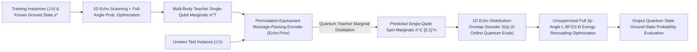
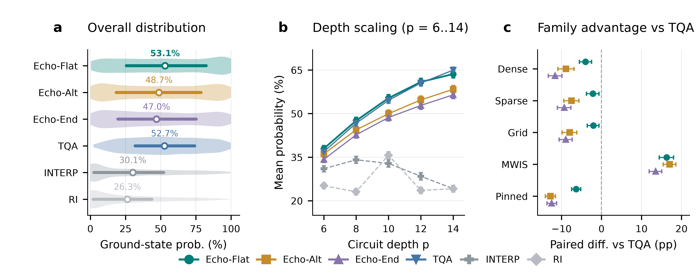
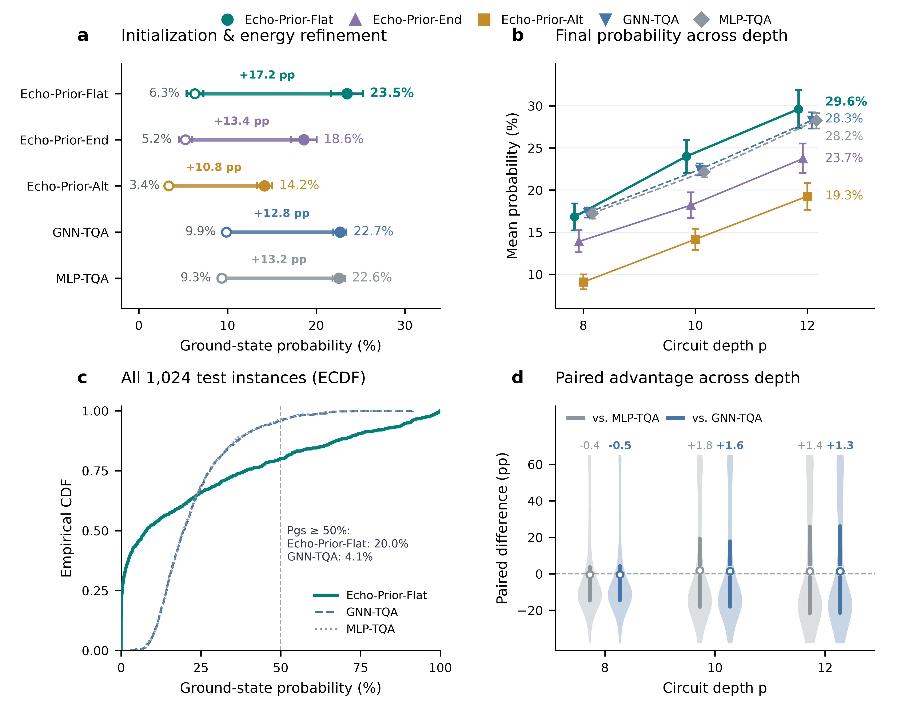

# Echo-QAOA: Constructive Spin-Echo Response Design and Per-Qubit Marginal Distillation for Variational Quantum Optimization

## Abstract

Solving constrained combinatorial optimization problems such as Maximum Weight Independent Set (MWIS) via the Quantum Approximate Optimization Algorithm (QAOA) requires navigating rugged $2p$-dimensional landscapes shaped by competing couplings $J$ and heterogeneous fields $h$. Homogeneous annealing schedules lack single-qubit phase resolution and require costly online circuit selection, whereas direct neural angle regression collapses under cross-branch jumping and an implicit-function curvature conflict between peak flatness and label stability. We propose **Echo-QAOA**, exploiting global spin-flip parity conjugation to cancel quadratic couplings exactly within the standard QAOA ansatz, factorizing target probabilities into $O(kn)$ single-qubit responses and enabling a zero-measurement overlap decoder that transforms angle regression into permutation-equivariant marginal distillation (**Echo-Prior**). Using Daubechies spectral factorization, we prove that arbitrary-order Flat-Top Echo responses are realizable with real angles, achieve $O(\delta^{2k})$ error tolerance, and remain strictly convex on zero-free intervals. Across 2,750 five-family benchmark and 5,120 cross-scale MWIS instances, **Echo-Prior-Flat** outperforms annealing initialization and 36 angle-regression models, expanding $P_{\mathrm{gs}}\ge 50\%$ coverage by $4.9\times$ with zero Stage-1 measurements.

## 1 Introduction

The Quantum Approximate Optimization Algorithm (QAOA) prepares candidate quantum states by alternating evolutions under a problem Hamiltonian $U_C(\gamma)=e^{-i\gamma H_C}$ and a transverse-field mixing operator $U_B(\beta)=e^{-i\beta\sum_i X_i}$, serving as a primary variational paradigm for combinatorial optimization on near-term quantum processors (Blekos et al., 2024; Cerezo et al., 2021; Farhi et al., 2014; Preskill, 2018). Unlike field-free ($h=0$) unweighted MaxCut, mapping constrained combinatorial problems such as Maximum Weight Independent Set (MWIS) into Ising form $E(s)=\frac12s^\top Js+h^\top s+C$ introduces both quadratic spin-spin couplings $J$ and strongly competing, heterogeneous local external fields $h$ (Ebadi et al., 2022; Hadfield et al., 2019; Lucas, 2014; Pichler et al., 2018). At fixed depth $p$, QAOA approximation quality is governed by the initial basin of attraction: because each hardware energy evaluation and parameter-shift gradient step requires thousands of projective shots (Harrigan et al., 2021; Mitarai et al., 2018; Pagano et al., 2020; Wierichs et al., 2022), while non-convex symmetric couplings induce exponentially many local traps (Anschuetz & Kiani, 2022; Bittel & Kliesch, 2021; McClean et al., 2018; Shaydulin et al., 2019; You & Wu, 2021), amortizing parameter generation directly from instance coefficients $(J,h)$ within the unmodified global QAOA ansatz ($|+\rangle^{\otimes n}$ initial state and uniform mixer $U_B(\beta)$) is a central challenge.

Existing QAOA initialization methods follow two primary paradigms: heuristic homogeneous trajectories—such as Trotterized Quantum Annealing (TQA), layerwise interpolation (INTERP / FOURIER), and cross-graph parameter concentration (Brandao et al., 2018; Crooks, 2018; Farhi et al., 2001; Galda et al., 2021; Kadowaki & Nishimori, 1998; Sack & Serbyn, 2021; Shaydulin et al., 2023; Zhou et al., 2020)—and end-to-end neural angle regression (Neural QAOA), which trains multilayer perceptrons (MLPs), graph neural networks (GNNs), or generative models to predict $2p$-dimensional circuit angles directly from $(J,h)$ (Amos, 2023; Amosy et al., 2024; Jain et al., 2022; Jiang et al., 2025; Liang et al., 2024; Meng et al., 2025). **However**, both paradigms break down under strong heterogeneous local fields $h$: homogeneous schedules impose uniform phase envelopes across all qubits without site-specific phase resolution and require dozens of online circuit measurements for step-size selection (Katial et al., 2025), whereas direct neural angle regression suffers from three intrinsic mathematical pathologies—(1) _cross-branch discrete jumping_: beyond sign-inversion and periodic symmetries (Lotshaw et al., 2021; Shaydulin et al., 2021), zero-probability singularity manifolds partition the parameter space into competing branches, causing global optimal angles to jump discontinuously as $(J,h)$ crosses branch intersections (Gould et al., 2021; Rupprecht et al., 2017; Zhang et al., 2019); (2) _an implicit-function curvature conflict between peak flatness and coordinate stability_: flatter probability peaks (smaller second-order curvature) improve tolerance to angle prediction errors but inversely amplify the implicit-function sensitivity upper bound of optimal angle coordinates to instance perturbations (Section 4.1); and (3) _heterogeneity loss under graph-level pooling_: collapsing node embeddings into a global $2p$-dimensional vector erases node-to-qubit local-field correspondences prior to readout.

To break this bottleneck, our core insight is to **carve out an exact product submanifold with explicit single-qubit analytical responses and interval convexity inside the standard QAOA circuit via parity decoupling, and use it as an analytical bridge to reformulate ill-conditioned global angle regression into well-conditioned node-level quantum marginal distillation**. Inspired by Spin Echo refocusing and dynamical decoupling (Carr & Purcell, 1954; Hahn, 1950; Viola et al., 1999), we exploit the opposite parities of quadratic couplings $H_J$ (even) and local fields $H_h$ (odd) under conjugation by the global spin-flip operator $F=\prod_i X_i$ (realized at mixer angle $\beta=\pi/2$) to formulate **Echo-QAOA**: pairing opposite-sign cost evolutions $(-g_j,g_j)$ with a $\pi/2$ flip forms a _complete Echo pair_ that cancels $H_J$ exactly without small-angle or weak-coupling approximations, preserving a strict product output state and factorizing target probabilities into $O(kn)$ single-qubit magnetization products. Isomorphic to polynomial spectral synthesis in Quantum Signal Processing (Gilyén et al., 2019; Low & Chuang, 2017; Low et al., 2016), this reduction yields **Flat-Top**, **Alternating-Phase**, and **Endpoint-Matched** 1D recipes, where Daubechies power-complementary spectral factorization guarantees $O(\delta^{2k})$ peak error tolerance and strict convexity on zero-free intervals (Daubechies, 1988; Herrmann, 1971). Crucially, the product structure factorizes the inner product between $2^n$-dimensional distributions into $n$ single-qubit marginal terms, yielding an $O(Mnk)$ **1D distribution-overlap decoder** with **zero online quantum evaluations**. Building on this decoder, **Per-Qubit Marginal Learning (Echo-Prior)** uses a permutation-equivariant message-passing network (Gilmer et al., 2017; Karalias & Loukas, 2020; Schuetz et al., 2022; Xu et al., 2019) to distill single-qubit positive-spin marginals $\pi_i^{\mathrm T}\in[0,1]$ of multi-body teacher states (Hinton et al., 2015; Wainwright & Jordan, 2008) from raw $(J,h)$, decodes them into fault-tolerant Flat-Top starting points, and releases all $2p$ angles in Stage 2 to linearly reactivate $H_J$ entanglement via symmetry breaking (Figure 1).

Our main contributions are threefold:

1. **Complete Echo-Pair Parity Decoupling Theory and Constructive 1D Response Recipes**: We prove the exact quadratic-coupling cancellation identity and $O(kn)$ multiplicative probability factorization for complete Echo pairs at arbitrary even depths (Propositions 1–2); we formulate Flat-Top, Alternating-Phase, and Endpoint-Matched 1D recipes, proving via Daubechies spectral factorization that arbitrary-order Flat-Top responses admit real-angle implementations (Proposition 3), achieve $O(\delta^{2k})$ peak error tolerance, and remain strictly convex on zero-free intervals (Proposition 4), while establishing local-field-driven boundaries and symmetry-breaking recoupling (Proposition 5) (Section 3).
2. **Implicit-Function Curvature Diagnosis, Zero-Measurement Overlap Decoder, and Per-Qubit Marginal Distillation (Echo-Prior)**: We prove the inverse curvature trade-off between peak flatness and label coordinate stability alongside cross-branch jumping via the implicit function theorem; we construct a zero-quantum-evaluation 1D distribution-overlap decoder $S(a)$ and propose permutation-equivariant Per-Qubit Quantum Teacher Marginal Distillation (`Echo-Prior-Flat`, `Echo-Prior-End`, `Echo-Prior-Alt`), decoupling smooth spin-marginal inference from non-convex circuit angle space (Section 4).
3. **2,750-Instance Five-Family Benchmark, 36-Model Controlled Online Evaluation, and 5,120-Instance Cross-Scale Generalization**: Across 2,750 five-family benchmark instances, Flat-Top Echo achieves the highest overall mean ground-state probability ($\mathbf{53.07}\%$), with all three Echo recipes beating TQA by $+13.52\text{--}+17.03$ pp on MWIS and outperforming equal-candidate TQA across all scales under uncapped convergence; on unseen online MWIS instances, **Echo-Prior-Flat** achieves the highest cross-depth mean final probability ($\mathbf{23.48}\%$) with zero Stage-1 quantum measurements, expanding $P_{\mathrm{gs}}\ge 50\%$ coverage to $\mathbf{20.0}\%$ ($4.9\times$ GNN-TQA and $5.6\times$ online TQA), beating all 36 full-angle regression models and 1D graph-pooled ablations, and generalizing zero-shot across $n\in\{6,8,10,12,14\}$ (5,120 instances) with $100\%$ Stage-1 shot-noise immunity (Section 5).

**Figure 1: Overview of Echo-QAOA constructive 1D spectral response design, per-qubit quantum teacher marginal distillation (Echo-Prior), zero-quantum-evaluation distribution-overlap decoding, and full-angle energy recoupling optimization.**

## 2 Related Work

### 2.1 Constrained Ising Variational Optimization and Heuristic Trajectory Initialization

The Quantum Approximate Optimization Algorithm (QAOA) (Farhi et al., 2014) discretizes adiabatic quantum evolution (Farhi et al., 2001; Kadowaki & Nishimori, 1998) into alternating parameterized quantum circuits (Blekos et al., 2024; Cerezo et al., 2021; Preskill, 2018). Through penalty mappings (Lucas, 2014) or constrained operator ansätze (Hadfield et al., 2019), NP-hard problems such as MWIS map to Ising models featuring both quadratic couplings $J$ and strong heterogeneous local fields $h$, validated across superconducting processors (Harrigan et al., 2021), trapped-ion simulators (Pagano et al., 2020), and neutral Rydberg atom arrays (Ebadi et al., 2022; Pichler et al., 2018). However, optimizing $2p$-dimensional angles at fixed depth $p$ faces barren plateaus (McClean et al., 2018), NP-hard variational landscapes (Bittel & Kliesch, 2021), exponentially many suboptimal local traps (Anschuetz & Kiani, 2022; You & Wu, 2021), and symmetric degeneracies from time reversal and periodic shifts (Lotshaw et al., 2021; Shaydulin et al., 2021). Because hardware parameter-shift gradients require $O(p)$ circuit measurements per step (Mitarai et al., 2018; Wierichs et al., 2022), blind multi-start quasi-Newton search (Byrd et al., 1995; Shaydulin et al., 2019) is prohibitively costly.

To compress the search space, heuristic initialization paradigms exploit layerwise smoothness or adiabatic priors, spanning linear interpolation and Fourier basis expansion (INTERP / FOURIER) (Crooks, 2018; Zhou et al., 2020), Pontryagin quasi-adiabatic composite pulses and counterdiabatic driving (Wurtz & Love, 2022; Yang et al., 2017), single-step-size Trotterized Quantum Annealing (TQA) (Sack & Serbyn, 2021), and cross-graph parameter concentration transfer (Brandao et al., 2018; Galda et al., 2021; Shaydulin et al., 2023). Yet on constrained problems with strong heterogeneous local fields $h$, homogeneous annealing envelopes fail to calibrate the competition between site-specific fields and topological couplings (Katial et al., 2025); in contrast, our Echo mechanism employs the highest-frequency layerwise sign-alternating sequence to cancel quadratic interference under heterogeneous fields. Ansatz-modifying variants—such as SDP-guided Warm-Start QAOA (Egger et al., 2021; Tate et al., 2023), multi-angle ma-QAOA (Herrman et al., 2022), or recursive RQAOA (Bravyi et al., 2020)—inject node biases by altering the initial state and replacing the global mixer $U_B(\beta)=e^{-i\beta\sum_i X_i}$ with customized rotations, forfeiting native global-pulse hardware compatibility and risking spin freezing. We adhere strictly to the unmodified global QAOA ansatz, carving out an exact 1D product submanifold inside the circuit before recoupling all $2p$ angles to synergize local-field alignment with multi-body entanglement tunneling (Dupont et al., 2022).

### 2.2 Spin Echo, Quantum Signal Processing, and Daubechies Wavelet Spectral Factorization

Our construction of intra-circuit decoupling and single-qubit response shaping bridges NMR coherent control, quantum signal processing, and orthogonal wavelet filter theory. Since the introduction of Spin Echo and multi-pulse refocusing sequences (Carr & Purcell, 1954; Hahn, 1950), reversing linear phase evolution via intermediate $\pi$ flip pulses has underpinned dynamical decoupling (Viola et al., 1999) and composite pulse control (Vandersypen & Chuang, 2005). In standard QAOA, setting the global mixer angle to $\beta=\pi/2$ is equivalent up to a global phase to applying the global spin flip $F=\prod_i X_i$; exploiting the even parity of $H_J$ and odd parity of $H_h$ under $F$, pairing anti-symmetric cost angles $(-g_j, g_j)$ with a $\pi/2$ mixer forms a _complete Echo pair_ that cancels quadratic couplings $H_J$ of arbitrary strength exactly. Within the decoupled single-qubit 2D subspace, synthesizing even-layer mixer sequences $(\theta_1,\ldots,\theta_k)$ to tolerate incommensurate field mismatches is isomorphic to single-qubit polynomial spectral synthesis in Quantum Signal Processing (QSP) and Quantum Singular Value Transformation (QSVT) (Gilyén et al., 2019; Low & Chuang, 2017; Low et al., 2016). Importing maximally flat magnitude-squared filters and Daubechies' power-complementary minimum-phase spectral factorization (Daubechies, 1988; Herrmann, 1971), we embed two-channel orthogonal lattice elimination into complete Echo pair sequences to prove exact real-angle realizability, $O(\delta^{2k})$ peak error tolerance, and strict convexity on zero-free intervals.

### 2.3 Amortized Implicit-Function Trade-offs and Per-Qubit Marginal Distillation

For online cross-instance deployment with unknown target states, research has shifted from recurrent Learning-to-Optimize controllers (Verdon et al., 2019) to end-to-end angle prediction (Neural QAOA), employing MLPs, GNNs, or conditional diffusion models to generate $2p$-dimensional circuit angles directly from problem graph features (Amosy et al., 2024; Jain et al., 2022; Jiang et al., 2025; Liang et al., 2024; Meng et al., 2025). Viewed through amortized optimization and implicit differentiation in deep declarative networks (Amos, 2023; Gould et al., 2021), however, direct angle regression suffers from an intrinsic geometric contradiction: reducing local peak curvature improves tolerance to angle errors but inversely amplifies the implicit-function coordinate sensitivity of optimal angle labels to instance perturbations, while zero-probability manifolds induce discrete cross-branch jumps; even with multi-hypothesis set prediction losses (Rupprecht et al., 2017; Zhang et al., 2019), global graph pooling (Xu et al., 2019) obliterates site-specific local-field biases. Inspired by graphical-model marginal inference (Wainwright & Jordan, 2008) and node-level geometric deep learning solvers (Gilmer et al., 2017; Karalias & Loukas, 2020; Loshchilov & Hutter, 2019; Schuetz et al., 2022), we use the analytical product distribution of Echo-QAOA to build a zero-quantum-evaluation **1D distribution-overlap decoder**, enabling knowledge distillation (Hinton et al., 2015) of a permutation-equivariant **Per-Qubit Quantum Teacher Marginal Network (Echo-Prior)** that bypasses cross-branch angle discontinuities.

## 3 Echo-QAOA: Operator Decoupling and Constructive 1D Response Theory

### 3.1 Ising Circuit Conventions with Local Fields and Exact Complete Echo-Pair Decoupling

Consider an Ising energy function with local external fields defined over $n$ spin variables $s\in\{-1,+1\}^n$:

$$
E(s)=\frac12s^\top Js+h^\top s+C,\qquad s\in\{-1,+1\}^n,
$$

where the coupling matrix $J\in\mathbb R^{n\times n}$ is symmetric with zero diagonal, $h\in\mathbb R^n$ is the local external field vector, and $C\in\mathbb R$ is a constant offset. Promoting classical spins to computational-basis operators decomposes the problem Hamiltonian as $H_C=H_J+H_h+C$, where the quadratic coupling term satisfies $H_J|s\rangle=(\frac12s^\top Js)|s\rangle$ and the local field term satisfies $H_h|s\rangle=(h^\top s)|s\rangle$; the constant $C$ contributes only a global phase during unitary evolution and does not affect measurement probabilities or parameter optimization.

Following standard QAOA conventions (Farhi et al., 2014), in a circuit of depth $p$, the problem evolution operator (cost) and transverse-field mixing operator (mixer) are defined as

$$
U_C(\gamma)=e^{-i\gamma H_C},\qquad U_B(\beta)=e^{-i\beta\sum_{i=1}^n X_i},
$$

where $X_i$ is the Pauli-$X$ operator acting on qubit $i$. Starting from the uniform superposition state $|+\rangle^{\otimes n}$, the output state after $p$ alternating layers is

$$
|\psi_p(\vartheta;J,h)\rangle=U_B(\beta_p)U_C(\gamma_p)\cdots U_B(\beta_1)U_C(\gamma_1)|+\rangle^{\otimes n},
$$

where the $2p$-dimensional angle vector is ordered with all cost angles followed by all mixer angles, $\vartheta=(\gamma_1,\ldots,\gamma_p,\beta_1,\ldots,\beta_p)$, subject to the box constraints $|\gamma_\ell|\le G$ (for a given cost-angle bound $G>0$) and $|\beta_\ell|\le\pi/2$.

Direct search for $\vartheta$ in $2p$-dimensional space is challenging because the quadratic coupling $H_J$ generates non-local multi-body entanglement and complex interference (Bravyi et al., 2020; Herrman et al., 2022). However, examining $H_J$ and $H_h$ under conjugation by the **global spin-flip operator** $F=\prod_{i=1}^n X_i$ reveals opposite parities: flipping all spins simultaneously ($s\mapsto -s$) leaves the quadratic form $s^\top Js$ invariant while strictly reversing the sign of the linear form $h^\top s$. At the operator level, this parity opposition reads

$$
FH_JF=H_J,\qquad FH_hF=-H_h,\qquad U_B(\pi/2)=(-i)^nF.
$$

The third identity shows that setting the special mixer angle $\beta=\pi/2$ is equivalent, up to the global phase $(-i)^n$, to applying the global spin flip $F$. Inspired by phase refocusing in Spin Echo and dynamical decoupling (Carr & Purcell, 1954; Hahn, 1950; Vandersypen & Chuang, 2005; Viola et al., 1999), we consider positive even circuit depths $p=2k$ ($k\ge 1$) and group adjacent QAOA layers into the $j$-th **complete Echo pair** ($j=1,\ldots,k$) with anti-symmetric cost angles sandwiching a $\pi/2$ spin flip:

$$
(\gamma_{2j-1},\gamma_{2j})=(-g_j,g_j),\qquad
(\beta_{2j-1},\beta_{2j})=(\pi/2,\theta_j).
$$

The following proposition proves that this two-layer composite structure cancels the quadratic coupling $H_J$ of arbitrary strength exactly during circuit evolution.

**Proposition 1 (Complete Echo-Pair Decoupling).** _Up to a global phase, the composite unitary evolution operator of the $j$-th complete Echo pair, $E(g_j,\theta_j):=U_B(\theta_j)U_C(g_j)U_B(\pi/2)U_C(-g_j)$, satisfies identically:_

$$
E(g_j,\theta_j)=U_B(\theta_j)e^{-2ig_jH_h}F.
$$

**Proof.** Using $U_B(\pi/2)\propto F$ and the commutativity of the diagonal operators $H_C$ and $FH_CF$ ($[H_C, FH_CF]=0$), expanding the operator product in evolutionary order gives

$$
\begin{aligned}
E(g_j,\theta_j)
&=U_B(\theta_j)e^{-ig_jH_C}Fe^{ig_jH_C}\\
&=U_B(\theta_j)e^{-ig_jH_C}\big(Fe^{ig_jH_C}F\big)F\\
&=U_B(\theta_j)e^{-ig_j(H_J+H_h+C)}e^{ig_j(FH_JF+FH_hF+C)}F\\
&=U_B(\theta_j)e^{-2ig_jH_h}F.
\end{aligned}
$$

Thus, the quadratic coupling $H_J$ and constant $C$ cancel exactly under forward-backward parity conjugation. $\square$

The central significance of Proposition 1 is that **this cancellation is algebraically exact: it arises purely from anti-symmetric cost-angle pairing and spin-flip parity conjugation, requiring neither a small-angle first-order approximation nor weak coupling $J$**. Once decoupled, the evolution operator of each complete Echo pair factorizes into independent single-qubit operations across all qubits. Consequently, starting from the product state $|+\rangle^{\otimes n}$, the output state after any $k$ complete Echo pairs remains strictly a product state.

### 3.2 Single-Qubit Amplitude Recursion, Multiplicative Probability Factorization, and 1D Parameter Families

By the product-state preservation property of Proposition 1, evolving quantum amplitudes in the $2^n$-dimensional Hilbert space reduces exactly to $n$ decoupled 2D single-qubit recursions. Fixing the computational basis ordering of qubit $i$ as $(|s_i=-1\rangle,|s_i=+1\rangle)$, the single-qubit transverse rotation matrix and initial superposition state are

$$
M(\theta)=
\begin{pmatrix}
\cos\theta&-i\sin\theta\\
-i\sin\theta&\cos\theta
\end{pmatrix},\qquad
u_i^{(0)}=\frac1{\sqrt2}\binom11.
$$

Let $u_i^{(j-1)}=\big(u_{i,-}^{(j-1)}, u_{i,+}^{(j-1)}\big)^\top$ denote the single-qubit state vector of qubit $i$ after the first $j-1$ complete Echo pairs. In the $j$-th Echo pair, the flip operator $X_i$ swaps the positive- and negative-spin components, the local-field evolution $e^{-2ig_j H_h}$ multiplies the $|s_i=-1\rangle$ and $|s_i=+1\rangle$ components by phase factors $e^{+2ig_j h_i}$ and $e^{-2ig_j h_i}$, respectively, and $M(\theta_j)$ applies the single-qubit mixing rotation:

$$
\binom{u_{i,-}^{(j)}}{u_{i,+}^{(j)}}
=M(\theta_j)
\binom{e^{2ig_jh_i}u_{i,+}^{(j-1)}}
      {e^{-2ig_jh_i}u_{i,-}^{(j-1)}},\qquad j=1,\ldots,k.
$$

After all $k$ Echo pairs, we define the final single-qubit magnetization of qubit $i$ (the difference between $+1$ and $-1$ spin measurement probabilities) as $m_i=|u_{i,+}^{(k)}|^2-|u_{i,-}^{(k)}|^2\in[-1,1]$.

**Proposition 2 (Multiplicative Probability Factorization).** _Under a depth-$p=2k$ circuit composed of $k$ complete Echo pairs, the joint measurement probability of any target spin configuration $s^\star\in\{-1,+1\}^n$ factorizes exactly into the product of single-qubit success factors:_

$$
P(s^\star)=\prod_{i=1}^n\frac{1+s_i^\star m_i}{2}.
$$

**Proof.** Because the global output state remains strictly a product state $\bigotimes_{i=1}^n u_i^{(k)}$, computational-basis measurement events across qubits are mutually independent. Combining the normalization $|u_{i,+}^{(k)}|^2+|u_{i,-}^{(k)}|^2=1$ with the magnetization definition $m_i=|u_{i,+}^{(k)}|^2-|u_{i,-}^{(k)}|^2$, the marginal probability of observing target spin $s_i^\star\in\{-1,+1\}$ on qubit $i$ is identically $(1+s_i^\star m_i)/2$, so the joint probability equals the product over all $n$ qubits. $\square$

Computationally, Proposition 2 reduces a single target-probability evaluation from exponential $O(pn2^n)$ full state-vector simulation to $kn$ multiplications of $2\times 2$ matrices—an $O(kn)$ time complexity and $O(1)$ per-qubit auxiliary space.

To systematically construct low-dimensional initialization manifolds from this decoupled structure, we introduce **one-dimensional constructive parameter families**. For a given positive even depth $p=2k$ and response recipe $v$, we fix the relative cost ratio coefficients $(r_1,\ldots,r_k)$ and even-layer mixer angles $(\theta_1,\ldots,\theta_k)$ in advance, driving the cost amplitudes of all $k$ Echo pairs linearly via a single scalar parameter $a$ ($g_j = r_j a$). This defines an affine embedding map $D_{v,k}(a)$ from the 1D scalar $a$ into the full $2p$-dimensional QAOA angle space:

$$
D_{v,k}(a)=\big(-r_1a,r_1a,\ldots,-r_ka,r_ka,\pi/2,\theta_1,\ldots,\pi/2,\theta_k\big),
\qquad a\in\mathcal A_{v,k}=\left[-\frac{G}{\max_j|r_j|},\frac{G}{\max_j|r_j|}\right].
$$

Under $D_{v,k}(a)$, the final magnetization response $m_i(a)$ of qubit $i$ is determined entirely by the single-qubit phase variable $\phi_i = 4a h_i$ and the recipe parameters $(r_j,\theta_j)_{j=1}^k$, with target-state measurement probability $P_{D_{v,k}(a)}(s^\star)=\prod_{i=1}^n\frac{1+s_i^\star m_i(a)}{2}$.

### 3.3 Flat-Top Echo: High-Order Flat Response and Spectral-Factor Realizability

In multi-qubit instances with local external fields, the site fields $h_i$ are generally incommensurate, making it impossible for a single global scalar $a$ to simultaneously align every qubit at its fundamental harmonic peak $\sin(4ah_i)=s_i^\star$. To overcome this multi-qubit phase competition, **Flat-Top Echo** is designed to maintain the dyadic step ratio $r=(1,2,\ldots,2)$ (corresponding to the valid scalar domain $a\in[-\frac{G}{2},\frac{G}{2}]$ for $k\ge 2$) while endowing the single-qubit magnetization response with the highest possible order of derivative flatness around the favorable phase peaks $t=\sin(4ah)=\pm 1$, thereby widening each qubit's tolerance window against phase mismatch and scalar perturbations.

Specifically, letting $t=\sin(4ah)\in[-1,1]$ denote the fundamental harmonic variable, we define the order-$k$ Flat-Top magnetization response via the normalized symmetric Beta integral:

$$
m_k(t)=
\frac{\int_0^t(1-z^2)^{k-1}\,dz}
     {\int_0^1(1-z^2)^{k-1}\,dz}.
$$

By the algebraic structure of the integrand, $m_k(t)$ is an odd polynomial in $t$ of degree $2k-1$ that strictly satisfies the endpoint alignment conditions $m_k(\pm 1)=\pm 1$, with all derivatives of orders $1$ through $k-1$ vanishing identically at the peak endpoints $t=\pm 1$. For instance, at $k=2,3$ (corresponding to $p=4,6$), the explicit response polynomials take the forms

$$
m_2(t)=\frac{3t-t^3}{2},\qquad
m_3(t)=\frac{15t-10t^3+3t^5}{8}.
$$

Introducing the linear change of variables $q=(1+t)/2\in[0,1]$, when the target spin is positively aligned, the single-qubit success factor $(1+m_k(t))/2$ can be expressed compactly in terms of the regularized incomplete Beta function $I_q(k,k)$ and its truncated power series:

$$
p_k(q)=\frac{1+m_k(2q-1)}2
=I_q(k,k)=q^kS_k(1-q),
$$

$$
S_k(y)=\sum_{r=0}^{k-1}\binom{k-1+r}{r}y^r,
\qquad p_k(q)+p_k(1-q)=1.
$$

While the polynomial $p_k(q)$ characterizes the ideal maximally flat filter response, the following proposition proves that there always exists a sequence of real mixer angles $(\theta_1,\ldots,\theta_k)$ that synthesizes this exact polynomial within the QAOA circuit via the single-qubit unitary recursion of Section 3.2.

**Proposition 3 (Constructive Realizability of Arbitrary-Order Flat-Top Responses).** _For any positive integer $k\ge 1$, there exists a sequence of real angles $\theta_1,\ldots,\theta_k\in[-\pi/2,\pi/2)$ such that a $k$-pair complete Echo circuit with cost ratios $g=(a,2a,\ldots,2a)$ produces the exact single-qubit magnetization response $m_k(\sin(4ah))$._

**Construction and Proof Sketch.** Let $\phi=4ah$, shift the phase to $\omega=\phi-\pi/2$, and set $z=e^{i\omega}$ on the unit circle, so that $q=(1+\sin\phi)/2=\cos^2(\omega/2)$. By the Fejér–Riesz theorem and Daubechies' orthogonal wavelet filter theory (Daubechies, 1988; Herrmann, 1971), the positive power-complementary response $p_k(\cos^2(\omega/2))$ ($p_k(q)+p_k(1-q)=1$) admits a real-coefficient minimum-phase spectral-factor polynomial $H_k(z)=\sum_{r=0}^{2k-1}c_rz^r$ of degree $2k-1$ satisfying

$$
\frac{|H_k(e^{i\omega})|^2}{2}
=p_k\!\left(\cos^2\frac\omega2\right),\qquad
H_k(1)=\sqrt2,\qquad
|H_k(z)|^2+|H_k(-z)|^2=2\quad (|z|=1).
$$

Defining the alternating reciprocal conjugate polynomial $H_j^\#(z)=z^{2j-1}H_j(-z^{-1})$ and exploiting their quadratic power orthogonality, two-channel real orthogonal lattice elimination from $j=k$ down to $j=1$ eliminates both constant and linear terms at each step (allowing exact division by the doubled phase step $e^{2i\phi}=-z^2$) and extracts unique real angles $\theta_j\in[-\pi/2,\pi/2)$. Unrolling this lattice recursion in reverse is algebraically isomorphic to the single-qubit Echo recursion in Section 3.2, ensuring that the $+1$ measurement probability equals $|H_k(z)|^2/2$ (explicit root construction and inductive proof in Appendix A.1 `[Move to Appendix A.1]`). $\square$

The mechanism by which the Flat-Top response smooths out phase mismatches and scalar deviations can be quantified via Taylor expansion around the resonance peak. From the Beta-integral definition, $1-m_k(1-\varepsilon)=O(\varepsilon^k)$ as $t\to 1^-$. If qubit $i$ achieves ideal target alignment $s_i^\star\sin(4a_0h_i)=1$ at scalar $a_0$, a scalar perturbation $a=a_0+\delta$ induces a quadratic decay in the harmonic variable:

$$
s_i^\star\sin(4h_i(a_0+\delta))
=1-8h_i^2\delta^2+O(\delta^4).
$$

Substituting this into the Flat-Top polynomial suppresses the single-qubit success-factor loss to $O(\delta^{2k})$ (for example, $O(\delta^4)$ at $k=2$ versus $O(\delta^2)$ for the standard sinusoidal response at $k=1$). In multi-qubit instances with incommensurate local fields $h_i$, this high-order peak flatness substantially widens the near-optimal phase window of each qubit, allowing multiple qubits that cannot simultaneously sit at exact resonance to share a broad high-probability overlap region.

### 3.4 Strict Convexity of the Flat-Top Objective on Zero-Free Intervals

Beyond widening peak error tolerance, a second core theoretical advantage of the Flat-Top response is the favorable local convexity of its log-likelihood objective. For a given instance and target configuration $s^\star$, let $w_i=4h_is_i^\star$ denote the signed field weight, and define the single-qubit phase deviation wrapped to the principal interval:

$$
e_i(a)=\operatorname{wrap}_{(-\pi,\pi]}(aw_i-\pi/2).
$$

By the odd symmetry of $m_k$, the target success factor of qubit $i$ can be written uniformly as $p_k((1+\cos e_i)/2)$. Consequently, the global negative log-probability loss of the restricted Flat-Top Echo circuit decomposes into a sum of per-qubit phase losses:

$$
\mathcal L_k(a;x)
=-\log P_{D_{\mathrm{flat},k}(a)}(s^\star)
=\sum_{i=1}^n \ell_k(e_i(a)),\qquad
\ell_k(e):=-\log p_k\!\left(\frac{1+\cos e}{2}\right).
$$

**Proposition 4 (Strict Convexity on Zero-Free Intervals).** _The single-qubit phase loss $\ell_k(e)$ is strictly convex on the principal open interval $(-\pi,\pi)$. For any multi-qubit instance containing at least one non-zero local field ($h_i\ne 0$), the global negative log-probability loss $\mathcal L_k(a;x)$ is strictly convex with respect to $a$ on every open interval in the scalar domain that contains no zero-probability singularities; hence, each zero-free interval admits at most one stationary point (its unique local minimum)._

**Proof Sketch.** For $0\le e<\pi$, trigonometric substitution expresses the single-qubit success factor as the odd-sine tail ratio $\pi_k(e):=p_k((1+\cos e)/2)=\int_e^\pi\sin^{2k-1}v\,dv/\int_0^\pi\sin^{2k-1}v\,dv$. Because the kernel $f(v)=\sin^{2k-1}v$ is strictly log-concave on $(0,\pi)$ ($(\log f)''=-(2k-1)\csc^2v<0$), its Mills-type tail ratio $R(e)=\int_e^\pi f(v)\,dv/f(e)$ decreases strictly on $(0,\pi)$, making $\ell_k'(e)=1/R(e)$ strictly increasing on $(0,\pi)$; even symmetry and $\ell_k'(0)=0$ establish strict convexity of $\ell_k(e)$ on $(-\pi,\pi)$. On any zero-free scalar open interval, each non-zero-field phase deviation $e_i(a)$ avoids the $\pm\pi$ branch cut and is strictly affine in $a$, so $\mathcal L_k(a;x)$ is strictly convex in $a$ by affine composition and summation (full proof in Appendix A.2 `[Move to Appendix A.2]`). $\square$

Proposition 4 sharply characterizes the global topology of the 1D parameter space: all non-convexity of the loss $\mathcal L_k(a;x)$ is concentrated at the singular breakpoints where a single-qubit success factor vanishes ($e_i(a)=\pm\pi$), namely

$$
\sin(aw_i)=-1
\iff
a=\frac{-\pi/2+2\pi z}{w_i},\qquad z\in\mathbb Z\quad (w_i\ne 0).
$$

Within the bounded scalar search domain, these finitely many zero-probability breakpoints partition the domain into disjoint zero-free open intervals, each of which forms a strictly convex unimodal basin.

### 3.5 Alternating-Phase Echo: Cumulative Effective Phase Expansion

Whereas Flat-Top Echo uses its degrees of freedom under the fixed dyadic ratio to flatten resonance peaks, our second recipe—**Alternating-Phase Echo**—is designed to maximize the effective cumulative phase range under bounded gate-angle constraints. For $k\ge 2$, the Alternating-Phase recipe adopts unit-magnitude cost ratios with mixing concentrated exclusively in the final pair:

$$
g_j=(-1)^{k-j}a\quad (j=1,\ldots,k),\qquad
\theta_j=0\quad (j<k),\qquad \theta_k=\pi/4.
$$

When the even-layer mixer angles of the first $k-1$ pairs are set to $\theta_j=0$, the global spin-flip operator $F$ between adjacent Echo pairs reverses the sign of the previously accumulated linear local-field phase, yielding the effective phase recursion $A_0=0$ and $A_j=g_j-A_{j-1}$. Substituting the sign-alternating sequence $g_j=(-1)^{k-j}a$ into this recursion produces constructive in-phase accumulation across all $k$ pairs, giving $A_k=ka$. Finally, the terminal mixer angle $\theta_k=\pi/4$ converts the accumulated phase into a computational-basis magnetization response in a single step:

$$
m_i(a)=\sin(4kah_i),\qquad
P_{D_{\mathrm{alt},k}(a)}(s^\star)=\prod_{i=1}^n\frac{1+s_i^\star\sin(4kah_i)}2.
$$

Across the entire Echo subfamily with zero intermediate mixers and per-layer cost angles bounded by $|g_j|\le G$, the cumulative phase coefficient obeys the upper bound

$$
|A_k|=\left|\sum_{j=1}^k(-1)^{k-j}g_j\right|
\le\sum_{j=1}^k|g_j|\le kG.
$$

The Alternating-Phase construction saturates this bound exactly, expanding the effective phase frequency by a factor of $k$ over the scalar domain $a\in[-G,G]$ and enabling high-resolution harmonic scanning to capture multi-qubit in-phase resonance peaks under complex heterogeneous fields.

### 3.6 Endpoint-Matched Echo: Positive-Phase Passband Balancing and Recipe Comparison

Our third recipe—**Endpoint-Matched Echo**—strikes a balance between the local derivative flatness of Flat-Top Echo and the high-frequency oscillation of Alternating-Phase Echo by directly equalizing the response height across the endpoints of a prescribed positive-phase passband $[\tau,1]$. For $k\ge 2$, this recipe retains the dyadic step ratio $g=(a,2a,\ldots,2a)$ (with scalar domain $a\in[-\frac{G}{2},\frac{G}{2}]$), but configures the even-layer mixer angles as a sign-alternating sequence governed by a single auxiliary parameter $B$:

$$
L=2k-1,\qquad
\theta_j=(-1)^{k-j}B\quad (j<k),\qquad \theta_k=\frac{B}{2}.
$$

Setting $u=\sin B$ and $t=\sin(4ah)$, grouping adjacent pairs into coaxial composite rotations on the Bloch sphere (Low et al., 2016; Vandersypen & Chuang, 2005) (full derivation in Appendix A.3) yields the closed-form single-qubit magnetization response:

$$
m_k(t)=\sin\big[L\arcsin(ut)\big].
$$

Given a positive-phase passband threshold $\tau\in(0,1)$, we choose $u$ and $B$ analytically as

$$
u=\frac{\sin(\pi/L)}
{\sqrt{1+2\tau\cos(\pi/L)+\tau^2}},
\qquad B=\arcsin u,
$$

which enforces the symmetric phase relation $L[\arcsin(u\tau)+\arcsin u]=\pi$ and thereby equalizes the magnetization response at both ends of the passband $[\tau,1]$: $m_k(\tau)=m_k(1)$. As $t$ increases from $\tau$ to $1$, $m_k(t)$ rises monotonically to its peak value $1$ in the interior before returning to $m_k(1)=m_k(\tau)$. Whenever there exists a scalar $a$ that places the aligned harmonic components of all qubits inside the positive passband,

$$
t_i=s_i^\star\sin(4ah_i)\in[\tau,1],\qquad \forall i\in\{1,\ldots,n\},
$$

the joint target-state measurement probability is guaranteed to satisfy

$$
P_{D_{\mathrm{end},k}(a)}(s^\star)\ge\left[\frac{1+m_k(\tau)}2\right]^n.
$$

Table 1 summarizes the parameter structures, single-qubit responses, and core theoretical properties of all three constructive Echo recipes for $k\ge 2$.

**Table 1: Comparison of parameter designs, single-qubit responses, and theoretical properties across the three constructive Echo recipes ($p=2k, k\ge 2$, where $\phi=4ah$ and $t=\sin\phi$).**

| Recipe Name                             | Cost Ratios $r_j$ & Even-Layer Mixer Angles $\theta_j$                                      | Single-Qubit Magnetization $m_k(t)$ & Scalar Domain $\mathcal A_{v,k}$ | Core Algebraic and Analytical Properties                                                                                                                              |
| :-------------------------------------- | :------------------------------------------------------------------------------------------ | :--------------------------------------------------------------------- | :-------------------------------------------------------------------------------------------------------------------------------------------------------------------- |
| **Flat-Top Echo** (`Echo-Flat`)         | $r=(1,2,\ldots,2)$; $\theta_j$ extracted via Daubechies spectral-factor lattice elimination | $2I_{(1+t)/2}(k,k)-1$, $a\in\left[-\frac{G}{2},\frac{G}{2}\right]$     | Vanishing derivatives up to order $k-1$ at peaks $t=\pm 1$ with $O(\delta^{2k})$ local error tolerance; strictly convex negative log-loss on zero-free open intervals |
| **Alternating-Phase Echo** (`Echo-Alt`) | $r_j=(-1)^{k-j}$; $\theta_j=0\ (j<k)$, $\theta_k=\pi/4$                                     | $\sin(k\phi)$, $a\in[-G,G]$                                            | Saturates the effective cumulative phase bound $kG$ of the zero-intermediate-mixer subfamily, expanding single-qubit phase scanning frequency by $k\times$            |
| **Endpoint-Matched Echo** (`Echo-End`)  | $r=(1,2,\ldots,2)$; $\theta_j=(-1)^{k-j}B\ (j<k)$, $\theta_k=B/2$                           | $\sin[(2k-1)\arcsin(ut)]$, $a\in\left[-\frac{G}{2},\frac{G}{2}\right]$ | Exactly balances responses at the endpoints of the positive passband $[\tau,1]$, $m_k(\tau)=m_k(1)$, providing a conditional analytical probability lower bound       |

### 3.7 Theoretical Boundaries of Restricted Product Evolution and Motivation for Recoupling

The decoupling identity in Proposition 1 implies that while complete Echo pairs exactly cancel the quadratic coupling $H_J$, the evolution of the restricted circuit is driven entirely by the local external field Hamiltonian $H_h$. This algebraic property directly determines the theoretical operating boundaries of pure Echo parameter families and explains from first principles why 1D Echo initialization must be followed by full-angle recoupling optimization.

**Proposition 5 (Local-Field-Driven Boundaries and Multiplicative Decay of Restricted Echo Evolution).** _Under the depth-$p=2k$ restricted Echo circuit $D_{v,k}(a)$, the target-state measurement probability obeys two structural bounds:_

1. **Zero-Field Upper Bound**: _If an instance contains $n_0$ qubits with zero local field ($h_i=0$), then for any scalar $a$,_
   $$P_{D_{v,k}(a)}(s^\star)\le 2^{-n_0};$$
   _in particular, when the external field vanishes globally ($h=0$), the output probability of all three recipes reduces identically to the uniform baseline $P_{D_{v,k}(a)}(s^\star)=2^{-n}$._
2. **Dimensional Attenuation Bound**: _If at scalar $a$ there are $q$ qubits whose target-aligned magnetizations reach at most a suboptimal level $s_i^\star m_i(a)\le\eta<1$, then the joint target probability satisfies_
   $$P_{D_{v,k}(a)}(s^\star)\le\left(\frac{1+\eta}{2}\right)^q.$$

**Proof.** (1) For any qubit $i$ with $h_i=0$, its local-field phase factor is identically $e^{\pm 2ig_j h_i}=1$; because $|+\rangle$ is a common eigenstate of both $X_i$ and $M(\theta_j)$, this qubit accumulates only a trivial phase throughout the evolution, yielding $m_i(a)=0$ and contributing a constant factor of $1/2$ in Proposition 2. Since the remaining $n-n_0$ factors are at most $1$, their product is bounded by $2^{-n_0}$ (and equals $2^{-n}$ when $n_0=n$). (2) When $q$ qubits satisfy $s_i^\star m_i(a)\le\eta<1$, each contributes at most $(1+\eta)/2$ while the remaining $n-q$ factors are at most $1$; multiplying them via Proposition 2 yields the bound. $\square$

Proposition 5 reveals two physical corollaries. First, because the odd-symmetric response $m_k(t)$ pushes in-phase qubits ($s_i^\star\sin(4ah_i)>0$) toward $+1$ while symmetrically suppressing out-of-phase qubits ($s_i^\star\sin(4ah_i)<0$) toward $-1$, the gain of high-order Flat-Top filtering relies on a global scalar scan that avoids anti-phase valleys and aligns the dominant qubit subset within the in-phase passband ($t_i>0$). Second, to transcend the expressivity ceiling of product states and resolve zero-field qubits or frustrated couplings, quadratic couplings $H_J$ must be re-activated after Echo initialization. Perturbing the $j$-th pair's cost angles from $(-g_j, g_j)$ along the symmetry-breaking direction to $(-g_j+\delta_j, g_j+\delta_j)$ transforms the pair operator into

$$
U_B(\theta_j)e^{-i(g_j+\delta_j)H_C}Fe^{-i(-g_j+\delta_j)H_C}
=U_B(\theta_j)e^{-2i\delta_j H_J}e^{-2ig_j H_h}F.
$$

This shows that breaking anti-symmetric cost pairing in any neighborhood of the Echo manifold re-activates the quadratic coupling evolution $e^{-2i\delta_j H_J}$ to first order, guaranteeing non-vanishing first-order tangent gradients along $\delta_j=(\gamma_{2j-1}+\gamma_{2j})/2$ (avoiding saddle points with vanishing coupling gradients). Releasing all $2p$ angle degrees of freedom in Stage 2 (including allowing odd-layer mixer angles $\beta_{2j-1}$ to depart from $\pi/2$) fully unleashes the entangling power of all $p$ two-qubit gate layers. This establishes the **two-stage division of labor** in Echo-QAOA (Dupont et al., 2022; Wurtz & Love, 2022; Yang et al., 2017): Stage 1 rapidly anchors a local-field-aligned basin starting point on the 1D Echo product manifold in $O(kn)$ classical time; Stage 2 releases all $2p$ angles for local optimization to restore multi-body entanglement.

### 3.8 1D Interval Derivative Root-Finding and Two-Stage Optimization Strategy

For offline probability optimization and teacher collection with known $s^\star$, our two-stage strategy proceeds as follows (numerical tolerances and grid parameters in Appendix B.1 `[Move to Appendix B.1]`):

1. **Interval Derivative Root-Finding for Flat-Top Echo**: By Proposition 4, the algorithm enumerates all zero-probability breakpoints from $w_i=4h_is_i^\star$ and performs deterministic bisection on the analytical derivative $\mathcal L_k'(a;x)$ within each disjoint zero-free open interval to locate its unique local minimum.
2. **Grid Peak-Finding and Local Refinement for Oscillatory Recipes**: For Alternating-Phase and Endpoint-Matched recipes, the algorithm evaluates target probabilities on a bounded scalar grid via $O(kn)$ single-qubit recursion, isolates separated local peaks, and refines each via golden-section search.
3. **Candidate Deduplication and Batched Recoupling**: Candidates are deduplicated by scalar spacing and supplied in descending probability order to the Stage-2 full-angle quasi-Newton optimizer.

## 4 Per-Qubit Marginal Distillation Initialization via Distribution-Overlap Decoding

### 4.1 Local Sensitivity Trade-offs and Cross-Branch Jumping in Parameter Space

Before designing a cross-instance parameter generator (Amos, 2023; Verdon et al., 2019), we examine the regularity of the mapping from problem coefficients $x=(J,h)$ to optimal parameters $\vartheta^\star(x)$. Even within the 1D Flat-Top Echo subspace where multi-body entanglement interference is absent and each zero-free open interval is strictly convex (Proposition 4), the response of the global optimal scalar parameter to instance perturbations exhibits a fundamental **local curvature trade-off** and **global cross-branch discontinuity**.

**Intra-branch implicit-function sensitivity.** Taking Flat-Top Echo as an example, let $I_b(x)$ be a zero-free open interval evolving continuously with normalized instance coefficients $x=(J,h)$, and let $a_b^\star(x)\in I_b(x)$ be its unique interior stationary point satisfying $\partial_a\mathcal L_k(a_b^\star(x);x)=0$. If within an open neighborhood of $x$ the target ground state $s^\star(x)$ remains invariant, $\mathcal L_k$ is twice continuously differentiable, and the local curvature is bounded below by $\partial_{aa}\mathcal L_k\ge\mu>0$, the implicit function theorem in declarative optimization (Amos, 2023; Gould et al., 2021) guarantees that $a_b^\star(x)$ is continuously differentiable with respect to $x$, with Jacobian

$$
\nabla_xa_b^\star(x)
=-\big(\partial_{aa}\mathcal L_k(a_b^\star(x);x)\big)^{-1}
  \partial_{ax}\mathcal L_k(a_b^\star(x);x).
$$

When the mixed partial derivative is bounded by $\|\partial_{ax}\mathcal L_k\|\le M$, the local Lipschitz sensitivity of the intra-branch optimal label to instance perturbations is bounded above by $M/\mu$. Whenever a perturbation crosses a Hamiltonian gap-closing point (altering $s^\star(x)$), pushes the stationary point onto a domain boundary, or causes local curvature degeneration ($\mu\to 0$), the direct mapping from problem features to optimal circuit angles loses smoothness.

**Geometric trade-off between peak flatness and coordinate stability.** Consider now the impact of a scalar prediction error $\delta=\widehat a-a_b^\star$ on target-state probability. Around the interior stationary point $a_b^\star$, the second-order Taylor expansion of the negative log-probability loss reads

$$
\mathcal L_k(a_b^\star+\delta;x)-\mathcal L_k(a_b^\star;x)
=\frac12\mathcal L_k''(a_b^\star;x)\delta^2+o(\delta^2).
$$

Comparing this expansion with the implicit-function gradient formula exposes an intrinsic geometric contradiction in parameter-space supervised learning: **robustness of the target probability to model prediction errors and stability of optimal label coordinates under instance perturbations are governed in opposite directions by the same local curvature $\partial_{aa}\mathcal L_k$**. Specifically, a smaller local curvature $\mathcal L_k''(a_b^\star;x)$ yields a broader, flatter probability peak that tolerates larger parameter prediction errors $\delta$; simultaneously, however, a smaller denominator $\partial_{aa}\mathcal L_k$ in the implicit gradient amplifies the sensitivity upper bound $M/\mu$ of the stationary coordinate $a_b^\star(x)$ to instance perturbations. In the ideal limit where all qubits achieve exact peak alignment at $a_b^\star$, $\mathcal L_k''(a_b^\star;x)=0$ for $k\ge 2$: the probability loss enjoys $O(\delta^{2k})$ high-order error tolerance, but the first-order implicit sensitivity upper bound of the optimal angle coordinate diverges.

**Cross-branch discrete jumps and symmetric mean collapse.** Across the bounded scalar domain $\mathcal A_{v,k}$, zero-probability breakpoints partition the search space into competing convex-interval branches $\{I_b(x)\}$. The global optimal scalar is selected via discrete minimization across branches:

$$
b^\star(x)\in\arg\min_b\mathcal L_k(a_b^\star(x);x),
\qquad a^\star(x)=a_{b^\star(x)}^\star(x).
$$

As instance coefficients $x$ vary continuously and two distant competing branches $b_1\ne b_2$ cross in loss value ($\mathcal L_k(a_{b_1}^\star;x)=\mathcal L_k(a_{b_2}^\star;x)$), the global optimum $a^\star(x)$ jumps discontinuously from $a_{b_1}^\star$ to $a_{b_2}^\star$. Furthermore, because the QAOA parameter space possesses global sign-inversion and multi-period resonance symmetries, neural networks trained with standard mean-squared angle error tend to output the conditional expectation across symmetric branches (collapsing near zero angles), landing in destructive-interference valleys.

This theoretical diagnosis points directly to our representation redesign: rather than fitting multi-valued, jump-prone circuit angle coordinates, we first infer a unique, smooth **single-qubit positive-spin marginal prior** $\boldsymbol{\pi}=(\pi_1,\ldots,\pi_n)\in[0,1]^n$ in spin state space, and then project it analytically onto the standard QAOA parameter manifold—reaping the $O(\delta^{2k})$ error-tolerance dividend of Flat-Top responses without suffering angle-coordinate sensitivity.

### 4.2 1D Distribution-Overlap Decoding and Full-Angle Energy Recoupling

Given a single-qubit positive-spin marginal vector $\boldsymbol{\pi}=(\pi_1,\ldots,\pi_n)\in[0,1]^n$ estimated for an unseen instance, we formulate a general analytical engine that maps $\boldsymbol{\pi}$ to a standard $2p$-dimensional QAOA starting point $\vartheta_0$ and restores multi-body coupling evolution.

**1D distribution-overlap decoding via product factorization.** The marginal vector $\boldsymbol{\pi}$ defines a surrogate independent spin distribution on $\{-1,+1\}^n$:

$$
P_{\pi}(s)=\prod_{i=1}^n\pi_i^{\mathbf1[s_i=+1]}(1-\pi_i)^{\mathbf1[s_i=-1]}.
$$

For a general entangling quantum circuit, finding parameters whose output distribution matches $P_{\pi}(s)$ requires exponential $O(2^n)$ full-state simulation. By the **Multiplicative Probability Factorization Theorem** (Proposition 2), however, the output distribution $Q_a(s)$ of a restricted Echo recipe at any scalar $a\in\mathcal A_{v,k}$ is also a strict product distribution, where qubit $i$ takes spin $+1$ with analytical probability $q_i(a)=(1+m_i(a))/2$. Consequently, the inner product between the two $2^n$-dimensional full-state probability distributions—the **Distribution Overlap** $S(a)$—factorizes algebraically into a product of $n$ single-qubit marginal matching terms:

$$
S(a)=\sum_{s\in\{-1,+1\}^n}P_{\pi}(s)Q_a(s) =\prod_{i=1}^n\Big[\pi_iq_i(a)+\big(1-\pi_i\big)\big(1-q_i(a)\big)\Big].
$$

The decoder evaluates the analytical single-qubit responses $q_i(a)$ on a deterministic $M$-point uniform grid $\mathcal A_M\subset\mathcal A_{v,k}$, selects the grid scalar maximizing overlap, $\widehat a=\arg\max_{a\in\mathcal A_M}S(a)$, and expands it via the affine map into the full $2p$-dimensional starting point $\vartheta_0=D_{v,k}(\widehat a)$. Bypassing quantum circuit execution and exponential state simulation entirely, overlap decoding requires only $O(Mnk)$ classical time for Flat-Top Echo and $O(Mn)$ for closed-form Alternating-Phase and Endpoint-Matched Echo, with **strictly zero Stage-1 online quantum evaluations**.

**Full-angle energy recoupling optimization.** The decoded Echo starting point $\vartheta_0$ is subsequently fed into an unsupervised energy minimizer that depends solely on $(J,h)$:

$$
\vartheta_0\longmapsto\vartheta_{\mathrm{out}},\qquad \min_{\vartheta}\mathbb E_{s\sim |\langle s|\psi_p(\vartheta;J,h)\rangle|^2}\left[\frac12s^\top Js+h^\top s\right].
$$

This stage invokes a bound-constrained quasi-Newton optimizer (Byrd et al., 1995) to release all $2p$ angle degrees of freedom simultaneously. In Stage 1, exact forward-backward pairing cancels $H_J$ and uses low-dimensional product factorization to anchor a starting point $\vartheta_0$ aligned with local fields and marginal priors; in Stage 2, gradient updates drive the $2p$ angles away from the anti-symmetric paired manifold, re-activating the quadratic coupling $H_J$ linearly (Section 3.7) while strictly preserving the standard $|+\rangle^{\otimes n}$ initial state and global transverse-field mixer (implementation parameters and hardware control orthogonality in Appendix B.1–B.2 and D.2 `[Move to Appendix B.1–B.2, D.2]`).

### 4.3 Offline Probability Teachers and Symmetry-Aware Multi-Branch Angle-Set Supervision

To train supervised neural parameter generators, we first collect reference parameters on the training set. For each training instance (with pre-verified unique ground state $s^\star$), we run the three Echo recipes (Flat-Top, Alternating-Phase, Endpoint-Matched) and three heuristic baselines (RI, TQA, INTERP) to form six offline probability teachers.

Because each instance's parameter space contains multiple separated local optima with comparable target probabilities (Section 4.1), we filter the evaluated candidate pool of each teacher to retain solutions achieving at least $\alpha_{\mathrm{prob}}\in(0,1)$ of the pool's maximum probability. Accounting for global sign inversion ($\vartheta\mapsto -\vartheta$) and $\pi$-periodicity of mixer angles in standard QAOA (Lotshaw et al., 2021; Shaydulin et al., 2021), we define the **normalized symmetry-equivalent distance** between two $2p$-dimensional angle vectors:

$$
d^2(\vartheta,\vartheta')=\min_{\sigma\in\{-1,1\}}\frac1{2p}\left[\sum_{\ell=1}^p\left(\frac{\gamma_\ell-\sigma\gamma'_\ell}{G}\right)^2+\sum_{\ell=1}^p\left(\frac{\operatorname{wrap}_{\pi}(\beta_\ell-\sigma\beta'_\ell)}{\pi/2}\right)^2\right].
$$

Greedily selecting candidates in descending order of target probability subject to pairwise separation $d^2>\delta_{\mathrm{sep}}^2$ yields an effective teacher label set $\mathcal T_q=\{\vartheta_{qr}^{\mathrm T}\}_{r=1}^{R_q}$ ($R_q\le R$) of at most $R$ separated branches per training instance $q$. When training structural neural networks (MLPs and GNNs) (Amosy et al., 2024; Jain et al., 2022; Liang et al., 2024) to directly regress $2p$-dimensional angles $\widehat\vartheta_q$, we follow multi-hypothesis winner-take-all set prediction (Rupprecht et al., 2017; Zhang et al., 2019) and minimize the minimum equivalent distance to the teacher set:

$$
\mathcal L_q=\min_{\vartheta^{\mathrm T}\in\mathcal T_q}d^2\big(\widehat\vartheta_q,\vartheta^{\mathrm T}\big).
$$

### 4.4 Permutation-Equivariant Per-Qubit Teacher Marginal Learning (Echo-Prior)

To bypass cross-branch angle jumping while generalizing multi-body quantum entanglement biases to unseen instances, we propose **Per-Qubit Echo Marginal Learning** (**Echo-Prior**) for the three constructive Echo teachers.

**From multi-body entangled teacher states to single-qubit marginal supervision.** For a training instance $q$ and a chosen Echo teacher, we select the highest-probability teacher angle $\vartheta^{\mathrm T}$ from $\mathcal T_q$, evolve the full $2p$-angle QAOA circuit to obtain the output distribution $P_{\mathrm T}(s)$, and extract the single-qubit positive-spin ($s_i=+1$) marginal probability $\pi_i^{\mathrm T}\in[0,1]$:

$$
P_{\mathrm T}(s)=\big|\langle s|\psi_p(\vartheta^{\mathrm T};J,h)\rangle\big|^2, \qquad \pi_i^{\mathrm T}=\sum_{s\in\{-1,+1\}^n}P_{\mathrm T}(s)\mathbf1[s_i=+1].
$$

Because $\vartheta^{\mathrm T}$ has undergone full $2p$-angle probability optimization, $P_{\mathrm T}(s)$ incorporates multi-qubit entanglement and finite-depth coherent interference induced by $J$. Projecting $P_{\mathrm T}(s)$ onto the marginal vector $\boldsymbol{\pi}^{\mathrm T}=(\pi_1^{\mathrm T},\ldots,\pi_n^{\mathrm T})$ distills (Hinton et al., 2015) the multi-body teacher wavefunction into target spin polarization biases. Unlike multi-valued, jump-prone circuit angles, each training instance corresponds to a unique, smooth quantum marginal label $\boldsymbol{\pi}^{\mathrm T}\in[0,1]^n$.

**Permutation-equivariant message-passing encoder.** During online inference, the per-qubit encoder (`Echo-Prior`) receives only standardized raw problem coefficients $(\tilde J,\tilde h)$ (without hand-crafted auxiliary features), constructs $W$-dimensional initial node embeddings $\boldsymbol z_i^{(0)}=\phi_{\mathrm{node}}(\tilde h_i)\in\mathbb R^W$ from local fields, and executes $L$ rounds of message passing and residual node updates along non-zero coupling edges ($M_{ij}=\mathbf1[J_{ij}\ne 0]$) (Gilmer et al., 2017; Xu et al., 2019):

$$
\boldsymbol a_i^{(\ell)}=\frac{1}{Z_{\mathrm{agg}}}\sum_{j=1}^n M_{ij}\,\phi_{\mathrm{msg}}^{(\ell)}\!\big(\boldsymbol z_i^{(\ell-1)},\boldsymbol z_j^{(\ell-1)},\tilde J_{ij}\big),\qquad
\boldsymbol z_i^{(\ell)}=\boldsymbol z_i^{(\ell-1)}+\phi_{\mathrm{upd}}^{(\ell)}\!\big(\boldsymbol z_i^{(\ell-1)},\boldsymbol a_i^{(\ell)}\big),
$$

where $Z_{\mathrm{agg}}$ is the fixed training-set sparse graph aggregation scale. A node-wise readout head outputs logits $z_i=\phi_{\mathrm{head}}(\boldsymbol z_i^{(L)})$ and predicted positive-spin marginals $\widehat\pi_i=\operatorname{sigmoid}(z_i)$ (Karalias & Loukas, 2020; Schuetz et al., 2022). Because all coupling edges share one set of standardization parameters, all node fields share another, and message passing follows graph topology strictly, forward propagation is strictly **permutation-equivariant** under arbitrary vertex relabelings. The network is trained by minimizing the per-qubit binary cross-entropy loss against teacher soft labels:

$$
\mathcal L_{\mathrm{BCE}}=-\frac1{|B|n}\sum_{q\in B}\sum_{i=1}^n\Big[\pi_{qi}^{\mathrm T}\log\widehat\pi_{qi}+\big(1-\pi_{qi}^{\mathrm T}\big)\log\big(1-\widehat\pi_{qi}\big)\Big].
$$

At test time, the predicted marginal vector $\widehat{\boldsymbol{\pi}}$ is fed directly into the 1D distribution-overlap decoder of Section 4.2 (forming **Echo-Prior-Flat**, **Echo-Prior-End**, and **Echo-Prior-Alt**) followed by unsupervised full-angle L-BFGS-B energy refinement, mapping unseen problem coefficients $(J,h)$ end-to-end into high-quality QAOA parameters (hyperparameters in Appendix B.3).

## 5 Experiments

### 5.1 Experimental Setup and Evaluation Protocol

**Five-family offline benchmark.** The offline benchmark comprises five problem families with distinct topologies and local-field structures: fully connected Gaussian `Dense Ising`, Hamiltonian-cycle-preserving `Sparse Ising`, 2D rectangular nearest-neighbor `Grid Ising`, single-spin-pinned `Pinned MaxCut`, and constrained `MWIS` with strong heterogeneous positive local fields (construction protocols and ground-state uniqueness verification in Appendix C `[Move to Appendix C]`). Each family contains 50 unique-ground-state instances at each integer system size $n\in\{6,\ldots,16\}$ (11 scales), totaling 2,750 instances. Across five positive even depths $p\in\{6,8,10,12,14\}$, we compare six methods—`Flat-Top` (`Echo-Flat`), `Alternating-Phase` (`Echo-Alt`), `Endpoint-Matched` (`Echo-End`), `RI`, `TQA`, and `INTERP`—under both a 30.0-second wall-clock budget per task and uncapped natural convergence ($n\in\{6,8,10,12,14\}$ with 1,024 instances per scale at $p=10$) to maximize $P(s^\star)$.

**MWIS online unsupervised initialization, zero-shot cross-scale transfer, and finite-shot robustness.** Online cross-instance learning focuses on constrained MWIS centered at $n=10$ (5,632 unique-ground-state instances split into 4,096 training, 512 validation, and 1,024 unseen test instances shared across $p\in\{8,10,12\}$), complemented by four large-sample cross-scale test sets at $n\in\{6,8,12,14\}$ (1,024 unseen test instances per scale, totaling 5,120 test instances across $n\in\{6,8,10,12,14\}$). We compare per-qubit marginal distillation (`Echo-Prior-Flat/End/Alt` with $M=128$ overlap decoding grid, training aggregation scale $Z_{\mathrm{agg}}=9$, and $0$ Stage-1 quantum evaluations), 12 groups (6 teachers $\times$ 2 architectures $\times$ 3 depths = 36 models) of full $2p$-angle regression networks (`GNN-*`, `MLP-*`), 1D manifold graph-pooled ablations (`Echo-GNN-Scalar`, `Echo-GNN-Grid`), and online heuristics (32-evaluation `TQA` and `RI (32)`, plus single-start `RI (1)`), alongside finite-shot evaluations $N_{\mathrm{shots}}\in\{16,\ldots,4096\}$ at $n=10, p=10$. All training, sampling, and resampling are strictly locked to a single default seed `seed = 0`. Online evaluation follows a strict **unsupervised protocol** (receiving only $(J,h)$ with $s^\star$ withheld), feeding initial angles into an identically configured full-angle L-BFGS-B energy minimizer (or parameter-shift noisy gradient optimizer) before evaluating true ground-state probability $P_{\mathrm{gs}}$ via dual independent engines. All 95% confidence intervals (CIs) are computed at the instance level via 4,000 non-parametric percentile bootstrap resamples (optimizer and network hyperparameters in Appendix B.2–B.4 `[Move to Appendix B.2–B.4]`).

### 5.2 Offline Probability Optimization with Known Target States

**Figure 2: Constructive initialization and probability optimization across the five-family benchmark (2,750 instances, $n=6\ldots 16, p\in\{6,8,10,12,14\}$).** (a) Violin plots, interquartile ranges, and mean markers of overall ground-state probability across five depths and all 2,750 instances for the six methods; (b) Mean ground-state probability scaling curves across circuit depths $p=6,8,10,12,14$ (with 95% CIs); (c) Per-instance paired probability differences (percentage points, pp) of the three Echo recipes relative to TQA across the five problem families (550 instances per family; vertical dashed line indicates parity).

Figure 2 and Table 2 present overall and per-family results across all 2,750 benchmark instances. In overall equal-weighted mean, **Flat-Top Echo** (`Echo-Flat`) achieves the highest mean ground-state probability of $\mathbf{53.07}\%$ ($53.07^{+1.15}_{-1.18}\%$), surpassing `TQA` ($52.73\%$), `Echo-Alt` ($48.71\%$), `Echo-End` ($46.97\%$), `INTERP` ($30.11\%$), and `RI` ($26.33\%$). The per-family and per-depth breakdowns confirm the theoretical mechanisms of Section 3 across three physical regimes:

**Table 2: Mean ground-state probabilities by problem family and overall across the five-family benchmark (550 instances per family, 2,750 total; unit: %). Superscripts and subscripts denote 95% bootstrap CI offsets (pp); row maxima are in bold.**

| Problem Family                 |           `Echo-Flat`            |            `Echo-Alt`            |       `Echo-End`        |           RI            |               TQA                |         INTERP          |
| :----------------------------- | :------------------------------: | :------------------------------: | :---------------------: | :---------------------: | :------------------------------: | :---------------------: |
| Dense Ising                    |     $56.17^{+2.39}_{-2.57}$      |     $51.27^{+2.59}_{-2.73}$      | $48.57^{+2.50}_{-2.58}$ | $20.16^{+1.78}_{-1.75}$ | $\mathbf{60.18}^{+1.83}_{-1.88}$ | $30.36^{+2.42}_{-2.43}$ |
| Sparse Ising                   |     $60.16^{+2.34}_{-2.45}$      |     $54.84^{+2.49}_{-2.68}$      | $53.02^{+2.44}_{-2.57}$ | $25.19^{+2.01}_{-2.05}$ | $\mathbf{62.33}^{+1.82}_{-1.90}$ | $30.84^{+2.39}_{-2.47}$ |
| Grid Ising                     |     $60.64^{+2.37}_{-2.44}$      |     $54.73^{+2.57}_{-2.60}$      | $53.74^{+2.50}_{-2.58}$ | $30.30^{+2.36}_{-2.38}$ | $\mathbf{62.69}^{+1.95}_{-1.91}$ | $33.82^{+2.51}_{-2.54}$ |
| MWIS                           |     $49.34^{+2.85}_{-2.93}$      | $\mathbf{50.09}^{+2.62}_{-2.75}$ | $46.59^{+2.63}_{-2.73}$ | $35.32^{+2.60}_{-2.65}$ |     $33.07^{+1.77}_{-1.79}$      | $31.64^{+2.36}_{-2.52}$ |
| Pinned MaxCut                  |     $39.06^{+2.21}_{-2.22}$      |     $32.63^{+2.21}_{-2.21}$      | $32.94^{+2.09}_{-2.08}$ | $20.70^{+1.80}_{-1.79}$ | $\mathbf{45.39}^{+1.95}_{-1.85}$ | $23.91^{+2.10}_{-2.12}$ |
| **Overall Mean (2,750 inst.)** | $\mathbf{53.07}^{+1.15}_{-1.18}$ |     $48.71^{+1.20}_{-1.20}$      | $46.97^{+1.14}_{-1.17}$ | $26.33^{+1.01}_{-0.98}$ |     $52.73^{+0.93}_{-0.95}$      | $30.11^{+1.07}_{-1.11}$ |

1. **Dominance on Strongly Heterogeneous Constrained Problems (`MWIS`) and Full-Scale Uncapped Convergence**: On MWIS, where penalty terms induce strong heterogeneous positive fields ($h_i=Qd_i/4-v_i/2>0$), homogeneous `TQA` ($33.07\%$) and smooth `INTERP` ($31.64\%$) fail to resolve site-specific phase competition and fall below random `RI` ($35.32\%$). By canceling quadratic interference exactly (Proposition 1) and shaping single-qubit responses, our three Echo recipes achieve $\mathbf{50.09}\%$ (`Echo-Alt`, $+17.03$ pp paired net gain over `TQA`, $[+15.42, +18.60]$), $49.34\%$ (`Echo-Flat`, $+16.27$ pp), and $46.59\%$ (`Echo-End`, $+13.52$ pp). Under uncapped natural convergence across $n\in\{6,8,10,12,14\}$ ($p=10$), single-candidate `Echo-Flat (Top-1)` attains $\mathbf{94.37}\%, \mathbf{77.25}\%, \mathbf{53.08}\%, \mathbf{29.64}\%$, and $\mathbf{17.47}\%$, outperforming `TQA (Top-1)` ($59.88\%\text{--}17.23\%$) at every scale by $+34.49, +33.63, +21.56, +6.19$, and $+0.24$ pp—confirming the strict interval convexity and phase-alignment advantages of Propositions 3–4.
2. **Balanced Ising Families and Wall-Clock Truncation Mechanics**: Across `Dense`, `Sparse`, and `Grid Ising`, `Echo-Flat` ranks first overall at every system size $n=6\ldots 11$ ($\mathbf{93.41}\%\text{--}\mathbf{51.27}\%$; per-scale breakdown in Appendix Table D.1 `[Move to Appendix D.1]`). Only at $n\ge 12$ under the 30-second cap—where $2^n$ statevector simulation overhead compresses Stage-2 optimization batches—do the 11-scale averages ($56.17\%\text{--}60.64\%$) slightly trail scan-free `TQA` ($60.18\%\text{--}62.69\%$), while still nearly doubling `INTERP` and `RI`.
3. **Interior Zero-Field Family (`Pinned MaxCut`) Confirming Proposition 5's Division of Labor**: `Pinned MaxCut` induces non-zero fields only on neighbors of the pinned spin $s_0=+1$, leaving most interior vertices with $h_i=0$. This serves as a controlled test of Proposition 5's zero-field bound $2^{-n_0}$: while global-coupling `TQA` leads ($\mathbf{45.39}\%$) because pure Stage-1 Echo is bounded on zero-field interior sites, `Echo-Flat` still reaches $39.06\%$ (beating `INTERP` at $23.91\%$ and `RI` at $20.70\%$ by over $+15$ pp) by locking boundary fields in Stage 1 and linearly reactivating interior couplings $H_J$ via symmetry-breaking perturbations $\delta_j$ in Stage 2 (Section 3.7).

**Table 3: Mean ground-state probabilities across circuit depths $p$ on the five-family benchmark (2,750 instances per depth; unit: %). Row maxima are in bold.**

| Depth $p$ |           `Echo-Flat`            |       `Echo-Alt`        |       `Echo-End`        |           RI            |               TQA                |         INTERP          |
| :-------: | :------------------------------: | :---------------------: | :---------------------: | :---------------------: | :------------------------------: | :---------------------: |
|    $6$    | $\mathbf{37.95}^{+1.09}_{-1.10}$ | $36.13^{+1.06}_{-1.09}$ | $34.24^{+1.02}_{-1.06}$ | $25.17^{+0.98}_{-0.95}$ |     $36.87^{+0.86}_{-0.85}$      | $31.03^{+0.99}_{-0.99}$ |
|    $8$    | $\mathbf{47.57}^{+1.15}_{-1.18}$ | $44.40^{+1.19}_{-1.24}$ | $42.69^{+1.12}_{-1.15}$ | $23.10^{+1.04}_{-1.05}$ |     $46.71^{+0.95}_{-0.94}$      | $34.10^{+1.16}_{-1.20}$ |
|   $10$    | $\mathbf{55.33}^{+1.20}_{-1.22}$ | $49.95^{+1.26}_{-1.28}$ | $48.66^{+1.16}_{-1.20}$ | $35.69^{+1.16}_{-1.19}$ |     $54.57^{+1.00}_{-1.02}$      | $32.84^{+1.24}_{-1.30}$ |
|   $12$    | $\mathbf{60.89}^{+1.21}_{-1.24}$ | $54.72^{+1.31}_{-1.33}$ | $52.81^{+1.20}_{-1.26}$ | $23.58^{+1.08}_{-1.07}$ |     $60.55^{+0.99}_{-1.02}$      | $28.43^{+1.24}_{-1.28}$ |
|   $14$    |     $63.62^{+1.26}_{-1.29}$      | $58.36^{+1.31}_{-1.33}$ | $56.46^{+1.24}_{-1.29}$ | $24.13^{+1.08}_{-1.08}$ | $\mathbf{64.97}^{+0.97}_{-1.00}$ | $24.16^{+1.14}_{-1.13}$ |

Across depths $p=6\ldots 14$ (Table 3 and Figure 2b), `Echo-Flat` ranks first across $p=6,8,10,12$ (climbing monotonically from $\mathbf{37.95}\%$ to $\mathbf{60.89}\%$ and $63.62\%$), whereas `INTERP` and `RI` degrade at $p\ge 10$ ($24.16\%$ and $24.13\%$ at $p=14$) due to continuation overhead and high-dimensional local traps—validating the broadening of the Daubechies flat passband with filter order $k=p/2$.

### 5.3 Online Neural Parameter Initialization and Bidirectional Zero-Shot Cross-Scale Generalization

**Figure 3: Comparison of per-qubit quantum teacher distillation (Echo-Prior) and full-angle regression models on unseen MWIS test instances ($n=10$, 1,024 instances).** (a) Dumbbell plot of cross-depth instance-averaged initial ground-state probability (open circles) and post-L-BFGS-B final ground-state probability (filled circles), annotated with net energy-recoupling gains (pp); (b) Final mean ground-state probability scaling curves across $p=8,10,12$; (c) Empirical cumulative distribution functions (ECDFs) of cross-depth mean final ground-state probability and high-probability coverage ($P_{\mathrm{gs}}\ge 50\%$) for Echo-Prior-Flat, GNN-TQA, and MLP-TQA; (d) Violin plots of per-instance paired net gains of Echo-Prior-Flat over MLP-TQA (gray) and GNN-TQA (blue) at $p=8,10,12$.

Figure 3 and Table 4 compare per-qubit quantum teacher marginal distillation (**Echo-Prior-Flat/End/Alt**), 36 full $2p$-dimensional angle regression models (**GNN-\***, **MLP-\***), and online heuristics (**TQA**, **RI (32)**, **RI (1)**) on the held-out MWIS test set ($n=10$, 1,024 instances, $p\in\{8,10,12\}$). **Echo-Prior-Flat** achieves the highest cross-depth mean final ground-state probability of $\mathbf{23.48}\%$ ($16.83\%$, $\mathbf{24.00}\%$, and $\mathbf{29.60}\%$ at $p=8,10,12$) with zero Stage-1 quantum evaluations—surpassing `GNN-TQA` ($22.68\%$), `MLP-TQA` ($22.55\%$), 32-evaluation `TQA` ($22.42\%$), and `RI (32)` ($9.73\%$, paired net gain **$+13.74$ pp**, $[+12.09, +15.39]$).

**Table 4: Initial $\rightarrow$ post-energy-optimization mean ground-state probabilities (%) on the MWIS test set ($n=10$, 1,024 instances) for per-qubit marginal distillation (Echo-Prior), full $2p$-angle regression (GNN, MLP), and traditional online heuristic baselines. Best values are highlighted in bold.**

| Paradigm & Backbone                                                | Model Name          | Supervision Teacher & Decoding Mechanism                                  | Stage-1 Quantum Evals |                      $p = 8$                      |                     $p = 10$                      |                     $p = 12$                      |  Cross-Depth Mean  |
| :----------------------------------------------------------------- | :------------------ | :------------------------------------------------------------------------ | :-------------------: | :-----------------------------------------------: | :-----------------------------------------------: | :-----------------------------------------------: | :----------------: |
| **Per-Qubit Echo Marginal Distillation** _(Proposed)_           | **Echo-Prior-Flat** | Flat-Top teacher marginal distillation + 128-pt 1D Flat-Top overlap       |     $\mathbf{0}$      |     $6.00 \rightarrow 16.83^{+1.59}_{-1.62}$      | $6.26 \rightarrow \mathbf{24.00}^{+1.93}_{-1.99}$ | $6.68 \rightarrow \mathbf{29.60}^{+2.27}_{-2.26}$ | $\mathbf{23.48}\%$ |
|                                                                    | **Echo-Prior-End**  | Endpoint teacher marginal distillation + 128-pt 1D Endpoint overlap       |          $0$          |     $5.21 \rightarrow 13.90^{+1.35}_{-1.28}$      |     $5.22 \rightarrow 18.21^{+1.54}_{-1.52}$      |     $5.31 \rightarrow 23.72^{+1.81}_{-1.70}$      |     $18.61\%$      |
|                                                                    | **Echo-Prior-Alt**  | Alternating teacher marginal distillation + 128-pt 1D Alternating overlap |          $0$          |      $3.46 \rightarrow 9.09^{+0.90}_{-0.85}$      |     $3.32 \rightarrow 14.16^{+1.26}_{-1.26}$      |     $3.30 \rightarrow 19.27^{+1.59}_{-1.61}$      |     $14.18\%$      |
| **Direct Full-Angle Regression** _(Graph Neural Network, GNN)_  | **GNN-TQA**         | $2p$-D continuous annealing trajectory teacher (TQA)                      |          $0$          | $9.27 \rightarrow \mathbf{17.33}^{+0.60}_{-0.60}$ |     $10.40 \rightarrow 22.45^{+0.70}_{-0.71}$     |     $9.95 \rightarrow 28.28^{+0.94}_{-0.97}$      |     $22.68\%$      |
|                                                                    | **GNN-Flat**        | $2p$-D discrete multi-branch Flat-Top Echo teacher                        |          $0$          |      $0.09 \rightarrow 4.19^{+0.69}_{-0.62}$      |      $0.12 \rightarrow 7.04^{+1.00}_{-0.96}$      |     $0.11 \rightarrow 10.06^{+1.33}_{-1.22}$      |      $7.10\%$      |
|                                                                    | **GNN-End**         | $2p$-D discrete multi-branch Endpoint Echo teacher                        |          $0$          |      $0.11 \rightarrow 4.86^{+0.71}_{-0.66}$      |      $0.10 \rightarrow 7.19^{+0.92}_{-0.89}$      |     $0.11 \rightarrow 10.86^{+1.24}_{-1.20}$      |      $7.64\%$      |
|                                                                    | **GNN-Alt**         | $2p$-D discrete multi-branch Alternating Echo teacher                     |          $0$          |      $0.10 \rightarrow 4.97^{+0.71}_{-0.67}$      |      $0.10 \rightarrow 7.66^{+0.97}_{-0.94}$      |     $0.10 \rightarrow 11.08^{+1.23}_{-1.17}$      |      $7.90\%$      |
|                                                                    | **GNN-RI**          | $2p$-D multi-start random local-minima teacher (RI)                       |          $0$          |      $0.02 \rightarrow 7.99^{+0.30}_{-0.27}$      |      $0.09 \rightarrow 9.61^{+0.63}_{-0.60}$      |     $0.02 \rightarrow 14.25^{+0.61}_{-0.60}$      |     $10.62\%$      |
|                                                                    | **GNN-INTERP**      | $2p$-D layerwise interpolation teacher (INTERP)                           |          $0$          |      $0.10 \rightarrow 4.47^{+0.60}_{-0.57}$      |      $0.09 \rightarrow 7.12^{+0.86}_{-0.83}$      |      $0.11 \rightarrow 9.73^{+1.00}_{-0.96}$      |      $7.10\%$      |
| **Direct Full-Angle Regression** _(Multilayer Perceptron, MLP)_ | **MLP-TQA**         | $2p$-D continuous annealing trajectory teacher (TQA)                      |          $0$          |     $8.58 \rightarrow 17.24^{+0.61}_{-0.62}$      |     $9.08 \rightarrow 22.17^{+0.68}_{-0.67}$      |     $10.36 \rightarrow 28.25^{+0.93}_{-0.95}$     |     $22.55\%$      |
|                                                                    | **MLP-Flat**        | $2p$-D discrete multi-branch Flat-Top Echo teacher                        |          $0$          |      $0.10 \rightarrow 4.52^{+0.71}_{-0.67}$      |      $0.11 \rightarrow 7.98^{+1.07}_{-1.01}$      |     $0.11 \rightarrow 11.73^{+1.37}_{-1.30}$      |      $8.08\%$      |
|                                                                    | **MLP-End**         | $2p$-D discrete multi-branch Endpoint Echo teacher                        |          $0$          |      $0.11 \rightarrow 4.66^{+0.68}_{-0.66}$      |      $0.14 \rightarrow 8.07^{+1.03}_{-0.93}$      |     $0.09 \rightarrow 10.93^{+1.29}_{-1.22}$      |      $7.89\%$      |
|                                                                    | **MLP-Alt**         | $2p$-D discrete multi-branch Alternating Echo teacher                     |          $0$          |      $0.10 \rightarrow 5.37^{+0.72}_{-0.68}$      |      $0.10 \rightarrow 7.83^{+1.02}_{-0.97}$      |     $0.10 \rightarrow 10.31^{+1.27}_{-1.25}$      |      $7.83\%$      |
|                                                                    | **MLP-RI**          | $2p$-D multi-start random local-minima teacher (RI)                       |          $0$          |      $0.20 \rightarrow 6.87^{+0.47}_{-0.44}$      |      $0.15 \rightarrow 9.84^{+0.66}_{-0.60}$      |     $0.13 \rightarrow 10.96^{+0.77}_{-0.76}$      |      $9.22\%$      |
|                                                                    | **MLP-INTERP**      | $2p$-D layerwise interpolation teacher (INTERP)                           |          $0$          |      $0.11 \rightarrow 3.88^{+0.56}_{-0.53}$      |      $0.10 \rightarrow 6.57^{+0.74}_{-0.76}$      |      $0.10 \rightarrow 9.59^{+0.99}_{-0.96}$      |      $6.68\%$      |
| **Traditional Online Heuristics** _(Non-Learning Baselines)_    | **TQA**             | 32-point step-size $\Delta t$ online quantum energy selection             |         $32$          |     $4.60 \rightarrow 17.05^{+0.56}_{-0.56}$      |     $6.81 \rightarrow 21.94^{+0.68}_{-0.68}$      |     $8.23 \rightarrow 28.27^{+0.92}_{-0.91}$      |     $22.42\%$      |
|                                                                    | **RI (32)**         | 32-candidate random angles with online quantum energy selection           |         $32$          |      $0.22 \rightarrow 6.47^{+0.62}_{-0.60}$      |      $0.20 \rightarrow 9.93^{+0.87}_{-0.81}$      |     $0.17 \rightarrow 12.81^{+1.02}_{-0.97}$      |      $9.73\%$      |
|                                                                    | **RI (1)**          | Single-start random initialization                                        |          $0$          |      $0.10 \rightarrow 3.84^{+0.60}_{-0.57}$      |      $0.10 \rightarrow 6.82^{+0.90}_{-0.87}$      |     $0.10 \rightarrow 10.42^{+1.23}_{-1.20}$      |      $7.03\%$      |

Following a "phenomenon $\rightarrow$ mechanistic attribution $\rightarrow$ theoretical confirmation" progression, Table 4 and the cross-scale experiments establish four core findings:

- **Cross-Branch Collapse of Direct Angle Regression and $4.9\times$ Expansion in High-Probability Coverage ($P_{\mathrm{gs}}\ge 50\%$)**: Full-angle regression models supervised by the three Echo teachers (`MLP-Flat`, `GNN-Flat`, etc.) yield initial ground-state probabilities of only $0.09\%\text{--}0.14\%$ (collapsing to the uniform limit $2^{-10}\approx 0.10\%$) despite symmetry-aware multi-branch set losses (Section 4.3), recovering to only $7.10\%\text{--}8.08\%$ after optimization. Supervised by the exact same Flat-Top teacher, **Echo-Prior-Flat** boosts the cross-depth final probability by over **$3.3\times$** to $\mathbf{23.48}\%$ (beating `GNN-Flat` by a paired net gain of **$\mathbf{+16.38}$ pp**, $[+14.67, +18.08]$), directly confirming Section 4.1's implicit-function curvature conflict and cross-branch jumping theory. Furthermore, while `GNN-TQA` ($22.68\%$) and `MLP-TQA` ($22.55\%$) use auxiliary mean-field features to regress smooth annealing ramps, their predictions collapse toward a homogeneous ramp average—achieving $P_{\mathrm{gs}}\ge 50\%$ on only **$4.1\%$** and **$3.5\%$** of test instances (and online `TQA` on **$3.6\%$**)—whereas **Echo-Prior-Flat** (using only raw $(J,h)$) lifts $P_{\mathrm{gs}}\ge 50\%$ coverage to **$\mathbf{20.0}\%$** ($4.9\times$ `GNN-TQA`, Figure 3c) while requiring fewer Stage-2 quantum evaluations ($\mathbf{98.2}$ vs. $108.4$ for `GNN-TQA` and $118.3$ for `TQA`).
- **Zero-Quantum-Selection Supremacy Over 32-Evaluation Online Baselines**: Online `TQA` and `RI (32)` expend 32 full quantum circuit energy evaluations in Stage 1 yet reach only $22.42\%$ and $9.73\%$; exploiting Proposition 2's product-distribution inner-product factorization (Section 4.2), **Echo-Prior-Flat** selects its starting point via a single classical GNN pass and analytical overlap evaluation (**0 online quantum evaluations**), reaching $\mathbf{24.00}\%$ at $p=10$ and $\mathbf{29.60}\%$ at $p=12$ (paired net gains of $+2.06$ and $+1.33$ pp over `TQA`, and $+14.07$ and $+16.79$ pp over `RI (32)`).
- **Offline-to-Online Rank Reversal Confirming $O(\delta^{2k})$ Peak Error Tolerance**: Whereas high-frequency `Echo-Alt` ($50.09\%$) slightly edges out `Echo-Flat` ($49.34\%$) under ultra-dense offline scanning with known $s^\star$ (Table 2), in online neural marginal decoding **Echo-Prior-Flat** ($\mathbf{23.48}\%$) dominates **Echo-Prior-End** ($18.61\%$) and **Echo-Prior-Alt** ($14.18\%$) by $+4.87\text{--}+9.30$ pp. This rank reversal directly confirms Proposition 3: when neural marginal predictions $\widehat{\boldsymbol{\pi}}$ incur estimation noise, the $O(\delta^{2k})$ derivative flatness of the Daubechies Flat-Top filter provides the essential error-tolerance buffer.
- **Bidirectional Zero-Shot Cross-Scale Generalization Across $n\in\{6,8,10,12,14\}$ (5,120 Test Instances)**: Unlike angle-regression networks constrained by fixed input flattening or global-pooling scale shifts, `Echo-Prior` generalizes directly across graph sizes via node-wise permutation-equivariant message passing. Deploying the $n=10$ ($p=10$) **Echo-Prior-Flat** weights **zero-shot** across $n\in\{6,8,10,12,14\}$ (1,024 test instances per scale, 5,120 total) maintains **$90.01\%, 90.26\%, 87.16\%, 87.14\%, 85.11\%$** per-qubit spin orientation accuracy across all five scales; at $n=6,8,10$, it achieves initial $\rightarrow$ final probabilities of **$42.28\rightarrow \mathbf{71.69}^{+2.35}_{-2.47}\%$**, **$19.65\rightarrow \mathbf{48.74}^{+2.52}_{-2.48}\%$**, and **$6.26\rightarrow \mathbf{24.00}^{+1.93}_{-1.99}\%$**, outperforming 32-evaluation online `TQA` ($45.19\%, 31.64\%, 21.94\%$) by paired net gains of **$\mathbf{+26.50}$**, **$\mathbf{+17.10}$**, and **$\mathbf{+2.06}$ pp**; when extrapolated to $n=12, 14$ at fixed $p=10$ ($n>2k=10$), single-scalar 1D decoding reaches $9.50\%$ and $3.88\%$, matching the single-scalar multiplicative attenuation bound of Proposition 5.

### 5.4 Controlled 1D Manifold Readout Ablations and Finite-Shot Noise Robustness

#### 1. Graph-Level Output Representations vs. Node-Level Marginal Decoding Within the 1D Manifold

To isolate the contribution of node-level permutation-equivariant marginal representation from 1D manifold dimensionality reduction, we compare three readout paradigms under identical raw $(J,h)$ inputs, message-passing backbones, and Stage-2 L-BFGS-B optimizers (Table 5): (1) global mean pooling + continuous scalar regression (**Echo-GNN-Scalar**, symmetric set loss); (2) fourth-order central moment pooling + grid soft-distribution KL distillation (**Echo-GNN-Grid**); and (3) node-wise permutation-equivariant marginal prediction + analytical overlap decoding (**Echo-Prior-Flat**).

**Table 5: Controlled ablation of neural output representations within the 1D Flat-Top Echo manifold on the MWIS test set ($n=10$, 1,024 instances; initial $\rightarrow$ post-optimization ground-state probability, unit: %).**

| Model Name          | Output Space, Pooling, and Supervision / Decoding Mechanism                                    |                          $p = 8$                           |                          $p = 10$                          |                          $p = 12$                          |  Cross-Depth Mean  | Paired Gain of Echo-Prior-Flat Over Baseline ($p=8 / 10 / 12$, pp) |
| :------------------ | :--------------------------------------------------------------------------------------------- | :--------------------------------------------------------: | :--------------------------------------------------------: | :--------------------------------------------------------: | :----------------: | :----------------------------------------------------------------: |
| **Echo-GNN-Scalar** | Continuous scalar $a_{\mathrm{dec}}\in[-10\pi,10\pi]$ (mean pooling + symmetric set loss)      |          $0.07 \rightarrow 5.12^{+0.75}_{-0.72}$           |          $0.10 \rightarrow 8.21^{+1.08}_{-0.98}$           |          $0.18 \rightarrow 12.02^{+1.40}_{-1.33}$          |      $8.45\%$      |                   $+11.71\ /\ +15.80\ /\ +17.59$                   |
| **Echo-GNN-Grid**   | $128$-way soft grid distribution (4th-order moment pooling + KL soft-label distillation)       |          $3.37 \rightarrow 11.63^{+1.35}_{-1.29}$          |          $3.27 \rightarrow 16.53^{+1.58}_{-1.63}$          |          $3.38 \rightarrow 22.55^{+1.91}_{-1.88}$          |     $16.90\%$      |                    $+5.20\ /\ +7.47\ /\ +7.05$                     |
| **Echo-Prior-Flat** | $n$-D single-qubit marginals (node-wise permutation-equivariant + analytical overlap decoding) | $\mathbf{6.00} \rightarrow \mathbf{16.83}^{+1.59}_{-1.62}$ | $\mathbf{6.26} \rightarrow \mathbf{24.00}^{+1.93}_{-1.99}$ | $\mathbf{6.68} \rightarrow \mathbf{29.60}^{+2.27}_{-2.26}$ | $\mathbf{23.48}\%$ |                         Reference ($0.00$)                         |

Table 5 demonstrates a three-step mechanistic progression confirming Sections 4.1–4.4: even within the 1D manifold, continuous scalar regression (`Echo-GNN-Scalar`) collapses due to periodic branch jumping across zero-probability breakpoints ($8.45\%$); soft-grid distillation (`Echo-GNN-Grid`) eliminates coordinate interpolation collapse and doubles performance to $16.90\%$, but graph pooling erases node-to-qubit topological correspondence before readout and cannot resolve the high-frequency $n$-fold product interference spectrum; preserving node-level permutation equivariance and delegating high-frequency multiplication to the analytical overlap decoder (**Echo-Prior-Flat**) achieves **$23.48\%$** (a paired net gain of **$+6.57$ pp**, $[+5.18, +8.00]$, over `Echo-GNN-Grid`).

#### 2. Immunity to Stage-1 Winner's Curse and Shot-Frugal Optimization Under Projective Measurement Noise

On quantum hardware, energy evaluations are corrupted by multinomial shot noise $\sigma_E/\sqrt{N_{\mathrm{shots}}}$. When Stage 1 selects among candidates using finite shots $N_{\mathrm{shots}}\in\{16,\ldots,1024\}$, online `TQA` (32 candidates) suffers severe "Winner's Curse" misselection: its hit rate for identifying the true noiseless optimal step size drops to **$36.86\%$, $44.86\%$, and $51.02\%$** at $N_{\mathrm{shots}}=16, 32, 64$ (and $61.00\%\text{--}78.20\%$ at $N_{\mathrm{shots}}=128\text{--}1024$), whereas `Echo-Prior-Flat` executes Stage-1 selection entirely on the classical processor via analytical overlap (**0 quantum measurements**), achieving **$100\%$** immunity to Stage-1 shot noise.

**Table 6: End-to-end variational optimization ground-state probabilities (%) on the MWIS test set ($n=10, p=10$, 1,024 instances) under finite projective measurement shot noise and parameter-shift gradient estimation ($2\times 2p=40$ circuit evaluations per step). Parentheses indicate Stage-1 selection + Stage-2 gradient circuit evaluations (16- and 32-step early stopping save $75.3\%$ and $50.6\%$ of total measurement shots compared to 64-step TQA).**

| Shots per Evaluation $N_{\mathrm{shots}}$ | Echo-Prior-Flat (16 steps, $0+640$) | Echo-Prior-Flat (32 steps, $0+1280$) | Echo-Prior-Flat (64 steps, $0+2560$) | TQA (64 steps, $32+2560$) | Paired Gain of Echo-Prior-Flat (64 steps) vs. TQA (pp) |
| :---------------------------------------: | :---------------------------------: | :----------------------------------: | :----------------------------------: | :-----------------------: | :----------------------------------------------------: |
|                   $64$                    |       $14.55^{+1.54}_{-1.55}$       |       $17.76^{+1.71}_{-1.68}$        |   $\mathbf{19.67}^{+1.76}_{-1.76}$   |  $18.52^{+0.64}_{-0.63}$  |           $\mathbf{+1.15}\ ([-0.54, +2.88])$           |
|                   $256$                   |       $14.86^{+1.57}_{-1.57}$       |       $17.99^{+1.75}_{-1.72}$        |   $\mathbf{19.78}^{+1.81}_{-1.78}$   |  $18.93^{+0.64}_{-0.63}$  |           $\mathbf{+0.85}\ ([-0.87, +2.58])$           |
|                 $1{,}024$                 |       $14.97^{+1.58}_{-1.59}$       |       $18.18^{+1.74}_{-1.73}$        |   $\mathbf{19.96}^{+1.80}_{-1.77}$   |  $19.03^{+0.65}_{-0.64}$  |           $\mathbf{+0.93}\ ([-0.78, +2.68])$           |
|                 $4{,}096$                 |       $15.04^{+1.58}_{-1.59}$       |       $18.28^{+1.76}_{-1.74}$        |   $\mathbf{19.98}^{+1.81}_{-1.78}$   |  $19.11^{+0.65}_{-0.64}$  |           $\mathbf{+0.87}\ ([-0.84, +2.62])$           |
|       $\infty$ (Exact Statevector)        |                  —                  |                  —                   |   $\mathbf{24.00}^{+1.93}_{-1.99}$   |  $21.94^{+0.68}_{-0.68}$  |           $\mathbf{+2.06}\ ([+0.16, +3.97])$           |

Under end-to-end finite-shot optimization (Table 6), because `Echo-Prior-Flat` eliminates noisy Stage-1 measurements and anchors its starting point in the target polarization basin, **32-step early stopping (saving $50.6\%$ of total shots)** already reaches $17.76\%\text{--}18.28\%$ (approaching 64-step `TQA` at $18.52\%\text{--}19.11\%$); at **64 steps**, **Echo-Prior-Flat** achieves the highest ground-state probability across all shot levels (**$\mathbf{19.67}\%\text{--}\mathbf{19.98}\%$**, and **$\mathbf{+2.06}$ pp** in the noiseless limit).

## 6 Discussion and Conclusion

**Decoupled synergy of algebraic spectral filtering, implicit-function regularization, and geometric deep learning.** Addressing the intrinsic curvature conflict between peak flatness (error tolerance) and label coordinate stability in local-field QAOA parameter spaces, we embedded spin-echo parity decoupling (Propositions 1–2) and Daubechies power-complementary spectral factorization (Propositions 3–4) into the standard global QAOA ansatz to build a zero-measurement 1D distribution-overlap decoder. This reformulates the neural learning target from discontinuous global circuit angles into smooth, unique node-level positive-spin marginals, enabling a permutation-equivariant message-passing network (**Echo-Prior**) to distill multi-body entanglement biases from offline teachers and project them onto $O(\delta^{2k})$ fault-tolerant Flat-Top starting points before Stage-2 full-angle recoupling restores multi-body entanglement (stage-wise progression from $n$-DoF static product states to 1D projection and $2p$-D recoupling in Appendix D.2 `[Move to Appendix D.2]`).

**Theory-guided scaling and conclusion.** Proposition 5 simultaneously establishes two structural design principles for restricted product manifolds: first, Stage-1 localization is driven by local external fields $H_h$, so field-free ($h=0$) pure coupling problems require spin pinning or symmetry breaking to induce effective local fields; second, under incommensurate fields, a fixed-depth single-scalar manifold obeys the multiplicative attenuation bound as $n$ grows, motivating commensurate circuit-depth scaling $p=2k$ alongside Stage-2 full-angle recoupling. Across 2,750 five-family benchmark instances and 5,120 cross-scale MWIS test instances, our theoretical and empirical results establish "constructive Flat-Top spin-echo response + per-qubit equivariant marginal distillation + full-angle energy recoupling" as a principled paradigm for constrained quantum optimization within the standard QAOA architecture.

## References

Amos, B. (2023). Tutorial on amortized optimization. _Foundations and Trends in Machine Learning_, _16_(5), 592–732. https://doi.org/10.1561/2200000102

Amosy, O., Danzig, T., Lev, O., Porat, E., Chechik, G., & Makmal, A. (2024). Iteration-free quantum approximate optimization algorithm using neural networks. _Quantum Machine Intelligence_, _6_(2), 38. https://doi.org/10.1007/s42484-024-00159-y

Anschuetz, E. R., & Kiani, B. T. (2022). Quantum variational algorithms are swamped with traps. _Nature Communications_, _13_(1), 7760. https://doi.org/10.1038/s41467-022-35364-5

Bittel, L., & Kliesch, M. (2021). Training variational quantum algorithms is NP-hard. _Physical Review Letters_, _127_(12), 120502. https://doi.org/10.1103/physrevlett.127.120502

Blekos, K., Brand, D., Ceschini, A., Chou, C. H., Li, R. H., Pandya, K., & Summer, A. (2024). A review on quantum approximate optimization algorithm and its variants. _Physics Reports_, _1068_, 1–66. https://doi.org/10.1016/j.physrep.2024.03.002

Brandao, F. G. S. L., Broughton, M., Farhi, E., Gutmann, S., & Neven, H. (2018). For fixed control parameters the quantum approximate optimization algorithm's objective function value concentrates for typical instances. _arXiv_. https://doi.org/10.48550/arXiv.1812.04170

Bravyi, S., Kliesch, A., Koenig, R., & Tang, E. (2020). Obstacles to variational quantum optimization from symmetry protection. _Physical Review Letters_, _125_(26), 260505. https://doi.org/10.1103/physrevlett.125.260505

Byrd, R. H., Lu, P., Nocedal, J., & Zhu, C. (1995). A limited memory algorithm for bound constrained optimization. _SIAM Journal on Scientific Computing_, _16_(5), 1190–1208. https://doi.org/10.1137/0916069

Carr, H. Y., & Purcell, E. M. (1954). Effects of diffusion on free precession in nuclear magnetic resonance experiments. _Physical Review_, _94_(3), 630–638. https://doi.org/10.1103/physrev.94.630

Cerezo, M., Arrasmith, A., Babbush, R., Benjamin, S. C., Endo, S., Fujii, K., McClean, J. R., Mitarai, K., Yuan, X., Cincio, L., & Coles, P. J. (2021). Variational quantum algorithms. _Nature Reviews Physics_, _3_(9), 625–644. https://doi.org/10.1038/s42254-021-00348-9

Crooks, G. E. (2018). Performance of the quantum approximate optimization algorithm on the Maximum Cut problem. _arXiv_. https://doi.org/10.48550/arXiv.1811.08419

Daubechies, I. (1988). Orthonormal bases of compactly supported wavelets. _Communications on Pure and Applied Mathematics_, _41_(7), 909–996. https://doi.org/10.1002/cpa.3160410705

Dupont, M., Didier, N., Hodson, M. J., Moore, J. E., & Reagor, M. J. (2022). Entanglement perspective on the quantum approximate optimization algorithm. _Physical Review A_, _106_(2), 022423. https://doi.org/10.1103/physreva.106.022423

Ebadi, S., Keesling, A., Cain, M., Wang, T. T., Levine, H., Bluvstein, D., Semeghini, G., Omran, A., Liu, J. G., Samajdar, R., Luo, X. Z., Nash, B., Gao, X., Barak, B., Farhi, E., Sachdev, S., Gemelke, N., Zhou, L., Choi, S., ... Lukin, M. D. (2022). Quantum optimization of maximum independent set using Rydberg atom arrays. _Science_, _376_(6598), 1209–1215. https://doi.org/10.1126/science.abo6587

Egger, D. J., Mareček, J., & Woerner, S. (2021). Warm-starting quantum optimization. _Quantum_, _5_, 479. https://doi.org/10.22331/q-2021-06-17-479

Farhi, E., Goldstone, J., & Gutmann, S. (2014). A quantum approximate optimization algorithm. _arXiv_. https://doi.org/10.48550/arXiv.1411.4028

Farhi, E., Goldstone, J., Gutmann, S., Lapan, J., Lundgren, A., & Preda, D. (2001). A quantum adiabatic evolution algorithm applied to random instances of an NP-complete problem. _Science_, _292_(5516), 472–475. https://doi.org/10.1126/science.1057726

Galda, A., Liu, X., Lykov, D., Alexeev, Y., & Safro, I. (2021). Transferability of optimal QAOA parameters between random graphs. In _2021 IEEE International Conference on Quantum Computing and Engineering (QCE)_ (pp. 171–180). IEEE. https://doi.org/10.1109/qce52317.2021.00034

Gilmer, J., Schoenholz, S. S., Riley, P. F., Vinyals, O., & Dahl, G. E. (2017). Neural message passing for quantum chemistry. In _Proceedings of the 34th International Conference on Machine Learning (ICML)_ (Vol. 70, pp. 1263–1272). PMLR. https://doi.org/10.48550/arXiv.1704.01212

Gilyén, A., Su, Y., Low, G. H., & Wiebe, N. (2019). Quantum singular value transformation and beyond: Exponential improvements for quantum matrix arithmetics. In _Proceedings of the 51st Annual ACM SIGACT Symposium on Theory of Computing (STOC)_ (pp. 193–204). ACM. https://doi.org/10.1145/3313276.3316366

Gould, S., Hartley, R., & Campbell, D. J. (2021). Deep declarative networks. _IEEE Transactions on Pattern Analysis and Machine Intelligence_, _44_(8), 3988–4004. https://doi.org/10.1109/tpami.2021.3059462

Hadfield, S., Wang, Z., O'Gorman, B., Rieffel, E. G., Venturelli, D., & Biswas, R. (2019). From the quantum approximate optimization algorithm to a quantum alternating operator ansatz. _Algorithms_, _12_(2), 34. https://doi.org/10.3390/a12020034

Hahn, E. L. (1950). Spin echoes. _Physical Review_, _80_(4), 580–594. https://doi.org/10.1103/physrev.80.580

Harrigan, M. P., Sung, K. J., Neeley, M., Satzinger, K. J., Arute, F., Arya, K., Atalaya, J., Bardin, J. C., Barends, R., Boixo, S., Broughton, M., Buckley, B. B., Buell, D. A., Burkett, B., Bushnell, N., Chen, Y., Chen, Z., Chiaro, B., Collins, R., ... Babbush, R. (2021). Quantum approximate optimization of non-planar graph problems on a planar superconducting processor. _Nature Physics_, _17_(3), 332–336. https://doi.org/10.1038/s41567-020-01105-y

Herrman, R., Lotshaw, P. C., Ostrowski, J., Humble, T. S., & Siopsis, G. (2022). Multi-angle quantum approximate optimization algorithm. _Scientific Reports_, _12_(1), 6781. https://doi.org/10.1038/s41598-022-10555-8

Herrmann, O. (1971). On the approximation problem in nonrecursive digital filter design. _IEEE Transactions on Circuit Theory_, _18_(3), 411–413. https://doi.org/10.1109/tct.1971.1083275

Hinton, G., Vinyals, O., & Dean, J. (2015). Distilling the knowledge in a neural network. _arXiv_. https://doi.org/10.48550/arXiv.1503.02531

Jain, N., Coyle, B., Kashefi, E., & Kumar, N. (2022). Graph neural network initialisation of quantum approximate optimisation. _Quantum_, _6_, 861. https://doi.org/10.22331/q-2022-11-17-861

Jiang, L., Zhang, C., & Chen, F. (2025). QSeer: A quantum-inspired graph neural network for parameter initialization in quantum approximate optimization algorithm circuits. In _2025 IEEE International Conference on Quantum Computing and Engineering (QCE)_ (pp. 1496–1504). IEEE. https://doi.org/10.1109/qce65121.2025.00167

Kadowaki, T., & Nishimori, H. (1998). Quantum annealing in the transverse Ising model. _Physical Review E_, _58_(5), 5355–5363. https://doi.org/10.1103/physreve.58.5355

Karalias, N., & Loukas, A. (2020). Erdős goes neural: An unsupervised learning framework for combinatorial optimization on graphs. _Advances in Neural Information Processing Systems_, _33_, 6659–6672. https://doi.org/10.48550/arXiv.2006.10643

Katial, V., Smith-Miles, K., Hill, C., & Hollenberg, L. (2025). On the instance dependence of parameter initialization for the quantum approximate optimization algorithm: Insights via instance space analysis. _INFORMS Journal on Computing_, _37_(1), 146–171. https://doi.org/10.1287/ijoc.2024.0564

Liang, Z., Liu, G., Liu, Z., Cheng, J., Hao, T., Liu, K., Ren, H., Song, Z., Liu, J., Ye, F., & Shi, Y. (2024). Invited: Graph learning for parameter prediction of quantum approximate optimization algorithm. In _Proceedings of the 61st ACM/IEEE Design Automation Conference (DAC)_ (pp. 1–4). ACM. https://doi.org/10.1145/3649329.3663523

Loshchilov, I., & Hutter, F. (2019). Decoupled weight decay regularization. In _International Conference on Learning Representations (ICLR)_. https://doi.org/10.48550/arXiv.1711.05101

Lotshaw, P. C., Humble, T. S., Herrman, R., Ostrowski, J., & Siopsis, G. (2021). Empirical performance bounds for quantum approximate optimization. _Quantum Information Processing_, _20_(12), 403. https://doi.org/10.1007/s11128-021-03342-3

Low, G. H., & Chuang, I. L. (2017). Optimal Hamiltonian simulation by quantum signal processing. _Physical Review Letters_, _118_(1), 010501. https://doi.org/10.1103/physrevlett.118.010501

Low, G. H., Yoder, T. J., & Chuang, I. L. (2016). Methodology of resonant equiangular composite quantum gates. _Physical Review X_, _6_(4), 041067. https://doi.org/10.1103/physrevx.6.041067

Lucas, A. (2014). Ising formulations of many NP problems. _Frontiers in Physics_, _2_, 5. https://doi.org/10.3389/fphy.2014.00005

McClean, J. R., Boixo, S., Smelyanskiy, V. N., Babbush, R., & Neven, H. (2018). Barren plateaus in quantum neural network training landscapes. _Nature Communications_, _9_(1), 4812. https://doi.org/10.1038/s41467-018-07090-4

Meng, F., Zhou, X., Zhu, P., & Luo, Y. (2025). Conditional diffusion-based parameter generation for quantum approximate optimization algorithm. _EPJ Quantum Technology_, _12_(1), 100. https://doi.org/10.1140/epjqt/s40507-025-00397-4

Mitarai, K., Negoro, M., Kitagawa, M., & Fujii, K. (2018). Quantum circuit learning. _Physical Review A_, _98_(3), 032309. https://doi.org/10.1103/physreva.98.032309

Pagano, G., Bapat, A., Becker, P., Collins, K. S., De, A., Hess, P. W., Kaplan, H. B., Kyprianidis, A., Tan, W. L., Baldwin, C., Brady, L. T., Deshpande, A., Liu, F., Jordan, S., Gorshkov, A. V., & Monroe, C. (2020). Quantum approximate optimization of the long-range Ising model with a trapped-ion quantum simulator. _Proceedings of the National Academy of Sciences_, _117_(41), 25396–25401. https://doi.org/10.1073/pnas.2006373117

Pichler, H., Wang, S. T., Zhou, L., Choi, S., & Lukin, M. D. (2018). Quantum optimization for maximum independent set using Rydberg atom arrays. _arXiv_. https://doi.org/10.48550/arXiv.1808.10816

Preskill, J. (2018). Quantum computing in the NISQ era and beyond. _Quantum_, _2_, 79. https://doi.org/10.22331/q-2018-08-06-79

Rupprecht, C., Laina, I., DiPietro, R., Baust, M., Tombari, F., Navab, N., & Hager, G. D. (2017). Learning in an uncertain world: Representing ambiguity through multiple hypotheses. In _2017 IEEE International Conference on Computer Vision (ICCV)_ (pp. 3611–3620). IEEE. https://doi.org/10.1109/iccv.2017.388

Sack, S. H., & Serbyn, M. (2021). Quantum annealing initialization of the quantum approximate optimization algorithm. _Quantum_, _5_, 491. https://doi.org/10.22331/q-2021-07-01-491

Schuetz, M. J. A., Brubaker, J. K., & Katzgraber, H. G. (2022). Combinatorial optimization with physics-inspired graph neural networks. _Nature Machine Intelligence_, _4_(4), 367–377. https://doi.org/10.1038/s42256-022-00468-6

Shaydulin, R., Hadfield, S., Hogg, T., & Safro, I. (2021). Classical symmetries and the quantum approximate optimization algorithm. _Quantum Information Processing_, _20_(11), 359. https://doi.org/10.1007/s11128-021-03298-4

Shaydulin, R., Lotshaw, P. C., Larson, J., Ostrowski, J., & Humble, T. S. (2023). Parameter transfer for quantum approximate optimization of weighted MaxCut. _ACM Transactions on Quantum Computing_, _4_(3), 1–15. https://doi.org/10.1145/3584706

Shaydulin, R., Safro, I., & Larson, J. (2019). Multistart methods for quantum approximate optimization. In _2019 IEEE High Performance Extreme Computing Conference (HPEC)_ (pp. 1–8). IEEE. https://doi.org/10.1109/hpec.2019.8916288

Tate, R., Moondra, J., Gard, B., Mohler, G., & Gupta, S. (2023). Warm-started QAOA with custom mixers provably converges and computationally beats Goemans-Williamson's Max-Cut at low circuit depths. _Quantum_, _7_, 1121. https://doi.org/10.22331/q-2023-09-26-1121

Vandersypen, L. M. K., & Chuang, I. L. (2005). NMR techniques for quantum control and computation. _Reviews of Modern Physics_, _76_(4), 1037–1069. https://doi.org/10.1103/revmodphys.76.1037

Verdon, G., Broughton, M., McClean, J. R., Sung, K. J., Babbush, R., Jiang, Z., Neven, H., & Mohseni, M. (2019). Learning to learn with quantum neural networks via classical neural networks. _arXiv_. https://doi.org/10.48550/arXiv.1907.05415

Viola, L., Knill, E., & Lloyd, S. (1999). Dynamical decoupling of open quantum systems. _Physical Review Letters_, _82_(12), 2417–2421. https://doi.org/10.1103/physrevlett.82.2417

Wainwright, M. J., & Jordan, M. I. (2008). Graphical models, exponential families, and variational inference. _Foundations and Trends in Machine Learning_, _1_(1–2), 1–305. https://doi.org/10.1561/2200000001

Wierichs, D., Izaac, J., Wang, C., & Lin, C. Y. Y. (2022). General parameter-shift rules for quantum gradients. _Quantum_, _6_, 677. https://doi.org/10.22331/q-2022-03-30-677

Wurtz, J., & Love, P. J. (2022). Counterdiabaticity and the quantum approximate optimization algorithm. _Quantum_, _6_, 635. https://doi.org/10.22331/q-2022-01-27-635

Xu, K., Hu, W., Leskovec, J., & Jegelka, S. (2019). How powerful are graph neural networks? In _International Conference on Learning Representations (ICLR)_. https://doi.org/10.48550/arXiv.1810.00826

Yang, Z. C., Rahmani, A., Shabani, A., Neven, H., & Chamon, C. (2017). Optimizing variational quantum algorithms using Pontryagin's minimum principle. _Physical Review X_, _7_(2), 021027. https://doi.org/10.1103/physrevx.7.021027

You, X., & Wu, X. (2021). Exponentially many local minima in quantum neural networks. In _Proceedings of the 38th International Conference on Machine Learning (ICML)_ (Vol. 139, pp. 12144–12155). PMLR. https://doi.org/10.48550/arXiv.2110.02479

Zhang, Y., Hare, J., & Prügel-Bennett, A. (2019). Deep set prediction networks. _Advances in Neural Information Processing Systems_, _32_, 3212–3222. https://doi.org/10.48550/arXiv.1906.06565

Zhou, L., Wang, S. T., Choi, S., Pichler, H., & Lukin, M. D. (2020). Quantum approximate optimization algorithm: Performance, mechanism, and implementation on near-term devices. _Physical Review X_, _10_(2), 021067. https://doi.org/10.1103/physrevx.10.021067

---

## Appendix A Complete Proofs of Mathematical Propositions

### A.1 Layerwise Rotational Decomposition of the Flat-Top Spectral Factor (Proof of Proposition 3)

Let $H_j(z)$ be the current polynomial of degree $2j-1$ with real coefficients, and define its alternating reciprocal conjugate polynomial:

$$
H_j^\#(z)=z^{2j-1}H_j(-z^{-1}).
$$

For $z$ on the unit circle $|z|=1$, we have $|H_j^\#(z)|=|H_j(-z)|$. Write $H_j(z)=\sum_{r=0}^{2j-1}c_rz^r$, with leading and trailing coefficients $c_{2j-1}$ and $c_0$. Proceeding recursively from the highest order $j=k$ down to $j=2$, at each step we select the rotation angle

$$
\theta_j=\operatorname{atan2}\big((-1)^{j+1}c_{2j-1},c_0\big)\pmod\pi,
$$

canonicalize its representative to $[-\pi/2,\pi/2)$, and define the degree-reduced polynomial

$$
H_{j-1}(z)=
\frac{-\sin\theta_jH_j(z)
-(-1)^{j-1}\cos\theta_jH_j^\#(z)}{z^2}.
$$

This choice of $\theta_j$ forces the constant term ($z^0$ coefficient) of the numerator to vanish identically. Furthermore, by the power-complementary identity $|H_j(z)|^2+|H_j(-z)|^2=2$, the highest non-trivial even autocorrelation coefficient ($z^{2j-2}$ term) of $H_j(z)H_j(z^{-1})+H_j(-z)H_j(-z^{-1})=2$ must vanish, namely

$$
c_0c_{2j-2}+c_1c_{2j-1}=0.
$$

This orthogonality relation guarantees that the linear term ($z^1$ coefficient) of the numerator vanishes simultaneously. Consequently, the numerator polynomial is divisible by $z^2$, and the resulting quotient $H_{j-1}(z)$ is a real-coefficient polynomial of degree at most $2j-3$. Because each layer transformation applies a 2D real orthogonal rotation followed by a unit-modulus delay $z^{-2}$ to the two-channel polynomial vector $(H_j(z), H_j^\#(z))^\top$, the degree-reduced polynomial $H_{j-1}(z)$ strictly preserves the same power-complementary identity $|H_{j-1}(z)|^2+|H_{j-1}(-z)|^2=2$. Upon reaching $j=1$, we obtain a first-degree polynomial $H_1(z)=c_0+c_1z$ satisfying $c_0^2+c_1^2=1$, and finally set

$$
\theta_1=\operatorname{atan2}(c_1,c_0)\pmod\pi.
$$

Unrolling this elimination recursion in reverse yields the polynomial reconstruction recursion:

$$
H_j(z)=(-1)^{j-1}\cos\theta_jH_{j-1}^\#(z)
-\sin\theta_jz^2H_{j-1}(z).
$$

This algebraic recursion is completely isomorphic to the single-qubit quantum amplitude recursion in Section 3.2. Letting $\phi=4ah$ be the single-qubit phase and $z=e^{i(\phi-\pi/2)}$ be the unit-circle variable, up to an irrelevant global phase, the positive- and negative-spin probability amplitudes after the first Echo pair ($g_1=a$) satisfy

$$
u_+^{(1)}=\frac{e^{-i\phi/2}}{\sqrt2}H_1(z),\qquad
u_-^{(1)}=\frac{i e^{-i\phi/2}}{\sqrt2}H_1^\#(z).
$$

For subsequent Echo pairs $j\ge 2$ ($g_j=2a$), assume by induction that the amplitudes after the $(j-1)$-th pair satisfy

$$
u_+^{(j-1)}=K_{j-1}H_{j-1}(z),\qquad
u_-^{(j-1)}=i(-1)^{j-2}K_{j-1}H_{j-1}^\#(z),
$$

with $|K_{j-1}|=1/\sqrt2$. Substituting this into the single-qubit recursion of Section 3.2 and invoking the doubled-phase relation $e^{2i\phi}=-z^2$ immediately yields

$$
u_+^{(j)}=K_jH_j(z),\qquad
u_-^{(j)}=i(-1)^{j-1}K_jH_j^\#(z),\qquad
K_j=-ie^{-i\phi}K_{j-1}.
$$

By mathematical induction, after all $k$ pairs, the positive-spin measurement probability is identically $|u_+^{(k)}|^2=|H_k(z)|^2/2=p_k((1+\sin\phi)/2)$, and the corresponding single-qubit magnetization equals $m_k(\sin\phi)$ as defined in Section 3.3. This completes the constructive proof that arbitrary-order Flat-Top responses are realizable within the QAOA circuit.

As an explicit low-order example, under the computational basis ordering $(|-1\rangle,|+1\rangle)$ with Pauli matrix $Z=\operatorname{diag}(1,-1)$, the single-qubit magnetization is $m=-\langle Z\rangle$. For $k=2$ ($g_1=a, g_2=ra, \alpha=2\theta_1, b=2\theta_2$), expanding the two-pair Bloch rotations directly gives

$$
\begin{aligned}
m(\phi)
={}&\frac{\sin b(1-\cos\alpha)}2\sin[(r+1)\phi]\\
&+\frac{\sin b(1+\cos\alpha)}2\sin[(r-1)\phi]
-\sin\alpha\cos b\sin\phi.
\end{aligned}
$$

Substituting the Flat-Top ratio $r=2$ and the analytical angles $\theta_1=-\pi/6, \theta_2=\pi/12$ (i.e., $\alpha=-\pi/3, b=\pi/6$) yields the cubic Flat-Top polynomial:

$$
m(\phi)=\frac98\sin\phi+\frac18\sin3\phi
=\frac{3\sin\phi-\sin^3\phi}{2}.
$$

### A.2 Strict Convexity of Arbitrary-Order Flat-Top Loss (Proof of Proposition 4)

To avoid confusion with the argument of $p_k(q)$, denote the single-qubit phase success factor by $\pi_k(e):=p_k((1+\cos e)/2)$. Letting $r=2k-1$ be the odd exponent, for $e\in[0,\pi)$, differentiating the incomplete Beta function under the trigonometric substitution $q=\cos^2(e/2)$ together with the boundary condition $\pi_k(0)=1$ gives the integral representation:

$$
\pi_k(e)=\frac{\int_e^\pi\sin^r v\,dv}{Z_r},
\qquad Z_r=\int_0^\pi\sin^r v\,dv,
\qquad \pi_k(-e)=\pi_k(e).
$$

For $e\in(0,\pi)$, denote the unnormalized kernel by $f(e)=\sin^r e$ and define the tail-integral ratio:

$$
R(e)=\frac{\int_e^\pi f(v)\,dv}{f(e)}
=\int_0^{\pi-e}\frac{f(e+u)}{f(e)}\,du.
$$

For any integration variable $0<u<\pi-e$, the logarithmic partial derivative of the integrand with respect to $e$ is

$$
\frac{\partial}{\partial e}
\log\frac{f(e+u)}{f(e)}
=r\,[\cot(e+u)-\cot e]<0.
$$

Because the cotangent function is strictly decreasing on $(0,\pi)$, as $e$ increases, the positive integrand $\frac{f(e+u)}{f(e)}$ decreases strictly for all $u$ while the upper integration limit $\pi-e$ shrinks strictly; hence $R(e)$ is strictly decreasing in $e$ on $(0,\pi)$. Consequently, the first derivative of the single-qubit negative log-loss $\ell_k(e)=-\log\pi_k(e)$,

$$
\ell_k'(e)=-\frac{\pi_k'(e)}{\pi_k(e)}
=\frac1{R(e)},
$$

is strictly increasing on $(0,\pi)$. Combined with the even symmetry of $\ell_k(e)$ ($\ell_k'(-e)=-\ell_k'(e)$) and continuity at the origin $\ell_k'(0)=0$, $\ell_k'(e)$ is strictly increasing across the entire principal open interval $(-\pi,\pi)$, proving that $\ell_k(e)$ is strictly convex on $(-\pi,\pi)$.

For a multi-qubit instance, on any open scalar interval free of zero-probability breakpoints, the wrapped phase $e_i(a)=\operatorname{wrap}_{(-\pi,\pi]}(aw_i-\pi/2)$ of each non-zero-field qubit never crosses the $\pm\pi$ branch cut, meaning there exists a fixed integer branch constant $z_i\in\mathbb Z$ such that $e_i(a)=aw_i-\pi/2+2\pi z_i$ is strictly affine in $a$. Whenever the instance contains at least one non-zero local field $w_i\ne 0$, the composite term $\ell_k(e_i(a))$ is strictly convex in $a$, while zero-field qubits ($w_i=0$) contribute only $\log 2$. Thus, the global loss $\mathcal L_k(a;x)=\sum_{i=1}^n\ell_k(e_i(a))$ is strictly convex in $a$ on that zero-free open interval and admits at most one stationary point. Setting $c=\cos e\in(-1,1]$, direct differentiation yields the closed-form second derivatives for $k=2,3$:

$$
\ell_2''(e)=\frac{9(1-c)}{(1+c)(2-c)^2},\qquad
\ell_3''(e)=\frac{75(1-c)^2(3-c)}{(1+c)(8-9c+3c^2)^2},
$$

both of which are strictly positive on $e\in(-\pi,\pi)\setminus\{0\}$ and vanish only at the isolated peak $e=0$ ($c=1$).

### A.3 Bloch-Rotation Proof of the Endpoint-Matched Response (Section 3.6 Derivation)

Maintaining the computational basis ordering $(|s=-1\rangle,|s=+1\rangle)$ and standard Pauli matrices, the single-qubit physical magnetization is $m=-\langle Z\rangle$. Letting $\phi=4ah$, define the operators and auxiliary variables:

$$
D_z(\phi)=e^{i\phi Z},\qquad R_x(b)=e^{-ibX},
\qquad q=\sin B\sin\phi,\qquad \alpha=\arcsin q.
$$

Under the dyadic step ratio $g=(a,2a,\ldots,2a)$, the local-field evolution of the first Echo pair is $D_z(\phi/2)$, and that of each subsequent pair $j\ge 2$ is $D_z(\phi)$. Using the Pauli commutation and inversion identities

$$
XD_z(\phi)=D_z(-\phi)X,\qquad
XR_x(b)=R_x(b)X,\qquad X|+\rangle=|+\rangle,
$$

we commute all flip operators $X$ to the right where they annihilate on $|+\rangle$, and group adjacent pairs with alternating mixer signs into a periodic operator block $Q$. Specifically, setting $\varepsilon=+1$ when $k=2r+1$ is odd and $\varepsilon=-1$ when $k=2r$ is even, the output state takes the form

$$
|\psi_k\rangle
=Q^rR_x(\varepsilon B/2)D_z(\phi/2)|+\rangle,
$$

$$
Q=R_x(B/2)D_z(\phi)R_x(-B)D_z(-\phi)R_x(B/2).
$$

Letting $c=\cos B, S=\sin\phi, C_\phi=\cos\phi$, multiplying these five $2\times 2$ unitary matrices directly simplifies to

$$
Q=(1-2q^2)I-2iq(cSX+C_\phi Y).
$$

Using $c^2S^2+C_\phi^2=1-\sin^2 B\sin^2\phi=1-q^2=\cos^2\alpha$, we write $Q$ in canonical $\mathrm{SU}(2)$ rotation form:

$$
Q=\cos(2\alpha)I-i\sin(2\alpha)\,\boldsymbol n\cdot\boldsymbol\sigma,
\qquad
\boldsymbol n=\frac{(cS,C_\phi,0)}{\sqrt{1-q^2}}.
$$

On the 3D Bloch sphere, $Q$ corresponds to a rotation by angle $4\alpha$ about the horizontal unit axis $\boldsymbol n$. Meanwhile, the Bloch vector of the right-hand initial block is

$$
\boldsymbol v_0=(C_\phi,-cS,-\varepsilon q),
\qquad \boldsymbol n\cdot\boldsymbol v_0=0,
\qquad (\boldsymbol n\times\boldsymbol v_0)_z=-\sqrt{1-q^2}.
$$

Because $\boldsymbol v_0$ is strictly orthogonal to the rotation axis $\boldsymbol n$, applying $Q^r$ via Rodrigues' rotation formula and taking the negative $z$-component yields the final single-qubit magnetization:

$$
\begin{aligned}
m_k
&=\varepsilon q\cos(4r\alpha)+\sqrt{1-q^2}\sin(4r\alpha)\\
&=\sin[(4r+\varepsilon)\alpha]
=\sin[(2k-1)\arcsin(\sin B\sin\phi)].
\end{aligned}
$$

Isolated points with $|q|=1$ follow by continuity. To equalize the response at both ends of $[\tau,1]$ for $k\ge 2$ ($L=2k-1\ge 3$), setting $\alpha_0=\pi/L$ and enforcing symmetry about $\pi/2$ ($\arcsin(u\tau)=\alpha_0-B$ with $B=\arcsin u$) yields

$$
u\tau=\sin\alpha_0\sqrt{1-u^2}-u\cos\alpha_0
\implies
u^2\big[(\tau+\cos\alpha_0)^2+\sin^2\alpha_0\big]
=\sin^2\alpha_0.
$$

Taking the non-negative root gives $u=\sin(\pi/L)/\sqrt{1+2\tau\cos(\pi/L)+\tau^2}$, ensuring $m_k(\tau)=m_k(1)$.

---

## Appendix B Algorithmic Implementation and Experimental Configuration Details

### B.1 High-Precision Spectral-Factor Synthesis, 1D Scanning, and Overlap Decoding Parameters

**Single-pair degenerate case ($k=1$).** When $p=2$ ($k=1$), a single complete Echo pair has only one cost ratio $r_1$ and one even-layer mixer angle $\theta_1$. All three recipes reduce to the fundamental sinusoidal construction $r_1=1, \theta_1=\pi/4$, scalar domain $a\in[-G,G]$, and magnetization response $m_1(t)=t=\sin(4ah)$ (for Endpoint-Matched Echo, the endpoint equality condition $m_1(\tau)=m_1(1)$ applies only to $k\ge 2$ with fixed $\tau=0.5$).

**High-precision spectral-factor synthesis.** For $k\ge 2$, Daubechies spectral factorization for Flat-Top Echo is performed using extended-precision floating-point arithmetic (`mpmath` working precision $40+3k$ decimal digits, plus $20k$ extra digits and up to 300 iterations for polynomial root-finding) to extract double-precision real mixer angles $\theta_j\in[-\pi/2,\pi/2)$. Every synthesis verifies single-qubit recursive responses against the incomplete Beta ground truth across $\max(257, 32k+1)$ uniform phase points, requiring spectral factorization, response reconstruction, and statevector normalization residuals to be strictly below $10^{-10}$.

**Offline 1D scanning and online overlap decoding grids.** Under cost-angle bound $G=10\pi$, implementations use the normalized maximum cost-angle coordinate $a_{\mathrm{dec}}=a\max_j|r_j|\in[-10\pi,10\pi]$ ($a_{\mathrm{dec}}=2a$ for Flat-Top and Endpoint-Matched when $k\ge 2$, and $a_{\mathrm{dec}}=a$ for Alternating-Phase). In offline scanning with known $s^\star$: Flat-Top Echo runs up to 60 bisection steps (width tolerance $10^{-9}$) on the analytical first derivative within each zero-free open interval and merges roots with interval endpoints and a 4,097-point uniform grid; Alternating-Phase and Endpoint-Matched scan $4096k+1$-point and 4,097-point uniform grids, refining up to 64 separated local peaks (minimum spacing $1.0$ rad) via 36 golden-section steps. Candidates are deduplicated in $1/16$-rad bins and grouped greedily at minimum spacings of $1.0, 0.5, 0.25$ rad into batches of 32 starting points for Stage 2. In online deployment with unknown target states, the 1D distribution-overlap decoder evaluates $S(a)$ on an $M=128$-point uniform grid over $a_{\mathrm{dec}}\in[-10\pi,10\pi]$ and expands the maximizer directly (the 4,097-point grid is used only for offline post-training validation diagnostics).

### B.2 Offline Teacher Collection, Label Filtering, L-BFGS-B Optimizer, and Finite-Shot Simulation Protocol

**Heuristic baseline starting points.** Random Initialization (`RI`) alternates between global uniform sampling $\gamma_\ell\in[-10\pi,10\pi]$ and shared log-scale sampling, with mixer angles drawn uniformly from $[-\pi/2,\pi/2]$ (online single-start RI uses deterministic instance `seed = 0`). Trotterized Quantum Annealing (`TQA`) sets $u_\ell=(\ell-1/2)/p$, $\gamma_\ell=\Delta t\,u_\ell$, and $\beta_\ell=-\Delta t(1-u_\ell)$ (wrapped mod $\pi$ to $[-\pi/2,\pi/2)$), evaluating an initial batch of 32 geometric step sizes $\Delta t\in[0.05, 5.0]$ (online TQA evaluates quantum expected energy at all 32 points and selects the lowest-energy candidate). Layerwise Interpolation (`INTERP`) starts from $p=1$ random initialization and linearly interpolates optimized angles layer by layer up to depth $p$.

**Optimization budgets and L-BFGS-B hyperparameters.** Offline teacher collection (Section 4.3) and the five-family benchmark (Section 5.2) enforce strict wall-clock caps of 10 s and 30 s per task, respectively, covering recipe synthesis, 1D scanning, energy-table setup, and local optimization. All local optimizations (offline probability maximization and online unsupervised energy minimization) use bound-constrained L-BFGS-B (Byrd et al., 1995) with `maxiter = 128`, `maxfun = 2048`, `maxls = 20`, `ftol = 2.220446049250313e-9`, `gtol = 1e-8`, and bounds $\gamma_\ell\in[-10\pi,10\pi]$, $\beta_\ell\in[-\pi/2,\pi/2]$. Online energy optimization runs without wall-clock truncation and returns the lowest-energy trajectory point evaluated. Offline multi-branch teacher filtering uses relative probability threshold $\alpha_{\mathrm{prob}}=0.9$ and normalized equivalent distance threshold $\delta_{\mathrm{sep}}=0.01$, retaining up to $R=4$ separated branches per instance and teacher.

**Finite-shot projective measurement noise protocol.** In the finite-shot experiments (Section 5.4, MWIS test set, $n=10, p=10$, 1,024 instances), for any parameter vector $\vartheta$, we compute the exact measurement distribution $P_\vartheta(s)=|\langle s|\psi_p(\vartheta)\rangle|^2$. In Stage-1 selection testing ($N_{\mathrm{shots}}\in\{16,32,64,128,256,512,1024\}$), each instance `idx` runs 5 independent trials with deterministic RNG `SeedSequence([0, 1, idx])`: each trial draws multinomial counts $\boldsymbol{c}_m\sim\operatorname{Multinomial}(N_{\mathrm{shots}},P(\vartheta_m))$ across TQA's 32 candidates to select the lowest empirical energy $\widehat E(\vartheta_m)=\boldsymbol{c}_m^\top\boldsymbol{E}/N_{\mathrm{shots}}$. In end-to-end parameter-shift optimization ($N_{\mathrm{shots}}\in\{64,256,1024,4096\}$, deterministic RNG `SeedSequence([0, 2, shots, idx])`), TQA selects its starting point via 1 multinomial draw per candidate at $N_{\mathrm{shots}}$, whereas `Echo-Prior-Flat` (`seed = 0` frozen weights) uses its zero-quantum-measurement 128-point classical overlap starting point; in Stage 2 ($2\times 2p=40$ circuit evaluations per step at $p=10$), at each step $t=1,\ldots,64$, we draw $2\times 2p$ multinomial projective measurement samples to form the noisy parameter-shift gradient and one multinomial energy measurement to track the best-observed parameter vector under Adam ($\beta_1=0.9, \beta_2=0.999, \epsilon=10^{-8}$) with 64-step cosine learning-rate annealing ($0.04\to 0.002$), evaluating true $P_{\mathrm{gs}}$ at steps $16$ ($640$ Stage-2 circuit evaluations), $32$ ($1{,}280$ evaluations), and $64$ ($2{,}560$ evaluations).

### B.3 Neural Network Feature Engineering and Training Hyperparameters

**Structural MLP and Structural GNN (full $2p$-angle regression).** Node-level input features (12-D) comprise $h_i$, $|h_i|$, vertex degree, sum of incident coupling magnitudes, signed coupling sum, maximum incident edge weight, sum and mean of first-neighbor local fields, classical damped mean-field magnetizations $m_i^{\mathrm{mf}}$ (80 steps, damping $0.5$) at inverse temperatures $\beta_{\mathrm{mf}}\in\{1,2,5\}$ (Wainwright & Jordan, 2008), and $|m_i^{\mathrm{mf}}|$ at $\beta_{\mathrm{mf}}=2$. Graph-level global features (24-D) comprise coupling Frobenius norm, field $\ell_2$ norm, number of non-zero edges, mean edge weight, field statistics (mean, mean absolute, max/min absolute, std), and mean-field energy, entropy, free energy, susceptibility, and mean magnetization magnitude across $\beta_{\mathrm{mf}}\in\{1,2,5\}$. All features are standardized using training-set statistics only. The Structural MLP flattens node features, concatenates global features, and passes them through 3 GELU hidden layers of width 256 to output $2p$ angles; the Structural GNN performs 4 rounds of width-128 message passing and residual updates along non-zero edges with edge features $(J_{ij}, |J_{ij}|)$ (Gilmer et al., 2017; Xu et al., 2019), followed by global mean pooling to output $2p$ angles. Models use `float64` precision at fixed `seed = 0` and AdamW (Loshchilov & Hutter, 2019) (batch size 128, 300 epochs, initial lr $10^{-3}$ cosine-annealed to $10^{-5}$, weight decay $10^{-4}$), selecting checkpoints by minimum validation set-distance loss.

**1D manifold readout ablation models (`Echo-GNN-Scalar` and `Echo-GNN-Grid`).** Both models share the exact raw $(J,h)$ inputs and 4-round width-64 message-passing backbone of `Echo-Prior` (`seed = 0`), but pool node embeddings to output 1D Flat-Top manifold parameters: `Echo-GNN-Scalar` applies global mean pooling to regress a 1D scalar $\widehat a_{\mathrm{dec}}\in[-10\pi,10\pi]$ under the symmetric multi-branch set loss $\min_{r,\sigma}((\widehat a_{\mathrm{dec}}-\sigma a_{\mathrm{dec},qr}^{\mathrm T})/a_{\max})^2$ (retaining up to $R=4$ peaks on the 128-point grid with overlap $\ge 0.9$ of the maximum and separation $>0.01$); `Echo-GNN-Grid` applies fourth-order central moment pooling (concatenating mean, variance, skewness, and kurtosis into $256$-D) and minimizes KL divergence against the normalized 128-point overlap distribution $P_{\mathrm{soft}}(a_m)=S_q(a_m)/\sum_{m'}S_q(a_{m'})$. Both are trained for 4,000 steps with AdamW cosine annealing.

**Per-qubit marginal encoder (`Echo-Prior`).** `Echo-Prior` takes only upper-triangle couplings and local fields standardized by training-set global scalar means and standard deviations, constructs width-64 initial node embeddings, runs $L=4$ message-passing rounds of width 64 (GELU activations, residual connections, fixed aggregation denominator $Z_{\mathrm{agg}}=n_{\mathrm{train}}-1=9$), and outputs per-node marginal logits. Trained in `float32` at fixed `seed = 0` using AdamW (batch size 64, 4,000 steps, lr $10^{-3}\to 10^{-5}$, weight decay $10^{-4}$), final weights are frozen.

### B.4 Independent Circuit Recomputation and Numerical Verification

All offline and online outputs are cross-verified by two independent statevector engines (`NumPy/autograd` and `PyTorch complex128`). Across all five-family offline benchmark runs, the maximum target-state probability residual is $5.77\times 10^{-15}$ and statevector norm residuals are below $10^{-14}$; across all MWIS online evaluations, checkpoint reload angle differences are at most $2.13\times 10^{-14}$ and full $2^n$-distribution / expected-energy residuals are at most $6.06\times 10^{-14}$. Applying random vertex permutations $(J,h)\mapsto(PJP^\top, Ph)$ across all 1,024 test instances yields a maximum inverse-permuted marginal difference of $1.07\times 10^{-6}$ (`float32` precision) and **0/1,024 differences** in decoded 128-point scalars and starting angles across all three depths, confirming strict permutation equivariance and invariance. All confidence intervals use `replicates = 4000, seed = 0` instance-level non-parametric percentile bootstrap.

---

## Appendix C Benchmark Instance Generation and Ground-State Uniqueness Verification

### C.1 Hamiltonian Normalization and Five-Family Construction Protocols

All instances are formulated over spins $s_i\in\{-1,+1\}$ ($x_i=(1+s_i)/2\in\{0,1\}$, where the MSB of the statevector index corresponds to qubit $0$) and normalized by the RMS coupling-and-field scale factor:

$$
\lambda=\sqrt{\frac{\|J_{\mathrm{raw}}\|_F^2+\|h_{\mathrm{raw}}\|_2^2}{n}},
\qquad J=\frac{J_{\mathrm{raw}}}{\lambda},\qquad h=\frac{h_{\mathrm{raw}}}{\lambda},\qquad C=0.
$$

1. **Dense Ising**: Standard Gaussian couplings and fields on a complete graph, scaled so $\sum_{i<j}J_{ij}^2=n/2$ and mean squared field is $1$ before normalization ($\|J\|_F^2=\|h\|_2^2=n/2$).
2. **Sparse Ising**: Random Hamiltonian cycle (ensuring connectivity and $d_i\ge 2$) plus independent non-cycle edges with probability $1/(n-3)$ (expected average degree $\approx 3$); Gaussian weights as in Dense Ising.
3. **Grid Ising**: Row-major 2D rectangular nearest-neighbor lattices across $n=6\ldots 16$ (near-square grids $2\times 3, 2\times 4, 3\times 3, 2\times 5, 3\times 4, 2\times 7, 3\times 5, 4\times 4$ for composite $n$, and 1D chains $1\times n$ for prime $n$); Gaussian weights as above.
4. **Pinned MaxCut**: Pinning vertex $s_0=+1$ in an $(n+1)$-vertex weighted sparse graph ($w_{ij}\sim U(0.5, 1.5)$), yielding $J_{ij}=w_{ij}/2$ and $h_i=w_{0i}/2$ ($h_i=0$ for interior vertices not adjacent to $s_0$).
5. **MWIS**: On the connected sparse graph topology ($d_i\ge 2$), vertex weights $v_i\sim U(0.5, 1.5)$ and conflict penalty $Q=2\max_i v_i$ define $E(x)=-\sum_{i=1}^n v_ix_i+Q\sum_{(i,j)\in E}x_ix_j$, mapping to $J_{\mathrm{raw},ij}=Q/4$ and $h_{\mathrm{raw},i}=\frac{Qd_i}{4}-\frac{v_i}{2}\ge\frac{v_i}{2}>0$ for all vertices. Because every local field is strictly positive ($h_i>0$), field signs alone do not reveal the independent set.

### C.2 Ground-State Uniqueness Verification and Dataset Splitting

Every candidate instance enumerates all $2^n$ spin configurations: near-ground states within $10^{-10}\max(1,\max|E|)$ in `float64` are re-evaluated in `np.longdouble`, requiring a strictly unique minimum at tolerance $64\epsilon_{\mathrm{longdouble}}\max(1,\max|E|)$. In the MWIS learning and cross-scale datasets (centered at $n=10$ with 5,632 instances split into 4,096 train / 512 val / 1,024 test, plus 1,024 unseen test instances at each cross-scale size $n\in\{6,8,12,14\}$, totaling 5,120 test instances), vertices retain their raw random sampling order (preventing positional index leakage), while canonical relabeling keys sorted by continuous $v_i$ enforce zero isomorphic duplicates across splits.

---

## Appendix D Supplementary Experiments and Mechanistic Analysis

### D.1 Five-Family Benchmark Breakdown by System Size

Table D.1 breaks down the five-family offline benchmark across all 11 system sizes $n\in\{6,\ldots,16\}$ (250 instances per row, averaged across $p\in\{6,8,10,12,14\}$). Flat-Top Echo (`Echo-Flat`) achieves the highest mean probability across all six small-to-medium scales $n=6\ldots 11$ (e.g., $\mathbf{93.41}\%$, $\mathbf{88.53}\%$, $\mathbf{78.07}\%$, and $\mathbf{69.65}\%$ at $n=6,7,8,9$), while at larger scales $n\ge 12$, 30-second wall-clock truncation ($2^n$ statevector simulation overhead) and the fixed-depth 1D multiplicative attenuation bound of Proposition 5 under incommensurate local fields govern the single-scalar trajectory, in exact agreement with Section 3.7.

**Table D.1: Breakdown of mean ground-state probability by system size $n$ on the five-family benchmark (250 instances per row, averaged across five depths $p\in\{6,8,10,12,14\}$; unit: %). Row maxima are in bold.**

| Size $n$ |           `Echo-Flat`            |       `Echo-Alt`        |       `Echo-End`        |           RI            |               TQA                |         INTERP          |
| :------: | :------------------------------: | :---------------------: | :---------------------: | :---------------------: | :------------------------------: | :---------------------: |
|   $6$    | $\mathbf{93.41}^{+1.00}_{-1.03}$ | $92.74^{+1.00}_{-1.06}$ | $91.21^{+1.08}_{-1.13}$ | $73.45^{+1.54}_{-1.53}$ |     $79.92^{+1.88}_{-2.00}$      | $77.10^{+1.78}_{-1.84}$ |
|   $7$    | $\mathbf{88.53}^{+1.37}_{-1.44}$ | $86.83^{+1.37}_{-1.47}$ | $84.49^{+1.43}_{-1.52}$ | $62.59^{+1.98}_{-2.01}$ |     $73.82^{+2.10}_{-2.25}$      | $68.09^{+2.23}_{-2.25}$ |
|   $8$    | $\mathbf{78.07}^{+2.02}_{-2.04}$ | $77.23^{+1.83}_{-1.92}$ | $72.90^{+2.00}_{-2.06}$ | $46.04^{+1.95}_{-1.84}$ |     $66.76^{+2.40}_{-2.39}$      | $53.74^{+2.29}_{-2.22}$ |
|   $9$    | $\mathbf{69.65}^{+2.31}_{-2.21}$ | $68.24^{+1.93}_{-2.01}$ | $62.78^{+2.20}_{-2.11}$ | $35.31^{+1.69}_{-1.64}$ |     $61.38^{+2.49}_{-2.49}$      | $43.60^{+2.27}_{-2.15}$ |
|   $10$   | $\mathbf{59.46}^{+2.38}_{-2.33}$ | $58.92^{+1.86}_{-1.94}$ | $52.62^{+2.16}_{-2.07}$ | $26.51^{+1.62}_{-1.51}$ |     $56.30^{+2.60}_{-2.73}$      | $32.97^{+2.04}_{-1.96}$ |
|   $11$   | $\mathbf{51.27}^{+2.18}_{-2.30}$ | $48.54^{+1.93}_{-1.92}$ | $44.08^{+2.02}_{-2.03}$ | $21.26^{+1.38}_{-1.37}$ |     $50.59^{+2.58}_{-2.58}$      | $25.72^{+1.74}_{-1.77}$ |
|   $12$   |     $42.97^{+2.21}_{-2.29}$      | $38.26^{+1.62}_{-1.69}$ | $36.14^{+1.92}_{-1.93}$ | $13.43^{+1.02}_{-0.93}$ | $\mathbf{45.12}^{+2.51}_{-2.63}$ | $16.79^{+1.44}_{-1.43}$ |
|   $13$   |     $37.89^{+2.66}_{-2.57}$      | $31.29^{+1.82}_{-1.81}$ | $30.93^{+2.17}_{-2.15}$ | $8.83^{+0.67}_{-0.64}$  | $\mathbf{43.76}^{+2.77}_{-2.92}$ | $9.63^{+0.91}_{-0.90}$  |
|   $14$   |     $28.67^{+2.39}_{-2.43}$      | $19.54^{+1.38}_{-1.30}$ | $20.99^{+1.71}_{-1.72}$ | $1.79^{+0.24}_{-0.23}$  | $\mathbf{38.72}^{+2.54}_{-2.53}$ | $2.89^{+0.38}_{-0.36}$  |
|   $15$   |     $21.82^{+2.38}_{-2.34}$      | $10.85^{+1.03}_{-0.98}$ | $14.35^{+1.58}_{-1.57}$ | $0.42^{+0.08}_{-0.07}$  | $\mathbf{34.37}^{+2.67}_{-2.73}$ | $0.58^{+0.20}_{-0.16}$  |
|   $16$   |     $12.07^{+2.07}_{-2.00}$      | $3.40^{+0.48}_{-0.44}$  | $6.20^{+1.16}_{-1.06}$  | $0.06^{+0.01}_{-0.01}$  | $\mathbf{29.30}^{+2.36}_{-2.28}$ | $0.14^{+0.04}_{-0.04}$  |

### D.2 Hardware Control Constraints, 1D Manifold Projection, and Multi-Body Recoupling Dynamics

Table D.2 tracks the ground-state probability progression on all 1,024 MWIS test instances ($n=10$, `seed = 0`) from the $n$-DoF static independent product distribution predicted by `Echo-Prior-Flat`, through 128-point 1D Echo manifold projection, to $2p$-D full-angle recoupling.

**Table D.2: Mechanistic progression on the MWIS test set ($n=10$, 1,024 instances, `seed = 0`) comparing the $n$-DoF static independent product state, the standard-QAOA 1D Echo manifold projected starting point, and the $2p$-D full-angle recoupled endpoint (%).**

|  Depth   | $n$-DoF Static Echo-Prior Product $\prod_i\widehat\pi_i(s_i^\star)$ | 1D Echo Projected Start (`Echo-Prior-Flat` Init.) | 1D Recoupled Endpoint (`Echo-Prior-Flat` Final) | Stage-2 Recoupling Net Gain (pp) | Per-Instance Win Rate |
| :------: | :-----------------------------------------------------------------: | :-----------------------------------------------: | :---------------------------------------------: | :------------------------------: | :-------------------: |
| $p = 8$  |                       $8.97^{+0.59}_{-0.57}$                        |              $6.00^{+0.91}_{-0.89}$               |        $\mathbf{16.83}^{+1.59}_{-1.62}$         |     $+10.83^{+1.05}_{-1.05}$     |       $89.4\%$        |
| $p = 10$ |                       $11.02^{+0.73}_{-0.72}$                       |              $6.26^{+0.97}_{-0.93}$               |        $\mathbf{24.00}^{+1.93}_{-1.99}$         |     $+17.75^{+1.47}_{-1.49}$     |       $90.9\%$        |
| $p = 12$ |                       $12.05^{+0.83}_{-0.80}$                       |              $6.68^{+1.07}_{-1.01}$               |        $\mathbf{29.60}^{+2.27}_{-2.26}$         |     $+22.93^{+1.79}_{-1.77}$     |       $92.7\%$        |

While the ideal static product distribution $\prod_{i=1}^n\widehat\pi_i^{\mathbf1[s_i^\star=+1]}(1-\widehat\pi_i)^{\mathbf1[s_i^\star=-1]}$ attains $8.97\%\text{--}12.05\%$, it requires $n=10$ independent per-qubit degrees of freedom that cannot be prepared by any single-layer global angle in standard QAOA without modifying the initial state and mixers (as in Warm-Start QAOA). Projecting onto the 1D Flat-Top Echo manifold $Q_a(s)$ compresses $n=10$ degrees of freedom into a single scalar $a$ ($6.00\%\text{--}6.68\%$); releasing all $2p$ global angles in Stage 2 re-activates $H_J$ and boosts the probability by $+10.83$, $+17.75$, and $+22.93$ pp to $\mathbf{16.83}\%$, $\mathbf{24.00}\%$, and $\mathbf{29.60}\%$ (win rates $89.4\%\text{--}92.7\%$), surpassing the static product distribution by $+7.86\text{--}+17.55$ pp.

---

## Code and Data Availability

All source code, benchmark datasets, pretrained model weights, and independent verification suites are open-sourced under the MIT License at:

- **Repository**: [https://github.com/jollyxenon/Echo-Prior](https://github.com/jollyxenon/Echo-Prior)

## Acknowledgments

This research grew out of a competition experience. The author gratefully acknowledges the DataTech Club at ShanghaiTech University for introducing the competition platform and providing computing resources, thanks his mother for funding part of this research, and thanks ShanghaiTech University for its academic environment.
