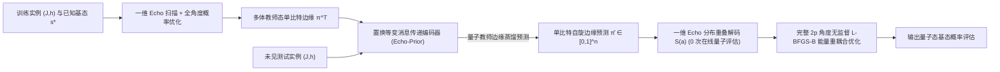
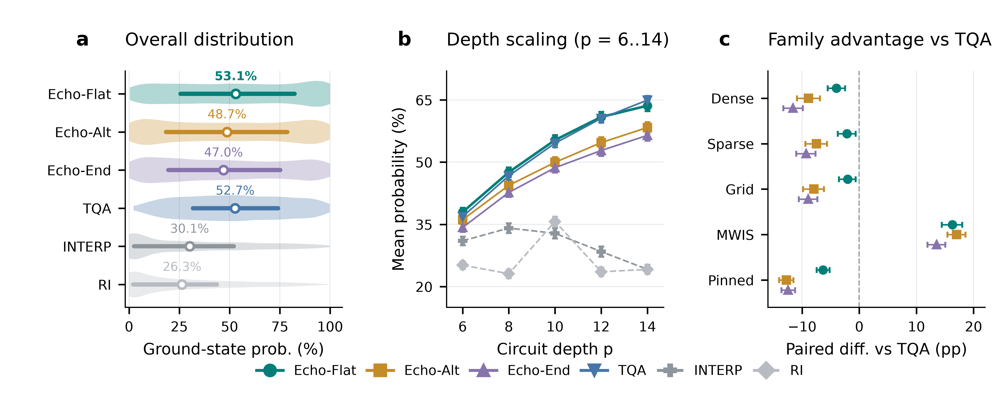
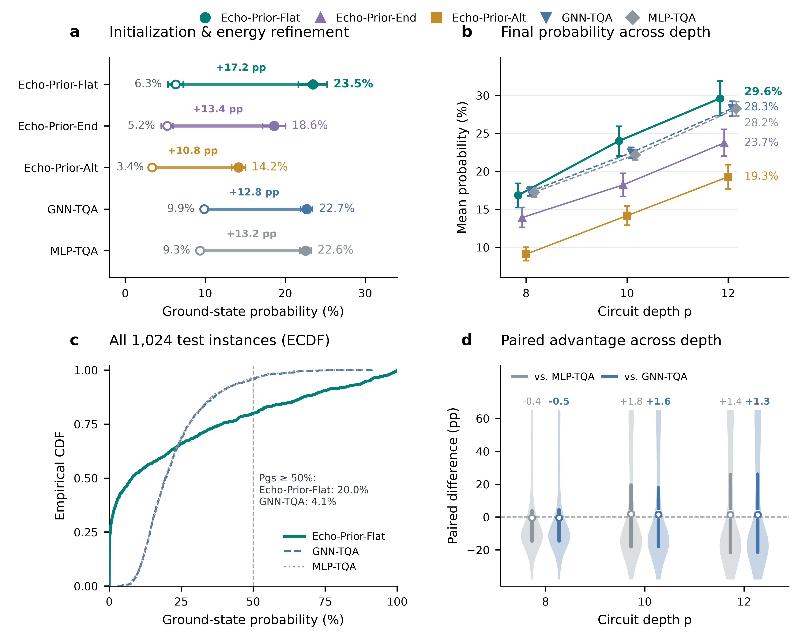

# Echo-QAOA：面向变分量子优化的构造性回波响应设计与逐比特边缘蒸馏

## 摘要

利用量子近似优化算法（QAOA）求解最大权独立集（MWIS）等受约束组合优化问题时，二次自旋耦合 $J$ 与异构局域外场 $h$ 的剧烈竞争使 $2p$ 维变分参数景观呈现密集的局部极值陷阱。现有同质退火轨迹缺乏单比特相位分辨率且需耗费大量在线量子测量选点，而端到端神经角度回归则受制于跨分支离散跳变，以及概率峰顶平坦度（预测容错性）与标签坐标隐函数稳定性之间的内禀曲率矛盾。本文提出 **Echo-QAOA**，利用整体自旋翻转下的算符奇偶共轭性在标准 QAOA 线路内部精确抵消二次耦合，将目标态概率严格分解为 $O(kn)$ 单比特磁化响应乘积；进而建立零量子测量的分布重叠解码器，将病态高维角度回归重构为置换等变的逐比特量子教师边缘蒸馏（**Echo-Prior**）并衔接全角度能量重耦合。借助 Daubechies 功率互补谱因子分解，我们严格证明了任意阶平顶（Flat-Top）响应的实角度线路可实现性、峰顶 $O(\delta^{2k})$ 阶误差容忍度以及无零概率区间内的严格凸性。在 2,750 道五家族基准与 5,120 道跨规模 MWIS 测试实例中，平顶 Echo 与 **Echo-Prior-Flat** 在阶段一零量子测量下全面超越量子退火初始化与全部 36 个直接角度回归模型，将高概率解（$P_{\mathrm{gs}}\ge 50\%$）覆盖率提升 $4.9$ 倍并实现阶段一测量散粒噪声的 $100\%$ 免疫。

## 1 引言

量子近似优化算法（QAOA）通过交替演化问题哈密顿量 $U_C(\gamma)=e^{-i\gamma H_C}$ 与横向场混合算符 $U_B(\beta)=e^{-i\beta\sum_i X_i}$ 制备候选量子态，是近期有噪中等规模量子（NISQ）计算求解组合优化问题的核心变分范式 (Blekos et al., 2024; Cerezo et al., 2021; Farhi et al., 2014; Preskill, 2018)。不同于无外场（$h=0$）的未加权最大割，最大权独立集（MWIS）等硬约束组合优化问题在转化为 Ising 模型 $E(s)=\frac12s^\top Js+h^\top s+C$ 后，同时包含二次自旋耦合 $J$ 与剧烈竞争的非均匀局域外场 $h$ (Ebadi et al., 2022; Hadfield et al., 2019; Lucas, 2014; Pichler et al., 2018)。在固定线路深度 $p$ 下，QAOA 的逼近质量高度依赖于局部优化的初始吸引盆地：由于真实量子处理器上的每次能量评估与参数移位梯度估计均需耗费数千次投影测量 (Harrigan et al., 2021; Mitarai et al., 2018; Pagano et al., 2020; Wierichs et al., 2022)，而在非凸对称耦合诱导的指数级局部极值陷阱中执行多起点盲搜开销高昂 (Anschuetz & Kiani, 2022; Bittel & Kliesch, 2021; McClean et al., 2018; Shaydulin et al., 2019; You & Wu, 2021)，在严格保持标准 QAOA 全局线路架构（初态 $|+\rangle^{\otimes n}$ 与全局横向场混合算符 $U_B(\beta)$）的前提下直接从实例系数 $(J,h)$ 跨实例生成高质量初始参数，成为摊销变分量子优化成本的核心课题。

现有的 QAOA 参数生成研究主要遵循“启发式同质退火轨迹”与“端到端神经角度回归”两大范式：前者利用时间离散化量子退火（TQA）、逐层插值（INTERP / FOURIER）或跨图参数集中特性压缩搜索空间 (Brandao et al., 2018; Crooks, 2018; Farhi et al., 2001; Galda et al., 2021; Kadowaki & Nishimori, 1998; Sack & Serbyn, 2021; Shaydulin et al., 2023; Zhou et al., 2020)；后者（Neural QAOA）则训练多层感知机（MLP）、图神经网络（GNN）或生成模型直接从图特征 $(J,h)$ 预测完整的 $2p$ 维电路角度 (Amos, 2023; Amosy et al., 2024; Jain et al., 2022; Jiang et al., 2025; Liang et al., 2024; Meng et al., 2025)。**然而**，这两类范式在面对强异构局域外场 $h$ 时均遭遇根本性理论瓶颈：同质退火轨迹对所有量子比特施加统一的宏观相位包络，缺乏对单比特不可公度外场相位的解析控制能力，且在线需耗费数十次量子测量选点 (Katial et al., 2025)；而端到端神经角度回归则受制于三重内禀数学病态——（1）**跨分支离散跳变**：参数空间不仅存在反演与周期简并 (Lotshaw et al., 2021; Shaydulin et al., 2021)，更被零概率奇点流形切割为多个竞争分支，$(J,h)$ 的连续微扰跨越分支交叉点时引发全局最优角度非连续跳变 (Gould et al., 2021; Rupprecht et al., 2017; Zhang et al., 2019)；（2）**峰值平坦度与坐标稳定性的隐函数曲率矛盾**：宽平的概率峰顶（小二阶曲率）虽能提升对角度预测误差的容忍度，却按隐函数定理反比放大最优角度坐标对实例微扰的灵敏度上界（见 4.1 节）；（3）**图级池化的异构偏置丢失**：将节点特征全局池化为图级角度向量会抹平逐比特局域外场与拓扑排斥的精确对应关系。

为打破上述瓶颈，本文的核心洞察在于：**利用代数奇偶消耦在标准 QAOA 线路内部构造具有显式单比特解析响应与区间凸性的直积子流形，并以此为解析枢纽将病态的高维角度回归重构为良态的节点级量子边缘蒸馏**。受核磁共振自旋回波与动力学解耦启发 (Carr & Purcell, 1954; Hahn, 1950; Viola et al., 1999)，我们利用二次耦合 $H_J$（偶对称）与局域外场 $H_h$（奇对称）在整体自旋翻转算符 $F=\prod_i X_i$（对应特殊混合角 $\beta=\pi/2$）共轭下的奇偶对立性质提出 **Echo-QAOA**：将正反配对的代价演化 $(-g_j,g_j)$ 与一次 $\pi/2$ 翻转组合为**完整 Echo 对**，无需小角度或弱耦合近似即可在线路演化中精确抵消 $H_J$，使输出态保持严格直积结构，并将目标态测量概率化为 $O(kn)$ 复杂度的单比特磁化响应乘积。基于与量子信号处理多项式谱合成的同构性 (Gilyén et al., 2019; Low & Chuang, 2017; Low et al., 2016)，我们构造了平顶（Flat-Top）、交替相位（Alternating-Phase）和端点匹配（Endpoint-Matched）三种互补的一维解析配方，并通过 Daubechies 功率互补谱因子分解证明平顶配方兼具 $O(\delta^{2k})$ 峰顶容错与无零概率区间严格凸性 (Daubechies, 1988; Herrmann, 1971)。进一步地，完整 Echo 对的直积结构将 $2^n$ 维全分布内积精确分解为 $n$ 个单比特边缘匹配项之积，建立起仅需 $O(Mnk)$ 经典计算、**零在线量子评估**的一维**分布重叠解码器**；据此提出的**逐比特量子教师边缘学习（Echo-Prior）**利用置换等变消息传递网络 (Gilmer et al., 2017; Karalias & Loukas, 2020; Schuetz et al., 2022; Xu et al., 2019) 从原始 $(J,h)$ 蒸馏多体教师态的单比特正自旋边缘 $\pi_i^{\mathrm T}\in[0,1]$ (Hinton et al., 2015; Wainwright & Jordan, 2008)，经重叠解码投射为标准 QAOA 起点后，由第二阶段全角度无监督能量优化打破配对对称性以线性重激活 $H_J$ 的多体纠缠演化（图 1）。

本文的核心贡献归纳如下：

1. **完整 Echo 对奇偶消耦理论与三种构造性一维响应配方**：证明了任意正偶数深度下完整 Echo 对精确抵消二次耦合的算符恒等式与 $O(kn)$ 概率乘积分解定理（命题 1–2）；提出平顶、交替相位与端点匹配三种一维配方，基于 Daubechies 谱因子分解严格证明了任意阶平顶响应的实角度线路可实现性（命题 3）、峰顶 $O(\delta^{2k})$ 容错度及无零概率区间严格凸性（命题 4），并确立受限直积演化的局域场驱动边界与对称破缺重耦合激活机制（命题 5）（第 3 章）。
2. **隐函数曲率权衡诊断、零量子测量重叠解码器与逐比特边缘蒸馏（Echo-Prior）**：从隐函数定理严格导出参数空间峰值平坦度与最优坐标稳定性的反向曲率矛盾及跨分支跳变机制；利用直积分布内积分解构建零在线量子评估的一维分布重叠解码器 $S(a)$，并提出置换等变的逐比特量子教师边缘蒸馏网络（`Echo-Prior-Flat`、`Echo-Prior-End`、`Echo-Prior-Alt`），实现平滑自旋边缘推断与非凸电路参数空间的解耦协同（第 4 章）。
3. **五家族 2,750 题离线基准、36 模型在线受控对比与 5,120 题跨规模零样本泛化验证**：在 2,750 道五家族基准上，平顶 Echo 取得 $\mathbf{53.07}\%$ 的最高总体基态概率，在强异构外场 MWIS 上三种 Echo 配方较 TQA 净赢 $+13.52\sim +17.03$ pp 且在无截断收敛轨下全规模超越同候选数 TQA；在未知目标态的 MWIS 在线测试中，**Echo-Prior-Flat** 在零阶段一量子测量下取得 $\mathbf{23.48}\%$ 的最高跨深度平均基态概率，将高概率解（$P_{\mathrm{gs}}\ge 50\%$）覆盖率提升至 $\mathbf{20.0}\%$（达最强角度回归基线 GNN-TQA 的 $4.9$ 倍、在线 TQA 的 $5.6$ 倍），全面击败全部 36 个直接角度回归模型与一维图级池化消融基线，并在 $n\in\{6,8,10,12,14\}$（5,120 题）双向零样本迁移与有限测量散粒噪声测试中证实了跨规模泛化能力与 $100\%$ 阶段一抗噪优势（第 5 章）。

**图 1：Echo-QAOA 的一维构造性谱响应设计、逐比特量子教师边缘蒸馏（Echo-Prior）、零量子评估分布重叠解码及全角度能量重耦合优化流程。**

## 2 相关工作

### 2.1 受约束 Ising 变分优化与启发式轨迹初始化

量子近似优化算法（QAOA）(Farhi et al., 2014) 将绝热量子演化 (Farhi et al., 2001; Kadowaki & Nishimori, 1998) 离散化为交替参数化量子线路 (Blekos et al., 2024; Cerezo et al., 2021; Preskill, 2018)。通过惩罚项映射 (Lucas, 2014) 或受约束算符拟设 (Hadfield et al., 2019)，MWIS 等 NP-hard 问题转化为同时含二次耦合 $J$ 与强异构局域外场 $h$ 的 Ising 模型，并已在超导处理器 (Harrigan et al., 2021)、囚禁离子模拟器 (Pagano et al., 2020) 及中性里德堡原子阵列 (Ebadi et al., 2022; Pichler et al., 2018) 上得到验证。然而，在固定深度 $p$ 下直接优化 $2p$ 维角度面临贫瘠高原 (McClean et al., 2018)、NP-hard 变分景观 (Bittel & Kliesch, 2021)、指数级局部极值陷阱 (Anschuetz & Kiani, 2022; You & Wu, 2021) 及时间反演与周期平移诱导的对称简并分支 (Lotshaw et al., 2021; Shaydulin et al., 2021)。受限于参数移位梯度所需的 $O(p)$ 次硬件投影测量 (Mitarai et al., 2018; Wierichs et al., 2022)，多起点拟牛顿盲搜 (Byrd et al., 1995; Shaydulin et al., 2019) 难以扩展。

为压缩搜索维度，主流启发式初始化范式利用层间平滑性或绝热物理先验构造低维演化轨迹，涵盖逐层线性插值与傅里叶基展开（INTERP / FOURIER）(Crooks, 2018; Zhou et al., 2020)、Pontryagin 准绝热复合脉冲与反绝热驱动 (Wurtz & Love, 2022; Yang et al., 2017)、单步长 $\Delta t$ 驱动的 Trotter 化量子退火（TQA）(Sack & Serbyn, 2021) 以及跨图参数集中迁移 (Brandao et al., 2018; Galda et al., 2021; Shaydulin et al., 2023)。然而，在带强异构局域外场 $h$ 的受约束问题中，同质退火包络无法在单比特尺度上协调异构外场与拓扑耦合的剧烈竞争 (Katial et al., 2025)；相反，本文提出的 Echo 机制采用最高频的逐层正负交替序列，专门在非均匀外场下精确消耦二次干涉。另一类修改电路结构的变体——如替换初态并定制异构混合算符的 Warm-Start QAOA (Egger et al., 2021; Tate et al., 2023)、赋予每点每边独立参数的 ma-QAOA (Herrman et al., 2022) 或递归消元 RQAOA (Bravyi et al., 2020)——虽能注入节点偏置，但破坏了全局横向场脉冲 $U_B(\beta)=e^{-i\beta\sum_i X_i}$ 的原生硬件兼容性且易引发自旋冻结。本文坚持保持标准全局 QAOA 线路不变的正交范式，在线路内部开辟精确直积子流形并衔接全角度重耦合，实现局域场偏置定位与多体纠缠隧穿的两阶段协同 (Dupont et al., 2022)。

### 2.2 自旋回波、量子信号处理与 Daubechies 小波谱因子分解

本文“标准线路内精确消耦与单比特响应成形”的构造融合了核磁共振相干控制、量子信号处理与正交小波滤波器理论。自自旋回波（Spin Echo）与多脉冲重聚焦序列建立以来 (Carr & Purcell, 1954; Hahn, 1950)，利用中间 $\pi$ 翻转脉冲反转线性演化相位已成为动力学解耦 (Viola et al., 1999) 与复合脉冲控制 (Vandersypen & Chuang, 2005) 的基石。本文揭示：在标准 QAOA 中，取特殊全局混合角 $\beta=\pi/2$ 在忽略全局相位下等价于执行整体自旋翻转 $F=\prod_i X_i$；利用 $H_J$ 偶对称不变而 $H_h$ 奇对称反号的对立性质，将反对称代价角 $(-g_j,g_j)$ 与 $\pi/2$ 混合配对为**完整 Echo 对**即可精确消去任意强度的二次耦合 $H_J$。在消耦后的单比特二维子空间中，设计偶层混合角 $(\theta_1,\ldots,\theta_k)$ 以容忍不可公度外场相位失配，与量子信号处理（QSP）及量子奇异值变换（QSVT）中的单比特多项式谱合成同构 (Gilyén et al., 2019; Low & Chuang, 2017; Low et al., 2016)。我们引入最大平坦滤波器与 Daubechies 功率互补最小相位谱因子分解定理 (Daubechies, 1988; Herrmann, 1971)，通过双通道正交格型消元严格证明了任意阶平顶响应在标准 QAOA 中的实角度可实现性、峰顶 $O(\delta^{2k})$ 容错度及无零点区间严格凸性。

### 2.3 摊销优化隐函数权衡与逐比特边缘蒸馏

面向未知目标态的在线跨实例部署，研究重心已从早期循环神经控制器学习优化（L2O）(Verdon et al., 2019) 转向端到端角度预测（Neural QAOA），即利用 MLP、GNN 或条件扩散模型从问题图特征直接生成 $2p$ 维电路角度 (Amosy et al., 2024; Jain et al., 2022; Jiang et al., 2025; Liang et al., 2024; Meng et al., 2025)。然而，从摊销优化与深度声明式网络的隐函数微分理论 (Amos, 2023; Gould et al., 2021) 审视，直接回归电路角度面临深刻的内禀几何矛盾：减小峰顶局部曲率虽能提升目标概率对角度误差的容忍度，却反比放大隐函数定理下最优角度坐标对实例微扰的灵敏度，且零概率奇点流形诱导跨分支离散跳变；即便引入多假设赢家通吃与集合损失 (Rupprecht et al., 2017; Zhang et al., 2019)，图级全局池化 (Xu et al., 2019) 仍会抹平节点级异构局域场偏置。本文受概率图模型边缘推断 (Wainwright & Jordan, 2008) 与节点级几何深度学习组合求解器 (Gilmer et al., 2017; Karalias & Loukas, 2020; Loshchilov & Hutter, 2019; Schuetz et al., 2022) 启发，以 Echo-QAOA 的解析直积分布为桥梁构建零量子评估的一维**分布重叠解码器**，并通过知识蒸馏 (Hinton et al., 2015) 训练置换等变的**逐比特量子教师边缘网络（Echo-Prior）**，彻底规避角度空间的跨分支不连续性。

## 3 Echo-QAOA：算符消耦与一维构造性响应理论

### 3.1 带场 Ising 线路约定与完整 Echo 对精确消耦

考虑定义在 $n$ 个自旋变量 $s\in\{-1,+1\}^n$ 上的带局域外场 Ising 能量函数：

$$
E(s)=\frac12s^\top Js+h^\top s+C,\qquad s\in\{-1,+1\}^n,
$$

其中耦合矩阵 $J\in\mathbb R^{n\times n}$ 对称且对角线元素为零，$h\in\mathbb R^n$ 为局域外场向量，$C\in\mathbb R$ 为常数偏移。将经典自旋提升为计算基算符后，对应的问题哈密顿量可分解为 $H_C=H_J+H_h+C$，其中二次耦合项满足 $H_J|s\rangle=(\frac12s^\top Js)|s\rangle$，局域外场项满足 $H_h|s\rangle=(h^\top s)|s\rangle$；常数项 $C$ 在幺正演化中仅贡献全局相位，不影响测量概率分布与参数优化。

遵循标准 QAOA 约定 (Farhi et al., 2014)，在深度为 $p$ 的量子线路中，定义问题演化算符与横向场混合算符（mixer）分别为：

$$
U_C(\gamma)=e^{-i\gamma H_C},\qquad U_B(\beta)=e^{-i\beta\sum_{i=1}^n X_i},
$$

其中 $X_i$ 为作用在第 $i$ 个量子比特上的 Pauli-$X$ 算符。从均匀叠加初态 $|+\rangle^{\otimes n}$ 出发，经过 $p$ 层交替演化后的输出量子态记为：

$$
|\psi_p(\vartheta;J,h)\rangle=U_B(\beta_p)U_C(\gamma_p)\cdots U_B(\beta_1)U_C(\gamma_1)|+\rangle^{\otimes n},
$$

其中 $2p$ 维角度向量按全部 cost 角后接全部 mixer 角的顺序排列为 $\vartheta=(\gamma_1,\ldots,\gamma_p,\beta_1,\ldots,\beta_p)$，并受有界域 $|\gamma_\ell|\le G$（$G>0$ 为给定的 cost 角幅值上界）与 $|\beta_\ell|\le\pi/2$ 约束。

直接在 $2p$ 维空间中搜索 $\vartheta$ 之所以困难，根源在于二次耦合项 $H_J$ 诱导了非局域的多体纠缠与复杂干涉 (Bravyi et al., 2020; Herrman et al., 2022)。然而，观察 $H_J$ 与 $H_h$ 在**整体自旋翻转算符** $F=\prod_{i=1}^n X_i$ 共轭作用下的代数性质，可以发现两者具有截然相反的奇偶性：由于整体翻转将所有自旋同时反号（$s\mapsto -s$），二次型 $s^\top Js$ 保持不变，而线性型 $h^\top s$ 严格反号。算符层面上，这一奇偶对立关系表现为：

$$
FH_JF=H_J,\qquad FH_hF=-H_h,\qquad U_B(\pi/2)=(-i)^nF.
$$

上述第三式表明，当取特殊 mixer 角 $\beta=\pi/2$ 时，横向场混合演化在忽略全局相位 $(-i)^n$ 的意义下恰好等价于执行一次整体自旋翻转 $F$。受自旋回波（Spin Echo）与动力学解耦 (Carr & Purcell, 1954; Hahn, 1950; Vandersypen & Chuang, 2005; Viola et al., 1999) 相位重聚焦机制的启发，我们考虑正偶数深度 $p=2k$（$k\ge 1$），将相邻的两个 QAOA 层组合为第 $j$ 个**完整 Echo 对**（$j=1,\ldots,k$），并赋予其反对称的 cost 角配对与夹心翻转结构：

$$
(\gamma_{2j-1},\gamma_{2j})=(-g_j,g_j),\qquad
(\beta_{2j-1},\beta_{2j})=(\pi/2,\theta_j).
$$

下述命题证明，这一两层复合结构能够在线路演化中精确消去任意强度的二次耦合项 $H_J$。

**命题 1（完整 Echo 对消耦）。** 忽略全局相位，第 $j$ 个完整 Echo 对的复合幺正演化算符 $E(g_j,\theta_j):=U_B(\theta_j)U_C(g_j)U_B(\pi/2)U_C(-g_j)$ 恒满足：

$$
E(g_j,\theta_j)=U_B(\theta_j)e^{-2ig_jH_h}F.
$$

**证明。** 利用 $U_B(\pi/2)\propto F$ 以及对角算符 $H_C$ 与 $FH_CF$ 之间的对易性（$[H_C, FH_CF]=0$），将算符按演化次序展开可得：

$$
\begin{aligned}
E(g_j,\theta_j)
&=U_B(\theta_j)e^{-ig_jH_C}Fe^{ig_jH_C}\\
&=U_B(\theta_j)e^{-ig_jH_C}\big(Fe^{ig_jH_C}F\big)F\\
&=U_B(\theta_j)e^{-ig_j(H_J+H_h+C)}e^{ig_j(FH_JF+FH_hF+C)}F\\
&=U_B(\theta_j)e^{-2ig_jH_h}F.
\end{aligned}
$$

至此，二次耦合项 $H_J$ 与常数项 $C$ 在正反演化的奇偶共轭下完全抵消。$\square$

命题 1 的核心意义在于：**这种精确抵消完全源自正反 cost 角的对称配对与自旋翻转算符的奇偶共轭性质，既非小角度一阶近似，也不要求耦合矩阵 $J$ 在数值上微弱**。消耦之后，每个完整 Echo 对的演化算符严格分解为各量子比特上相互独立的单比特操作。因此，从直积初态 $|+\rangle^{\otimes n}$ 出发，经过任意 $k$ 个完整 Echo 对演化后的输出态始终保持严格的直积态结构。

### 3.2 单比特幅值递推、概率乘积分解与一维参数族

得益于命题 1 建立的直积态保持性质，原本需要在 $2^n$ 维希尔伯特空间中演化计算的量子态概率幅，现在可以严格退化为 $n$ 个解耦的二维单比特递推。具体而言，固定第 $i$ 个量子比特的计算基序为 $(|s_i=-1\rangle,|s_i=+1\rangle)$，单比特横向旋转算符与初始叠加态可分别表示为 $2\times 2$ 矩阵与二维列向量：

$$
M(\theta)=
\begin{pmatrix}
\cos\theta&-i\sin\theta\\
-i\sin\theta&\cos\theta
\end{pmatrix},\qquad
u_i^{(0)}=\frac1{\sqrt2}\binom11.
$$

设第 $i$ 个量子比特在经过前 $j-1$ 个完整 Echo 对后的单比特状态向量为 $u_i^{(j-1)}=\big(u_{i,-}^{(j-1)}, u_{i,+}^{(j-1)}\big)^\top$。在第 $j$ 个 Echo 对中，翻转算符 $X_i$ 首先交换正负自旋分量的位置，局域场演化 $e^{-2ig_j H_h}$ 随后在 $|s_i=-1\rangle$ 与 $|s_i=+1\rangle$ 分量上分别施加相位因子 $e^{+2ig_j h_i}$ 与 $e^{-2ig_j h_i}$，最后由 $M(\theta_j)$ 完成单比特混合：

$$
\binom{u_{i,-}^{(j)}}{u_{i,+}^{(j)}}
=M(\theta_j)
\binom{e^{2ig_jh_i}u_{i,+}^{(j-1)}}
      {e^{-2ig_jh_i}u_{i,-}^{(j-1)}},\qquad j=1,\ldots,k.
$$

经过全部 $k$ 个 Echo 对演化后，定义第 $i$ 个量子比特的最终单比特磁化强度（即 $+1$ 与 $-1$ 自旋测量概率之差）为 $m_i=|u_{i,+}^{(k)}|^2-|u_{i,-}^{(k)}|^2\in[-1,1]$。

**命题 2（概率乘积分解）。** 在由 $k$ 个完整 Echo 对构成的深度 $p=2k$ 线路下，任意指定目标自旋配置 $s^\star\in\{-1,+1\}^n$ 的联合测量概率精确分解为各单比特成功因子的乘积：

$$
P(s^\star)=\prod_{i=1}^n\frac{1+s_i^\star m_i}{2}.
$$

**证明。** 由于全局输出态严格保持为直积态 $\bigotimes_{i=1}^n u_i^{(k)}$，各量子比特在计算基下的测量事件相互独立。结合归一化条件 $|u_{i,+}^{(k)}|^2+|u_{i,-}^{(k)}|^2=1$ 与磁化定义 $m_i=|u_{i,+}^{(k)}|^2-|u_{i,-}^{(k)}|^2$，第 $i$ 个量子比特测量得到目标自旋 $s_i^\star\in\{-1,+1\}$ 的边缘概率恒为 $(1+s_i^\star m_i)/2$，故联合测量概率等于各独立单比特因子之积。$\square$

在计算复杂度上，命题 2 将单次目标概率评估从指数级的 $O(pn2^n)$ 全状态向量模拟降低至仅需执行 $kn$ 次 $2\times 2$ 矩阵乘法（即 $O(kn)$ 时间复杂度与 $O(1)$ 逐比特辅助空间）。

为了利用这一解耦结构系统性地构造低维初始化空间，我们进一步引入**一维构造性参数族**。对于给定的正偶数深度 $p=2k$ 与特定的响应配方 $v$，我们预先固定各 Echo 对的相对 cost 比例系数 $(r_1,\ldots,r_k)$ 以及偶层 mixer 角度序列 $(\theta_1,\ldots,\theta_k)$，使全部 $k$ 个 Echo 对的 cost 幅度由单一标量参数 $a$ 线性驱动（即 $g_j = r_j a$）。由此定义从一维标量 $a$ 到完整 $2p$ 维 QAOA 角度空间的仿射嵌入映射 $D_{v,k}(a)$：

$$
D_{v,k}(a)=\big(-r_1a,r_1a,\ldots,-r_ka,r_ka,\pi/2,\theta_1,\ldots,\pi/2,\theta_k\big),
\qquad a\in\mathcal A_{v,k}=\left[-\frac{G}{\max_j|r_j|},\frac{G}{\max_j|r_j|}\right].
$$

在映射 $D_{v,k}(a)$ 下，第 $i$ 个量子比特的最终磁化响应 $m_i(a)$ 完全由单比特相位变量 $\phi_i = 4a h_i$ 及配方参数 $(r_j,\theta_j)_{j=1}^k$ 决定，此时目标态测量概率记为 $P_{D_{v,k}(a)}(s^\star)=\prod_{i=1}^n\frac{1+s_i^\star m_i(a)}{2}$。

### 3.3 平顶 Echo：高阶平坦响应与谱因子可实现性

在包含多个量子比特的带场实例中，各比特的局域外场 $h_i$ 通常彼此不可公度，单一全局标量 $a$ 难以使所有比特同时精确对齐在基础谐波峰值 $\sin(4ah_i)=s_i^\star$ 处。针对这一多比特相位竞争问题，**平顶 Echo**（Flat-Top Echo）的设计目标是：在保持二倍阶梯比例 $r=(1,2,\ldots,2)$（对应合法标量域 $a\in[-\frac{G}{2},\frac{G}{2}]$，$k\ge 2$）的前提下，使单比特磁化响应在有利相位峰 $t=\sin(4ah)=\pm 1$ 附近具有尽可能高阶的导数平坦性，从而拓宽每个量子比特对相位失配与标量误差的容忍窗口。

具体而言，令基础谐波变量为 $t=\sin(4ah)\in[-1,1]$，我们将 $k$ 阶平顶磁化响应定义为如下正则化对称 Beta 积分：

$$
m_k(t)=
\frac{\int_0^t(1-z^2)^{k-1}\,dz}
     {\int_0^1(1-z^2)^{k-1}\,dz}.
$$

由被积函数的代数结构可知，$m_k(t)$ 是关于 $t$ 的 $2k-1$ 次奇多项式，严格满足端点对齐条件 $m_k(\pm 1)=\pm 1$，且在峰值端点 $t=\pm 1$ 处的一阶至 $k-1$ 阶导数全部为零。例如，$k=2,3$（对应 $p=4,6$）的显式响应多项式分别为：

$$
m_2(t)=\frac{3t-t^3}{2},\qquad
m_3(t)=\frac{15t-10t^3+3t^5}{8}.
$$

引入线性转换变量 $q=(1+t)/2\in[0,1]$，当目标自旋正向对齐时，单比特成功因子 $(1+m_k(t))/2$ 可紧凑地表示为正则化不完全 Beta 函数 $I_q(k,k)$ 及其截断幂级数形式：

$$
p_k(q)=\frac{1+m_k(2q-1)}2
=I_q(k,k)=q^kS_k(1-q),
$$

$$
S_k(y)=\sum_{r=0}^{k-1}\binom{k-1+r}{r}y^r,
\qquad p_k(q)+p_k(1-q)=1.
$$

上述多项式 $p_k(q)$ 刻画了理想的滤波器目标响应；下述命题进一步证明，必然存在一组实数 mixer 角序列 $(\theta_1,\ldots,\theta_k)$，能够通过 3.2 节的单比特幺正递推在线路中精确合成该多项式。

**命题 3（任意阶平顶响应的构造性可实现性）。** 对任意正整数 $k\ge 1$，存在实角度序列 $\theta_1,\ldots,\theta_k\in[-\pi/2,\pi/2)$，使得采用比例系数 $g=(a,2a,\ldots,2a)$ 的 $k$ 个完整 Echo 对线路精确产生单比特磁化响应 $m_k(\sin(4ah))$。

**证明概要（Daubechies 谱因子分解与格型消元）。** 令单比特相位为 $\phi=4ah$，作相移变换 $\omega=\phi-\pi/2$ 并记单位圆复变量为 $z=e^{i\omega}$，则 $q=(1+\sin\phi)/2=\cos^2(\omega/2)$。由 Fejér–Riesz 定理与 Daubechies 正交小波滤波器理论 (Daubechies, 1988; Herrmann, 1971)，对称 Beta 响应 $p_k(\cos^2(\omega/2))$ 在 $|z|=1$ 上恒正有界且满足功率互补恒等式 $p_k(q)+p_k(1-q)=1$，因而必然存在次数为 $2k-1$ 的实系数最小相位谱因子多项式 $H_k(z)=\sum_{r=0}^{2k-1}c_rz^r$，满足幅值平方匹配与正交镜像关系：

$$
\frac12\big|H_k(e^{i\omega})\big|^2
=p_k\!\left(\cos^2\frac\omega2\right),\qquad
H_k(1)=\sqrt2,\qquad
|H_k(z)|^2+|H_k(-z)|^2=2\quad (|z|=1).
$$

定义交替倒数共轭多项式 $H_j^\#(z)=z^{2j-1}H_j(-z^{-1})$，利用二者保持的二次功率正交性，从 $j=k$ 至 $j=1$ 执行双通道实正交格型消元即可逐层消去常数项与一次项（由功率互补性自动保证可被两倍相位步进 $e^{2i\phi}=-z^2$ 整除），提取出唯一实混合角 $\theta_j\in[-\pi/2,\pi/2)$。逆向展开该格型递推与 3.2 节的单比特 Echo 幅值递推完全同构，保证最终 $+1$ 基矢测量概率恒等于 $|H_k(z)|^2/2$（多项式求根构造与归纳证明见附录 A.1 `[Move to Appendix A.1]`）。$\square$

平顶响应对相位失配与标量偏差的平滑机制可通过峰顶邻域的泰勒展开精确量化。由 Beta 积分定义，当 $t\to 1^-$ 时有 $1-m_k(1-\varepsilon)=O(\varepsilon^k)$。若第 $i$ 个量子比特在标量 $a_0$ 处达到理想目标对齐 $s_i^\star\sin(4a_0h_i)=1$，当标量发生偏移 $a=a_0+\delta$ 时，谐波变量呈现二次退化：

$$
s_i^\star\sin(4h_i(a_0+\delta))
=1-8h_i^2\delta^2+O(\delta^4).
$$

代入平顶多项式可知，该比特的单比特成功因子损失被抑制至 $O(\delta^{2k})$ 阶（例如 $k=2$ 时局部损失为 $O(\delta^4)$，而标准正弦响应 $k=1$ 为 $O(\delta^2)$）。在各比特局域场 $h_i$ 不可公度的多比特实例中，这种高阶峰顶平坦性显著拓宽了每个比特的近优相位区间，使无法同时精确居于峰顶的多个量子比特能够共享更大的高概率重叠窗口。

### 3.4 平顶目标的无零概率区间严格凸性

除拓宽峰值容忍度外，平顶响应的另一项核心理论优势在于其对数似然目标函数具备优良的局部凸性结构。对于给定实例与目标配置 $s^\star$，令带符号场权重为 $w_i=4h_is_i^\star$，并定义包裹至主值区间的单比特相位偏差：

$$
e_i(a)=\operatorname{wrap}_{(-\pi,\pi]}(aw_i-\pi/2).
$$

利用 $m_k$ 的奇对称性，第 $i$ 个量子比特的目标成功因子可统一写为 $p_k((1+\cos e_i)/2)$。由此，受限平顶 Echo 线路的全局负对数概率损失函数可表示为各比特相位损失之和：

$$
\mathcal L_k(a;x)
=-\log P_{D_{\mathrm{flat},k}(a)}(s^\star)
=\sum_{i=1}^n \ell_k(e_i(a)),\qquad
\ell_k(e):=-\log p_k\!\left(\frac{1+\cos e}{2}\right).
$$

**命题 4（无零概率区间内的严格凸性）。** 单比特相位损失 $\ell_k(e)$ 在主值开区间 $(-\pi,\pi)$ 上为严格凸函数；对于任意至少包含一个非零局域场（$h_i\ne 0$）的多比特实例，全局负对数概率损失 $\mathcal L_k(a;x)$ 在标量域内每个不含零概率断点的开区间上关于 $a$ 严格凸，因而每个无零概率区间内部至多存在一个驻点（即唯一局部极小值点）。

**证明概要。** 对 $0\le e<\pi$，经三角换元可将单比特成功因子表示为正弦高次幂的尾积分比值 $\pi_k(e):=p_k((1+\cos e)/2)=\int_e^\pi\sin^{2k-1}v\,dv/\int_0^\pi\sin^{2k-1}v\,dv$。由于未归一化核 $f(v)=\sin^{2k-1}v$ 在 $(0,\pi)$ 上满足 $(\log f)''=-(2k-1)\csc^2v<0$（严格对数凹），对数凹密度的尾积分比值 $R(e)=\int_e^\pi f(v)\,dv/f(e)$ 随 $e\in(0,\pi)$ 严格单调递减，使一阶导数 $\ell_k'(e)=1/R(e)$ 在 $(0,\pi)$ 上严格单调递增；结合偶对称性与 $\ell_k'(0)=0$ 即证 $\ell_k(e)$ 在 $(-\pi,\pi)$ 上严格凸。在不含零概率断点的标量开区间内，非零场比特的相位偏差 $e_i(a)$ 不跨越 $\pm\pi$ 割线，关于 $a$ 严格仿射线性，故复合加和损失 $\mathcal L_k(a;x)$ 在该区间内关于 $a$ 严格凸（完整证明见附录 A.2 `[Move to Appendix A.2]`）。$\square$

命题 4 清晰刻画了一维参数空间的全局拓扑：损失函数 $\mathcal L_k(a;x)$ 的非凸性完全集中于单比特成功因子归零的奇异断点处，即满足 $e_i(a)=\pm\pi$ 的位置：

$$
\sin(aw_i)=-1
\iff
a=\frac{-\pi/2+2\pi z}{w_i},\qquad z\in\mathbb Z\quad (w_i\ne 0).
$$

在有界标量搜索域内，上述有限个零概率断点将搜索空间精确分割为若干个互不相交的无零概率开区间，而每个开区间内部均为严格凸的单峰景观。

### 3.5 交替相位 Echo：累积有效相位扩展

平顶 Echo 通过固定二倍比例将自由度用于重塑峰值平坦度，而第二种配方——**交替相位 Echo**（Alternating-Phase Echo）——则旨在最大化有界门角度约束下的有效累积相位范围。对于 $k\ge 2$，交替相位配方采用单位绝对值比例与末层集中混合策略：

$$
g_j=(-1)^{k-j}a\quad (j=1,\ldots,k),\qquad
\theta_j=0\quad (j<k),\qquad \theta_k=\pi/4.
$$

这一构造的物理机制十分直观：当中间前 $k-1$ 对的偶层 mixer 角均置为 $\theta_j=0$ 时，相邻 Echo 对之间的整体自旋翻转算符 $F$ 会将此前已累积的局域场线性相位符号整体反转，从而使有效相位系数满足递推关系 $A_0=0$ 与 $A_j=g_j-A_{j-1}$。将交替符号序列 $g_j=(-1)^{k-j}a$ 代入递推，各对的局域场相位实现同相相长累加，得到 $A_k=ka$；最后由第 $k$ 对末端的 mixer 角 $\theta_k=\pi/4$ 将累积相位一次性转化为计算基磁化响应：

$$
m_i(a)=\sin(4kah_i),\qquad
P_{D_{\mathrm{alt},k}(a)}(s^\star)=\prod_{i=1}^n\frac{1+s_i^\star\sin(4kah_i)}2.
$$

在所有满足中间 mixer 为零且单层角度受限于 $|g_j|\le G$ 的 Echo 子族中，累积相位系数满足绝对值上界：

$$
|A_k|=\left|\sum_{j=1}^k(-1)^{k-j}g_j\right|
\le\sum_{j=1}^k|g_j|\le kG.
$$

交替相位构造恰好饱和了这一上界，在保持标量搜索域 $a\in[-G,G]$ 的同时将有效相位频率扩展了 $k$ 倍，使其能够以密集的谐波分辨率在有界参数域内捕获复杂异构局域场下的多比特同相共振峰。

### 3.6 端点匹配 Echo：正相位通带平衡与配方对比

第三种配方——**端点匹配 Echo**（Endpoint-Matched Echo）——在平顶的局部导数平坦与交替相位的高频振荡之间采取了折中路线，旨在直接平衡指定正相位通带区间 $[\tau,1]$ 两端的响应高度。对于 $k\ge 2$，该配方保留二倍阶梯比例 $g=(a,2a,\ldots,2a)$（标量域 $a\in[-\frac{G}{2},\frac{G}{2}]$），但将偶层 mixer 角设计为由单一辅助参数 $B$ 控制的交替序列：

$$
L=2k-1,\qquad
\theta_j=(-1)^{k-j}B\quad (j<k),\qquad \theta_k=\frac{B}{2}.
$$

记 $u=\sin B$ 及基础谐波变量 $t=\sin(4ah)$，通过将相邻两对演化整理为共轴 Bloch 球复合旋转 (Low et al., 2016; Vandersypen & Chuang, 2005)（完整推导见附录 A.3），可证明该配方的单比特磁化响应具有如下闭式表达：

$$
m_k(t)=\sin\big[L\arcsin(ut)\big].
$$

给定正相位通带阈值 $\tau\in(0,1)$，我们通过解析选取参数 $u$ 与 $B$：

$$
u=\frac{\sin(\pi/L)}
{\sqrt{1+2\tau\cos(\pi/L)+\tau^2}},
\qquad B=\arcsin u,
$$

使两端相位满足对称关系 $L[\arcsin(u\tau)+\arcsin u]=\pi$，从而精确实现通带区间 $[\tau,1]$ 两端的磁化响应相等：$m_k(\tau)=m_k(1)$。当 $t$ 从左端点 $\tau$ 增至右端点 $1$ 时，响应函数 $m_k(t)$ 先单调上升至峰值 $1$（位于区间内部），随后回落至与左端点等高的 $m_k(1)=m_k(\tau)$。这一等波纹式的包络设计直接给出了多比特目标概率的条件性解析下界：若存在标量 $a$ 使所有量子比特的对齐谐波分量均落入该正相位通带内，即

$$
t_i=s_i^\star\sin(4ah_i)\in[\tau,1],\qquad \forall i\in\{1,\ldots,n\},
$$

则联合目标态测量概率必满足下界保证：

$$
P_{D_{\mathrm{end},k}(a)}(s^\star)\ge\left[\frac{1+m_k(\tau)}2\right]^n.
$$

表 1 汇总了三种构造性 Echo 配方在 $k\ge 2$ 时的参数结构、单比特解析响应及核心理论性质。

**表 1：三种构造性 Echo 配方（$p=2k, k\ge 2$）的参数设计、单比特响应与理论性质对比（其中 $\phi=4ah, t=\sin\phi$）。**

| 配方名称                       | 比例系数 $r_j$ 与偶层 mixer 角 $\theta_j$                         | 单比特磁化响应 $m_k(t)$ 与标量域 $\mathcal A_{v,k}$                    | 核心代数与解析性质                                                                                     |
| :----------------------------- | :---------------------------------------------------------------- | :--------------------------------------------------------------------- | :----------------------------------------------------------------------------------------------------- |
| **平顶 Echo** (`Echo-Flat`)    | $r=(1,2,\ldots,2)$；$\theta_j$ 由 Daubechies 谱因子格型消元提取   | $2I_{(1+t)/2}(k,k)-1$，$a\in\left[-\frac{G}{2},\frac{G}{2}\right]$     | 峰顶 $t=\pm 1$ 处具 $k-1$ 阶零导数与 $O(\delta^{2k})$ 局部误差容忍度；无零概率开区间内负对数损失严格凸 |
| **交替相位 Echo** (`Echo-Alt`) | $r_j=(-1)^{k-j}$；$\theta_j=0\ (j<k)$，$\theta_k=\pi/4$           | $\sin(k\phi)$，$a\in[-G,G]$                                            | 饱和零中间 mixer 子族的有效累积相位上界 $kG$，将单比特相位搜索频率扩展 $k$ 倍                          |
| **端点匹配 Echo** (`Echo-End`) | $r=(1,2,\ldots,2)$；$\theta_j=(-1)^{k-j}B\ (j<k)$，$\theta_k=B/2$ | $\sin[(2k-1)\arcsin(ut)]$，$a\in\left[-\frac{G}{2},\frac{G}{2}\right]$ | 精确平衡正相位通带 $[\tau,1]$ 两端响应 $m_k(\tau)=m_k(1)$，提供通带对齐条件下的解析概率下界            |

### 3.7 受限直积演化的理论边界与重耦合动机

命题 1 的消耦恒等式表明，完整 Echo 对在精确抵消二次耦合项 $H_J$ 的同时，使得受限线路的演化完全依赖于局域外场哈密顿量 $H_h$ 的相位驱动。这一代数特性直接决定了纯 Echo 参数族的理论作用边界，并从第一性原理阐明了为何在一维初始化之后必须衔接全角度重耦合优化。

**命题 5（受限 Echo 演化的局域场驱动与乘积边界）。** 在深度 $p=2k$ 的受限 Echo 线路 $D_{v,k}(a)$ 下，目标态测量概率满足以下两项结构约束：

1. **零场上限**：若实例包含 $n_0$ 个零局域场量子比特（$h_i=0$），则对任意标量 $a$ 恒有
   $$P_{D_{v,k}(a)}(s^\star)\le 2^{-n_0};$$
   特别地，当全局外场恒为零（$h=0$）时，三种配方的输出概率恒退化为均匀分布基准 $P_{D_{v,k}(a)}(s^\star)=2^{-n}$。
2. **维数衰减界**：若在标量 $a$ 处有 $q$ 个量子比特的目标对齐磁化仅达到次优水平 $s_i^\star m_i(a)\le\eta<1$，则联合目标概率满足
   $$P_{D_{v,k}(a)}(s^\star)\le\left(\frac{1+\eta}{2}\right)^q.$$

**证明。** （1）对于任意满足 $h_i=0$ 的量子比特 $i$，其局域场相位因子恒为 $e^{\pm 2ig_j h_i}=1$；由于初始态 $|+\rangle$ 是翻转算符 $X_i$ 与混合旋转 $M(\theta_j)$ 的共同本征态，该比特在演化中仅积累平凡相位，单比特磁化恒为 $m_i(a)=0$，在命题 2 的乘积分解中恒定贡献因子 $1/2$。其余 $n-n_0$ 个比特的单比特成功因子至多为 $1$，相乘即得 $2^{-n_0}$；当 $n_0=n$ 时所有因子均为 $1/2$，故恒等于 $2^{-n}$。（2）当 $q$ 个比特满足 $s_i^\star m_i(a)\le\eta<1$ 时，其各自成功因子均不超过 $(1+\eta)/2$，其余 $n-q$ 个因子不超过 $1$，由命题 2 相乘即得结论。$\square$

命题 5 揭示了两个核心物理机制。第一，由于奇对称响应 $m_k(t)$ 在将同相比特（$s_i^\star\sin(4ah_i)>0$）推向 $+1$ 的同时对称地压低反相比特，高阶平顶滤波的增益建立在通过全局标量搜索避开反相谷底、将主导比特群对齐至同相通带（$t_i>0$）的前提之上。第二，为突破直积态表达上限并解决零场比特或强耦合挫折问题，必须在 Echo 初始化后恢复二次耦合 $H_J$ 的多体纠缠作用。将第 $j$ 对的代价角从反对称配对 $(-g_j, g_j)$ 沿对称破缺方向微扰为 $(-g_j+\delta_j, g_j+\delta_j)$，复合算符立即变为：

$$
U_B(\theta_j)e^{-i(g_j+\delta_j)H_C}Fe^{-i(-g_j+\delta_j)H_C}
=U_B(\theta_j)e^{-2i\delta_j H_J}e^{-2ig_j H_h}F.
$$

上式证明，在受限 Echo 流形的任意邻域内，破坏正反配对约束即可一阶线性地重激活二次耦合演化 $e^{-2i\delta_j H_J}$，保证受限直积流形在对称破缺方向 $\delta_j=(\gamma_{2j-1}+\gamma_{2j})/2$ 上具有非零一阶切空间导数（绝不陷入耦合梯度消失的鞍点）。进入第二阶段并同时释放全部 $2p$ 个角度自由度（包括允许奇层混合角 $\beta_{2j-1}$ 偏离翻转支点 $\pi/2$）后，优化器充分调用全部 $p$ 层双比特门的纠缠表达能力。这从第一性原理确立了 Echo-QAOA 的**两阶段分工原则** (Dupont et al., 2022; Wurtz & Love, 2022; Yang et al., 2017)：第一阶段利用一维完整 Echo 对流形在 $O(kn)$ 纯经典复杂度下快速锚定与局域外场对齐的优质盆地起点；第二阶段释放全部 $2p$ 个角度自由度进行局部优化，通过对称破缺释放多体耦合纠缠。

### 3.8 一维区间导数求根与两阶段寻优策略

在已知目标态 $s^\star$ 的离线概率寻优与教师采集场景下，基于命题 1–5 的代数结构，两阶段寻优策略总结如下（数值容差与网格参数见附录 B.1 `[Move to Appendix B.1]`）：

1. **平顶配方的区间导数求根搜索**：利用命题 4 的严格凸性，算法由非零场权重 $w_i=4h_is_i^\star$ 精确枚举有界标量域内的全部零概率断点，并在每个互不相交的无零概率开区间内部对解析一阶导数 $\mathcal L_k'(a;x)$ 执行确定性二分求根，直接定位各区间的唯一局部极小值点。
2. **振荡配方的网格寻峰与局部精修**：对于交替相位与端点匹配配方，算法在有界标量网格上利用 $O(kn)$ 单比特递推评估目标概率，筛选分离的局部峰值点并执行黄金分割局部精修。
3. **候选去重与分批重耦合**：所有扫描候选按标量间距去重筛选后，按初始目标概率降序分批送入第二阶段全角度拟牛顿优化器。

## 4 基于分布重叠解码的逐比特边缘蒸馏初始化

### 4.1 参数空间的局部灵敏度权衡与跨分支跳变理论

在设计跨实例参数生成机制 (Amos, 2023; Verdon et al., 2019) 之前，必须首先考察从问题系数 $x=(J,h)$ 到最优参数 $\vartheta^\star(x)$ 的映射性质。即便在消除了多体纠缠干扰的一维平顶 Echo 子空间中，尽管无零概率开区间内部具有严格凸性（命题 4），全局最优标量参数对实例微扰的响应依然呈现出深刻的**局部曲率权衡**与**全局跨分支不连续性**。

**分支内隐函数灵敏度。** 以平顶 Echo 为例，设 $I_b(x)$ 为随归一化实例系数 $x=(J,h)$ 局部连续演化的某一个无零概率开区间，$a_b^\star(x)\in I_b(x)$ 为其内部唯一驻点，满足一阶最优性条件 $\partial_a\mathcal L_k(a_b^\star(x);x)=0$。若在实例 $x$ 的某个局部开邻域内，目标基态 $s^\star(x)$ 保持不变、损失函数 $\mathcal L_k$ 二阶连续可微，且局部二阶曲率满足一致正下界 $\partial_{aa}\mathcal L_k\ge\mu>0$，则由声明式优化中的隐函数定理 (Amos, 2023; Gould et al., 2021) 可知，该分支内的局部最优标量 $a_b^\star(x)$ 关于问题系数 $x$ 连续可微，其参数梯度满足：

$$
\nabla_xa_b^\star(x)
=-\big(\partial_{aa}\mathcal L_k(a_b^\star(x);x)\big)^{-1}
  \partial_{ax}\mathcal L_k(a_b^\star(x);x).
$$

若混合偏导数范数有界 $\|\partial_{ax}\mathcal L_k\|\le M$，则分支内最优标签对实例系数扰动的局部 Lipschitz 灵敏度上界为 $M/\mu$。一旦系数微扰跨越哈密顿量能隙闭合点导致基态 $s^\star(x)$ 发生改变、驻点触碰有界域边界或局部曲率退化（$\mu\to 0$），从问题特征到最优电路角度的直接映射便会丧失平滑性。

**峰值平坦度与坐标稳定性的几何权衡。** 进一步联合考察预测标量误差 $\delta=\widehat a-a_b^\star$ 对目标态概率的影响。在内部驻点 $a_b^\star$ 邻域内，负对数概率损失的二阶泰勒展开为：

$$
\mathcal L_k(a_b^\star+\delta;x)-\mathcal L_k(a_b^\star;x)
=\frac12\mathcal L_k''(a_b^\star;x)\delta^2+o(\delta^2).
$$

将此式与隐函数梯度公式对照，可以揭示参数空间监督学习中一对内禀的几何矛盾：**“目标概率对模型预测误差的鲁棒性”与“最优标签坐标对实例扰动的稳定性”受控于同一局部曲率 $\partial_{aa}\mathcal L_k$ 的相反方向**。具体而言，较小的局部曲率 $\mathcal L_k''(a_b^\star;x)$ 意味着概率峰顶部更加宽平，能够容忍更大的参数预测偏差 $\delta$；但与此同时，隐函数梯度中分母 $\partial_{aa}\mathcal L_k$ 的减小会直接放大驻点坐标 $a_b^\star(x)$ 对问题系数微扰的灵敏度上界 $M/\mu$。在理想极限下，若所有量子比特在 $a_b^\star$ 处实现完美峰顶对齐，则对 $k\ge 2$ 有 $\mathcal L_k''(a_b^\star;x)=0$：此时概率损失展现出极佳的 $O(\delta^{2k})$ 高阶误差容忍度，但最优角度坐标的一阶隐函数灵敏度上界趋于发散。

**跨分支离散跳变与对称均值坍缩。** 在整个有界标量域 $\mathcal A_{v,k}$ 上，零概率断点将搜索空间分割为多个相互竞争的凸区间分支 $\{I_b(x)\}$。全局最优标量由跨分支的离散极小化决定：

$$
b^\star(x)\in\arg\min_b\mathcal L_k(a_b^\star(x);x),
\qquad a^\star(x)=a_{b^\star(x)}^\star(x).
$$

当实例系数 $x$ 连续变化，使得两个在参数空间中相距甚远的竞争分支 $b_1\ne b_2$ 发生损失次序交叉（即 $\mathcal L_k(a_{b_1}^\star;x)=\mathcal L_k(a_{b_2}^\star;x)$）时，全局最优标量 $a^\star(x)$ 会从 $a_{b_1}^\star$ 离散跳变至 $a_{b_2}^\star$。此外，由于 QAOA 参数空间存在正负对称与多周期共振分支，直接最小化角度均方误差的神经网络倾向于输出多个对称分支的条件期望均值（趋近于零角度），从而落入相消干涉的低概率谷底。

上述理论分析直接指明了在线参数初始化的演进路径：与其在多值且易跳变的电路角度坐标上强行拟合，不如先在自旋状态空间中获取唯一、平滑的**单比特正自旋边缘先验** $\boldsymbol{\pi}=(\pi_1,\ldots,\pi_n)\in[0,1]^n$，再通过解析映射将其嵌入标准 QAOA 参数流形，从而在不承受角度坐标扰动敏感性的前提下，单向享受到平顶响应 $O(\delta^{2k})$ 的高阶容错红利。

### 4.2 基于直积分解的一维分布重叠解码与全角度能量重耦合

给定任意途径为未见实例估计出的单比特正自旋边缘向量 $\boldsymbol{\pi}=(\pi_1,\ldots,\pi_n)\in[0,1]^n$，本节建立将其直接转化为标准 QAOA $2p$ 维角度起点 $\vartheta_0$ 并恢复多体耦合演化的通用解析引擎。

**基于直积分解的一维分布重叠解码。** 边缘向量 $\boldsymbol{\pi}$ 在自旋配置空间 $\{-1,+1\}^n$ 上自然定义了一个代理独立自旋分布：

$$
P_{\pi}(s)=\prod_{i=1}^n\pi_i^{\mathbf1[s_i=+1]}(1-\pi_i)^{\mathbf1[s_i=-1]}.
$$

对于一般的含纠缠量子线路，寻找使线路输出分布匹配 $P_{\pi}(s)$ 的参数需要指数级开销 $O(2^n)$ 的全状态模拟。然而，得益于命题 2 的**概率乘积分解定理**，受限 Echo 配方在任意标量 $a\in\mathcal A_{v,k}$ 处产生的输出分布 $Q_a(s)$ 同样是严格的直积分布，其中第 $i$ 个量子比特取正自旋的解析概率为 $q_i(a)=(1+m_i(a))/2$。因此，两个定义在 $2^n$ 维空间上的全状态概率分布之间的内积——即**分布重叠度**（Distribution Overlap）$S(a)$——在代数上精确因式分解为 $n$ 个单比特边缘匹配项的乘积：

$$
S(a)=\sum_{s\in\{-1,+1\}^n}P_{\pi}(s)Q_a(s) =\prod_{i=1}^n\Big[\pi_iq_i(a)+\big(1-\pi_i\big)\big(1-q_i(a)\big)\Big].
$$

解码器在有界标量域的 $M$ 点确定性均匀网格 $\mathcal A_M\subset\mathcal A_{v,k}$ 上评估解析单比特响应 $q_i(a)$，直接选取最大化重叠度 $S(a)$ 的网格标量 $\widehat a=\arg\max_{a\in\mathcal A_M}S(a)$，并通过仿射映射将其展开为完整的 $2p$ 维角度起点 $\vartheta_0=D_{v,k}(\widehat a)$。由于完全避开了量子线路运行与指数级状态演化，平顶配方的重叠解码经典时间复杂度仅为 $O(Mnk)$，而具有闭式响应的交替相位与端点匹配配方更低至 $O(Mn)$，**阶段一在线量子评估次数严格为零**。

**完整角度能量重耦合优化。** 经一维分布重叠解码生成的 Echo 起点 $\vartheta_0$ 随后接入仅依赖问题系数 $(J,h)$ 的无监督能量最小化器：

$$
\vartheta_0\longmapsto\vartheta_{\mathrm{out}},\qquad \min_{\vartheta}\mathbb E_{s\sim |\langle s|\psi_p(\vartheta;J,h)\rangle|^2}\left[\frac12s^\top Js+h^\top s\right].
$$

此阶段调用盒约束拟牛顿优化器 (Byrd et al., 1995) 同时释放全部 $2p$ 个角度自由度。第一阶段受限 Echo 架构通过正反配对消去二次耦合 $H_J$，利用低维单比特乘积分解快速锚定与局域场及先验边缘对齐的吸引盆地起点 $\vartheta_0$；第二阶段拟牛顿能量优化驱动 $2p$ 个角度偏离反对称配对流形，使二次耦合算符 $H_J$ 在线路演化中一阶线性重激活（3.7 节），在严格保持标准 QAOA 初态与全局横向场混合算符门结构的前提下，引导量子态在优质局域场偏置基础上利用多体纠缠进一步降低系统能量（实现参数与硬件控制正交性分析见附录 B.1–B.2 及 D.2 `[Move to Appendix B.1–B.2, D.2]`）。

### 4.3 离线概率教师与对称感知的多分支角度集合监督

在构建有监督的神经参数生成模型时，我们需要先从训练实例集中提取高质量的参考参数。对于训练集中的每道实例（其唯一基态 $s^\star$ 已在离线阶段预先求得），我们运行第 3 章的三种 Echo 配方（平顶、交替相位、端点匹配）以及三种传统基线方法（RI、TQA、INTERP），形成六类离线概率教师。

如 4.1 节所指出的，每道训练实例的参数空间中往往同时存在多个目标概率相近但彼此分离的局部最优分支。为了使直接回归 $2p$ 维角度的基准神经网络（结构 MLP 与结构 GNN）避免将对称分支简单平均，我们从每道题、每种教师方法真实评估过的候选池中筛选出目标概率达到该池最高概率 $\alpha_{\mathrm{prob}}\in(0,1)$ 倍以上的高质量候选解。考虑到标准 QAOA 在无常数项演化下具有整组角度同时反号（$\vartheta\mapsto -\vartheta$）以及 mixer 角按 $\pi$ 周期平移的对称简并性 (Lotshaw et al., 2021; Shaydulin et al., 2021)，我们定义两个 $2p$ 维角度向量之间的**归一化对称等价距离**：

$$
d^2(\vartheta,\vartheta')=\min_{\sigma\in\{-1,1\}}\frac1{2p}\left[\sum_{\ell=1}^p\left(\frac{\gamma_\ell-\sigma\gamma'_\ell}{G}\right)^2+\sum_{\ell=1}^p\left(\frac{\operatorname{wrap}_{\pi}(\beta_\ell-\sigma\beta'_\ell)}{\pi/2}\right)^2\right].
$$

按目标概率降序贪心筛选彼此等价距离满足 $d^2>\delta_{\mathrm{sep}}^2$ 的代表性局部最优解，为每道训练实例 $q$ 构建包含至多 $R$ 条分离教师角度的有效标签集合 $\mathcal T_q=\{\vartheta_{qr}^{\mathrm T}\}_{r=1}^{R_q}$（$R_q\le R$）。在训练直接预测完整 $2p$ 维角度 $\widehat\vartheta_q$ 的结构神经网络（MLP 与 GNN）(Amosy et al., 2024; Jain et al., 2022; Liang et al., 2024) 时，借鉴多假设赢家通吃与集合预测思想 (Rupprecht et al., 2017; Zhang et al., 2019)，模型最小化预测角度到该实例有效教师集合的最小等价距离：

$$
\mathcal L_q=\min_{\vartheta^{\mathrm T}\in\mathcal T_q}d^2\big(\widehat\vartheta_q,\vartheta^{\mathrm T}\big).
$$

### 4.4 置换等变逐比特量子教师边缘学习（Echo-Prior）

为了在彻底规避角度空间跨分支跳变的同时，将离线多体教师的量子纠缠偏置泛化至未见实例，我们针对三种构造性 Echo 教师提出**逐比特回波教师边缘学习**（Per-Qubit Echo Marginal Learning，简记为 **Echo-Prior**）范式。

**从多体纠缠教师态到单比特边缘监督。** 对于给定的训练实例 $q$ 与选定的 Echo 教师类型，我们从该教师的有效标签池中选取目标基态概率最高的最优教师角度 $\vartheta^{\mathrm T}$，通过完整 $2p$ 角度 QAOA 线路生成对应的输出概率分布，并提取第 $i$ 个量子比特取正自旋（$s_i=+1$）的单比特边缘概率 $\pi_i^{\mathrm T}\in[0,1]$：

$$
P_{\mathrm T}(s)=\big|\langle s|\psi_p(\vartheta^{\mathrm T};J,h)\rangle\big|^2, \qquad \pi_i^{\mathrm T}=\sum_{s\in\{-1,+1\}^n}P_{\mathrm T}(s)\mathbf1[s_i=+1].
$$

由于教师角度 $\vartheta^{\mathrm T}$ 经历了释放全部 $2p$ 个自由度的完整角度概率优化，其量子态分布 $P_{\mathrm T}(s)$ 已经充分融合了由二次耦合矩阵 $J$ 诱导的多比特纠缠与有限深度相干干涉。将 $P_{\mathrm T}(s)$ 投影为单比特边缘向量 $\boldsymbol{\pi}^{\mathrm T}=(\pi_1^{\mathrm T},\ldots,\pi_n^{\mathrm T})$，相当于通过知识蒸馏 (Hinton et al., 2015) 将复杂的多体教师波函数浓缩为每个量子比特在最优演化下的目标自旋极化偏置。与多值且易跳变的电路角度相比，每道训练实例对应唯一一组平滑有界的量子边缘标签 $\boldsymbol{\pi}^{\mathrm T}\in[0,1]^n$。

**置换等变消息传递编码器。** 在在线推理时，逐比特编码器仅接收标准化后的原始问题系数 $(\tilde J,\tilde h)$（无需手工拼接任何统计辅助特征），由单层线性变换加非线性激活以局域外场构造 $W$ 维初始节点嵌入 $\boldsymbol z_i^{(0)}=\phi_{\mathrm{node}}(\tilde h_i)\in\mathbb R^W$，随后沿着非零耦合边（掩码 $M_{ij}=\mathbf1[J_{ij}\ne 0]$）执行 $L$ 轮图消息传递与节点残差更新 (Gilmer et al., 2017; Xu et al., 2019)：

$$
\boldsymbol a_i^{(\ell)}=\frac{1}{Z_{\mathrm{agg}}}\sum_{j=1}^n M_{ij}\,\phi_{\mathrm{msg}}^{(\ell)}\!\big(\boldsymbol z_i^{(\ell-1)},\boldsymbol z_j^{(\ell-1)},\tilde J_{ij}\big),\qquad
\boldsymbol z_i^{(\ell)}=\boldsymbol z_i^{(\ell-1)}+\phi_{\mathrm{upd}}^{(\ell)}\!\big(\boldsymbol z_i^{(\ell-1)},\boldsymbol a_i^{(\ell)}\big),
$$

其中消息聚合分母固定为训练集稀疏图尺度常数 $Z_{\mathrm{agg}}$。最终由逐节点输出头为每个量子比特 $i$ 输出对数几率 $z_i=\phi_{\mathrm{head}}(\boldsymbol z_i^{(L)})$ 及预测正自旋边缘概率 $\widehat\pi_i=\operatorname{sigmoid}(z_i)$ (Karalias & Loukas, 2020; Schuetz et al., 2022)。由于所有耦合边共享同一组标准化参数、所有节点外场共享另一组标准化参数且消息传递完全沿图拓扑进行，网络前向传播对图顶点的任意重编号严格保持**置换等变性（Permutation Equivariance）**。训练目标为最小化预测边缘与教师软标签之间的逐比特二元交叉熵损失：

$$
\mathcal L_{\mathrm{BCE}}=-\frac1{|B|n}\sum_{q\in B}\sum_{i=1}^n\Big[\pi_{qi}^{\mathrm T}\log\widehat\pi_{qi}+\big(1-\pi_{qi}^{\mathrm T}\big)\log\big(1-\widehat\pi_{qi}\big)\Big].
$$

在完成训练后，Echo-Prior 编码器对未见测试实例前向预测出的边缘向量 $\widehat{\boldsymbol{\pi}}$ 直接送入 4.2 节的一维分布重叠解码器（构成 **Echo-Prior-Flat**、**Echo-Prior-End**、**Echo-Prior-Alt**），并衔接全角度无监督能量精修器，从而实现从未知目标态实例系数 $(J,h)$ 到高质量 QAOA 参数的端到端生成（网络层宽、消息传递轮数与训练超参数见附录 B.3）。

## 5 实验

### 5.1 实验设置与评价协议

**五家族离线基准测试（Benchmark）。** 离线基准题库涵盖五个具有代表性拓扑与局域场特征的问题家族：完全图高斯耦合与高斯场的 `Dense Ising`、含哈密顿环的稀疏图 `Sparse Ising`、二维矩形最近邻晶格 `Grid Ising`、从 $n+1$ 顶点稀疏图钉扎单自旋消元所得的 `Pinned MaxCut`，以及由独立集硬约束惩罚诱导强异构正局域场的 `MWIS`（哈密顿量构造与唯一基态筛选见附录 C `[Move to Appendix C]`）。每个家族在 $n\in\{6,\ldots,16\}$（11 个规模）下各含 50 道严格唯一基态实例，共 2,750 道基准题。我们在正偶数深度 $p\in\{6,8,10,12,14\}$ 下对比平顶（`Echo-Flat`）、交替相位（`Echo-Alt`）、端点匹配（`Echo-End`）与随机多起点（`RI`）、量子退火初始化（`TQA`）、逐层插值（`INTERP`）六种方法，采用每任务 30.0 秒墙钟限时轨与无截断自然收敛轨（$n\in\{6,8,10,12,14\}$ 各 1,024 题，$p=10$）双轨评估目标态测量概率 $P(s^\star)$。

**MWIS 在线无监督参数初始化、跨规模泛化与有限采样测试。** 在线跨实例学习聚焦于受约束 MWIS 问题，以 $n=10$ 为中心规模（5,632 道唯一基态实例，固定划分为 4,096 训练 / 512 验证 / 1,024 测试，跨深度 $p\in\{8,10,12\}$ 共享实例），并向两侧扩展构建 $n\in\{6,8,12,14\}$ 四个跨规模测试集（每规模 1,024 道唯一基态测试题，连同 $n=10$ 共 5,120 道未见测试题）。我们系统对比三类逐比特边缘蒸馏模型（`Echo-Prior-Flat/End/Alt`，采用 $M=128$ 点重叠解码与训练聚合尺度 $Z_{\mathrm{agg}}=9$，阶段一量子评估为 $0$）、由六种教师监督的 12 组（6 教师 $\times$ 2 架构 $\times$ 3 深度 = 36 个模型）完整 $2p$ 维角度回归网络（`GNN-*`、`MLP-*`）、一维流形图级池化消融基线（`Echo-GNN-Scalar`、`Echo-GNN-Grid`）以及传统在线启发式方法（耗费 32 次在线量子能量选点的 `TQA` 与 `RI (32)`，及单起点 `RI (1)`），并在 $n=10, p=10$ 测试集上评测有限投影测量散粒噪声 $N_{\mathrm{shots}}\in\{16,\ldots,4096\}$ 下的选点命中率与参数移位量子梯度优化表现。全项目所有训练、采样与重采样严格固定单一默认随机种子 `seed = 0`；在线测试遵循**无监督协议**（仅输入 $(J,h)$，严禁使用 $s^\star$），统一接入同配置 L-BFGS-B 能量最小化器（或含噪参数移位梯度优化器），冻结输出参数后由双独立引擎评估真实基态概率 $P_{\mathrm{gs}}$。所有统计均值与配对差值的 95% 置信区间（CI）均以实例为单位通过 4,000 次非参数百分位 bootstrap 计算（优化器与网络超参数见附录 B.2–B.4 `[Move to Appendix B.2–B.4]`）。

### 5.2 已知目标态的离线概率寻优评估

**图 2：五家族基准（2,750 道实例，$n=6\ldots 16, p\in\{6,8,10,12,14\}$）上的构造性初始化与概率优化对比。** （a）六种方法跨五个深度、在全部 2,750 道实例上的总体基态概率分布小提琴、四分位区间与均值标记点；（b）六种方法随电路深度 $p=6,8,10,12,14$ 演化的平均基态概率扩展曲线（带 95% CI）；（c）三种 Echo 配方相对于 TQA 基线在五个问题家族上的按题配对概率差（单位：百分点 pp，每家族 550 道题，垂直虚线表示性能相等）。

图 2 与表 2 展示了六种方法在 2,750 道基准实例上的总体与分家族表现。在全量 2,750 道题等权均值上，**平顶 Echo**（`Echo-Flat`）以 $\mathbf{53.07}\%$（$53.07^{+1.15}_{-1.18}\%$）夺得最高总体平均基态概率，超越量子退火初始化（`TQA`，$52.73\%$），并大幅领先交替相位（$48.71\%$）、端点匹配（$46.97\%$）、逐层插值（`INTERP`，$30.11\%$）与随机初始化（`RI`，$26.33\%$）。按问题家族与电路深度的分解结果从三个维度印证了第 3 章的理论机制：

**表 2：五家族基准测试各家族及总体平均基态概率（每家族 550 题，总体 2,750 题，单位：%）。上下标为 95% 置信区间偏差（pp），每行最高值加粗标出。**

| 问题家族                 | `Echo-Flat` (平顶)               | `Echo-Alt` (交替相位)            | `Echo-End` (端点匹配)   | RI                      | TQA                              | INTERP                  |
| :----------------------- | :------------------------------: | :------------------------------: | :---------------------: | :---------------------: | :------------------------------: | :---------------------: |
| Dense Ising              | $56.17^{+2.39}_{-2.57}$          | $51.27^{+2.59}_{-2.73}$          | $48.57^{+2.50}_{-2.58}$ | $20.16^{+1.78}_{-1.75}$ | $\mathbf{60.18}^{+1.83}_{-1.88}$ | $30.36^{+2.42}_{-2.43}$ |
| Sparse Ising             | $60.16^{+2.34}_{-2.45}$          | $54.84^{+2.49}_{-2.68}$          | $53.02^{+2.44}_{-2.57}$ | $25.19^{+2.01}_{-2.05}$ | $\mathbf{62.33}^{+1.82}_{-1.90}$ | $30.84^{+2.39}_{-2.47}$ |
| Grid Ising               | $60.64^{+2.37}_{-2.44}$          | $54.73^{+2.57}_{-2.60}$          | $53.74^{+2.50}_{-2.58}$ | $30.30^{+2.36}_{-2.38}$ | $\mathbf{62.69}^{+1.95}_{-1.91}$ | $33.82^{+2.51}_{-2.54}$ |
| MWIS                     | $49.34^{+2.85}_{-2.93}$          | $\mathbf{50.09}^{+2.62}_{-2.75}$ | $46.59^{+2.63}_{-2.73}$ | $35.32^{+2.60}_{-2.65}$ | $33.07^{+1.77}_{-1.79}$          | $31.64^{+2.36}_{-2.52}$ |
| Pinned MaxCut            | $39.06^{+2.21}_{-2.22}$          | $32.63^{+2.21}_{-2.21}$          | $32.94^{+2.09}_{-2.08}$ | $20.70^{+1.80}_{-1.79}$ | $\mathbf{45.39}^{+1.95}_{-1.85}$ | $23.91^{+2.10}_{-2.12}$ |
| **总体均值（2,750 题）** | $\mathbf{53.07}^{+1.15}_{-1.18}$ | $48.71^{+1.20}_{-1.20}$          | $46.97^{+1.14}_{-1.17}$ | $26.33^{+1.01}_{-0.98}$ | $52.73^{+0.93}_{-0.95}$          | $30.11^{+1.07}_{-1.11}$ |

1. **强异构外场受约束问题（MWIS）的统治级突破与全规模自然收敛胜利**：在独立集惩罚诱导强非均匀正外场的 MWIS 家族上，同质退火 `TQA`（$33.07\%$）与平滑插值 `INTERP`（$31.64\%$）因无法解析节点间不可公度外场相位竞争而劣于随机多起点 `RI`（$35.32\%$）。相比之下，三种 Echo 配方凭借完整 Echo 对精确消去二次耦合干扰（命题 1）与单比特响应成形，实现 $\mathbf{50.09}\%$（`Echo-Alt`，较 `TQA` 配对净赢 $\mathbf{+17.03}$ pp，$[+15.42, +18.60]$）、$49.34\%$（`Echo-Flat`，净赢 $+16.27$ pp）与 $46.59\%$（`Echo-End`，净赢 $+13.52$ pp）的巨大飞跃。在消除墙钟模拟耗时截断的自然收敛对决（$n\in\{6,8,10,12,14\}$ 各 1,024 题，$p=10$）中，单起点 `Echo-Flat (Top-1)` 在五个规模上分别达到 $\mathbf{94.37}\%$、$\mathbf{77.25}\%$、$\mathbf{53.08}\%$、$\mathbf{29.64}\%$、$\mathbf{17.47}\%$，在全部规模上 100% 击败 `TQA (Top-1)`（$59.88\%\sim 17.23\%$，配对净赢 $+34.49$、$+33.63$、$+21.56$、$+6.19$、$+0.24$ pp），直接证实了命题 3–4 的区间严格凸性与平顶相位对齐优势。
2. **均衡带场 Ising 家族的跨规模表现与墙钟截断机制**：在 `Dense`、`Sparse` 与 `Grid Ising` 家族中，`Echo-Flat` 在中小规模 $n=6\ldots 11$ 全部六个规模上包揽总体第一（$\mathbf{93.41}\%\sim \mathbf{51.27}\%$，按规模分解见附录 D.1 表 D.1 `[Move to Appendix D.1]`）；仅在 $n\ge 12$ 的 30 秒限时轨下，受指数级 $2^n$ 状态向量模拟耗时挤压第二阶段优化批次的影响，11 规模均值（$56.17\%\sim 60.64\%$）才略低于无扫描开销的 `TQA`（$60.18\%\sim 62.69\%$），但仍领先 `INTERP` 与 `RI` 近一倍。
3. **局域钉扎零场家族（Pinned MaxCut）对命题 5 物理分工的印证**：`Pinned MaxCut` 仅在钉扎点邻居上具有非零外场，其余大量内部顶点满足 $h_i=0$。这构成了检验命题 5 零场上限 $2^{-n_0}$ 的受控实验：第一阶段纯局域场驱动受制于内部零场比特，使保留全局耦合斜坡的 `TQA` 占优（$\mathbf{45.39}\%$）；然而，`Echo-Flat` 通过第一阶段精准锁定边界外场并在第二阶段经对称破缺微扰 $\delta_j$ 线性重激活内部二次耦合 $H_J$（3.7 节），仍达到 $39.06\%$，大幅超越 `INTERP`（$23.91\%$）与 `RI`（$20.70\%$）逾 $+15$ pp，严密印证了两阶段“外场定位 + 耦合纠缠恢复”的物理职责分离。

**表 3：五家族基准测试在不同线路深度 $p$ 下的平均基态概率（每深度 2,750 题，单位：%）。每行最高值加粗标出。**

| 深度 $p$ |        `Echo-Flat` (平顶)        |  `Echo-Alt` (交替相位)  |  `Echo-End` (端点匹配)  |           RI            |               TQA                |         INTERP          |
| :------: | :------------------------------: | :---------------------: | :---------------------: | :---------------------: | :------------------------------: | :---------------------: |
|   $6$    | $\mathbf{37.95}^{+1.09}_{-1.10}$ | $36.13^{+1.06}_{-1.09}$ | $34.24^{+1.02}_{-1.06}$ | $25.17^{+0.98}_{-0.95}$ |     $36.87^{+0.86}_{-0.85}$      | $31.03^{+0.99}_{-0.99}$ |
|   $8$    | $\mathbf{47.57}^{+1.15}_{-1.18}$ | $44.40^{+1.19}_{-1.24}$ | $42.69^{+1.12}_{-1.15}$ | $23.10^{+1.04}_{-1.05}$ |     $46.71^{+0.95}_{-0.94}$      | $34.10^{+1.16}_{-1.20}$ |
|   $10$   | $\mathbf{55.33}^{+1.20}_{-1.22}$ | $49.95^{+1.26}_{-1.28}$ | $48.66^{+1.16}_{-1.20}$ | $35.69^{+1.16}_{-1.19}$ |     $54.57^{+1.00}_{-1.02}$      | $32.84^{+1.24}_{-1.30}$ |
|   $12$   | $\mathbf{60.89}^{+1.21}_{-1.24}$ | $54.72^{+1.31}_{-1.33}$ | $52.81^{+1.20}_{-1.26}$ | $23.58^{+1.08}_{-1.07}$ |     $60.55^{+0.99}_{-1.02}$      | $28.43^{+1.24}_{-1.28}$ |
|   $14$   |     $63.62^{+1.26}_{-1.29}$      | $58.36^{+1.31}_{-1.33}$ | $56.46^{+1.24}_{-1.29}$ | $24.13^{+1.08}_{-1.08}$ | $\mathbf{64.97}^{+0.97}_{-1.00}$ | $24.16^{+1.14}_{-1.13}$ |

随深度 $p=6\ldots 14$ 的扩展曲线（表 3 与图 2b）进一步表明：`Echo-Flat` 在 $p=6,8,10,12$ 全部四个深度包揽第一（从 $\mathbf{37.95}\%$ 单调提升至 $\mathbf{60.89}\%$ 与 $63.62\%$），而 `INTERP` 与 `RI` 在 $p\ge 10$ 时因逐层累积开销与高维非凸陷阱发生严重退化（$p=14$ 时跌至 $24.16\%$ 与 $24.13\%$），证实了高阶 Daubechies 平顶滤波器随深度 $k=p/2$ 增宽共振通带的解析优势。

### 5.3 未知目标态的在线神经参数初始化与双向跨规模零样本泛化

**图 3：MWIS 中心留出测试集（$n=10$，1,024 道未见测试实例）上逐比特量子教师蒸馏（Echo-Prior）与完整角度回归模型的对比。** （a）跨三个深度同题平均后的初始基态概率（空心圆）与 L-BFGS-B 能量精修后的最终基态概率（实心圆）哑铃对比图，连线上方标注能量优化净跃升幅度（pp）；（b）各模型在深度 $p=8,10,12$ 下的最终平均基态概率演化曲线；（c）Echo-Prior-Flat、GNN-TQA 与 MLP-TQA 的跨深度平均最终基态概率经验累积分布函数（ECDF）及高概率解（$P_{\mathrm{gs}}\ge 50\%$）覆盖率对比；（d）各深度下 Echo-Prior-Flat 相对于 MLP-TQA（灰色）和 GNN-TQA（蓝色）的按题配对净提升分布小提琴与均值点。

图 3 与表 4 展示了在未知目标态的 MWIS 中心留出测试集（$n=10$，1,024 题，$p\in\{8,10,12\}$）上，逐比特量子教师边缘蒸馏模型（**Echo-Prior-Flat/End/Alt**）与 36 个完整 $2p$ 维角度回归模型（**GNN-\***、**MLP-\***）及在线启发式基线（**TQA**、**RI (32)**、**RI (1)**）的对比结果。**Echo-Prior-Flat** 在阶段一零在线量子测量下取得 $\mathbf{23.48}\%$（$23.48^{+1.77}_{-1.83}\%$）的最高跨深度平均最终基态概率（$p=10,12$ 分别达 $\mathbf{24.00}\%$ 与 $\mathbf{29.60}\%$），全面超越最强角度回归基线 `GNN-TQA`（$22.68\%$）、`MLP-TQA`（$22.55\%$）以及耗费 32 次在线量子选点的 `TQA`（$22.42\%$）与 `RI (32)`（$9.73\%$，配对净赢 **$+13.74$ pp**，$[+12.09, +15.39]$）。

**表 4：MWIS 测试集（$n=10$，1,024 题）上逐比特边缘蒸馏模型（Echo-Prior）、完整 $2p$ 角度回归模型（GNN、MLP）及传统在线启发式基线的初始 $\rightarrow$ 能量优化后平均基态概率（%）。表格按方法范式严格分块排列，最优值加粗标出。**

| 模型范式与骨干架构                         | 模型名称            | 监督教师与起点生成机制                              | 阶段一量子评估 |                      $p = 8$                      |                     $p = 10$                      |                     $p = 12$                      |     跨深度均值     |
| :----------------------------------------- | :------------------ | :-------------------------------------------------- | :------------: | :-----------------------------------------------: | :-----------------------------------------------: | :-----------------------------------------------: | :----------------: |
| **逐比特回波边缘蒸馏** _(本文提出)_     | **Echo-Prior-Flat** | 平顶教师单比特边缘蒸馏 + 128 点 1D 平顶重叠解码     |  $\mathbf{0}$  |     $6.00 \rightarrow 16.83^{+1.59}_{-1.62}$      | $6.26 \rightarrow \mathbf{24.00}^{+1.93}_{-1.99}$ | $6.68 \rightarrow \mathbf{29.60}^{+2.27}_{-2.26}$ | $\mathbf{23.48}\%$ |
|                                            | **Echo-Prior-End**  | 端点教师单比特边缘蒸馏 + 128 点 1D 端点匹配重叠解码 |      $0$       |     $5.21 \rightarrow 13.90^{+1.35}_{-1.28}$      |     $5.22 \rightarrow 18.21^{+1.54}_{-1.52}$      |     $5.31 \rightarrow 23.72^{+1.81}_{-1.70}$      |     $18.61\%$      |
|                                            | **Echo-Prior-Alt**  | 交替教师单比特边缘蒸馏 + 128 点 1D 交替相位重叠解码 |      $0$       |      $3.46 \rightarrow 9.09^{+0.90}_{-0.85}$      |     $3.32 \rightarrow 14.16^{+1.26}_{-1.26}$      |     $3.30 \rightarrow 19.27^{+1.59}_{-1.61}$      |     $14.18\%$      |
| **完整角度直接回归** _(图神经网络 GNN)_ | **GNN-TQA**         | $2p$ 维连续物理退火轨迹教师 (TQA)                   |      $0$       | $9.27 \rightarrow \mathbf{17.33}^{+0.60}_{-0.60}$ |     $10.40 \rightarrow 22.45^{+0.70}_{-0.71}$     |     $9.95 \rightarrow 28.28^{+0.94}_{-0.97}$      |     $22.68\%$      |
|                                            | **GNN-Flat**        | $2p$ 维离散多分支平顶 Echo 教师                     |      $0$       |      $0.09 \rightarrow 4.19^{+0.69}_{-0.62}$      |      $0.12 \rightarrow 7.04^{+1.00}_{-0.96}$      |     $0.11 \rightarrow 10.06^{+1.33}_{-1.22}$      |      $7.10\%$      |
|                                            | **GNN-End**         | $2p$ 维离散多分支端点 Echo 教师                     |      $0$       |      $0.11 \rightarrow 4.86^{+0.71}_{-0.66}$      |      $0.10 \rightarrow 7.19^{+0.92}_{-0.89}$      |     $0.11 \rightarrow 10.86^{+1.24}_{-1.20}$      |      $7.64\%$      |
|                                            | **GNN-Alt**         | $2p$ 维离散多分支交替 Echo 教师                     |      $0$       |      $0.10 \rightarrow 4.97^{+0.71}_{-0.67}$      |      $0.10 \rightarrow 7.66^{+0.97}_{-0.94}$      |     $0.10 \rightarrow 11.08^{+1.23}_{-1.17}$      |      $7.90\%$      |
|                                            | **GNN-RI**          | $2p$ 维多起点随机局部极值教师 (RI)                  |      $0$       |      $0.02 \rightarrow 7.99^{+0.30}_{-0.27}$      |      $0.09 \rightarrow 9.61^{+0.63}_{-0.60}$      |     $0.02 \rightarrow 14.25^{+0.61}_{-0.60}$      |     $10.62\%$      |
|                                            | **GNN-INTERP**      | $2p$ 维逐层插值局部极值教师 (INTERP)                |      $0$       |      $0.10 \rightarrow 4.47^{+0.60}_{-0.57}$      |      $0.09 \rightarrow 7.12^{+0.86}_{-0.83}$      |      $0.11 \rightarrow 9.73^{+1.00}_{-0.96}$      |      $7.10\%$      |
| **完整角度直接回归** _(多层感知机 MLP)_ | **MLP-TQA**         | $2p$ 维连续物理退火轨迹教师 (TQA)                   |      $0$       |     $8.58 \rightarrow 17.24^{+0.61}_{-0.62}$      |     $9.08 \rightarrow 22.17^{+0.68}_{-0.67}$      |     $10.36 \rightarrow 28.25^{+0.93}_{-0.95}$     |     $22.55\%$      |
|                                            | **MLP-Flat**        | $2p$ 维离散多分支平顶 Echo 教师                     |      $0$       |      $0.10 \rightarrow 4.52^{+0.71}_{-0.67}$      |      $0.11 \rightarrow 7.98^{+1.07}_{-1.01}$      |     $0.11 \rightarrow 11.73^{+1.37}_{-1.30}$      |      $8.08\%$      |
|                                            | **MLP-End**         | $2p$ 维离散多分支端点 Echo 教师                     |      $0$       |      $0.11 \rightarrow 4.66^{+0.68}_{-0.66}$      |      $0.14 \rightarrow 8.07^{+1.03}_{-0.93}$      |     $0.09 \rightarrow 10.93^{+1.29}_{-1.22}$      |      $7.89\%$      |
|                                            | **MLP-Alt**         | $2p$ 维离散多分支交替 Echo 教师                     |      $0$       |      $0.10 \rightarrow 5.37^{+0.72}_{-0.68}$      |      $0.10 \rightarrow 7.83^{+1.02}_{-0.97}$      |     $0.10 \rightarrow 10.31^{+1.27}_{-1.25}$      |      $7.83\%$      |
|                                            | **MLP-RI**          | $2p$ 维多起点随机局部极值教师 (RI)                  |      $0$       |      $0.20 \rightarrow 6.87^{+0.47}_{-0.44}$      |      $0.15 \rightarrow 9.84^{+0.66}_{-0.60}$      |     $0.13 \rightarrow 10.96^{+0.77}_{-0.76}$      |      $9.22\%$      |
|                                            | **MLP-INTERP**      | $2p$ 维逐层插值局部极值教师 (INTERP)                |      $0$       |      $0.11 \rightarrow 3.88^{+0.56}_{-0.53}$      |      $0.10 \rightarrow 6.57^{+0.74}_{-0.76}$      |      $0.10 \rightarrow 9.59^{+0.99}_{-0.96}$      |      $6.68\%$      |
| **传统在线启发式基线** _(非学习参照)_   | **TQA**             | 32 点步长 $\Delta t$ 在线量子期望能量选点           |      $32$      |     $4.60 \rightarrow 17.05^{+0.56}_{-0.56}$      |     $6.81 \rightarrow 21.94^{+0.68}_{-0.68}$      |     $8.23 \rightarrow 28.27^{+0.92}_{-0.91}$      |     $22.42\%$      |
|                                            | **RI (32)**         | 32 组随机角度在线量子期望能量选点                   |      $32$      |      $0.22 \rightarrow 6.47^{+0.62}_{-0.60}$      |      $0.20 \rightarrow 9.93^{+0.87}_{-0.81}$      |     $0.17 \rightarrow 12.81^{+1.02}_{-0.97}$      |      $9.73\%$      |
|                                            | **RI (1)**          | 单次随机初始化                                      |      $0$       |      $0.10 \rightarrow 3.84^{+0.60}_{-0.57}$      |      $0.10 \rightarrow 6.82^{+0.90}_{-0.87}$      |     $0.10 \rightarrow 10.42^{+1.23}_{-1.20}$      |      $7.03\%$      |

遵循“现象 $\rightarrow$ 机制归因 $\rightarrow$ 理论印证”的分析脉络，表 4 与跨规模实验揭示了四项核心结论：

- **直接角度回归的跨分支崩溃与高概率解（$P_{\mathrm{gs}}\ge 50\%$）覆盖率的 $4.9$ 倍跨越**：以三种 Echo 配方为教师的完整角度回归模型（`MLP-Flat`、`GNN-Flat` 等）尽管采用了对称感知多分支集合损失（4.3 节），其初始基态概率仍仅有 $0.09\%\sim 0.14\%$（退化至均匀叠加极限 $2^{-10}\approx 0.10\%$），优化后跨深度均值仅 $7.10\%\sim 8.08\%$；而由同一平顶教师监督的 **Echo-Prior-Flat** 将最终概率提升逾 **$3.3$ 倍**至 $\mathbf{23.48}\%$（较同教师 `GNN-Flat` 跨深度配对净赢 **$\mathbf{+16.38}$ pp**，$[+14.67, +18.08]$）。这一悬殊对比直接印证了 4.1 节的隐函数曲率权衡与跨分支跳变理论：直接拟合角度坐标必然在分支切换边界处发生插值坍缩。同时，`GNN-TQA`（$22.68\%$）与 `MLP-TQA`（$22.55\%$）虽借助辅助平均场特征拟合平滑退火斜坡，但其输出坍缩向同质退火均值——在全部 1,024 道测试题上达到 $P_{\mathrm{gs}}\ge 50\%$ 的比例仅为 **$4.1\%$** 与 **$3.5\%$**（在线 `TQA` 亦仅 **$3.6\%$**），而仅输入原始 $(J,h)$ 的 **Echo-Prior-Flat** 将 $P_{\mathrm{gs}}\ge 50\%$ 覆盖率推高至 **$\mathbf{20.0}\%$**（达 `GNN-TQA` 的 **$4.9$ 倍**，图 3c），且第二阶段平均量子评估调用次数更少（$\mathbf{98.2}$ 次 vs. `GNN-TQA` $108.4$ 次、`TQA` $118.3$ 次）。
- **零量子选点解码对 32 次在线量子选点基线的全面超越**：在线 `TQA` 与 `RI (32)` 在阶段一须耗费 32 次完整量子电路期望能量评估选点，最终概率仍受限于 $22.42\%$ 与 $9.73\%$；而 **Echo-Prior-Flat** 依托命题 2 的直积分布内积分解（4.2 节），仅通过单次图网络前向推理与经典重叠评估即可在 **0 次在线量子评估**下完成选点，在 $p=10,12$ 上分别达到 $\mathbf{24.00}\%$ 与 $\mathbf{29.60}\%$（较 `TQA` 配对净赢 $+2.06$ 与 $+1.33$ pp，较 `RI (32)` 净赢 $+14.07$ 与 $+16.79$ pp）。
- **离线至在线阶段“交替相位 vs. 平顶 Echo”的排名反转印证 $O(\delta^{2k})$ 容错理论**：在已知 $s^\star$ 的离线超密扫描中（表 2），高频振荡的 `Echo-Alt`（$50.09\%$）略高于 `Echo-Flat`（$49.34\%$）；但在未知目标态的在线神经边缘解码中，**Echo-Prior-Flat**（$\mathbf{23.48}\%$）大幅领先 **Echo-Prior-End**（$18.61\%$）与 **Echo-Prior-Alt**（$14.18\%$）达 $+4.87\sim +9.30$ pp。这一排名反转直接印证了命题 3 的理论预言：当神经网络预测的单比特边缘 $\widehat{\boldsymbol{\pi}}$ 存在不可避免的估计偏差时，Daubechies 平顶滤波器在共振峰处的 $O(\delta^{2k})$ 高阶导数平坦性提供了吸收边缘预测误差的关键容错缓冲。
- **在 $n\in\{6,8,10,12,14\}$（5,120 道测试题）上的双向零样本跨规模泛化**：不同于受固定输入维度或全局池化尺度偏移制约的角度回归网络，`Echo-Prior` 凭借节点级置换等变消息传递可直接跨图规模推理。将仅在 $n=10$（$p=10$）训练冻结的 **Echo-Prior-Flat** 权重**零样本（Zero-Shot）**直接部署至 $n\in\{6,8,10,12,14\}$（每规模 1,024 题，共 5,120 题）时，模型在全部五个规模上保持 **$90.01\%$、$90.26\%$、$87.16\%$、$87.14\%$、$85.11\%$** 的高单比特自旋极化方向准确率；在 $n=6,8,10$ 上分别取得 **$42.28\rightarrow \mathbf{71.69}^{+2.35}_{-2.47}\%$**、**$19.65\rightarrow \mathbf{48.74}^{+2.52}_{-2.48}\%$** 与 **$6.26\rightarrow \mathbf{24.00}^{+1.93}_{-1.99}\%$** 的最终基态概率，以零量子选点全面击败 32 次量子选点的在线 `TQA`（$45.19\%$、$31.64\%$、$21.94\%$，配对净赢 **$\mathbf{+26.50}$**、**$\mathbf{+17.10}$** 与 **$\mathbf{+2.06}$ pp**）；当在固定 $p=10$ 下外推至 $n=12,14$（此时比特数 $n>2k=10$）时，单标量 1D 解码概率回落至 $9.50\%$ 与 $3.88\%$，精确符合命题 5 在不可公度外场下的单标量乘积衰减界。

### 5.4 一维流形输出表示受控消融与有限采样散粒噪声鲁棒性

#### 1. 一维流形内的图级输出表示与节点级边缘解码消融

为严格剥离“一维流形降维”与“节点级置换等变边缘表示”各自的独立贡献，我们在保持原始 $(J,h)$ 输入、消息传递主干与第二阶段 L-BFGS-B 优化器完全相同的受控条件下，对比三类输出表示范式（表 5）：（1）全局均值池化 + 连续标量回归（**Echo-GNN-Scalar**，对称集合损失）；（2）四阶中心统计矩池化 + 网格软分布 KL 蒸馏（**Echo-GNN-Grid**）；（3）逐节点置换等变边缘预测 + 解析重叠解码（**Echo-Prior-Flat**）。

**表 5：MWIS 测试集（$n=10$，1,024 题）上一维平顶 Echo 流形内神经输出表示的受控消融对比（初始 $\rightarrow$ 优化后基态概率，单位：%）。**

| 模型名称            | 输出空间、池化与监督解码机制                                            |                          $p = 8$                           |                          $p = 10$                          |                          $p = 12$                          |     跨深度均值     | Echo-Prior-Flat 相对各基线配对增益 ($p=8 / 10 / 12$, pp) |
| :------------------ | :---------------------------------------------------------------------- | :--------------------------------------------------------: | :--------------------------------------------------------: | :--------------------------------------------------------: | :----------------: | :------------------------------------------------------: |
| **Echo-GNN-Scalar** | 连续标量 $a_{\mathrm{dec}}\in[-10\pi,10\pi]$（均值池化 + 对称集合损失） |          $0.07 \rightarrow 5.12^{+0.75}_{-0.72}$           |          $0.10 \rightarrow 8.21^{+1.08}_{-0.98}$           |          $0.18 \rightarrow 12.02^{+1.40}_{-1.33}$          |      $8.45\%$      |              $+11.71\ /\ +15.80\ /\ +17.59$              |
| **Echo-GNN-Grid**   | $128$ 维网格软分布（四阶统计矩池化 + KL 散度软标签蒸馏）                |          $3.37 \rightarrow 11.63^{+1.35}_{-1.29}$          |          $3.27 \rightarrow 16.53^{+1.58}_{-1.63}$          |          $3.38 \rightarrow 22.55^{+1.91}_{-1.88}$          |     $16.90\%$      |               $+5.20\ /\ +7.47\ /\ +7.05$                |
| **Echo-Prior-Flat** | $n$ 维单比特边缘（逐节点置换等变预测 + 解析重叠解码）                   | $\mathbf{6.00} \rightarrow \mathbf{16.83}^{+1.59}_{-1.62}$ | $\mathbf{6.26} \rightarrow \mathbf{24.00}^{+1.93}_{-1.99}$ | $\mathbf{6.68} \rightarrow \mathbf{29.60}^{+2.27}_{-2.26}$ | $\mathbf{23.48}\%$ |                      基准 ($0.00$)                       |

表 5 的三级跃迁清晰印证了 4.1–4.4 节的表示设计逻辑：即便参数空间已约束至一维流形，直接回归连续标量（`Echo-GNN-Scalar`）仍因零概率断点切割出的周期分支跳变而崩溃（均值仅 $8.45\%$）；改为预测网格软分布（`Echo-GNN-Grid`）消除了跨分支坐标插值，将性能翻倍至 $16.90\%$，但图级池化在进入输出层前抹平了逐节点外场与拓扑的对应关系，难以直接拟合高频 $n$ 阶乘积干涉谱；唯有保持节点级置换等变输出并交由解析重叠公式执行高频连乘（**Echo-Prior-Flat**），才能实现 **$23.48\%$** 的最优表现（较 `Echo-GNN-Grid` 跨深度配对净赢 **$+6.57$ pp**，$[+5.18, +8.00]$）。

#### 2. 有限投影测量散粒噪声下的赢家诅咒免疫与少测量变分优化

在真实量子硬件上，单次能量评估受限于有限投影测量数 $N_{\mathrm{shots}}$ 带来的多项分布散粒噪声 $\sigma_E/\sqrt{N_{\mathrm{shots}}}$。当阶段一采用有限采样 $N_{\mathrm{shots}}\in\{16,\ldots,1024\}$ 对候选点选优时，在线 `TQA`（32 候选点）遭遇严重的“赢家诅咒”（Winner's Curse）：在 $N_{\mathrm{shots}}=16, 32, 64$ 下选出真实最优步长的命中率跌至 **$36.86\%$、$44.86\%$ 与 $51.02\%$**（在 $N_{\mathrm{shots}}=128\text{--}1024$ 下亦仅为 $61.00\%\text{--}78.20\%$）；而 `Echo-Prior-Flat` 的阶段一选点完全在经典处理器上经解析重叠公式完成（**0 次量子测量**），对阶段一散粒噪声绝对免疫（命中率恒为 **$100\%$**）。

**表 6：MWIS 测试集（$n=10, p=10$，1,024 题）在有限投影测量散粒噪声与参数移位梯度评估（每步 $2\times 2p=40$ 次电路评估）下的端到端变分优化基态概率（单位：%）。括号内标注阶段一选点与阶段二梯度评估的电路运行次数（16 步与 32 步早停较 64 步 TQA 分别节省 $75.3\%$ 与 $50.6\%$ 总测量数）。**

| 单次评估测量数 $N_{\mathrm{shots}}$ | Echo-Prior-Flat (16步, $0+640$) | Echo-Prior-Flat (32步, $0+1280$) | Echo-Prior-Flat (64步, $0+2560$) |  TQA (64步, $32+2560$)  | Echo-Prior-Flat (64步) 相对 TQA 配对增益 (pp) |
| :---------------------------------: | :-----------------------------: | :------------------------------: | :------------------------------: | :---------------------: | :-------------------------------------------: |
|                $64$                 |     $14.55^{+1.54}_{-1.55}$     |     $17.76^{+1.71}_{-1.68}$      | $\mathbf{19.67}^{+1.76}_{-1.76}$ | $18.52^{+0.64}_{-0.63}$ |      $\mathbf{+1.15}\ ([-0.54, +2.88])$       |
|                $256$                |     $14.86^{+1.57}_{-1.57}$     |     $17.99^{+1.75}_{-1.72}$      | $\mathbf{19.78}^{+1.81}_{-1.78}$ | $18.93^{+0.64}_{-0.63}$ |      $\mathbf{+0.85}\ ([-0.87, +2.58])$       |
|              $1{,}024$              |     $14.97^{+1.58}_{-1.59}$     |     $18.18^{+1.74}_{-1.73}$      | $\mathbf{19.96}^{+1.80}_{-1.77}$ | $19.03^{+0.65}_{-0.64}$ |      $\mathbf{+0.93}\ ([-0.78, +2.68])$       |
|              $4{,}096$              |     $15.04^{+1.58}_{-1.59}$     |     $18.28^{+1.76}_{-1.74}$      | $\mathbf{19.98}^{+1.81}_{-1.78}$ | $19.11^{+0.65}_{-0.64}$ |      $\mathbf{+0.87}\ ([-0.84, +2.62])$       |
|       $\infty$（精确态矢量）        |                —                |                —                 | $\mathbf{24.00}^{+1.93}_{-1.99}$ | $21.94^{+0.68}_{-0.68}$ |      $\mathbf{+2.06}\ ([+0.16, +3.97])$       |

在全程有限采样参数移位变分优化下（表 6），由于 `Echo-Prior-Flat` 免除了阶段一含噪测量且起点已锚定在正确极化盆地内，仅用 **32 步早停（节省 $50.6\%$ 总测量数）** 即达到 $17.76\%\text{--}18.28\%$（逼近 64 步 `TQA` 的 $18.52\%\text{--}19.11\%$）；运行满 **64 步**时，`Echo-Prior-Flat` 在全部采样水平下均一致取得最高基态概率（**$\mathbf{19.67}\%\text{--}\mathbf{19.98}\%$**，无噪极限下净赢 **$\mathbf{+2.06}$ pp**）。

## 6 讨论与结论

**代数谱滤波、隐函数正则化与几何深度学习的解耦协同。** 针对含非均匀局域外场 QAOA 参数空间内“峰值平坦度（误差容忍度）”与“标签坐标隐函数稳定性”之间的内禀曲率冲突，本文通过将自旋回波奇偶消耦（命题 1–2）与 Daubechies 功率互补谱因子分解（命题 3–4）嵌入标准全局 QAOA 线路，构建了零量子测量的一维分布重叠解码器。这一设计将神经网络的学习目标从多值不连续的全局电路角度重构为平滑唯一的节点级单比特正自旋边缘，使置换等变消息传递网络（**Echo-Prior**）得以稳定蒸馏多体教师的量子纠缠偏置，并在阶段一零量子评估下将其投射为具备 $O(\delta^{2k})$ 容错度的平顶起点，最终由第二阶段全角度对称破缺重耦合充分释放多体纠缠增益（从 $n$ 自由度静态乘积态到 1D 投影与 $2p$ 重耦合的逐级增益分解见附录 D.2 `[Move to Appendix D.2]`）。

**理论边界指导下的扩展方向与总结。** 命题 5 同时确立了受限直积流形的两条结构性设计准则：其一，第一阶段定位由局域外场 $H_h$ 驱动，对无外场（$h=0$）纯耦合问题需结合自旋钉扎或对称破缺诱导有效局域场方可启动；其二，在不可公度局域外场下，固定深度单标量流形随规模扩大受乘积衰减界制约，指明了随系统规模协调加深电路层数 $p=2k$ 并结合全角度重耦合的扩展路线。综上，在 2,750 道五家族基准与 5,120 道跨规模 MWIS 测试实例上的系统验证，确立了“构造性平顶回波响应 + 逐比特等变边缘蒸馏 + 全角度能量重耦合”作为标准 QAOA 架构下受约束组合优化参数生成的严谨范式。

## 参考文献

Amos, B. (2023). Tutorial on amortized optimization. _Foundations and Trends in Machine Learning_, _16_(5), 592–732. https://doi.org/10.1561/2200000102

Amosy, O., Danzig, T., Lev, O., Porat, E., Chechik, G., & Makmal, A. (2024). Iteration-free quantum approximate optimization algorithm using neural networks. _Quantum Machine Intelligence_, _6_(2), 38. https://doi.org/10.1007/s42484-024-00159-y

Anschuetz, E. R., & Kiani, B. T. (2022). Quantum variational algorithms are swamped with traps. _Nature Communications_, _13_(1), 7760. https://doi.org/10.1038/s41467-022-35364-5

Bittel, L., & Kliesch, M. (2021). Training variational quantum algorithms is NP-hard. _Physical Review Letters_, _127_(12), 120502. https://doi.org/10.1103/physrevlett.127.120502

Blekos, K., Brand, D., Ceschini, A., Chou, C. H., Li, R. H., Pandya, K., & Summer, A. (2024). A review on quantum approximate optimization algorithm and its variants. _Physics Reports_, _1068_, 1–66. https://doi.org/10.1016/j.physrep.2024.03.002

Brandao, F. G. S. L., Broughton, M., Farhi, E., Gutmann, S., & Neven, H. (2018). For fixed control parameters the quantum approximate optimization algorithm's objective function value concentrates for typical instances. _arXiv_. https://doi.org/10.48550/arXiv.1812.04170

Bravyi, S., Kliesch, A., Koenig, R., & Tang, E. (2020). Obstacles to variational quantum optimization from symmetry protection. _Physical Review Letters_, _125_(26), 260505. https://doi.org/10.1103/physrevlett.125.260505

Byrd, R. H., Lu, P., Nocedal, J., & Zhu, C. (1995). A limited memory algorithm for bound constrained optimization. _SIAM Journal on Scientific Computing_, _16_(5), 1190–1208. https://doi.org/10.1137/0916069

Carr, H. Y., & Purcell, E. M. (1954). Effects of diffusion on free precession in nuclear magnetic resonance experiments. _Physical Review_, _94_(3), 630–638. https://doi.org/10.1103/physrev.94.630

Cerezo, M., Arrasmith, A., Babbush, R., Benjamin, S. C., Endo, S., Fujii, K., McClean, J. R., Mitarai, K., Yuan, X., Cincio, L., & Coles, P. J. (2021). Variational quantum algorithms. _Nature Reviews Physics_, _3_(9), 625–644. https://doi.org/10.1038/s42254-021-00348-9

Crooks, G. E. (2018). Performance of the quantum approximate optimization algorithm on the Maximum Cut problem. _arXiv_. https://doi.org/10.48550/arXiv.1811.08419

Daubechies, I. (1988). Orthonormal bases of compactly supported wavelets. _Communications on Pure and Applied Mathematics_, _41_(7), 909–996. https://doi.org/10.1002/cpa.3160410705

Dupont, M., Didier, N., Hodson, M. J., Moore, J. E., & Reagor, M. J. (2022). Entanglement perspective on the quantum approximate optimization algorithm. _Physical Review A_, _106_(2), 022423. https://doi.org/10.1103/physreva.106.022423

Ebadi, S., Keesling, A., Cain, M., Wang, T. T., Levine, H., Bluvstein, D., Semeghini, G., Omran, A., Liu, J. G., Samajdar, R., Luo, X. Z., Nash, B., Gao, X., Barak, B., Farhi, E., Sachdev, S., Gemelke, N., Zhou, L., Choi, S., ... Lukin, M. D. (2022). Quantum optimization of maximum independent set using Rydberg atom arrays. _Science_, _376_(6598), 1209–1215. https://doi.org/10.1126/science.abo6587

Egger, D. J., Mareček, J., & Woerner, S. (2021). Warm-starting quantum optimization. _Quantum_, _5_, 479. https://doi.org/10.22331/q-2021-06-17-479

Farhi, E., Goldstone, J., & Gutmann, S. (2014). A quantum approximate optimization algorithm. _arXiv_. https://doi.org/10.48550/arXiv.1411.4028

Farhi, E., Goldstone, J., Gutmann, S., Lapan, J., Lundgren, A., & Preda, D. (2001). A quantum adiabatic evolution algorithm applied to random instances of an NP-complete problem. _Science_, _292_(5516), 472–475. https://doi.org/10.1126/science.1057726

Galda, A., Liu, X., Lykov, D., Alexeev, Y., & Safro, I. (2021). Transferability of optimal QAOA parameters between random graphs. In _2021 IEEE International Conference on Quantum Computing and Engineering (QCE)_ (pp. 171–180). IEEE. https://doi.org/10.1109/qce52317.2021.00034

Gilmer, J., Schoenholz, S. S., Riley, P. F., Vinyals, O., & Dahl, G. E. (2017). Neural message passing for quantum chemistry. In _Proceedings of the 34th International Conference on Machine Learning (ICML)_ (Vol. 70, pp. 1263–1272). PMLR. https://doi.org/10.48550/arXiv.1704.01212

Gilyén, A., Su, Y., Low, G. H., & Wiebe, N. (2019). Quantum singular value transformation and beyond: Exponential improvements for quantum matrix arithmetics. In _Proceedings of the 51st Annual ACM SIGACT Symposium on Theory of Computing (STOC)_ (pp. 193–204). ACM. https://doi.org/10.1145/3313276.3316366

Gould, S., Hartley, R., & Campbell, D. J. (2021). Deep declarative networks. _IEEE Transactions on Pattern Analysis and Machine Intelligence_, _44_(8), 3988–4004. https://doi.org/10.1109/tpami.2021.3059462

Hadfield, S., Wang, Z., O'Gorman, B., Rieffel, E. G., Venturelli, D., & Biswas, R. (2019). From the quantum approximate optimization algorithm to a quantum alternating operator ansatz. _Algorithms_, _12_(2), 34. https://doi.org/10.3390/a12020034

Hahn, E. L. (1950). Spin echoes. _Physical Review_, _80_(4), 580–594. https://doi.org/10.1103/physrev.80.580

Harrigan, M. P., Sung, K. J., Neeley, M., Satzinger, K. J., Arute, F., Arya, K., Atalaya, J., Bardin, J. C., Barends, R., Boixo, S., Broughton, M., Buckley, B. B., Buell, D. A., Burkett, B., Bushnell, N., Chen, Y., Chen, Z., Chiaro, B., Collins, R., ... Babbush, R. (2021). Quantum approximate optimization of non-planar graph problems on a planar superconducting processor. _Nature Physics_, _17_(3), 332–336. https://doi.org/10.1038/s41567-020-01105-y

Herrman, R., Lotshaw, P. C., Ostrowski, J., Humble, T. S., & Siopsis, G. (2022). Multi-angle quantum approximate optimization algorithm. _Scientific Reports_, _12_(1), 6781. https://doi.org/10.1038/s41598-022-10555-8

Herrmann, O. (1971). On the approximation problem in nonrecursive digital filter design. _IEEE Transactions on Circuit Theory_, _18_(3), 411–413. https://doi.org/10.1109/tct.1971.1083275

Hinton, G., Vinyals, O., & Dean, J. (2015). Distilling the knowledge in a neural network. _arXiv_. https://doi.org/10.48550/arXiv.1503.02531

Jain, N., Coyle, B., Kashefi, E., & Kumar, N. (2022). Graph neural network initialisation of quantum approximate optimisation. _Quantum_, _6_, 861. https://doi.org/10.22331/q-2022-11-17-861

Jiang, L., Zhang, C., & Chen, F. (2025). QSeer: A quantum-inspired graph neural network for parameter initialization in quantum approximate optimization algorithm circuits. In _2025 IEEE International Conference on Quantum Computing and Engineering (QCE)_ (pp. 1496–1504). IEEE. https://doi.org/10.1109/qce65121.2025.00167

Kadowaki, T., & Nishimori, H. (1998). Quantum annealing in the transverse Ising model. _Physical Review E_, _58_(5), 5355–5363. https://doi.org/10.1103/physreve.58.5355

Karalias, N., & Loukas, A. (2020). Erdős goes neural: An unsupervised learning framework for combinatorial optimization on graphs. _Advances in Neural Information Processing Systems_, _33_, 6659–6672. https://doi.org/10.48550/arXiv.2006.10643

Katial, V., Smith-Miles, K., Hill, C., & Hollenberg, L. (2025). On the instance dependence of parameter initialization for the quantum approximate optimization algorithm: Insights via instance space analysis. _INFORMS Journal on Computing_, _37_(1), 146–171. https://doi.org/10.1287/ijoc.2024.0564

Liang, Z., Liu, G., Liu, Z., Cheng, J., Hao, T., Liu, K., Ren, H., Song, Z., Liu, J., Ye, F., & Shi, Y. (2024). Invited: Graph learning for parameter prediction of quantum approximate optimization algorithm. In _Proceedings of the 61st ACM/IEEE Design Automation Conference (DAC)_ (pp. 1–4). ACM. https://doi.org/10.1145/3649329.3663523

Loshchilov, I., & Hutter, F. (2019). Decoupled weight decay regularization. In _International Conference on Learning Representations (ICLR)_. https://doi.org/10.48550/arXiv.1711.05101

Lotshaw, P. C., Humble, T. S., Herrman, R., Ostrowski, J., & Siopsis, G. (2021). Empirical performance bounds for quantum approximate optimization. _Quantum Information Processing_, _20_(12), 403. https://doi.org/10.1007/s11128-021-03342-3

Low, G. H., & Chuang, I. L. (2017). Optimal Hamiltonian simulation by quantum signal processing. _Physical Review Letters_, _118_(1), 010501. https://doi.org/10.1103/physrevlett.118.010501

Low, G. H., Yoder, T. J., & Chuang, I. L. (2016). Methodology of resonant equiangular composite quantum gates. _Physical Review X_, _6_(4), 041067. https://doi.org/10.1103/physrevx.6.041067

Lucas, A. (2014). Ising formulations of many NP problems. _Frontiers in Physics_, _2_, 5. https://doi.org/10.3389/fphy.2014.00005

McClean, J. R., Boixo, S., Smelyanskiy, V. N., Babbush, R., & Neven, H. (2018). Barren plateaus in quantum neural network training landscapes. _Nature Communications_, _9_(1), 4812. https://doi.org/10.1038/s41467-018-07090-4

Meng, F., Zhou, X., Zhu, P., & Luo, Y. (2025). Conditional diffusion-based parameter generation for quantum approximate optimization algorithm. _EPJ Quantum Technology_, _12_(1), 100. https://doi.org/10.1140/epjqt/s40507-025-00397-4

Mitarai, K., Negoro, M., Kitagawa, M., & Fujii, K. (2018). Quantum circuit learning. _Physical Review A_, _98_(3), 032309. https://doi.org/10.1103/physreva.98.032309

Pagano, G., Bapat, A., Becker, P., Collins, K. S., De, A., Hess, P. W., Kaplan, H. B., Kyprianidis, A., Tan, W. L., Baldwin, C., Brady, L. T., Deshpande, A., Liu, F., Jordan, S., Gorshkov, A. V., & Monroe, C. (2020). Quantum approximate optimization of the long-range Ising model with a trapped-ion quantum simulator. _Proceedings of the National Academy of Sciences_, _117_(41), 25396–25401. https://doi.org/10.1073/pnas.2006373117

Pichler, H., Wang, S. T., Zhou, L., Choi, S., & Lukin, M. D. (2018). Quantum optimization for maximum independent set using Rydberg atom arrays. _arXiv_. https://doi.org/10.48550/arXiv.1808.10816

Preskill, J. (2018). Quantum computing in the NISQ era and beyond. _Quantum_, _2_, 79. https://doi.org/10.22331/q-2018-08-06-79

Rupprecht, C., Laina, I., DiPietro, R., Baust, M., Tombari, F., Navab, N., & Hager, G. D. (2017). Learning in an uncertain world: Representing ambiguity through multiple hypotheses. In _2017 IEEE International Conference on Computer Vision (ICCV)_ (pp. 3611–3620). IEEE. https://doi.org/10.1109/iccv.2017.388

Sack, S. H., & Serbyn, M. (2021). Quantum annealing initialization of the quantum approximate optimization algorithm. _Quantum_, _5_, 491. https://doi.org/10.22331/q-2021-07-01-491

Schuetz, M. J. A., Brubaker, J. K., & Katzgraber, H. G. (2022). Combinatorial optimization with physics-inspired graph neural networks. _Nature Machine Intelligence_, _4_(4), 367–377. https://doi.org/10.1038/s42256-022-00468-6

Shaydulin, R., Hadfield, S., Hogg, T., & Safro, I. (2021). Classical symmetries and the quantum approximate optimization algorithm. _Quantum Information Processing_, _20_(11), 359. https://doi.org/10.1007/s11128-021-03298-4

Shaydulin, R., Lotshaw, P. C., Larson, J., Ostrowski, J., & Humble, T. S. (2023). Parameter transfer for quantum approximate optimization of weighted MaxCut. _ACM Transactions on Quantum Computing_, _4_(3), 1–15. https://doi.org/10.1145/3584706

Shaydulin, R., Safro, I., & Larson, J. (2019). Multistart methods for quantum approximate optimization. In _2019 IEEE High Performance Extreme Computing Conference (HPEC)_ (pp. 1–8). IEEE. https://doi.org/10.1109/hpec.2019.8916288

Tate, R., Moondra, J., Gard, B., Mohler, G., & Gupta, S. (2023). Warm-started QAOA with custom mixers provably converges and computationally beats Goemans-Williamson's Max-Cut at low circuit depths. _Quantum_, _7_, 1121. https://doi.org/10.22331/q-2023-09-26-1121

Vandersypen, L. M. K., & Chuang, I. L. (2005). NMR techniques for quantum control and computation. _Reviews of Modern Physics_, _76_(4), 1037–1069. https://doi.org/10.1103/revmodphys.76.1037

Verdon, G., Broughton, M., McClean, J. R., Sung, K. J., Babbush, R., Jiang, Z., Neven, H., & Mohseni, M. (2019). Learning to learn with quantum neural networks via classical neural networks. _arXiv_. https://doi.org/10.48550/arXiv.1907.05415

Viola, L., Knill, E., & Lloyd, S. (1999). Dynamical decoupling of open quantum systems. _Physical Review Letters_, _82_(12), 2417–2421. https://doi.org/10.1103/physrevlett.82.2417

Wainwright, M. J., & Jordan, M. I. (2008). Graphical models, exponential families, and variational inference. _Foundations and Trends in Machine Learning_, _1_(1–2), 1–305. https://doi.org/10.1561/2200000001

Wierichs, D., Izaac, J., Wang, C., & Lin, C. Y. Y. (2022). General parameter-shift rules for quantum gradients. _Quantum_, _6_, 677. https://doi.org/10.22331/q-2022-03-30-677

Wurtz, J., & Love, P. J. (2022). Counterdiabaticity and the quantum approximate optimization algorithm. _Quantum_, _6_, 635. https://doi.org/10.22331/q-2022-01-27-635

Xu, K., Hu, W., Leskovec, J., & Jegelka, S. (2019). How powerful are graph neural networks? In _International Conference on Learning Representations (ICLR)_. https://doi.org/10.48550/arXiv.1810.00826

Yang, Z. C., Rahmani, A., Shabani, A., Neven, H., & Chamon, C. (2017). Optimizing variational quantum algorithms using Pontryagin's minimum principle. _Physical Review X_, _7_(2), 021027. https://doi.org/10.1103/physrevx.7.021027

You, X., & Wu, X. (2021). Exponentially many local minima in quantum neural networks. In _Proceedings of the 38th International Conference on Machine Learning (ICML)_ (Vol. 139, pp. 12144–12155). PMLR. https://doi.org/10.48550/arXiv.2110.02479

Zhang, Y., Hare, J., & Prügel-Bennett, A. (2019). Deep set prediction networks. _Advances in Neural Information Processing Systems_, _32_, 3212–3222. https://doi.org/10.48550/arXiv.1906.06565

Zhou, L., Wang, S. T., Choi, S., Pichler, H., & Lukin, M. D. (2020). Quantum approximate optimization algorithm: Performance, mechanism, and implementation on near-term devices. _Physical Review X_, _10_(2), 021067. https://doi.org/10.1103/physrevx.10.021067

---

## 附录 A 数学定理的完整证明

### A.1 平顶谱因子的逐层旋转分解（命题 3 证明）

设 $H_j(z)$ 为实系数、次数为 $2j-1$ 的当前多项式，并定义交替倒数共轭多项式：

$$
H_j^\#(z)=z^{2j-1}H_j(-z^{-1}).
$$

对单位圆 $|z|=1$ 上的变量，有 $|H_j^\#(z)|=|H_j(-z)|$。设 $H_j(z)=\sum_{r=0}^{2j-1}c_rz^r$，其中首尾系数为 $c_0$ 与 $c_{2j-1}$。从最高阶 $j=k$ 依次递推降阶至 $j=2$，每一步选取旋转角：

$$
\theta_j=\operatorname{atan2}\big((-1)^{j+1}c_{2j-1},c_0\big)\pmod\pi,
$$

并将其代表元规范化至 $[-\pi/2,\pi/2)$，再定义降阶多项式：

$$
H_{j-1}(z)=
\frac{-\sin\theta_jH_j(z)
-(-1)^{j-1}\cos\theta_jH_j^\#(z)}{z^2}.
$$

上述角度 $\theta_j$ 的选取使分子的常数项（$z^0$ 项）精确为零。进一步地，由功率互补恒等式 $|H_j(z)|^2+|H_j(-z)|^2=2$ 可知，$H_j(z)H_j(z^{-1})+H_j(-z)H_j(-z^{-1})=2$ 的最高非平凡偶次相关系数（$z^{2j-2}$ 项）必为零，即：

$$
c_0c_{2j-2}+c_1c_{2j-1}=0.
$$

这一正交关系保证分子的一次线性项（$z^1$ 项）同步精确消失。因此，分子多项式可被 $z^2$ 整除，所得商多项式 $H_{j-1}(z)$ 为次数至多 $2j-3$ 的实系数多项式。由于每一层变换均是作用于正交二通道多项式向量 $(H_j(z), H_j^\#(z))^\top$ 上的二维实正交旋转与单位模延迟 $z^{-2}$，降阶后的 $H_{j-1}(z)$ 严格保持同一功率互补恒等式 $|H_{j-1}(z)|^2+|H_{j-1}(-z)|^2=2$。递推至 $j=1$ 时得到一次多项式 $H_1(z)=c_0+c_1z$，满足 $c_0^2+c_1^2=1$，最后取：

$$
\theta_1=\operatorname{atan2}(c_1,c_0)\pmod\pi.
$$

将上述消元过程逆向展开，可得多项式重建递推关系：

$$
H_j(z)=(-1)^{j-1}\cos\theta_jH_{j-1}^\#(z)
-\sin\theta_jz^2H_{j-1}(z).
$$

该代数递推与第 3.2 节的单比特量子幅值递推完全同构。令单比特相位为 $\phi=4ah$、单位圆变量为 $z=e^{i(\phi-\pi/2)}$，忽略无关全局相位，经过第 1 个 Echo 对（$g_1=a$）演化后的单比特正负自旋概率幅满足：

$$
u_+^{(1)}=\frac{e^{-i\phi/2}}{\sqrt2}H_1(z),\qquad
u_-^{(1)}=\frac{i e^{-i\phi/2}}{\sqrt2}H_1^\#(z).
$$

对后续第 $j\ge 2$ 个 Echo 对（$g_j=2a$），归纳假设第 $j-1$ 对后的概率幅满足：

$$
u_+^{(j-1)}=K_{j-1}H_{j-1}(z),\qquad
u_-^{(j-1)}=i(-1)^{j-2}K_{j-1}H_{j-1}^\#(z),
$$

其中 $|K_{j-1}|=1/\sqrt2$。将其代入第 3.2 节的单比特递推公式，并代入两倍相位关系 $e^{2i\phi}=-z^2$，即得：

$$
u_+^{(j)}=K_jH_j(z),\qquad
u_-^{(j)}=i(-1)^{j-1}K_jH_j^\#(z),\qquad
K_j=-ie^{-i\phi}K_{j-1}.
$$

由数学归纳法可知，经过全部 $k$ 对演化后，正自旋测量概率恒为 $|u_+^{(k)}|^2=|H_k(z)|^2/2=p_k((1+\sin\phi)/2)$，对应的单比特磁化强度恰为第 3.3 节定义的 $m_k(\sin\phi)$。这完成了任意阶平顶响应在线路中可实现性的构造性证明。

作为低阶显式算例，在计算基序 $(|-1\rangle,|+1\rangle)$ 下采用 Pauli 矩阵 $Z=\operatorname{diag}(1,-1)$，单比特磁化为 $m=-\langle Z\rangle$。对 $k=2$（$g_1=a, g_2=ra, \alpha=2\theta_1, b=2\theta_2$），两对 Bloch 旋转直接展开给出：

$$
\begin{aligned}
m(\phi)
={}&\frac{\sin b(1-\cos\alpha)}2\sin[(r+1)\phi]\\
&+\frac{\sin b(1+\cos\alpha)}2\sin[(r-1)\phi]
-\sin\alpha\cos b\sin\phi.
\end{aligned}
$$

代入平顶比例 $r=2$ 及解析角度 $\theta_1=-\pi/6, \theta_2=\pi/12$（即 $\alpha=-\pi/3, b=\pi/6$），即得三次平顶多项式：

$$
m(\phi)=\frac98\sin\phi+\frac18\sin3\phi
=\frac{3\sin\phi-\sin^3\phi}{2}.
$$

### A.2 任意阶平顶损失的严格凸性（命题 4 证明）

为避免与多项式 $p_k(q)$ 的自变量混淆，记单比特相位成功因子为 $\pi_k(e):=p_k((1+\cos e)/2)$。令奇数指数为 $r=2k-1$，对 $e\in[0,\pi)$，由三角换元 $q=\cos^2(e/2)$ 对不完全 Beta 函数求导并结合边界条件 $\pi_k(0)=1$，可得积分表示：

$$
\pi_k(e)=\frac{\int_e^\pi\sin^r v\,dv}{Z_r},
\qquad Z_r=\int_0^\pi\sin^r v\,dv,
\qquad \pi_k(-e)=\pi_k(e).
$$

对 $e\in(0,\pi)$，记未归一化核函数为 $f(e)=\sin^r e$，并定义尾积分比值函数：

$$
R(e)=\frac{\int_e^\pi f(v)\,dv}{f(e)}
=\int_0^{\pi-e}\frac{f(e+u)}{f(e)}\,du.
$$

对于任意积分变量 $0<u<\pi-e$，被积函数关于 $e$ 的对数偏导数为：

$$
\frac{\partial}{\partial e}
\log\frac{f(e+u)}{f(e)}
=r\,[\cot(e+u)-\cot e]<0.
$$

由于余切函数在 $(0,\pi)$ 上严格单调递减，当 $e$ 增大时，正值被积函数 $\frac{f(e+u)}{f(e)}$ 对所有 $u$ 严格减小，同时积分上限 $\pi-e$ 严格缩短，故 $R(e)$ 在 $(0,\pi)$ 上关于 $e$ 严格单调递减。由此可得单比特负对数损失 $\ell_k(e)=-\log\pi_k(e)$ 的一阶导数：

$$
\ell_k'(e)=-\frac{\pi_k'(e)}{\pi_k(e)}
=\frac1{R(e)}
$$

在 $(0,\pi)$ 上严格单调递增。结合 $\ell_k(e)$ 的偶对称性（$\ell_k'(-e)=-\ell_k'(e)$）以及原点处连续导数 $\ell_k'(0)=0$，可知 $\ell_k'(e)$ 在整个主值开区间 $(-\pi,\pi)$ 上严格单调递增，从而证明 $\ell_k(e)$ 在 $(-\pi,\pi)$ 上为严格凸函数。

对于多比特实例，在标量域内任意不含零概率断点的开区间上，每个非零场比特的包裹相位 $e_i(a)=\operatorname{wrap}_{(-\pi,\pi]}(aw_i-\pi/2)$ 均不跨越 $\pm\pi$ 分支割线，即存在固定的整数分支常数 $z_i\in\mathbb Z$ 使得 $e_i(a)=aw_i-\pi/2+2\pi z_i$ 为关于 $a$ 的严格仿射函数。只要实例至少包含一个非零局域场 $w_i\ne 0$，对应的复合项 $\ell_k(e_i(a))$ 即为关于 $a$ 的严格凸函数，而零场比特（$w_i=0$）仅贡献常数 $\log 2$。因此，全局损失 $\mathcal L_k(a;x)=\sum_{i=1}^n\ell_k(e_i(a))$ 在该无零概率开区间上关于 $a$ 严格凸，区间内部至多存在唯一驻点。作为低阶显式核对，令 $c=\cos e\in(-1,1]$，直接求导可得 $k=2,3$ 的二阶导数闭式表达：

$$
\ell_2''(e)=\frac{9(1-c)}{(1+c)(2-c)^2},\qquad
\ell_3''(e)=\frac{75(1-c)^2(3-c)}{(1+c)(8-9c+3c^2)^2},
$$

两者在 $e\in(-\pi,\pi)\setminus\{0\}$ 上严格为正，仅在孤立峰顶 $e=0$（$c=1$）处因高阶平坦性取值为零，与严格凸性完全一致。

### A.3 端点匹配响应的 Bloch 旋转证明（3.6 节推导）

维持计算基序 $(|s=-1\rangle,|s=+1\rangle)$ 及标准 Pauli 矩阵表示，单比特物理磁化为 $m=-\langle Z\rangle$。记单比特相位为 $\phi=4ah$，定义算符与辅助变量：

$$
D_z(\phi)=e^{i\phi Z},\qquad R_x(b)=e^{-ibX},
\qquad q=\sin B\sin\phi,\qquad \alpha=\arcsin q.
$$

在二倍阶梯比例 $g=(a,2a,\ldots,2a)$ 下，第 1 个 Echo 对的局域场演化为 $D_z(\phi/2)$，后续第 $j\ge 2$ 对均为 $D_z(\phi)$。利用 Pauli 算符对易与反演恒等式：

$$
XD_z(\phi)=D_z(-\phi)X,\qquad
XR_x(b)=R_x(b)X,\qquad X|+\rangle=|+\rangle,
$$

可将每对中的翻转算符 $X$ 全部向右移动并消去在初态 $|+\rangle$ 上，同时将相邻两对中符号交替的 mixer 旋转与局域场相位合并为统一的周期算符块 $Q$。具体而言，当对数 $k=2r+1$ 为奇数时令 $\varepsilon=+1$，当 $k=2r$ 为偶数时令 $\varepsilon=-1$，则输出态可写为：

$$
|\psi_k\rangle
=Q^rR_x(\varepsilon B/2)D_z(\phi/2)|+\rangle,
$$

$$
Q=R_x(B/2)D_z(\phi)R_x(-B)D_z(-\phi)R_x(B/2).
$$

记 $c=\cos B, S=\sin\phi, C_\phi=\cos\phi$，将上述五个 $2\times 2$ 幺正矩阵直接相乘化简可得：

$$
Q=(1-2q^2)I-2iq(cSX+C_\phi Y).
$$

利用恒等式 $c^2S^2+C_\phi^2=1-\sin^2 B\sin^2\phi=1-q^2=\cos^2\alpha$，可将 $Q$ 写为标准 SU(2) 旋转形式：

$$
Q=\cos(2\alpha)I-i\sin(2\alpha)\,\boldsymbol n\cdot\boldsymbol\sigma,
\qquad
\boldsymbol n=\frac{(cS,C_\phi,0)}{\sqrt{1-q^2}}.
$$

在三维 Bloch 球上，$Q$ 对应绕水平单位轴 $\boldsymbol n$ 旋转角度 $4\alpha$。另一方面，右端初始块的 Bloch 向量为：

$$
\boldsymbol v_0=(C_\phi,-cS,-\varepsilon q),
\qquad \boldsymbol n\cdot\boldsymbol v_0=0,
\qquad (\boldsymbol n\times\boldsymbol v_0)_z=-\sqrt{1-q^2}.
$$

由于初始 Bloch 向量 $\boldsymbol v_0$ 与旋转轴 $\boldsymbol n$ 严格正交，连续作用 $r$ 次旋转块 $Q^r$ 后，根据 Rodrigues 旋转公式并取负 $z$ 分量，即得最终单比特磁化强度：

$$
\begin{aligned}
m_k
&=\varepsilon q\cos(4r\alpha)+\sqrt{1-q^2}\sin(4r\alpha)\\
&=\sin[(4r+\varepsilon)\alpha]
=\sin[(2k-1)\arcsin(\sin B\sin\phi)].
\end{aligned}
$$

在 $|q|=1$ 的孤立点处由函数连续性自然延拓。进一步地，为在 $k\ge 2$（$L=2k-1\ge 3$）时平衡正相位区间 $[\tau,1]$ 两端的响应，令 $\alpha_0=\pi/L$，要求两端相位关于 $\pi/2$ 对称：

$$
\arcsin(u\tau)=\alpha_0-B,
\qquad B=\arcsin u.
$$

对上式两边取正弦并移项平方整理：

$$
u\tau=\sin\alpha_0\sqrt{1-u^2}-u\cos\alpha_0
\implies
u^2\big[(\tau+\cos\alpha_0)^2+\sin^2\alpha_0\big]
=\sin^2\alpha_0.
$$

取非负实根即得第 3.6 节给出的参数公式 $u=\sin(\pi/L)/\sqrt{1+2\tau\cos(\pi/L)+\tau^2}$。当 $0<\tau<1$ 且 $L\ge 3$ 时，恒有 $0<B<\alpha_0$，故两端合成相位 $L\arcsin(u\tau)$ 与 $L\arcsin u$ 恰好分居峰值相位 $\pi/2$ 两侧且和为 $\pi$，证明区间 $[\tau,1]$ 内的最小磁化响应必在两端点处取到。

---

## 附录 B 算法实现与实验配置细节

### B.1 谱因子高精度合成、一维扫描与分布重叠解码参数

**单对退化情形（$k=1$）。** 当 $p=2$（即 $k=1$）时，单对完整 Echo 线路仅含一个比例系数 $r_1$ 与一个偶层 mixer 角 $\theta_1$，无高阶自由度可调。此时三种配方统一采用基础正弦构造 $r_1=1, \theta_1=\pi/4$，标量域为 $a\in[-G,G]$，单比特磁化响应为 $m_1(t)=t=\sin(4ah)$。对于端点匹配配方，由于单对正弦响应在 $0<\tau<1$ 下无法满足非零端点相等条件 $m_1(\tau)=m_1(1)$，故 $k=1$ 退化为上述最大幅度正弦响应，端点相等条件仅适用于 $k\ge 2$（固定取 $\tau=0.5$）。

**高精度谱因子合成。** 在 $k\ge 2$ 时，平顶配方的 Daubechies 谱因子分解采用扩展精度浮点算术（工作精度设为 $40+3k$ 位十进制有效数字，多项式求根额外增加 $20k$ 位精度，最大求根迭代 300 步）执行求根与逐层格型消元，提取双精度实数 mixer 角 $\theta_j\in[-\pi/2,\pi/2)$。每次构造均在 $\max(257, 32k+1)$ 个均匀相位点上核对单比特递推响应与不完全 Beta 函数真值，要求谱因子分解、响应重构与态矢量归一化的最大残差均严格小于 $10^{-10}$。

**离线一维扫描与在线重叠解码网格。** 在角度域上界 $G=10\pi$ 下，为统一不同配方的比例尺度，实现中使用归一化最大 cost 角坐标 $a_{\mathrm{dec}}=a\max_j|r_j|\in[-10\pi,10\pi]$（当 $k\ge 2$ 时平顶与端点匹配满足 $a_{\mathrm{dec}}=2a$，交替相位满足 $a_{\mathrm{dec}}=a$）。在已知目标态 $s^\star$ 的离线扫描阶段：平顶配方在每个无零概率开区间内基于解析一阶导数执行至多 60 轮二分求根（区间宽度容差 $10^{-9}$），并与标量域端点、断点邻域及 4,097 点均匀网格合并；交替相位与端点匹配配方分别在 $4096k+1$ 点与 4,097 点均匀网格上扫描，选取至多 64 个间距大于 $1.0$ 弧度的分离局部峰执行 36 轮黄金分割精修。所有候选点先按 $1/16$ 弧度分箱去重，再依次按 $1.0, 0.5, 0.25$ 弧度最小间距贪心组织为每批 32 个起点的序列送入局部优化器。在未知目标态的一维在线部署阶段，分布重叠解码器统一在 $a_{\mathrm{dec}}\in[-10\pi,10\pi]$ 上采用包含两端点的 $M=128$ 点均匀网格评估重叠度 $S(a)$，直接选取最大重叠网格点展开为起点（不作局部精修；4,097 点网格仅用于训练结束后的离线验证诊断）。

### B.2 离线教师采集、标签筛选、L-BFGS-B 优化器与有限采样模拟协议

**启发式基线起点构造。** 随机初始化（RI）在全域均匀采样 $\gamma_\ell\in[-10\pi,10\pi]$ 与共享对数尺度采样（先在 $[1,10\pi]$ 对数均匀抽取尺度，再均匀采样各层 $\gamma_\ell$）之间交替重启，mixer 角均在 $[-\pi/2,\pi/2]$ 内均匀抽取（在线单起点 RI 固定采用确定性实例种子 `seed = 0`）。量子退火初始化（TQA）令离散时间步比例为 $u_\ell=(\ell-1/2)/p$，取 $\gamma_\ell=\Delta t\,u_\ell$、$\beta_\ell=-\Delta t(1-u_\ell)$（按 $\pi$ 周期折叠至 $[-\pi/2,\pi/2)$），首批 32 个步长 $\Delta t$ 在 $[0.05, 5.0]$ 上按几何级数分布，后续批次依次插入相邻步长的几何中点并按初始概率降序优化（在线 TQA 在 32 个几何步长点上通过量子期望能量评估选出最低能量起点）。逐层插值（INTERP）从 $p=1$ 随机起点开始，对相邻深度优化后的角度执行线性插值并逐层优化至目标深度 $p$。

**优化预算与 L-BFGS-B 超参数。** 离线概率教师采集（4.3 节）与五家族基准测试（5.2 节）分别采用每任务 10 秒与 30 秒的严格墙钟时间上限，计时涵盖配方合成、一维扫描、能量表准备与局部优化，仅在截止时刻前完成评估的候选点允许更新最优记录。所有阶段的局部优化（含离线概率最大化与在线无监督能量最小化）均采用盒约束拟牛顿优化器 L-BFGS-B (Byrd et al., 1995)，统一配置为：最大迭代步数 $128$、最大函数评估次数 $2{,}048$、最大线搜索步数 $20$、函数值相对收敛容差 $2.220446049250313\times 10^{-9}$、梯度无穷范数容差 $10^{-8}$，边界约束为 $\gamma_\ell\in[-10\pi,10\pi]$、$\beta_\ell\in[-\pi/2,\pi/2]$。在线能量优化不设墙钟时间上限，返回优化轨迹中已评估能量最低的参数向量。在离线多分支标签筛选中，取相对概率阈值 $\alpha_{\mathrm{prob}}=0.9$、归一化等价距离阈值 $\delta_{\mathrm{sep}}=0.01$，每道训练题每种教师保留至多 $R=4$ 条分离角度标签。

**有限投影测量散粒噪声模拟协议。** 在有限采样实验中（5.4 节，MWIS 测试集 $n=10, p=10$，1,024 题），对于任意电路参数 $\vartheta$，首先精确演化量子态获得测量概率分布 $P_\vartheta(s)=|\langle s|\psi_p(\vartheta)\rangle|^2$。在单次评估采样数为 $N_{\mathrm{shots}}\in\{16,32,64,128,256,512,1024\}$ 的阶段一选点测试中，每道测试题 `idx` 使用确定性随机数生成器（`SeedSequence([0, 1, idx])`）独立重复 5 次试验：每次对 TQA 的 32 个候选点分别执行多项分布抽样 $\boldsymbol{c}_m\sim\operatorname{Multinomial}(N_{\mathrm{shots}},P(\vartheta_m))$，计算经验观测能量 $\widehat E(\vartheta_m)=\boldsymbol{c}_m^\top\boldsymbol{E}/N_{\mathrm{shots}}$ 并选出经验能量最低点与无噪真实最优候选点对比。在端到端全程有限采样参数移位变分优化测试（$N_{\mathrm{shots}}\in\{64,256,1024,4096\}$）中，每题每采样水平使用独立确定性随机数生成器（`SeedSequence([0, 2, shots, idx])`）：TQA 先在当前 $N_{\mathrm{shots}}$ 下对 32 个候选点各执行 1 次多项分布抽样选出起点，而 Echo-Prior-Flat（`seed = 0` 标准冻结权重）直接使用零量子测量的经典 128 点重叠解码起点；进入阶段二后，在深度 $p=10$（$2p=20$ 个角度参数）下，按参数移位准则每步梯度更新执行 $2\times 2p=40$ 次多项分布投影测量抽样合成含噪参数移位梯度，同时执行一次多项分布抽样观测含噪能量以维护历史最优参数；采用 Adam 优化器（$\beta_1=0.9, \beta_2=0.999, \epsilon=10^{-8}$）配合 64 步余弦学习率退火（从 $0.04$ 退火至 $0.002$）更新参数并投影回有界物理域，分别在 $16$ 步（$640$ 次阶段二电路评估）、$32$ 步（$1{,}280$ 次评估）与 $64$ 步（$2{,}560$ 次评估）处输出根据观测能量择优的参数并评估真实基态概率 $P_{\mathrm{gs}}$。

### B.3 神经网络特征工程与训练超参数

**结构 MLP 与结构 GNN（完整 $2p$ 角度回归）。** 节点级输入特征（12 维）包含：局域外场 $h_i$、$|h_i|$、顶点度、关联边耦合绝对值之和、带符号耦合之和、最大关联边权重、一阶邻居外场之和与均值，以及在逆温度 $\beta_{\mathrm{mf}}\in\{1,2,5\}$ 下固定执行 80 步阻尼迭代（阻尼系数 $0.5$）所得的经典平均场自旋磁化 $m_i^{\mathrm{mf}}$ (Wainwright & Jordan, 2008) 及 $\beta_{\mathrm{mf}}=2$ 下的磁化绝对值 $|m_i^{\mathrm{mf}}|$。图级全局特征（24 维）包含：耦合矩阵 Frobenius 范数、外场二范数、非零边数、平均边权重、外场统计量（均值、绝对值均值、最大/最小绝对值、标准差），以及三个逆温度下的平均场能量、熵、自由能、磁化率与平均磁化幅值。所有特征仅使用训练集统计量标准化。结构 MLP 将节点特征展平后拼接全局特征，经 3 个宽度为 256 的 GELU 隐藏层输出 $2p$ 维角度；结构 GNN 在非零耦合边上以 $(J_{ij}, |J_{ij}|)$ 为边特征执行 4 轮宽度为 128 的消息传递与残差更新 (Gilmer et al., 2017; Xu et al., 2019)，经全局均值池化后输出 $2p$ 维角度。模型采用 64 位双精度浮点数，固定单一随机种子 `seed = 0`，使用 AdamW 优化器 (Loshchilov & Hutter, 2019)（批大小 128，训练 300 轮，初始学习率 $10^{-3}$，权重衰减 $10^{-4}$，余弦退火至 $10^{-5}$），按验证集最小集合距离损失选择最优权重。

**一维流形输出表示消融模型（Echo-GNN-Scalar 与 Echo-GNN-Grid）。** 两个受控消融模型采用与 Echo-Prior 完全相同的原始 $(J,h)$ 输入特征与 GNN 消息传递主干（宽度 $W=64$、$L=4$ 轮消息传递，固定种子 `seed = 0`），但经由图级池化输出一维平顶流形参数：Echo-GNN-Scalar 将全局均值池化特征映射为宽频域 $\widehat a_{\mathrm{dec}}\in[-10\pi,10\pi]$ 上的 1 维连续标量，为消除正负号对称简并（$a\mapsto -a$），采用与 4.3 节一致的对称感知多分支集合损失 $\min_{r\in\{1,\ldots,R_q\},\sigma\in\{-1,1\}}((\widehat a_{\mathrm{dec}}-\sigma a_{\mathrm{dec},qr}^{\mathrm T})/a_{\max})^2$（在 128 点均匀网格上保留重叠度达最优值 $\ge 0.9$ 倍且归一化对称距离 $>0.01$ 的至多 $R=4$ 个分离峰值分支）；Echo-GNN-Grid 将池化层设为提取节点嵌入一至四阶中心统计矩（均值、方差、偏度、峰度）的统计矩池化（$4\times 64=256$ 维），并以 128 点完整归一化重叠度分布 $P_{\mathrm{soft}}(a_m)=S_q(a_m)/\sum_{m'}S_q(a_{m'})$ 为软目标最小化 KL 散度损失。各模型在 $p\in\{8,10,12\}$ 上均使用 AdamW 余弦退火调度训练 4,000 步。

**逐比特边缘编码器（Echo-Prior）。** 逐比特编码器（Echo-Prior）仅接收上三角耦合系数与局域外场，以训练集全局标量均值和标准差标准化后构造 $W=64$ 维初始节点嵌入，沿非零耦合边执行 $L=4$ 轮宽度为 64 的消息传递（GELU 激活与节点残差连接，消息聚合分母固定为训练集稀疏尺度常数 $Z_{\mathrm{agg}}=n_{\mathrm{train}}-1=9$），由逐节点线性头输出边缘 logit。模型采用 32 位单精度浮点数，固定随机种子 `seed = 0`，使用 AdamW 优化器（每步随机抽取 64 道训练题，初始学习率 $10^{-3}$，权重衰减 $10^{-4}$，余弦退火至 $10^{-5}$）固定训练 4,000 步并冻结最终权重。

### B.4 独立线路复算与数值核验

为确保全部实验数据绝对可靠，所有离线与在线实验的最终输出均通过独立的自动微分状态向量线路与 PyTorch 128 位双精度复数状态向量线路进行双重交叉核验。在五家族离线基准测试的全部运行记录中，独立复算的目标态概率最大残差仅为 $5.77\times 10^{-15}$，量子态矢量归一化范数最大残差小于 $10^{-14}$；在 MWIS 在线测试集的全部模型评测中，冻结权重恢复前后的预测起点最大角度差仅为 $2.13\times 10^{-14}$，完整 $2^n$ 维测量概率分布与期望能量的独立复算最大残差仅为 $6.06\times 10^{-14}$。此外，对全部 1,024 道测试实例施加随机顶点置换 $(J,h)\mapsto(PJP^\top, Ph)$ 时，Echo-Prior-Flat 预测边缘经逆置换后的最大绝对偏差仅为 $1.07\times 10^{-6}$（符合单精度浮点算术精度），在全部三个深度上解码出的 128 点网格标量与角度起点 100% 严格恒等（$0/1,024$ 差异），实证确认了编码与解码全流程的严格置换等变性与不变性。在统计置信区间计算中，全篇所有表格、图表及配对差值检验 100% 统一采用 `replicates = 4000, seed = 0` 的按题非参数百分位 bootstrap 重采样。

---

## 附录 C 题库构造与唯一性核验细节

### C.1 哈密顿量归一化与五类问题构造

所有问题实例统一表示为自旋变量 $s_i\in\{-1,+1\}$（与二值变量 $x_i=(1+s_i)/2\in\{0,1\}$ 一一对应；在 $2^n$ 维状态向量编码中，整数基矢索引的最高二进制位对应第 0 个自旋）。设原始问题系数为 $(J_{\mathrm{raw}}, h_{\mathrm{raw}}, C_{\mathrm{raw}})$，为消除不同图密度与问题家族间的绝对能量尺度差异，统一按均方根耦合与场强尺度因子 $\lambda$ 进行归一化：

$$
\lambda=\sqrt{\frac{\|J_{\mathrm{raw}}\|_F^2+\|h_{\mathrm{raw}}\|_2^2}{n}},
\qquad J=\frac{J_{\mathrm{raw}}}{\lambda},\qquad h=\frac{h_{\mathrm{raw}}}{\lambda},\qquad C=0,
$$

同时在实例文件中完整保存原始系数与尺度因子 $\lambda$。五个问题家族的具体生成协议如下：

1. **Dense Ising**：在 $n$ 顶点完全图上独立抽取标准高斯耦合与高斯局域场，先将耦合缩放至 $\sum_{i<j}J_{ij}^2=n/2$、局域场缩放至均方值为 $1$，再执行上述统一归一化，使归一化后满足 $\|J\|_F^2=\|h\|_2^2=n/2$。
2. **Sparse Ising**：首先构造一个随机哈密顿环以保证图连通且每个顶点度数 $d_i\ge 2$，随后对所有非环顶点对以概率 $1/(n-3)$ 独立添加边（期望平均度约为 $3$），边耦合与局域场分布同 Dense Ising。
3. **Grid Ising**：采用行优先编号的二维矩形最近邻晶格（涵盖 $n=6\ldots 16$，对合数规模取近似方格如 $2\times 3, 2\times 4, 3\times 3, 2\times 5, 3\times 4, 2\times 7, 3\times 5, 4\times 4$，对素数规模取一维链 $1\times n$），边耦合与局域场分布同上。
4. **Pinned MaxCut**：从包含 $n+1$ 个顶点的加权稀疏源图（边权独立服从均匀分布 $w_{ij}\sim U(0.5, 1.5)$）出发，将第 0 号源自旋固定钉扎为 $s_0=+1$ 并消去该自由度，约化为剩余 $n$ 个自旋上的带场 Ising 模型，其中 $J_{ij}=w_{ij}/2$，局域外场 $h_i=w_{0i}/2$（仅与钉扎点直接相连的邻居顶点具有正外场，其余内部顶点满足 $h_i=0$）。
5. **MWIS（最大权独立集）**：采用与 Sparse Ising 相同的含哈密顿环稀疏图拓扑，每个顶点赋予独立均匀随机权重 $v_i\sim U(0.5, 1.5)$，并将独立集边冲突惩罚系数设为 $Q=2\max_i v_i$。在二值变量 $x_i\in\{0,1\}$ 下，惩罚能量函数为：
   $$E(x)=-\sum_{i=1}^n v_ix_i+Q\sum_{(i,j)\in E}x_ix_j.$$
   代入 $x_i=(1+s_i)/2$ 转化为 Ising 模型后，原始耦合矩阵在每条边 $(i,j)\in E$ 上取正常数 $J_{\mathrm{raw},ij}=Q/4$，原始局域外场为 $h_{\mathrm{raw},i}=\frac{Qd_i}{4}-\frac{v_i}{2}$，常数偏移为 $C_{\mathrm{raw}}=\frac{Q|E|}{4}-\frac{1}{2}\sum_i v_i$。由于含哈密顿环的连通稀疏图满足全部顶点度数 $d_i\ge 2$ 且 $Q=2\max_j v_j\ge 2v_i$，全部顶点恒满足 $h_{\mathrm{raw},i}\ge\frac{v_i}{2}>0$；这意味着转换后的 MWIS 实例中所有量子比特的局域外场 $h_i$ 严格为正，单比特外场正负符号本身不直接给出独立集划分，算法必须解析连续外场幅值比值与拓扑边耦合之间的非平凡竞争。

### C.2 基态唯一性核验与数据集划分

为确保目标态概率 $P(s^\star)$ 定义严格无歧义，生成器在采样每道候选实例后枚举全部 $2^n$ 个自旋配置：首先使用 64 位双精度浮点数筛选出与最低能量差值不超过 $10^{-10}\max(1,\max|E|)$ 的全部近基态配置，随后使用扩展精度浮点数（long double）逐项重算并比较这些近基态的精确能量（判定容差设为 $64\epsilon_{\mathrm{longdouble}}\max(1,\max|E|)$）。若最低能量基态不唯一，生成器立即丢弃该样本并重新采样，直至获得严格唯一基态。对于 MWIS 学习与跨规模评测数据集（以 $n=10$ 为中心，共 5,632 道题，固定划分为 4,096 训练 / 512 验证 / 1,024 测试；并包含 $n\in\{6,8,12,14\}$ 各 1,024 道独立生成的跨规模测试题，全套测试集共 5,120 道题），数据集中保存并输入各模型的顶点权重 $v_i$、局域外场 $h$ 与耦合矩阵 $J$ 严格保持采样时的原始随机顶点顺序（杜绝顶点下标位置泄漏）；生成器仅在内存中按连续随机权重 $v_i$ 构造临时规范重排键以执行跨训练、验证、测试三个划分的同构查重，确保不同划分之间不存在任何重编号同构重复实例。

---

## 附录 D 补充实验与机制分析

### D.1 五家族基准按规模分解

表 D.1 展示了五家族离线基准测试按比特规模 $n\in\{6,\ldots,16\}$（共 11 个规模）的分解结果（每规模含五家族各 50 道实例，共 250 题）。在中小规模 $n=6,7,8,9,10,11$ 全部六个规模上，平顶 Echo（`Echo-Flat`）包揽了最高平均基态概率（例如在 $n=6,7,8,9$ 上分别达到 $\mathbf{93.41}\%$、$\mathbf{88.53}\%$、$\mathbf{78.07}\%$ 与 $\mathbf{69.65}\%$，较 TQA 大幅领先 $+13.49$、$+14.71$、$+11.31$ 与 $+8.27$ 个百分点）；当规模增至 $n\ge 12$ 时，受 30 秒墙钟预算内 $2^n$ 状态向量模拟耗时增长以及命题 5 固定深度单标量乘积衰减界的共同制约，一维标量射线在不可公度局域外场下的限时寻优概率随比特数自然回落，与第 3.7 节的理论边界分析完全吻合。

**表 D.1：五家族基准测试按比特规模 $n$ 的平均基态概率分解（每行 250 题，跨五个深度 $p\in\{6,8,10,12,14\}$ 平均，单位：%）。每行最高值加粗标出。**

| 规模 $n$ |        `Echo-Flat` (平顶)        |  `Echo-Alt` (交替相位)  |  `Echo-End` (端点匹配)  |           RI            |               TQA                |         INTERP          |
| :------: | :------------------------------: | :---------------------: | :---------------------: | :---------------------: | :------------------------------: | :---------------------: |
|   $6$    | $\mathbf{93.41}^{+1.00}_{-1.03}$ | $92.74^{+1.00}_{-1.06}$ | $91.21^{+1.08}_{-1.13}$ | $73.45^{+1.54}_{-1.53}$ |     $79.92^{+1.88}_{-2.00}$      | $77.10^{+1.78}_{-1.84}$ |
|   $7$    | $\mathbf{88.53}^{+1.37}_{-1.44}$ | $86.83^{+1.37}_{-1.47}$ | $84.49^{+1.43}_{-1.52}$ | $62.59^{+1.98}_{-2.01}$ |     $73.82^{+2.10}_{-2.25}$      | $68.09^{+2.23}_{-2.25}$ |
|   $8$    | $\mathbf{78.07}^{+2.02}_{-2.04}$ | $77.23^{+1.83}_{-1.92}$ | $72.90^{+2.00}_{-2.06}$ | $46.04^{+1.95}_{-1.84}$ |     $66.76^{+2.40}_{-2.39}$      | $53.74^{+2.29}_{-2.22}$ |
|   $9$    | $\mathbf{69.65}^{+2.31}_{-2.21}$ | $68.24^{+1.93}_{-2.01}$ | $62.78^{+2.20}_{-2.11}$ | $35.31^{+1.69}_{-1.64}$ |     $61.38^{+2.49}_{-2.49}$      | $43.60^{+2.27}_{-2.15}$ |
|   $10$   | $\mathbf{59.46}^{+2.38}_{-2.33}$ | $58.92^{+1.86}_{-1.94}$ | $52.62^{+2.16}_{-2.07}$ | $26.51^{+1.62}_{-1.51}$ |     $56.30^{+2.60}_{-2.73}$      | $32.97^{+2.04}_{-1.96}$ |
|   $11$   | $\mathbf{51.27}^{+2.18}_{-2.30}$ | $48.54^{+1.93}_{-1.92}$ | $44.08^{+2.02}_{-2.03}$ | $21.26^{+1.38}_{-1.37}$ |     $50.59^{+2.58}_{-2.58}$      | $25.72^{+1.74}_{-1.77}$ |
|   $12$   |     $42.97^{+2.21}_{-2.29}$      | $38.26^{+1.62}_{-1.69}$ | $36.14^{+1.92}_{-1.93}$ | $13.43^{+1.02}_{-0.93}$ | $\mathbf{45.12}^{+2.51}_{-2.63}$ | $16.79^{+1.44}_{-1.43}$ |
|   $13$   |     $37.89^{+2.66}_{-2.57}$      | $31.29^{+1.82}_{-1.81}$ | $30.93^{+2.17}_{-2.15}$ | $8.83^{+0.67}_{-0.64}$  | $\mathbf{43.76}^{+2.77}_{-2.92}$ | $9.63^{+0.91}_{-0.90}$  |
|   $14$   |     $28.67^{+2.39}_{-2.43}$      | $19.54^{+1.38}_{-1.30}$ | $20.99^{+1.71}_{-1.72}$ | $1.79^{+0.24}_{-0.23}$  | $\mathbf{38.72}^{+2.54}_{-2.53}$ | $2.89^{+0.38}_{-0.36}$  |
|   $15$   |     $21.82^{+2.38}_{-2.34}$      | $10.85^{+1.03}_{-0.98}$ | $14.35^{+1.58}_{-1.57}$ | $0.42^{+0.08}_{-0.07}$  | $\mathbf{34.37}^{+2.67}_{-2.73}$ | $0.58^{+0.20}_{-0.16}$  |
|   $16$   |     $12.07^{+2.07}_{-2.00}$      | $3.40^{+0.48}_{-0.44}$  | $6.20^{+1.16}_{-1.06}$  | $0.06^{+0.01}_{-0.01}$  | $\mathbf{29.30}^{+2.36}_{-2.28}$ | $0.14^{+0.04}_{-0.04}$  |

### D.2 硬件控制物理约束、一维流形投影与多体重耦合动力学机制

表 D.2 完整展示了从逐比特边缘编码器（Echo-Prior-Flat）预测的 $n=10$ 自由度静态独立乘积态、经 128 点一维 Echo 流形投影后的量子直积起点，到释放全部 $2p$ 维角度激活二次耦合 $H_J$ 后的基态概率演变。

**表 D.2：MWIS 测试集（$n=10$，1,024 题，`seed = 0`）上 $n$ 自由度静态独立乘积态、标准 QAOA 一维 Echo 流形投影起点与 $2p$ 维全角度重耦合终点的机制演进（%）。**

| 演化深度 | $n$ 自由度静态先验乘积态 $\prod_i\widehat\pi_i(s_i^\star)$ | 1D Echo 投影起点 (`Echo-Prior-Flat` 初始) | 1D 重耦合终点 (`Echo-Prior-Flat` 最终) | Stage-2 重耦合净增益 (pp) | 按题优化胜率 |
| :------: | :--------------------------------------------------------: | :---------------------------------------: | :------------------------------------: | :-----------------------: | :----------: |
| $p = 8$  |                   $8.97^{+0.59}_{-0.57}$                   |          $6.00^{+0.91}_{-0.89}$           |    $\mathbf{16.83}^{+1.59}_{-1.62}$    | $+10.83^{+1.05}_{-1.05}$  |   $89.4\%$   |
| $p = 10$ |                  $11.02^{+0.73}_{-0.72}$                   |          $6.26^{+0.97}_{-0.93}$           |    $\mathbf{24.00}^{+1.93}_{-1.99}$    | $+17.75^{+1.47}_{-1.49}$  |   $90.9\%$   |
| $p = 12$ |                  $12.05^{+0.83}_{-0.80}$                   |          $6.68^{+1.07}_{-1.01}$           |    $\mathbf{29.60}^{+2.27}_{-2.26}$    | $+22.93^{+1.79}_{-1.77}$  |   $92.7\%$   |

由预测软边缘直接构成的理想独立乘积态 $\prod_{i=1}^n\widehat\pi_i^{\mathbf1[s_i^\star=+1]}(1-\widehat\pi_i)^{\mathbf1[s_i^\star=-1]}$ 包含 $n=10$ 个逐比特独立自由度；在固定 $|+\rangle^{\otimes n}$ 初态和全局横向场 Mixer 的标准 QAOA 架构中，不存在任何单层全局角度能够直接制备任意给定的 $n$ 自由度非均匀乘积态（区别于修改线路架构的 Warm-Start QAOA）。第 4.2 节的 128 点一维分布重叠解码，是用标准 QAOA 内部仅含 **1 个全局标量自由度 $a$** 的平顶 Echo 直积流形 $Q_a(s)$ 去最佳投影逼近 $n=10$ 维的理想分布 $P_{\widehat\pi}(s)$。初始概率 $6.00\%\sim 6.68\%$ 反映了将 $n=10$ 个独立自由度压缩至单个全局标量的物理边界；而一旦在第二阶段释放全部 $2p$ 个全局角度自由度并激活多比特耦合 $H_J$，最终基态概率立刻在 $p=8,10,12$ 下激增 $+10.83$、$+17.75$ 与 $+22.93$ pp 至 $\mathbf{16.83}\%$、$\mathbf{24.00}\%$ 与 $\mathbf{29.60}\%$（按题胜率高达 $89.4\%\text{--}92.7\%$），不仅完全收复了一维投影折损，更超越无纠缠静态软先验乘积态 $+7.86\sim +17.55$ pp。

---

## 代码与数据开源可用性说明

本研究所涉及的全部核心算法源码、题库数据集、预训练模型权重与独立复算验证测试套件均已在 MIT 协议下完全开源：

- **开源仓库地址**：[https://github.com/jollyxenon/Echo-Prior](https://github.com/jollyxenon/Echo-Prior)

## 致谢

本研究脱胎于一次竞赛经历。作者衷心感谢上海科技大学 DataTech 社团引介竞赛平台并提供算力支持，感谢母亲资助本人开展部分研究工作，并感谢上海科技大学提供的优秀学习环境与科研氛围。
