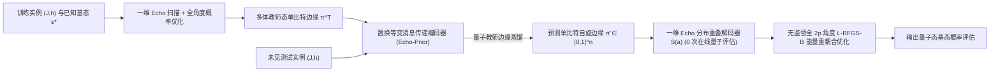

# Echo-QAOA：面向变分量子优化的构造性自旋回波响应设计与逐比特边缘蒸馏

## 摘要

利用量子近似优化算法（QAOA）求解最大权独立集（MWIS）等受约束组合优化问题，需要在由竞争性二次耦合 $J$ 与异构局域外场 $h$ 共同塑造的崎岖 $2p$ 维参数景观中寻优。同质退火轨迹缺乏逐位点相位分辨率且需耗费高昂的在线量子电路选点开销，而直接神经角度回归则因跨分支跳变以及峰值平坦度与坐标稳定性之间的隐函数曲率冲突而崩溃。本文提出 **Echo-QAOA**，利用全局自旋翻转奇偶共轭性在未修改的标准 QAOA 线路拟设内部精确抵消二次耦合 $H_J$，将目标态概率分解为 $O(kn)$ 单比特响应乘积，并构建零量子测量的重叠解码器，从而将病态的角度回归转化为置换等变的边缘蒸馏（**Echo-Prior**）。借助 Daubechies 谱因子分解，我们证明任意阶平顶（Flat-Top）Echo 响应均可由实角度精确实现，具备 $O(\delta^{2k})$ 峰值误差容忍度，且在无零概率区间上严格凸。在 2,750 道五家族基准与 5,120 道跨规模 MWIS 实例上，**Echo-Prior-Flat** 全面超越退火初始化与全部 36 个角度回归模型，在阶段一零量子测量下将高概率解（$P_{\mathrm{gs}}\ge 50\%$）覆盖率提升 $4.9$ 倍。

## 1 引言

量子近似优化算法（QAOA）通过在近期量子处理器上交替执行问题哈密顿量演化 $U_C(\gamma)=e^{-i\gamma H_C}$ 与横向场混合算符 $U_B(\beta)=e^{-i\beta\sum_i X_i}$ 来制备候选量子态 (Blekos et al., 2024; Cerezo et al., 2021; Farhi et al., 2014; Preskill, 2018)。不同于无外场（$h=0$）的最大割问题，最大权独立集（MWIS）等受约束问题在通过惩罚项映射为 Ising 能量 $E(s)=\frac12s^\top Js+h^\top s+C$ 后，会在二次耦合 $J$ 与异构局域外场 $h$ 之间引发剧烈竞争 (Ebadi et al., 2022; Hadfield et al., 2019; Lucas, 2014; Pichler et al., 2018)。由于硬件能量评估与参数移位梯度步均需耗费数千次投影测量 (Harrigan et al., 2021; Mitarai et al., 2018; Pagano et al., 2020; Wierichs et al., 2022)，而非凸耦合又诱导指数级局部陷阱 (Anschuetz & Kiani, 2022; Bittel & Kliesch, 2021; McClean et al., 2018; Shaydulin et al., 2019; You & Wu, 2021)，在标准 QAOA 线路拟设（$|+\rangle^{\otimes n}$ 初态与均匀混合算符 $U_B(\beta)$）内部从 $(J,h)$ 摊销参数初始化是变分量子优化的核心挑战。

现有的初始化方法遵循两大范式：启发式同质轨迹——Trotter 化量子退火（TQA）、逐层插值（INTERP / FOURIER）与参数集中迁移 (Brandao et al., 2018; Crooks, 2018; Farhi et al., 2001; Galda et al., 2021; Kadowaki & Nishimori, 1998; Sack & Serbyn, 2021; Shaydulin et al., 2023; Zhou et al., 2020)——以及利用 MLP、GNN 或生成模型的直接神经角度回归（Neural QAOA）(Amos, 2023; Amosy et al., 2024; Jain et al., 2022; Jiang et al., 2025; Liang et al., 2024; Meng et al., 2025)。**然而**，这两类范式在强异构局域外场 $h$ 下均告失效：同质退火轨迹对所有量子比特施加统一的相位包络，且步长选优需耗费数十次在线量子测量 (Katial et al., 2025)；而直接角度回归则受制于三重病态——（1）_跨分支离散跳变_：除正负号与周期对称简并外 (Lotshaw et al., 2021; Shaydulin et al., 2021)，零概率流形将参数空间分割为多个竞争分支，使最优角度在 $(J,h)$ 跨越分支交叉面时发生不连续跳变 (Gould et al., 2021; Rupprecht et al., 2017; Zhang et al., 2019)；（2）_隐函数曲率冲突_：更平坦的概率峰顶虽能提升对角度误差的容忍度，却反比放大最优角度坐标对实例微扰的隐函数灵敏度（4.1 节）；以及（3）_图池化下的异构性丢失_：将节点嵌入坍缩为全局 $2p$ 维向量会抹去节点到量子比特的局域外场对应关系。

**图 1：Echo-QAOA 一维构造性谱响应设计、逐比特量子教师边缘蒸馏（Echo-Prior）、零量子评估分布重叠解码与全角度能量重耦合优化总览。**

为突破这一瓶颈，本文的核心洞察是：**通过奇偶消耦在标准 QAOA 线路内部开辟具有显式单比特响应与区间凸性的精确直积子流形，并以此为解析桥梁将病态的全局角度回归重构为良态的节点级量子边缘蒸馏**。受自旋回波（Spin Echo）重聚焦启发 (Carr & Purcell, 1954; Hahn, 1950; Viola et al., 1999)，我们利用 $H_J$（偶对称）与 $H_h$（奇对称）在全局自旋翻转 $F=\prod_i X_i$（$\beta=\pi/2$）下的相反奇偶性提出 **Echo-QAOA**：将反对称代价角 $(-g_j,g_j)$ 与一次 $\pi/2$ 翻转配对即可精确抵消 $H_J$，将目标概率分解为 $O(kn)$ 单比特响应。利用与量子信号处理中多项式合成的同构性 (Gilyén et al., 2019; Low & Chuang, 2017; Low et al., 2016)，我们导出 **平顶（Flat-Top）**、**交替相位（Alternating-Phase）** 与 **端点匹配（Endpoint-Matched）** 三种一维配方，其中 Daubechies 谱因子分解保证了 $O(\delta^{2k})$ 误差容忍度与无零点区间严格凸性 (Daubechies, 1988; Herrmann, 1971)。直积分解将 $2^n$ 维分布之间的内积化简为 $n$ 个单比特边缘项之积，从而给出时间复杂度 $O(Mnk)$、**零在线量子评估**的**一维分布重叠解码器**。在此解码器基础上，**Echo-Prior** 利用置换等变消息传递网络 (Gilmer et al., 2017; Karalias & Loukas, 2020; Schuetz et al., 2022; Xu et al., 2019) 从原始 $(J,h)$ 蒸馏多体教师态的单比特正自旋边缘 $\pi_i^{\mathrm T}\in[0,1]$ (Hinton et al., 2015; Wainwright & Jordan, 2008)，将其解码为高容错的平顶起点，并在第二阶段释放全部 $2p$ 个角度以重激活 $H_J$ 多体纠缠（图 1）。本文的主要贡献如下：

1. **Echo 对奇偶消耦与构造性一维配方**：证明完整 Echo 对的精确 $H_J$ 抵消与 $O(kn)$ 概率乘积分解（命题 1–2）；提出平顶、交替相位与端点匹配三种一维配方，通过 Daubechies 谱因子分解证明任意阶平顶响应具备实角度可实现性（命题 3）、$O(\delta^{2k})$ 误差容忍度与无零点区间严格凸性（命题 4），并确立局域场边界与重耦合激活机制（命题 5；第 3 章）。
2. **隐函数诊断、重叠解码器与 Echo-Prior**：证明峰值平坦度与坐标稳定性之间的反向曲率权衡及跨分支跳变；构建零测量一维重叠解码器 $S(a)$ 并提出置换等变逐比特边缘蒸馏（`Echo-Prior-Flat/End/Alt`），实现自旋边缘推断与非凸角度空间的解耦（第 4 章）。
3. **2,750 题基准、36 模型评测与 5,120 题跨规模泛化**：在 2,750 道基准实例上，平顶 Echo 取得最高总体平均概率（$\mathbf{53.07}\%$），在 MWIS 上超越 TQA 达 $+13.52\text{--}+17.03$ pp 且在无截断收敛轨下全规模胜出；在未见 MWIS 实例上，**Echo-Prior-Flat** 在零阶段一测量下取得最高跨深度平均概率（$\mathbf{23.48}\%$），将 $P_{\mathrm{gs}}\ge 50\%$ 覆盖率扩展至 $\mathbf{20.0}\%$（GNN-TQA 的 $4.9$ 倍），击败全部 36 个角度回归模型与一维池化消融基线，并在 $n\in\{6,8,10,12,14\}$（5,120 题）上实现零样本跨规模泛化与 $100\%$ 阶段一抗噪免疫（第 5 章）。

## 2 相关工作

### 2.1 受约束 Ising 变分优化与启发式轨迹初始化

QAOA (Farhi et al., 2014) 将绝热演化 (Farhi et al., 2001; Kadowaki & Nishimori, 1998) 离散化为交替参数化线路 (Blekos et al., 2024; Cerezo et al., 2021; Preskill, 2018)。惩罚项映射 (Lucas, 2014) 与受约束拟设 (Hadfield et al., 2019) 将 MWIS 等 NP-hard 问题转化为超导、囚禁离子与里德堡平台上含竞争耦合 $J$ 与异构外场 $h$ 的 Ising 模型 (Ebadi et al., 2022; Harrigan et al., 2021; Pagano et al., 2020; Pichler et al., 2018)。直接 $2p$ 维角度优化面临贫瘠高原 (McClean et al., 2018)、NP-hard 景观 (Bittel & Kliesch, 2021)、局部陷阱 (Anschuetz & Kiani, 2022; You & Wu, 2021) 与对称简并 (Lotshaw et al., 2021; Shaydulin et al., 2021)，使配合 $O(p)$ 参数移位梯度 (Mitarai et al., 2018; Wierichs et al., 2022) 的多起点拟牛顿搜索 (Byrd et al., 1995; Shaydulin et al., 2019) 开销高昂。启发式轨迹——插值/傅里叶基 (Crooks, 2018; Zhou et al., 2020)、反绝热驱动 (Wurtz & Love, 2022; Yang et al., 2017)、TQA (Sack & Serbyn, 2021) 与参数迁移 (Brandao et al., 2018; Galda et al., 2021; Shaydulin et al., 2023)——施加均匀相位包络，在异构外场 $h$ 下失效 (Katial et al., 2025)。Warm-Start QAOA (Egger et al., 2021; Tate et al., 2023)、ma-QAOA (Herrman et al., 2022) 与 RQAOA (Bravyi et al., 2020) 等修改拟设的变体改变了初态或混合算符 $U_B(\beta)$，丧失了原生全局脉冲兼容性。本文严格保持未修改的标准 QAOA 拟设，在重耦合全部 $2p$ 个角度之前在线路内部开辟精确的一维直积子流形 (Dupont et al., 2022)。

### 2.2 自旋回波、量子信号处理与 Daubechies 小波谱因子分解

反转线性相位演化的中间 $\pi$ 翻转脉冲是核磁共振自旋回波 (Carr & Purcell, 1954; Hahn, 1950)、动力学解耦 (Viola et al., 1999) 与复合脉冲 (Vandersypen & Chuang, 2005) 的基础。在标准 QAOA 中，$\beta=\pi/2$ 在全局相位意义下实现全局自旋翻转 $F=\prod_i X_i$；将反对称代价角 $(-g_j,g_j)$ 与 $\beta=\pi/2$ 配对可在抵消偶对称 $H_J$ 的同时加倍奇对称 $H_h$。在解耦后的单比特子空间内，合成偶层混合角 $(\theta_1,\ldots,\theta_k)$ 与 QSP 及 QSVT 中的多项式谱合成同构 (Gilyén et al., 2019; Low & Chuang, 2017; Low et al., 2016)。我们引入最大平坦滤波器与 Daubechies 功率互补谱因子分解 (Daubechies, 1988; Herrmann, 1971)，将双通道正交格型消元嵌入完整 Echo 对，以保证实角度可实现性、$O(\delta^{2k})$ 平坦度与区间严格凸性。

### 2.3 摊销隐函数权衡与逐比特边缘蒸馏

面向未知目标态的在线初始化研究已从循环 L2O 控制器 (Verdon et al., 2019) 转向利用 MLP、GNN 或扩散模型的直接角度预测 (Amosy et al., 2024; Jain et al., 2022; Jiang et al., 2025; Liang et al., 2024; Meng et al., 2025)。由摊销优化中的隐函数微分可知 (Amos, 2023; Gould et al., 2021)，降低峰顶曲率以换取误差容忍度会反比放大坐标对实例微扰的灵敏度，而零概率流形则触发跨分支跳变；即便采用集合损失 (Rupprecht et al., 2017; Zhang et al., 2019)，全局图池化 (Xu et al., 2019) 仍会抹去节点级外场偏置。受图模型边缘推断 (Wainwright & Jordan, 2008) 与等变图求解器 (Gilmer et al., 2017; Karalias & Loukas, 2020; Loshchilov & Hutter, 2019; Schuetz et al., 2022) 启发，我们将 Echo-QAOA 的重叠解码器与置换等变 **Echo-Prior** 网络的知识蒸馏 (Hinton et al., 2015) 相结合，彻底绕过角度跳变。

## 3 Echo-QAOA：算符消耦与一维构造性响应理论

### 3.1 带局域外场的 Ising 线路约定与完整 Echo 对精确消耦

考虑 $s\in\{-1,+1\}^n$ 上的 $n$ 自旋 Ising 能量 $E(s)=\frac12s^\top Js+h^\top s+C$，其中 $J\in\mathbb R^{n\times n}$ 为零对角对称耦合矩阵，$h\in\mathbb R^n$ 为外场，$C\in\mathbb R$ 为常数偏移。将自旋提升为计算基算符可得 $H_C=H_J+H_h+C$，其中 $H_J|s\rangle=(\frac12s^\top Js)|s\rangle$，$H_h|s\rangle=(h^\top s)|s\rangle$（$C$ 仅贡献全局相位）。在代价算符 $U_C(\gamma)=e^{-i\gamma H_C}$、混合算符 $U_B(\beta)=e^{-i\beta\sum_{i=1}^n X_i}$ 的深度 $p$ QAOA 线路中 (Farhi et al., 2014)，从 $|+\rangle^{\otimes n}$ 出发可制备 $|\psi_p(\vartheta;J,h)\rangle=U_B(\beta_p)U_C(\gamma_p)\cdots U_B(\beta_1)U_C(\gamma_1)|+\rangle^{\otimes n}$，其中 $\vartheta=(\gamma_1,\ldots,\gamma_p,\beta_1,\ldots,\beta_p)$ 满足 $|\gamma_\ell|\le G, |\beta_\ell|\le\pi/2$。

尽管 $H_J$ 会产生复杂的多体干涉 (Bravyi et al., 2020; Herrman et al., 2022)，用**全局自旋翻转算符** $F=\prod_{i=1}^n X_i$（$s\mapsto -s$）对 $H_J$ 与 $H_h$ 作共轭变换却揭示了相反的奇偶性：$FH_JF=H_J$，$FH_hF=-H_h$，且 $U_B(\pi/2)=(-i)^nF$。受自旋回波重聚焦启发 (Carr & Purcell, 1954; Hahn, 1950; Vandersypen & Chuang, 2005; Viola et al., 1999)，对正偶数深度 $p=2k$（$k\ge 1$），我们将相邻两层组合为第 $j$ 个**完整 Echo 对**（$j=1,\ldots,k$），取 $(\gamma_{2j-1},\gamma_{2j})=(-g_j,g_j)$ 且 $(\beta_{2j-1},\beta_{2j})=(\pi/2,\theta_j)$。

**命题 1（完整 Echo 对消耦）。** _忽略全局相位，第 $j$ 个完整 Echo 对的复合幺正演化算符 $E(g_j,\theta_j):=U_B(\theta_j)U_C(g_j)U_B(\pi/2)U_C(-g_j)$ 恒满足 $E(g_j,\theta_j)=U_B(\theta_j)e^{-2ig_jH_h}F$。_

**证明概要。** 利用 $U_B(\pi/2)\propto F$、$F^2=I$、$F(H_J+H_h+C)F=H_J-H_h+C$ 以及对易关系 $[H_C,FH_CF]=0$，无需弱耦合近似即可在全部 $k$ 对上精确抵消 $H_J$ 与 $C$ 并加倍 $-ig_jH_h$，使从 $|+\rangle^{\otimes n}$ 出发的演化严格保持直积态结构（附录 A.1）。$\square$

### 3.2 单比特幅值递推、概率乘积分解与一维参数族

由命题 1，$2^n$ 维演化退化为 $n$ 个解耦的二维递推。在计算基 $(|s_i=-1\rangle,|s_i=+1\rangle)$ 下，以 $u_i^{(0)}=\frac{1}{\sqrt{2}}\binom{1}{1}$ 为初态、$M(\theta)=\binom{\cos\theta\ \ -i\sin\theta}{-i\sin\theta\ \ \cos\theta}$ 为单比特混合矩阵，状态 $u_i^{(j)}=\big(u_{i,-}^{(j)}, u_{i,+}^{(j)}\big)^\top$ 经自旋交换 $X_i$、局域场相位 $e^{\pm 2ig_jh_i}$ 与混合旋转 $M(\theta_j)$ 按 $\binom{u_{i,-}^{(j)}}{u_{i,+}^{(j)}}=M(\theta_j)\binom{e^{2ig_jh_i}u_{i,+}^{(j-1)}}{e^{-2ig_jh_i}u_{i,-}^{(j-1)}}$（$j=1,\ldots,k$）更新，给出最终磁化 $m_i=|u_{i,+}^{(k)}|^2-|u_{i,-}^{(k)}|^2\in[-1,1]$。

**命题 2（概率乘积分解）。** _在由 $k$ 个完整 Echo 对构成的深度 $p=2k$ 线路下，任意目标自旋配置 $s^\star\in\{-1,+1\}^n$ 的测量概率分解为 $P(s^\star)=\prod_{i=1}^n\frac{1+s_i^\star m_i}{2}$。_

**证明概要。** 直积态保持性质使各比特测量相互独立，单比特边缘概率为 $|u_{i,s_i^\star}^{(k)}|^2=(1+s_i^\star m_i)/2$（附录 A.1），将单次评估复杂度从 $O(pn2^n)$ 降至 $O(kn)$ 时间与 $O(1)$ 空间。$\square$

对偶数深度 $p=2k$ 与配方 $v$，固定代价比例 $(r_1,\ldots,r_k)$ 与偶层混合角 $(\theta_1,\ldots,\theta_k)$ 可通过单一标量 $a$（$g_j=r_ja$）及仿射嵌入 $D_{v,k}(a)=(-r_1a,r_1a,\ldots,-r_ka,r_ka,\tfrac\pi2,\theta_1,\ldots,\tfrac\pi2,\theta_k)$ 驱动全部代价幅值（$a\in\mathcal A_{v,k}=[-G/\max_j|r_j|,G/\max_j|r_j|]$），此时 $m_i(a)$ 仅依赖于 $\phi_i=4ah_i$ 与 $(r_j,\theta_j)_{j=1}^k$。

**表 1：三种构造性 Echo 配方（$p=2k, k\ge 2$，其中 $\phi=4ah, t=\sin\phi$）的参数设计、单比特响应与理论性质对比。**

| 配方名称                                | 代价比例 $r_j$ 与偶层混合角 $\theta_j$                        | 磁化响应 $m_k(t)$ 与定义域 $\mathcal A_{v,k}$               | 核心代数与解析性质                                                                         |
| :-------------------------------------- | :------------------------------------------------------------ | :---------------------------------------------------------- | :----------------------------------------------------------------------------------------- |
| **平顶 Echo** (`Echo-Flat`)             | $r=(1,2,\ldots,2)$；$\theta_j$ 由 Daubechies 谱因子消元提取   | $2I_{(1+t)/2}(k,k)-1$，$a\in[-\frac{G}{2},\frac{G}{2}]$     | 在 $t=\pm 1$ 处一至 $k-1$ 阶导数为零，具 $O(\delta^{2k})$ 误差容忍度；无零点区间上严格凸   |
| **交替相位 Echo** (`Echo-Alt`)          | $r_j=(-1)^{k-j}$；$\theta_j=0\ (j<k)$，$\theta_k=\pi/4$       | $\sin(k\phi)$，$a\in[-G,G]$                                 | 饱和零中间混合角子族的累积相位上界 $kG$，将相位扫描频率扩展 $k$ 倍                         |
| **端点匹配 Echo** (`Echo-End`)          | $r=(1,2,\ldots,2)$；$\theta_j=(-1)^{k-j}B\ (j<k)$，$\theta_k=B/2$ | $\sin[(2k-1)\arcsin(ut)]$，$a\in[-\frac{G}{2},\frac{G}{2}]$ | 平衡正相位通带 $[\tau,1]$ 两端响应 $m_k(\tau)=m_k(1)$，提供条件性解析概率下界              |

### 3.3 平顶 Echo：高阶平坦响应与谱因子可实现性

由于各位点局域外场 $h_i$ 通常彼此不可公度，单一标量 $a$ 无法使所有比特同时对齐在 $\sin(4ah_i)=s_i^\star$。**平顶 Echo** 采用二倍比例 $r=(1,2,\ldots,2)$（$k\ge 2$ 时 $a\in[-G/2,G/2]$），通过归一化对称 Beta 积分 $m_k(t)=\int_0^t(1-z^2)^{k-1}\,dz/\int_0^1(1-z^2)^{k-1}\,dz$ 对基础谐波 $t=\sin(4ah)\in[-1,1]$ 上的单比特磁化进行成形；对 $q=(1+t)/2\in[0,1]$，其成功因子为 $p_k(q)=(1+m_k(2q-1))/2=I_q(k,k)$ 并满足 $p_k(q)+p_k(1-q)=1$（例如 $m_2(t)=(3t-t^3)/2$、$m_3(t)=(15t-10t^3+3t^5)/8$；附录 A.2）。此处 $m_k(t)$ 为 $2k-1$ 次奇多项式，满足 $m_k(\pm 1)=\pm 1$ 且在 $t=\pm 1$ 处的一至 $k-1$ 阶导数全部消失。

**命题 3（任意阶平顶响应的构造性可实现性）。** _对任意整数 $k\ge 1$，存在实角度 $\theta_1,\ldots,\theta_k\in[-\pi/2,\pi/2)$，使得采用代价比例 $g=(a,2a,\ldots,2a)$ 的 $k$ 对完整 Echo 线路精确产生单比特磁化响应 $m_k(\sin(4ah))$。_

**构造与证明概要。** 令 $\omega=4ah-\pi/2$ 与 $z=e^{i\omega}$（$q=\cos^2(\omega/2)$），Daubechies 功率互补谱因子分解 (Daubechies, 1988; Herrmann, 1971) 给出实最小相位多项式 $H_k(z)=\sum_{r=0}^{2k-1}c_rz^r$，满足 $|H_k(e^{i\omega})|^2/2=p_k(\cos^2(\omega/2))$ 与 $|H_k(z)|^2+|H_k(-z)|^2=2$。将 $H_j(z)$ 与 $H_j^\#(z)=z^{2j-1}H_j(-z^{-1})$ 配对，从 $j=k$ 至 $1$ 执行双通道正交格型消元可在每步同时消去常数项与一次项（可被 $e^{2i\phi}=-z^2$ 整除），提取出唯一实角度 $\theta_j\in[-\pi/2,\pi/2)$，其逆向递推与 3.2 节完全同构（附录 A.2）。$\square$

在峰顶对齐点 $s_i^\star\sin(4a_0h_i)=1$ 附近，微扰 $a=a_0+\delta$ 给出 $1-s_i^\star\sin(4h_i(a_0+\delta))=8h_i^2\delta^2+O(\delta^4)$。由于 $1-m_k(1-\varepsilon)=O(\varepsilon^k)$，单比特概率损失被抑制至 $O(\delta^{2k})$ 阶，从而拓宽了不可公度外场下各比特的高概率重叠窗口。

### 3.4 平顶目标在无零概率区间上的严格凸性

对目标配置 $s^\star$，令 $w_i=4h_is_i^\star$ 并定义包裹相位偏差 $e_i(a)=\operatorname{wrap}_{(-\pi,\pi]}(aw_i-\pi/2)$。平顶 Echo 的负对数概率损失分解为逐比特相位损失之和 $\mathcal L_k(a;x)=-\log P_{D_{\mathrm{flat},k}(a)}(s^\star)=\sum_{i=1}^n \ell_k(e_i(a))$，其中 $\ell_k(e):=-\log p_k((1+\cos e)/2)$。

**命题 4（无零概率区间上的严格凸性）。** _单比特相位损失 $\ell_k(e)$ 在 $(-\pi,\pi)$ 上严格凸。对任意至少含一个非零局域场（$h_i\ne 0$）的实例，全局损失 $\mathcal L_k(a;x)$ 在每个不含零概率奇点的标量开区间上关于 $a$ 严格凸，每个区间至多存在一个驻点（即唯一局部极小值点）。_

**证明概要。** 对 $e\in[0,\pi)$ 将 $p_k((1+\cos e)/2)$ 表为 $\int_e^\pi\sin^{2k-1}v\,dv/\int_0^\pi\sin^{2k-1}v\,dv$，核函数 $\sin^{2k-1}v$ 在 $(0,\pi)$ 上的严格对数凹性意味着 Mills 尾积分比值 $R(e)$ 严格递减，使 $\ell_k'(e)=1/R(e)$ 在 $(-\pi,\pi)$ 上严格递增。在避开零概率断点 $a=(-\pi/2+2\pi z)/w_i$（$z\in\mathbb Z, w_i\ne 0$）的任意开区间内，每个 $e_i(a)$ 关于 $a$ 严格仿射，求和后仍保持严格凸性（附录 A.3）。$\square$

### 3.5 交替相位 Echo：累积有效相位扩展

为在 $|g_j|\le G$ 下最大化累积相位范围，**交替相位 Echo**（$k\ge 2$）取 $g_j=(-1)^{k-j}a$、$\theta_j=0$（$j<k$）及 $\theta_k=\pi/4$。由于中间翻转 $F$ 会反转已累积的局域场相位（$A_j=g_j-A_{j-1}$），交替符号实现相长累加以达到 $A_k=ka$，饱和子族上界 $|A_k|\le\sum_{j=1}^k|g_j|\le kG$ 并给出 $m_i(a)=\sin(4kah_i)$（附录 A.1）。

### 3.6 端点匹配 Echo：正相位通带平衡与配方对比

为兼顾平坦度与振荡性，**端点匹配 Echo**（$k\ge 2$）保留 $g=(a,2a,\ldots,2a)$（$a\in[-G/2,G/2]$）并采用交替混合角 $\theta_j=(-1)^{k-j}B$（$j<k$）与 $\theta_k=B/2$。以 $L=2k-1$、$u=\sin B$ 及 $t=\sin(4ah)$ 将相邻对归并为共轴 Bloch 旋转 (Low et al., 2016; Vandersypen & Chuang, 2005)（附录 A.4）可得 $m_k(t)=\sin[L\arcsin(ut)]$。对通带阈值 $\tau\in(0,1)$，取 $u=\sin(\pi/L)/\sqrt{1+2\tau\cos(\pi/L)+\tau^2}$ 与 $B=\arcsin u$ 可强制 $m_k(\tau)=m_k(1)$，在所有 $t_i=s_i^\star\sin(4ah_i)\in[\tau,1]$ 时保证 $P_{D_{\mathrm{end},k}(a)}(s^\star)\ge[(1+m_k(\tau))/2]^n$（表 1）。

### 3.7 受限直积演化的理论边界与重耦合动机

由于完整 Echo 对精确抵消了 $H_J$，阶段一演化完全由 $H_h$ 驱动，这确立了阶段二全角度重耦合的结构性动机。

**命题 5（受限 Echo 演化的局域场驱动边界与乘积衰减）。** _在深度 $p=2k$ 的受限 Echo 线路 $D_{v,k}(a)$ 下，目标概率满足：_
_（1）**零场上限**：若 $n_0$ 个量子比特满足 $h_i=0$，则对所有 $a$ 恒有 $P_{D_{v,k}(a)}(s^\star)\le 2^{-n_0}$（$h=0$ 时退化为 $2^{-n}$）；_
_（2）**维数衰减界**：若在标量 $a$ 处有 $q$ 个比特满足 $s_i^\star m_i(a)\le\eta<1$，则 $P_{D_{v,k}(a)}(s^\star)\le\big(\frac{1+\eta}{2}\big)^q$。_

**证明概要。** $h_i=0$ 的比特在 $|+\rangle$ 上仅积累平凡相位，使 $m_i(a)=0$ 并在命题 2 中贡献固定因子 $1/2$；满足 $s_i^\star m_i(a)\le\eta$ 的比特各自贡献 $\le(1+\eta)/2$（附录 A.1）。$\square$

为突破直积态以解决零场位点与受挫耦合，将第 $j$ 对代价角沿对称破缺方向微扰为 $(-g_j+\delta_j, g_j+\delta_j)$ 可得 $U_B(\theta_j)e^{-2i\delta_j H_J}e^{-2ig_j H_h}F$（附录 A.1），从而沿 $\delta_j=(\gamma_{2j-1}+\gamma_{2j})/2$ 以非零一阶梯度线性重激活 $H_J$。这确立了 Echo-QAOA 的**两阶段分工原则** (Dupont et al., 2022; Wurtz & Love, 2022; Yang et al., 2017)：阶段一在 $O(kn)$ 经典时间内于一维 Echo 流形上锚定外场对齐起点；阶段二释放全部 $2p$ 个角度以恢复多体纠缠。

### 3.8 一维区间导数求根与两阶段优化策略

在已知 $s^\star$ 的离线教师采集中（附录 B.1），阶段一通过以下方式定位一维候选点：（1）平顶 Echo 在每个无零点凸区间内对 $\mathcal L_k'(a;x)$ 执行确定性二分求根（命题 4）；（2）振荡配方执行 $O(kn)$ 网格寻峰与黄金分割精修；以及（3）间距去重后送入阶段二 L-BFGS-B 精修。

## 4 基于分布重叠解码的逐比特边缘蒸馏初始化

### 4.1 参数空间的局部灵敏度权衡与跨分支跳变

为设计从 $x=(J,h)$ 到 $\vartheta^\star(x)$ 的跨实例生成器 (Amos, 2023; Verdon et al., 2019)，设 $a_b^\star(x)\in I_b(x)$ 为无零点平顶分支 $I_b(x)$ 上的唯一内部驻点（$\partial_a\mathcal L_k(a_b^\star(x);x)=0$），满足曲率下界 $\partial_{aa}\mathcal L_k\ge\mu>0$ 与 $\|\partial_{ax}\mathcal L_k\|\le M$。由隐函数定理 (Amos, 2023; Gould et al., 2021)，标签灵敏度满足 $\nabla_xa_b^\star(x)=-(\partial_{aa}\mathcal L_k(a_b^\star;x))^{-1}\partial_{ax}\mathcal L_k(a_b^\star;x)$（上界为 $M/\mu$），而在预测误差 $\delta=\widehat a-a_b^\star$ 下损失增量为 $\Delta\mathcal L_k(\delta;x)=\frac12\mathcal L_k''(a_b^\star;x)\delta^2+o(\delta^2)$。这揭示了内禀的**曲率冲突**：减小曲率 $\mathcal L_k''(a_b^\star;x)$ 可展平峰顶以容忍更大误差 $\delta$（理想对齐 $\mathcal L_k''=0$ 时达 $O(\delta^{2k})$），但会反比放大坐标对实例微扰的灵敏度上界 $M/\mu$。全局上，零概率断点将 $\mathcal A_{v,k}$ 分割为竞争分支 $\{I_b(x)\}$；每当两个分支随 $x$ 变化发生损失交叉时，全局极小点 $a^\star(x)=a_{b^\star(x)}^\star(x)$ 即发生不连续跳变，而符号与周期对称性又使 MSE 回归坍缩向零角度谷底（附录 A.3）。因此，我们先在状态空间推断唯一、平滑的**单比特正自旋边缘先验** $\boldsymbol{\pi}=(\pi_1,\ldots,\pi_n)\in[0,1]^n$，再将其解析投射至 Echo 流形。

### 4.2 一维分布重叠解码与全角度能量重耦合

给定定义代理乘积分布 $P_{\pi}(s)=\prod_{i=1}^n\pi_i^{\mathbf1[s_i=+1]}(1-\pi_i)^{\mathbf1[s_i=-1]}$ 的估计边缘先验 $\boldsymbol{\pi}\in[0,1]^n$，命题 2 保证标量 $a$ 处的受限 Echo 分布 $Q_a(s)$ 同样是 $+1$ 边缘为 $q_i(a)=(1+m_i(a))/2$ 的严格乘积分布。因此，$2^n$ 维**分布重叠度** $S(a)=\sum_{s\in\{-1,+1\}^n}P_{\pi}(s)Q_a(s)=\prod_{i=1}^n[\pi_iq_i(a)+(1-\pi_i)(1-q_i(a))]$ 精确分解为 $n$ 个单比特项之积。在 $M$ 点均匀网格 $\mathcal A_M\subset\mathcal A_{v,k}$ 上评估 $S(a)$ 可在 $O(Mnk)$ 经典时间、**严格零次阶段一在线量子评估**下选出 $\widehat a=\arg\max_{a\in\mathcal A_M}S(a)$ 并展开为 $\vartheta_0=D_{v,k}(\widehat a)$。阶段二随后通过盒约束 L-BFGS-B (Byrd et al., 1995) 最小化无监督量子能量 $\min_{\vartheta}\langle\psi_p(\vartheta;J,h)|\frac12s^\top Js+h^\top s|\psi_p(\vartheta;J,h)\rangle$，驱动全部 $2p$ 个角度偏离反对称流形，在标准 QAOA 拟设内重激活 $H_J$（附录 B.1, D.2）。

### 4.3 离线概率教师与对称感知的多分支角度集合监督

在训练集（已知唯一 $s^\star$）上，我们运行三种 Echo 配方与三种基线（RI、TQA、INTERP）构建六类离线教师。保留达到各池峰值概率 $\alpha_{\mathrm{prob}}\in(0,1)$ 倍以上的候选解后，我们通过**归一化对称等价距离** $d^2(\vartheta,\vartheta')=\min_{\sigma\in\{\pm 1\}}\frac{1}{2p}\sum_{\ell=1}^p\big[(\frac{\gamma_\ell-\sigma\gamma'_\ell}{G})^2+(\frac{\operatorname{wrap}_{\pi}(\beta_\ell-\sigma\beta'_\ell)}{\pi/2})^2\big]$ 消除符号反演（$\vartheta\mapsto -\vartheta$）与混合角 $\pi$ 周期简并 (Lotshaw et al., 2021; Shaydulin et al., 2021)。以间距阈值 $d^2>\delta_{\mathrm{sep}}^2$ 贪心筛选可为每道实例 $q$ 提取至多 $R$ 条分离分支 $\mathcal T_q=\{\vartheta_{qr}^{\mathrm T}\}_{r=1}^{R_q}$。全角度回归基线（MLP 与 GNN）(Amosy et al., 2024; Jain et al., 2022; Liang et al., 2024) 最小化集合损失 $\mathcal L_q=\min_{\vartheta^{\mathrm T}\in\mathcal T_q}d^2(\widehat\vartheta_q,\vartheta^{\mathrm T})$ (Rupprecht et al., 2017; Zhang et al., 2019)。

### 4.4 置换等变逐比特量子教师边缘学习（Echo-Prior）

为在蒸馏多体纠缠偏置的同时绕过角度空间不连续性，**Echo-Prior** 从最优教师态 $\vartheta^{\mathrm T}\in\mathcal T_q$ 中提取单比特正自旋边缘 $\pi_i^{\mathrm T}=\sum_{s}|\langle s|\psi_p(\vartheta^{\mathrm T};J,h)\rangle|^2\mathbf1[s_i=+1]\in[0,1]$ (Hinton et al., 2015)。编码器仅接收标准化后的原始系数 $(\tilde J,\tilde h)$，嵌入 $\boldsymbol z_i^{(0)}=\phi_{\mathrm{node}}(\tilde h_i)\in\mathbb R^W$ 并沿非零边 $M_{ij}=\mathbf1[J_{ij}\ne 0]$ 执行 $L$ 轮消息传递 (Gilmer et al., 2017; Xu et al., 2019)：$\boldsymbol a_i^{(\ell)}=\frac{1}{Z_{\mathrm{agg}}}\sum_{j=1}^n M_{ij}\,\phi_{\mathrm{msg}}^{(\ell)}(\boldsymbol z_i^{(\ell-1)},\boldsymbol z_j^{(\ell-1)},\tilde J_{ij})$ 与 $\boldsymbol z_i^{(\ell)}=\boldsymbol z_i^{(\ell-1)}+\phi_{\mathrm{upd}}^{(\ell)}(\boldsymbol z_i^{(\ell-1)},\boldsymbol a_i^{(\ell)})$（固定尺度 $Z_{\mathrm{agg}}$），最终输出 $\widehat\pi_i=\operatorname{sigmoid}(\phi_{\mathrm{head}}(\boldsymbol z_i^{(L)}))$ (Karalias & Loukas, 2020; Schuetz et al., 2022)。共享边/点参数与拓扑聚合保证了严格的**置换等变性**。我们最小化逐比特二元交叉熵 $\mathcal L_{\mathrm{BCE}}=-\frac{1}{|B|n}\sum_{q\in B,i}[\pi_{qi}^{\mathrm T}\log\widehat\pi_{qi}+(1-\pi_{qi}^{\mathrm T})\log(1-\widehat\pi_{qi})]$，并通过 $S(a)$ 解码 $\widehat{\boldsymbol{\pi}}$（**Echo-Prior-Flat/End/Alt**）后接全角度 L-BFGS-B 精修（附录 B.3）。

## 5 实验

### 5.1 实验设置与评价协议

**五家族离线基准测试。** 我们评测五个问题家族——完全图 `Dense Ising`、含哈密顿环的 `Sparse Ising`、二维晶格 `Grid Ising`、单自旋钉扎 `Pinned MaxCut` 以及具异构正外场 $h_i>0$ 的受约束 `MWIS`（生成协议与唯一性验证见附录 C）——在 $n\in\{6,\ldots,16\}$ 上每规模每家族各含 50 道唯一基态实例（共 2,750 题）。在 $p\in\{6,8,10,12,14\}$ 上，我们在每任务 30.0 秒墙钟上限与无截断自然收敛（$n\in\{6,8,10,12,14\}$，每规模 1,024 题，$p=10$）下对比 `Echo-Flat`、`Echo-Alt`、`Echo-End`、`RI`、`TQA` 与 `INTERP`。

**MWIS 在线初始化、跨规模迁移与有限采样鲁棒性。** 以 $n=10$ 为中心（4,096 训练 / 512 验证 / 1,024 测试实例，跨 $p\in\{8,10,12\}$ 共享）并扩展至 $n\in\{6,8,12,14\}$ 四个跨规模测试集（每规模 1,024 题，共 5,120 道测试题），我们对比 `Echo-Prior-Flat/End/Alt`（$M=128$，$Z_{\mathrm{agg}}=9$，$0$ 次阶段一评估）、36 个全角度回归模型（6 教师 $\times$ 2 骨干 `GNN/MLP` $\times$ 3 深度）、一维池化消融基线（`Echo-GNN-Scalar/Grid`）以及在线启发式方法（耗费 32 次评估的 `TQA` 与 `RI (32)`，及 `RI (1)`），同时在 $n=10, p=10$ 下执行有限采样测试 $N_{\mathrm{shots}}\in\{16,\ldots,4096\}$。全部实验固定 `seed = 0`，在线 L-BFGS-B 最小化期间隐去 $s^\star$，经双独立引擎核验真实 $P_{\mathrm{gs}}$，并报告 4,000 次重采样 bootstrap 95% 置信区间（附录 B.2–B.4）。

### 5.2 已知目标态的离线概率优化

**图 2：五家族基准（2,750 道实例，$n=6\ldots 16, p\in\{6,8,10,12,14\}$）上的构造性初始化与概率优化对比。** （a）五个深度及全部 2,750 道实例上的总体基态概率小提琴分布、四分位距与均值标记；（b）随深度 $p=6\ldots 14$ 演化的平均基态概率扩展曲线（带 95% CI）；（c）五个家族上三种 Echo 配方相对于 TQA 的按题配对概率差（单位：pp，每家族 550 题）。

**表 2：五家族基准各问题家族及总体平均基态概率（每家族 550 题，共 2,750 题；单位：%）。上下标表示 95% bootstrap 置信区间偏移（pp）；每行最高值加粗标出。**

| 问题家族                 |           `Echo-Flat`            |            `Echo-Alt`            |       `Echo-End`        |           RI            |               TQA                |         INTERP          |
| :----------------------- | :------------------------------: | :------------------------------: | :---------------------: | :---------------------: | :------------------------------: | :---------------------: |
| Dense Ising              |     $56.17^{+2.39}_{-2.57}$      |     $51.27^{+2.59}_{-2.73}$      | $48.57^{+2.50}_{-2.58}$ | $20.16^{+1.78}_{-1.75}$ | $\mathbf{60.18}^{+1.83}_{-1.88}$ | $30.36^{+2.42}_{-2.43}$ |
| Sparse Ising             |     $60.16^{+2.34}_{-2.45}$      |     $54.84^{+2.49}_{-2.68}$      | $53.02^{+2.44}_{-2.57}$ | $25.19^{+2.01}_{-2.05}$ | $\mathbf{62.33}^{+1.82}_{-1.90}$ | $30.84^{+2.39}_{-2.47}$ |
| Grid Ising               |     $60.64^{+2.37}_{-2.44}$      |     $54.73^{+2.57}_{-2.60}$      | $53.74^{+2.50}_{-2.58}$ | $30.30^{+2.36}_{-2.38}$ | $\mathbf{62.69}^{+1.95}_{-1.91}$ | $33.82^{+2.51}_{-2.54}$ |
| MWIS                     |     $49.34^{+2.85}_{-2.93}$      | $\mathbf{50.09}^{+2.62}_{-2.75}$ | $46.59^{+2.63}_{-2.73}$ | $35.32^{+2.60}_{-2.65}$ |     $33.07^{+1.77}_{-1.79}$      | $31.64^{+2.36}_{-2.52}$ |
| Pinned MaxCut            |     $39.06^{+2.21}_{-2.22}$      |     $32.63^{+2.21}_{-2.21}$      | $32.94^{+2.09}_{-2.08}$ | $20.70^{+1.80}_{-1.79}$ | $\mathbf{45.39}^{+1.95}_{-1.85}$ | $23.91^{+2.10}_{-2.12}$ |
| **总体均值（2,750 题）** | $\mathbf{53.07}^{+1.15}_{-1.18}$ |     $48.71^{+1.20}_{-1.20}$      | $46.97^{+1.14}_{-1.17}$ | $26.33^{+1.01}_{-0.98}$ |     $52.73^{+0.93}_{-0.95}$      | $30.11^{+1.07}_{-1.11}$ |

图 2 与表 2 汇总了 2,750 道基准测试结果。**平顶 Echo**（`Echo-Flat`）取得 $\mathbf{53.07}\%$ 的最高总体平均基态概率，超越 `TQA`（$52.73\%$）、`Echo-Alt`（$48.71\%$）、`Echo-End`（$46.97\%$）、`INTERP`（$30.11\%$）与 `RI`（$26.33\%$），在三类物理机制下印证了第 3 章的理论：

1. **异构受约束 `MWIS` 上的统治级优势与全规模无截断收敛胜利**：在惩罚项诱导强异构正外场（$h_i=Qd_i/4-v_i/2>0$）的 MWIS 上，同质 `TQA`（$33.07\%$）与 `INTERP`（$31.64\%$）劣于随机 `RI`（$35.32\%$）。通过抵消 $H_J$（命题 1）并成形单比特响应，我们的 Echo 配方达到 $\mathbf{50.09}\%$（`Echo-Alt`，较 `TQA` 配对净赢 $+17.03$ pp，$[+15.42, +18.60]$）、$49.34\%$（`Echo-Flat`，$+16.27$ pp）与 $46.59\%$（`Echo-End`，$+13.52$ pp）。在 $n\in\{6,8,10,12,14\}$（$p=10$）无截断收敛下，单起点 `Echo-Flat (Top-1)` 取得 $\mathbf{94.37}\%, \mathbf{77.25}\%, \mathbf{53.08}\%, \mathbf{29.64}\%$ 与 $\mathbf{17.47}\%$，在全部规模上击败 `TQA (Top-1)`（$59.88\%\text{--}17.23\%$），净赢 $+34.49, +33.63, +21.56, +6.19$ 与 $+0.24$ pp（命题 3–4）。
2. **均衡 Ising 家族与深度扩展**：在 `Dense`、`Sparse` 与 `Grid Ising` 上，`Echo-Flat` 在 $n=6\ldots 11$ 每个规模上均居总体第一（$\mathbf{93.41}\%\text{--}\mathbf{51.27}\%$；表 D.1），并在 $p=6,8,10,12$ 四个深度上包揽第一（从 $\mathbf{37.95}\%$ 单调升至 $\mathbf{60.89}\%$ 及 $p=14$ 的 $63.62\%$，而 `INTERP` 与 `RI` 退化至 $24.16\%$ 与 $24.13\%$；图 2b，表 D.2）；仅在 $n\ge 12$ 的 30 秒上限下，$2^n$ 模拟开销使无需扫描的 `TQA` 略占优。
3. **印证命题 5 的内部零场 `Pinned MaxCut`**：由于非零外场仅限于钉扎点 $s_0=+1$ 的邻居，阶段一 Echo 受制于内部零场界 $2^{-n_0}$，使含全局耦合的 `TQA` 占优（$\mathbf{45.39}\%$）；然而 `Echo-Flat` 通过在阶段一锁定边界外场并在阶段二重激活内部 $H_J$（3.7 节），仍达到 $39.06\%$（领先 `INTERP` 与 `RI` 逾 $15$ pp）。

### 5.3 未知目标态的在线神经初始化与零样本跨规模泛化

**图 3：未见 MWIS 测试实例（$n=10$，1,024 题）上逐比特量子教师蒸馏（Echo-Prior）与全角度回归模型的对比。** （a）跨深度初始（空心圆）与 L-BFGS-B 优化后最终基态概率（实心圆）的哑铃图，标注能量重耦合净增益（pp）；（b）随 $p=8,10,12$ 演化的最终平均概率曲线；（c）跨深度平均最终概率的经验累积分布函数（ECDF）与高概率覆盖率（$P_{\mathrm{gs}}\ge 50\%$）；（d）Echo-Prior-Flat 相对于 MLP-TQA 与 GNN-TQA 的按题配对净增益小提琴分布。

**表 3：MWIS 测试集（$n=10$，1,024 题）上逐比特边缘蒸馏（Echo-Prior）、完整 $2p$ 角度回归（GNN、MLP）与在线启发式基线的初始 $\rightarrow$ 能量优化后平均基态概率（%）。最优值加粗标出。**

| 范式与骨干架构                      | 模型名称            | 监督教师与解码机制                           | 阶段一评估   |                      $p = 8$                      |                     $p = 10$                      |                     $p = 12$                      | 跨深度均值         |
| :---------------------------------- | :------------------ | :------------------------------------------- | :----------: | :-----------------------------------------------: | :-----------------------------------------------: | :-----------------------------------------------: | :----------------: |
| **逐比特 Echo 蒸馏** _(本文)_       | **Echo-Prior-Flat** | 平顶教师边缘 + 128 点 1D 重叠解码            | $\mathbf{0}$ |     $6.00 \rightarrow 16.83^{+1.59}_{-1.62}$      | $6.26 \rightarrow \mathbf{24.00}^{+1.93}_{-1.99}$ | $6.68 \rightarrow \mathbf{29.60}^{+2.27}_{-2.26}$ | $\mathbf{23.48}\%$ |
|                                     | **Echo-Prior-End**  | 端点教师边缘 + 128 点 1D 重叠解码            |     $0$      |     $5.21 \rightarrow 13.90^{+1.35}_{-1.28}$      |     $5.22 \rightarrow 18.21^{+1.54}_{-1.52}$      |     $5.31 \rightarrow 23.72^{+1.81}_{-1.70}$      | $18.61\%$          |
|                                     | **Echo-Prior-Alt**  | 交替教师边缘 + 128 点 1D 重叠解码            |     $0$      |      $3.46 \rightarrow 9.09^{+0.90}_{-0.85}$      |     $3.32 \rightarrow 14.16^{+1.26}_{-1.26}$      |     $3.30 \rightarrow 19.27^{+1.59}_{-1.61}$      | $14.18\%$          |
| **全角度回归** _(GNN)_              | **GNN-TQA**         | $2p$ 维连续退火轨迹教师 (TQA)                |     $0$      | $9.27 \rightarrow \mathbf{17.33}^{+0.60}_{-0.60}$ |     $10.40 \rightarrow 22.45^{+0.70}_{-0.71}$     |     $9.95 \rightarrow 28.28^{+0.94}_{-0.97}$      | $22.68\%$          |
|                                     | **GNN-Flat**        | $2p$ 维多分支平顶 Echo 教师                  |     $0$      |      $0.09 \rightarrow 4.19^{+0.69}_{-0.62}$      |      $0.12 \rightarrow 7.04^{+1.00}_{-0.96}$      |     $0.11 \rightarrow 10.06^{+1.33}_{-1.22}$      | $7.10\%$           |
|                                     | **GNN-End**         | $2p$ 维多分支端点 Echo 教师                  |     $0$      |      $0.11 \rightarrow 4.86^{+0.71}_{-0.66}$      |      $0.10 \rightarrow 7.19^{+0.92}_{-0.89}$      |     $0.11 \rightarrow 10.86^{+1.24}_{-1.20}$      | $7.64\%$           |
|                                     | **GNN-Alt**         | $2p$ 维多分支交替 Echo 教师                  |     $0$      |      $0.10 \rightarrow 4.97^{+0.71}_{-0.67}$      |      $0.10 \rightarrow 7.66^{+0.97}_{-0.94}$      |     $0.10 \rightarrow 11.08^{+1.23}_{-1.17}$      | $7.90\%$           |
|                                     | **GNN-RI**          | $2p$ 维多起点随机局部极小教师 (RI)           |     $0$      |      $0.02 \rightarrow 7.99^{+0.30}_{-0.27}$      |      $0.09 \rightarrow 9.61^{+0.63}_{-0.60}$      |     $0.02 \rightarrow 14.25^{+0.61}_{-0.60}$      | $10.62\%$          |
|                                     | **GNN-INTERP**      | $2p$ 维逐层插值教师 (INTERP)                 |     $0$      |      $0.10 \rightarrow 4.47^{+0.60}_{-0.57}$      |      $0.09 \rightarrow 7.12^{+0.86}_{-0.83}$      |      $0.11 \rightarrow 9.73^{+1.00}_{-0.96}$      | $7.10\%$           |
| **全角度回归** _(MLP)_              | **MLP-TQA**         | $2p$ 维连续退火轨迹教师 (TQA)                |     $0$      |     $8.58 \rightarrow 17.24^{+0.61}_{-0.62}$      |     $9.08 \rightarrow 22.17^{+0.68}_{-0.67}$      |     $10.36 \rightarrow 28.25^{+0.93}_{-0.95}$     | $22.55\%$          |
|                                     | **MLP-Flat**        | $2p$ 维多分支平顶 Echo 教师                  |     $0$      |      $0.10 \rightarrow 4.52^{+0.71}_{-0.67}$      |      $0.11 \rightarrow 7.98^{+1.07}_{-1.01}$      |     $0.11 \rightarrow 11.73^{+1.37}_{-1.30}$      | $8.08\%$           |
|                                     | **MLP-End**         | $2p$ 维多分支端点 Echo 教师                  |     $0$      |      $0.11 \rightarrow 4.66^{+0.68}_{-0.66}$      |      $0.14 \rightarrow 8.07^{+1.03}_{-0.93}$      |     $0.09 \rightarrow 10.93^{+1.29}_{-1.22}$      | $7.89\%$           |
|                                     | **MLP-Alt**         | $2p$ 维多分支交替 Echo 教师                  |     $0$      |      $0.10 \rightarrow 5.37^{+0.72}_{-0.68}$      |      $0.10 \rightarrow 7.83^{+1.02}_{-0.97}$      |     $0.10 \rightarrow 10.31^{+1.27}_{-1.25}$      | $7.83\%$           |
|                                     | **MLP-RI**          | $2p$ 维多起点随机局部极小教师 (RI)           |     $0$      |      $0.20 \rightarrow 6.87^{+0.47}_{-0.44}$      |      $0.15 \rightarrow 9.84^{+0.66}_{-0.60}$      |     $0.13 \rightarrow 10.96^{+0.77}_{-0.76}$      | $9.22\%$           |
|                                     | **MLP-INTERP**      | $2p$ 维逐层插值教师 (INTERP)                 |     $0$      |      $0.11 \rightarrow 3.88^{+0.56}_{-0.53}$      |      $0.10 \rightarrow 6.57^{+0.74}_{-0.76}$      |      $0.10 \rightarrow 9.59^{+0.99}_{-0.96}$      | $6.68\%$           |
| **在线启发式** _(基线)_             | **TQA**             | 32 点步长 $\Delta t$ 在线量子选点            |    $32$      |     $4.60 \rightarrow 17.05^{+0.56}_{-0.56}$      |     $6.81 \rightarrow 21.94^{+0.68}_{-0.68}$      |     $8.23 \rightarrow 28.27^{+0.92}_{-0.91}$      | $22.42\%$          |
|                                     | **RI (32)**         | 32 组随机角度在线选点                        |    $32$      |      $0.22 \rightarrow 6.47^{+0.62}_{-0.60}$      |      $0.20 \rightarrow 9.93^{+0.87}_{-0.81}$      |     $0.17 \rightarrow 12.81^{+1.02}_{-0.97}$      | $9.73\%$           |
|                                     | **RI (1)**          | 单起点随机初始化                             |     $0$      |      $0.10 \rightarrow 3.84^{+0.60}_{-0.57}$      |      $0.10 \rightarrow 6.82^{+0.90}_{-0.87}$      |     $0.10 \rightarrow 10.42^{+1.23}_{-1.20}$      | $7.03\%$           |

图 3 与表 3 评估了未见 MWIS 实例（$n=10$，1,024 题）。**Echo-Prior-Flat** 在零次阶段一评估下取得 $\mathbf{23.48}\%$ 的最高平均基态概率（$p=10,12$ 分别为 $\mathbf{24.00}\%, \mathbf{29.60}\%$）——击败 `GNN-TQA`（$22.68\%$）、`MLP-TQA`（$22.55\%$）、`TQA`（$22.42\%$）与 `RI (32)`（$9.73\%$，**$+13.74$ pp**）：

- **角度回归的跨分支崩溃与 $4.9\times$ 高概率覆盖率（$P_{\mathrm{gs}}\ge 50\%$）**：由 Echo 教师监督的全角度模型（`MLP/GNN-Flat/End/Alt`）尽管采用了对称集合损失，其初始概率仍崩溃至 $0.09\%\text{--}0.14\%$（$\approx 2^{-10}$），优化后仅 $7.10\%\text{--}8.08\%$。由同一平顶教师监督的 **Echo-Prior-Flat** 将最终概率提升 **$3.3\times$** 至 $\mathbf{23.48}\%$（较 `GNN-Flat` 净赢 $+16.38$ pp，$[+14.67, +18.08]$），印证了 4.1 节理论。同时，`GNN-TQA` 与 `MLP-TQA` 虽借助辅助平均场特征拟合平滑斜坡，却坍缩向同质均值——仅在 **$4.1\%, 3.5\%$** 的实例上达到 $P_{\mathrm{gs}}\ge 50\%$（`TQA` 仅 **$3.6\%$**）——而仅用原始 $(J,h)$ 的 **Echo-Prior-Flat** 将 $P_{\mathrm{gs}}\ge 50\%$ 覆盖率扩展至 **$\mathbf{20.0}\%$**（`GNN-TQA` 的 $4.9\times$，图 3c），且阶段二评估步数更少（$\mathbf{98.2}$ vs. $108.4, 118.3$）。
- **零量子选点优势**：在线 `TQA` 与 `RI (32)` 耗费 32 次阶段一量子评估仍仅达 $22.42\%$ 与 $9.73\%$；**Echo-Prior-Flat** 通过经典重叠选出起点（**0 次量子评估**，命题 2），在 $p=10,12$ 上超越 `TQA` 达 $+2.06, +1.33$ pp。
- **印证 $O(\delta^{2k})$ 容错度的离线至在线排名反转**：在已知 $s^\star$ 的离线密集扫描下，振荡型 `Echo-Alt`（$50.09\%$）略高于 `Echo-Flat`（$49.34\%$）；而在线部署时 **Echo-Prior-Flat**（$\mathbf{23.48}\%$）领先 **Echo-Prior-End**（$18.61\%$）与 **Echo-Prior-Alt**（$14.18\%$）达 $+4.87\text{--}+9.30$ pp，证实了命题 3 的 $O(\delta^{2k})$ 峰顶平坦度对边缘噪声的缓冲作用。
- **双向零样本跨规模泛化（$n\in\{6,8,10,12,14\}$，5,120 道测试题）**：将 $n=10$（$p=10$）**Echo-Prior-Flat** 权重**零样本**部署至 $n\in\{6,8,10,12,14\}$（每规模 1,024 题）在五个规模上保持 **$90.01\%, 90.26\%, 87.16\%, 87.14\%, 85.11\%$** 的方向准确率；在 $n=6,8,10$ 上达到 **$42.28\rightarrow \mathbf{71.69}^{+2.35}_{-2.47}\%$**、**$19.65\rightarrow \mathbf{48.74}^{+2.52}_{-2.48}\%$** 与 **$6.26\rightarrow \mathbf{24.00}^{+1.93}_{-1.99}\%$**，击败 32 次评估的 `TQA`（$45.19\%, 31.64\%, 21.94\%$）达 **$\mathbf{+26.50}, \mathbf{+17.10}, \mathbf{+2.06}$ pp**（在 $n=12, 14$ 上为 $9.50\%, 3.88\%$，符合命题 5）。

### 5.4 一维流形读出受控消融与有限采样散粒噪声鲁棒性

**表 4：MWIS 测试集（$n=10$，1,024 题）上一维平顶 Echo 流形内神经输出表示的受控消融（初始 $\rightarrow$ 优化后基态概率，单位：%）。**

| 模型名称            | 输出空间、池化与监督/解码机制                                           |                          $p = 8$                           |                          $p = 10$                          |                          $p = 12$                          |     跨深度均值     | Echo-Prior-Flat 配对增益 ($p=8 / 10 / 12$, pp) |
| :------------------ | :---------------------------------------------------------------------- | :--------------------------------------------------------: | :--------------------------------------------------------: | :--------------------------------------------------------: | :----------------: | :--------------------------------------------: |
| **Echo-GNN-Scalar** | 连续标量 $a_{\mathrm{dec}}\in[-10\pi,10\pi]$（均值池化 + 集合损失）     |          $0.07 \rightarrow 5.12^{+0.75}_{-0.72}$           |          $0.10 \rightarrow 8.21^{+1.08}_{-0.98}$           |          $0.18 \rightarrow 12.02^{+1.40}_{-1.33}$          |      $8.45\%$      |         $+11.71\ /\ +15.80\ /\ +17.59$         |
| **Echo-GNN-Grid**   | $128$ 维软网格分布（四阶矩池化 + KL 蒸馏）                              |          $3.37 \rightarrow 11.63^{+1.35}_{-1.29}$          |          $3.27 \rightarrow 16.53^{+1.58}_{-1.63}$          |          $3.38 \rightarrow 22.55^{+1.91}_{-1.88}$          |     $16.90\%$      |          $+5.20\ /\ +7.47\ /\ +7.05$           |
| **Echo-Prior-Flat** | $n$ 维单比特边缘（节点等变 + 解析重叠解码）                             | $\mathbf{6.00} \rightarrow \mathbf{16.83}^{+1.59}_{-1.62}$ | $\mathbf{6.26} \rightarrow \mathbf{24.00}^{+1.93}_{-1.99}$ | $\mathbf{6.68} \rightarrow \mathbf{29.60}^{+2.27}_{-2.26}$ | $\mathbf{23.48}\%$ |                  基准 ($0.00$)                 |

**表 5：MWIS 测试集（$n=10, p=10$，1,024 题）在有限投影测量散粒噪声与参数移位梯度（每步 $40$ 次电路评估）下的端到端变分优化基态概率（%）。括号内标注阶段一 + 阶段二电路评估次数（16 步与 32 步早停较 64 步 TQA 分别节省 $75.3\%$ 与 $50.6\%$ 总测量数）。**

| 单次评估测量数 $N_{\mathrm{shots}}$ | Echo-Prior-Flat (16 步, $0+640$) | Echo-Prior-Flat (32 步, $0+1280$) | Echo-Prior-Flat (64 步, $0+2560$) | TQA (64 步, $32+2560$)  | Echo-Prior-Flat (64 步) 相对 TQA 配对增益 (pp) |
| :---------------------------------: | :------------------------------: | :-------------------------------: | :-------------------------------: | :---------------------: | :--------------------------------------------: |
|                $64$                 |     $14.55^{+1.54}_{-1.55}$      |      $17.76^{+1.71}_{-1.68}$      | $\mathbf{19.67}^{+1.76}_{-1.76}$  | $18.52^{+0.64}_{-0.63}$ |       $\mathbf{+1.15}\ ([-0.54, +2.88])$       |
|                $256$                |     $14.86^{+1.57}_{-1.57}$      |      $17.99^{+1.75}_{-1.72}$      | $\mathbf{19.78}^{+1.81}_{-1.78}$  | $18.93^{+0.64}_{-0.63}$ |       $\mathbf{+0.85}\ ([-0.87, +2.58])$       |
|              $1{,}024$              |     $14.97^{+1.58}_{-1.59}$      |      $18.18^{+1.74}_{-1.73}$      | $\mathbf{19.96}^{+1.80}_{-1.77}$  | $19.03^{+0.65}_{-0.64}$ |       $\mathbf{+0.93}\ ([-0.78, +2.68])$       |
|              $4{,}096$              |     $15.04^{+1.58}_{-1.59}$      |      $18.28^{+1.76}_{-1.74}$      | $\mathbf{19.98}^{+1.81}_{-1.78}$  | $19.11^{+0.65}_{-0.64}$ |       $\mathbf{+0.87}\ ([-0.84, +2.62])$       |
|       $\infty$（精确态矢量）        |                —                 |                 —                 | $\mathbf{24.00}^{+1.93}_{-1.99}$  | $21.94^{+0.68}_{-0.68}$ |       $\mathbf{+2.06}\ ([+0.16, +3.97])$       |

**一维流形内的图级读出与节点级读出对比。** 在完全相同的原始 $(J,h)$ 输入与 GNN 骨干下对比三类读出头（表 4）可分离表示增益：在一维流形内部，连续标量回归（`Echo-GNN-Scalar`）因分支跳变而崩溃（$8.45\%$）；软网格 KL 蒸馏（`Echo-GNN-Grid`）避免了坐标插值（$16.90\%$），但图池化抹去了节点到量子比特的对应关系，无法解析 $n$ 重乘积谱；节点等变边缘 + 重叠解码（**Echo-Prior-Flat**）达到 **$\mathbf{23.48}\%$**（$+6.57$ pp，$[+5.18, +8.00]$）。

**阶段一赢家诅咒免疫与少测量优化。** 在多项分布散粒噪声 $\sigma_E/\sqrt{N_{\mathrm{shots}}}$ 下，32 候选在线 `TQA` 遭受严重的阶段一“赢家诅咒”：其选出真实最优步长的命中率在 $N_{\mathrm{shots}}=16, 32, 64$ 下跌至 **$36.86\%, 44.86\%, 51.02\%$**（$128\text{--}1024$ 下为 $61.00\%\text{--}78.20\%$），而 `Echo-Prior-Flat` 在经典处理器上解码（**0 次测量**，**$100\%$** 免疫）。在端到端参数移位优化中（表 5），`Echo-Prior-Flat` 配合 **32 步早停（节省 $50.6\%$ 测量数）** 即达 $17.76\%\text{--}18.28\%$，在 **64 步** 下于所有采样水平均取得最高概率（**$\mathbf{19.67}\%\text{--}\mathbf{19.98}\%$**）。

## 6 讨论与结论

**解耦协同与规模扩展。** 将自旋回波奇偶消耦（命题 1–2）与 Daubechies 谱因子分解（命题 3–4）嵌入标准 QAOA 拟设，给出了零测量一维重叠解码器，将不连续的角度回归重构为平滑的节点级边缘蒸馏（**Echo-Prior**），在阶段二重耦合恢复纠缠之前投射为具备 $O(\delta^{2k})$ 容错度的平顶起点（附录 D.2）。命题 5 表明，阶段一定位要求非零外场 $H_h$（启发在 $h=0$ 时引入自旋钉扎），且在不可公度外场下随 $n$ 增长遵循单标量衰减界，这指明了随规模协调扩展深度 $p=2k$ 并结合全角度重耦合的演进路线。

## 参考文献

Amos, B. (2023). Tutorial on amortized optimization. _Foundations and Trends in Machine Learning_, _16_(5), 592–732. https://doi.org/10.1561/2200000102

Amosy, O., Danzig, T., Lev, O., Porat, E., Chechik, G., & Makmal, A. (2024). Iteration-free quantum approximate optimization algorithm using neural networks. _Quantum Machine Intelligence_, _6_(2), 38. https://doi.org/10.1007/s42484-024-00159-y

Anschuetz, E. R., & Kiani, B. T. (2022). Quantum variational algorithms are swamped with traps. _Nature Communications_, _13_(1), 7760. https://doi.org/10.1038/s41467-022-35364-5

Bittel, L., & Kliesch, M. (2021). Training variational quantum algorithms is NP-hard. _Physical Review Letters_, _127_(12), 120502. https://doi.org/10.1103/physrevlett.127.120502

Blekos, K., Brand, D., Ceschini, A., Chou, C. H., Li, R. H., Pandya, K., & Summer, A. (2024). A review on quantum approximate optimization algorithm and its variants. _Physics Reports_, _1068_, 1–66. https://doi.org/10.1016/j.physrep.2024.03.002

Brandao, F. G. S. L., Broughton, M., Farhi, E., Gutmann, S., & Neven, H. (2018). For fixed control parameters the quantum approximate optimization algorithm's objective function value concentrates for typical instances. _arXiv_. https://doi.org/10.48550/arXiv.1812.04170

Bravyi, S., Kliesch, A., Koenig, R., & Tang, E. (2020). Obstacles to variational quantum optimization from symmetry protection. _Physical Review Letters_, _125_(26), 260505. https://doi.org/10.1103/physrevlett.125.260505

Byrd, R. H., Lu, P., Nocedal, J., & Zhu, C. (1995). A limited memory algorithm for bound constrained optimization. _SIAM Journal on Scientific Computing_, _16_(5), 1190–1208. https://doi.org/10.1137/0916069

Carr, H. Y., & Purcell, E. M. (1954). Effects of diffusion on free precession in nuclear magnetic resonance experiments. _Physical Review_, _94_(3), 630–638. https://doi.org/10.1103/physrev.94.630

Cerezo, M., Arrasmith, A., Babbush, R., Benjamin, S. C., Endo, S., Fujii, K., McClean, J. R., Mitarai, K., Yuan, X., Cincio, L., & Coles, P. J. (2021). Variational quantum algorithms. _Nature Reviews Physics_, _3_(9), 625–644. https://doi.org/10.1038/s42254-021-00348-9

Crooks, G. E. (2018). Performance of the quantum approximate optimization algorithm on the Maximum Cut problem. _arXiv_. https://doi.org/10.48550/arXiv.1811.08419

Daubechies, I. (1988). Orthonormal bases of compactly supported wavelets. _Communications on Pure and Applied Mathematics_, _41_(7), 909–996. https://doi.org/10.1002/cpa.3160410705

Dupont, M., Didier, N., Hodson, M. J., Moore, J. E., & Reagor, M. J. (2022). Entanglement perspective on the quantum approximate optimization algorithm. _Physical Review A_, _106_(2), 022423. https://doi.org/10.1103/physreva.106.022423

Ebadi, S., Keesling, A., Cain, M., Wang, T. T., Levine, H., Bluvstein, D., Semeghini, G., Omran, A., Liu, J. G., Samajdar, R., Luo, X. Z., Nash, B., Gao, X., Barak, B., Farhi, E., Sachdev, S., Gemelke, N., Zhou, L., Choi, S., ... Lukin, M. D. (2022). Quantum optimization of maximum independent set using Rydberg atom arrays. _Science_, _376_(6598), 1209–1215. https://doi.org/10.1126/science.abo6587

Egger, D. J., Mareček, J., & Woerner, S. (2021). Warm-starting quantum optimization. _Quantum_, _5_, 479. https://doi.org/10.22331/q-2021-06-17-479

Farhi, E., Goldstone, J., & Gutmann, S. (2014). A quantum approximate optimization algorithm. _arXiv_. https://doi.org/10.48550/arXiv.1411.4028

Farhi, E., Goldstone, J., Gutmann, S., Lapan, J., Lundgren, A., & Preda, D. (2001). A quantum adiabatic evolution algorithm applied to random instances of an NP-complete problem. _Science_, _292_(5516), 472–475. https://doi.org/10.1126/science.1057726

Galda, A., Liu, X., Lykov, D., Alexeev, Y., & Safro, I. (2021). Transferability of optimal QAOA parameters between random graphs. In _2021 IEEE International Conference on Quantum Computing and Engineering (QCE)_ (pp. 171–180). IEEE. https://doi.org/10.1109/qce52317.2021.00034

Gilmer, J., Schoenholz, S. S., Riley, P. F., Vinyals, O., & Dahl, G. E. (2017). Neural message passing for quantum chemistry. In _Proceedings of the 34th International Conference on Machine Learning (ICML)_ (Vol. 70, pp. 1263–1272). PMLR. https://doi.org/10.48550/arXiv.1704.01212

Gilyén, A., Su, Y., Low, G. H., & Wiebe, N. (2019). Quantum singular value transformation and beyond: Exponential improvements for quantum matrix arithmetics. In _Proceedings of the 51st Annual ACM SIGACT Symposium on Theory of Computing (STOC)_ (pp. 193–204). ACM. https://doi.org/10.1145/3313276.3316366

Gould, S., Hartley, R., & Campbell, D. J. (2021). Deep declarative networks. _IEEE Transactions on Pattern Analysis and Machine Intelligence_, _44_(8), 3988–4004. https://doi.org/10.1109/tpami.2021.3059462

Hadfield, S., Wang, Z., O'Gorman, B., Rieffel, E. G., Venturelli, D., & Biswas, R. (2019). From the quantum approximate optimization algorithm to a quantum alternating operator ansatz. _Algorithms_, _12_(2), 34. https://doi.org/10.3390/a12020034

Hahn, E. L. (1950). Spin echoes. _Physical Review_, _80_(4), 580–594. https://doi.org/10.1103/physrev.80.580

Harrigan, M. P., Sung, K. J., Neeley, M., Satzinger, K. J., Arute, F., Arya, K., Atalaya, J., Bardin, J. C., Barends, R., Boixo, S., Broughton, M., Buckley, B. B., Buell, D. A., Burkett, B., Bushnell, N., Chen, Y., Chen, Z., Chiaro, B., Collins, R., ... Babbush, R. (2021). Quantum approximate optimization of non-planar graph problems on a planar superconducting processor. _Nature Physics_, _17_(3), 332–336. https://doi.org/10.1038/s41567-020-01105-y

Herrman, R., Lotshaw, P. C., Ostrowski, J., Humble, T. S., & Siopsis, G. (2022). Multi-angle quantum approximate optimization algorithm. _Scientific Reports_, _12_(1), 6781. https://doi.org/10.1038/s41598-022-10555-8

Herrmann, O. (1971). On the approximation problem in nonrecursive digital filter design. _IEEE Transactions on Circuit Theory_, _18_(3), 411–413. https://doi.org/10.1109/tct.1971.1083275

Hinton, G., Vinyals, O., & Dean, J. (2015). Distilling the knowledge in a neural network. _arXiv_. https://doi.org/10.48550/arXiv.1503.02531

Jain, N., Coyle, B., Kashefi, E., & Kumar, N. (2022). Graph neural network initialisation of quantum approximate optimisation. _Quantum_, _6_, 861. https://doi.org/10.22331/q-2022-11-17-861

Jiang, L., Zhang, C., & Chen, F. (2025). QSeer: A quantum-inspired graph neural network for parameter initialization in quantum approximate optimization algorithm circuits. In _2025 IEEE International Conference on Quantum Computing and Engineering (QCE)_ (pp. 1496–1504). IEEE. https://doi.org/10.1109/qce65121.2025.00167

Kadowaki, T., & Nishimori, H. (1998). Quantum annealing in the transverse Ising model. _Physical Review E_, _58_(5), 5355–5363. https://doi.org/10.1103/physreve.58.5355

Karalias, N., & Loukas, A. (2020). Erdős goes neural: An unsupervised learning framework for combinatorial optimization on graphs. _Advances in Neural Information Processing Systems_, _33_, 6659–6672. https://doi.org/10.48550/arXiv.2006.10643

Katial, V., Smith-Miles, K., Hill, C., & Hollenberg, L. (2025). On the instance dependence of parameter initialization for the quantum approximate optimization algorithm: Insights via instance space analysis. _INFORMS Journal on Computing_, _37_(1), 146–171. https://doi.org/10.1287/ijoc.2024.0564

Liang, Z., Liu, G., Liu, Z., Cheng, J., Hao, T., Liu, K., Ren, H., Song, Z., Liu, J., Ye, F., & Shi, Y. (2024). Invited: Graph learning for parameter prediction of quantum approximate optimization algorithm. In _Proceedings of the 61st ACM/IEEE Design Automation Conference (DAC)_ (pp. 1–4). ACM. https://doi.org/10.1145/3649329.3663523

Loshchilov, I., & Hutter, F. (2019). Decoupled weight decay regularization. In _International Conference on Learning Representations (ICLR)_. https://doi.org/10.48550/arXiv.1711.05101

Lotshaw, P. C., Humble, T. S., Herrman, R., Ostrowski, J., & Siopsis, G. (2021). Empirical performance bounds for quantum approximate optimization. _Quantum Information Processing_, _20_(12), 403. https://doi.org/10.1007/s11128-021-03342-3

Low, G. H., & Chuang, I. L. (2017). Optimal Hamiltonian simulation by quantum signal processing. _Physical Review Letters_, _118_(1), 010501. https://doi.org/10.1103/physrevlett.118.010501

Low, G. H., Yoder, T. J., & Chuang, I. L. (2016). Methodology of resonant equiangular composite quantum gates. _Physical Review X_, _6_(4), 041067. https://doi.org/10.1103/physrevx.6.041067

Lucas, A. (2014). Ising formulations of many NP problems. _Frontiers in Physics_, _2_, 5. https://doi.org/10.3389/fphy.2014.00005

McClean, J. R., Boixo, S., Smelyanskiy, V. N., Babbush, R., & Neven, H. (2018). Barren plateaus in quantum neural network training landscapes. _Nature Communications_, _9_(1), 4812. https://doi.org/10.1038/s41467-018-07090-4

Meng, F., Zhou, X., Zhu, P., & Luo, Y. (2025). Conditional diffusion-based parameter generation for quantum approximate optimization algorithm. _EPJ Quantum Technology_, _12_(1), 100. https://doi.org/10.1140/epjqt/s40507-025-00397-4

Mitarai, K., Negoro, M., Kitagawa, M., & Fujii, K. (2018). Quantum circuit learning. _Physical Review A_, _98_(3), 032309. https://doi.org/10.1103/physreva.98.032309

Pagano, G., Bapat, A., Becker, P., Collins, K. S., De, A., Hess, P. W., Kaplan, H. B., Kyprianidis, A., Tan, W. L., Baldwin, C., Brady, L. T., Deshpande, A., Liu, F., Jordan, S., Gorshkov, A. V., & Monroe, C. (2020). Quantum approximate optimization of the long-range Ising model with a trapped-ion quantum simulator. _Proceedings of the National Academy of Sciences_, _117_(41), 25396–25401. https://doi.org/10.1073/pnas.2006373117

Pichler, H., Wang, S. T., Zhou, L., Choi, S., & Lukin, M. D. (2018). Quantum optimization for maximum independent set using Rydberg atom arrays. _arXiv_. https://doi.org/10.48550/arXiv.1808.10816

Preskill, J. (2018). Quantum computing in the NISQ era and beyond. _Quantum_, _2_, 79. https://doi.org/10.22331/q-2018-08-06-79

Rupprecht, C., Laina, I., DiPietro, R., Baust, M., Tombari, F., Navab, N., & Hager, G. D. (2017). Learning in an uncertain world: Representing ambiguity through multiple hypotheses. In _2017 IEEE International Conference on Computer Vision (ICCV)_ (pp. 3611–3620). IEEE. https://doi.org/10.1109/iccv.2017.388

Sack, S. H., & Serbyn, M. (2021). Quantum annealing initialization of the quantum approximate optimization algorithm. _Quantum_, _5_, 491. https://doi.org/10.22331/q-2021-07-01-491

Schuetz, M. J. A., Brubaker, J. K., & Katzgraber, H. G. (2022). Combinatorial optimization with physics-inspired graph neural networks. _Nature Machine Intelligence_, _4_(4), 367–377. https://doi.org/10.1038/s42256-022-00468-6

Shaydulin, R., Hadfield, S., Hogg, T., & Safro, I. (2021). Classical symmetries and the quantum approximate optimization algorithm. _Quantum Information Processing_, _20_(11), 359. https://doi.org/10.1007/s11128-021-03298-4

Shaydulin, R., Lotshaw, P. C., Larson, J., Ostrowski, J., & Humble, T. S. (2023). Parameter transfer for quantum approximate optimization of weighted MaxCut. _ACM Transactions on Quantum Computing_, _4_(3), 1–15. https://doi.org/10.1145/3584706

Shaydulin, R., Safro, I., & Larson, J. (2019). Multistart methods for quantum approximate optimization. In _2019 IEEE High Performance Extreme Computing Conference (HPEC)_ (pp. 1–8). IEEE. https://doi.org/10.1109/hpec.2019.8916288

Tate, R., Moondra, J., Gard, B., Mohler, G., & Gupta, S. (2023). Warm-started QAOA with custom mixers provably converges and computationally beats Goemans-Williamson's Max-Cut at low circuit depths. _Quantum_, _7_, 1121. https://doi.org/10.22331/q-2023-09-26-1121

Vandersypen, L. M. K., & Chuang, I. L. (2005). NMR techniques for quantum control and computation. _Reviews of Modern Physics_, _76_(4), 1037–1069. https://doi.org/10.1103/revmodphys.76.1037

Verdon, G., Broughton, M., McClean, J. R., Sung, K. J., Babbush, R., Jiang, Z., Neven, H., & Mohseni, M. (2019). Learning to learn with quantum neural networks via classical neural networks. _arXiv_. https://doi.org/10.48550/arXiv.1907.05415

Viola, L., Knill, E., & Lloyd, S. (1999). Dynamical decoupling of open quantum systems. _Physical Review Letters_, _82_(12), 2417–2421. https://doi.org/10.1103/physrevlett.82.2417

Wainwright, M. J., & Jordan, M. I. (2008). Graphical models, exponential families, and variational inference. _Foundations and Trends in Machine Learning_, _1_(1–2), 1–305. https://doi.org/10.1561/2200000001

Wierichs, D., Izaac, J., Wang, C., & Lin, C. Y. Y. (2022). General parameter-shift rules for quantum gradients. _Quantum_, _6_, 677. https://doi.org/10.22331/q-2022-03-30-677

Wurtz, J., & Love, P. J. (2022). Counterdiabaticity and the quantum approximate optimization algorithm. _Quantum_, _6_, 635. https://doi.org/10.22331/q-2022-01-27-635

Xu, K., Hu, W., Leskovec, J., & Jegelka, S. (2019). How powerful are graph neural networks? In _International Conference on Learning Representations (ICLR)_. https://doi.org/10.48550/arXiv.1810.00826

Yang, Z. C., Rahmani, A., Shabani, A., Neven, H., & Chamon, C. (2017). Optimizing variational quantum algorithms using Pontryagin's minimum principle. _Physical Review X_, _7_(2), 021027. https://doi.org/10.1103/physrevx.7.021027

You, X., & Wu, X. (2021). Exponentially many local minima in quantum neural networks. In _Proceedings of the 38th International Conference on Machine Learning (ICML)_ (Vol. 139, pp. 12144–12155). PMLR. https://doi.org/10.48550/arXiv.2110.02479

Zhang, Y., Hare, J., & Prügel-Bennett, A. (2019). Deep set prediction networks. _Advances in Neural Information Processing Systems_, _32_, 3212–3222. https://doi.org/10.48550/arXiv.1906.06565

Zhou, L., Wang, S. T., Choi, S., Pichler, H., & Lukin, M. D. (2020). Quantum approximate optimization algorithm: Performance, mechanism, and implementation on near-term devices. _Physical Review X_, _10_(2), 021067. https://doi.org/10.1103/physrevx.10.021067

---

## 附录 A 数学命题的完整证明

### A.1 命题 1、2、5 的完整证明、交替相位递推与重耦合微扰

**命题 1 证明（完整 Echo 对消耦）。** 利用 $U_B(\pi/2)=(-i)^nF$ 以及对角算符 $H_C$ 与 $FH_CF$ 的对易性（$[H_C, FH_CF]=0$），按演化次序展开第 $j$ 个完整 Echo 对的算符乘积可得：

$$
\begin{aligned}
E(g_j,\theta_j)
&=U_B(\theta_j)e^{-ig_jH_C}Fe^{ig_jH_C}\\
&=U_B(\theta_j)e^{-ig_jH_C}\big(Fe^{ig_jH_C}F\big)F\\
&=U_B(\theta_j)e^{-ig_j(H_J+H_h+C)}e^{ig_j(FH_JF+FH_hF+C)}F\\
&=U_B(\theta_j)e^{-2ig_jH_h}F.
\end{aligned}
$$

因此，二次耦合 $H_J$ 与常数项 $C$ 在正反演化的奇偶共轭下完全抵消。$\square$

**命题 2 证明（概率乘积分解）。** 由于在 $k$ 个完整 Echo 对下全局输出态严格保持为直积态 $\bigotimes_{i=1}^n u_i^{(k)}$，各量子比特在计算基下的测量事件相互独立。结合归一化条件 $|u_{i,+}^{(k)}|^2+|u_{i,-}^{(k)}|^2=1$ 与磁化定义 $m_i=|u_{i,+}^{(k)}|^2-|u_{i,-}^{(k)}|^2$，第 $i$ 个量子比特观测到目标自旋 $s_i^\star\in\{-1,+1\}$ 的边缘概率恒为 $(1+s_i^\star m_i)/2$，故联合概率等于 $\prod_{i=1}^n(1+s_i^\star m_i)/2$。$\square$

**交替相位 Echo 的累积相位扩展（3.5 节）。** 当将前 $k-1$ 对的偶层混合角置为 $\theta_j=0$ 时，相邻 Echo 对之间的全局自旋翻转算符 $F$ 会反转此前已累积的线性局域场相位符号，给出有效相位递推 $A_0=0$ 与 $A_j=g_j-A_{j-1}$。代入 $g_j=(-1)^{k-j}a$ 产生同相相长累加 $A_k=ka$，再由末层混合角 $\theta_k=\pi/4$ 转化为 $m_i(a)=\sin(4kah_i)$ 与 $P_{D_{\mathrm{alt},k}(a)}(s^\star)=\prod_{i=1}^n(1+s_i^\star\sin(4kah_i))/2$，恰好饱和子族上界 $|A_k|=\big|\sum_{j=1}^k(-1)^{k-j}g_j\big|\le\sum_{j=1}^k|g_j|\le kG$。

**命题 5 证明与对称破缺重耦合（3.7 节）。** （1）对任意满足 $h_i=0$ 的量子比特 $i$，其局域场相位因子恒为 $e^{\pm 2ig_j h_i}=1$；由于 $|+\rangle$ 是 $X_i$ 与 $M(\theta_j)$ 的共同本征态，该比特在整个演化中仅积累平凡相位，给出 $m_i(a)=0$ 并在命题 2 中贡献常数因子 $1/2$。其余 $n-n_0$ 个因子至多为 $1$，故乘积受限于 $2^{-n_0}$（当 $n_0=n$ 时等于 $2^{-n}$）。（2）当 $q$ 个比特满足 $s_i^\star m_i(a)\le\eta<1$ 时，每个比特至多贡献 $(1+\eta)/2$，其余 $n-q$ 个因子至多为 $1$，从而给出 $P_{D_{v,k}(a)}(s^\star)\le((1+\eta)/2)^q$。最后，将第 $j$ 对的代价角从 $(-g_j, g_j)$ 沿对称破缺方向微扰为 $(-g_j+\delta_j, g_j+\delta_j)$，对算符即转化为：

$$
U_B(\theta_j)e^{-i(g_j+\delta_j)H_C}Fe^{-i(-g_j+\delta_j)H_C}
=U_B(\theta_j)e^{-2i\delta_j H_J}e^{-2ig_j H_h}F,
$$

从而沿 $\delta_j=(\gamma_{2j-1}+\gamma_{2j})/2$ 以非零一阶切向梯度线性重激活二次耦合演化 $e^{-2i\delta_j H_J}$。$\square$

### A.2 平顶谱因子的逐层旋转分解（命题 3 证明）

对 $q=(1+t)/2\in[0,1]$，正则化不完全 Beta 函数 $p_k(q)=I_q(k,k)=q^kS_k(1-q)$ 具有截断幂级数 $S_k(y)=\sum_{r=0}^{k-1}\binom{k-1+r}{r}y^r$ 并满足 $p_k(q)+p_k(1-q)=1$。设 $H_j(z)$ 为实系数、次数为 $2j-1$ 的当前多项式，并定义其交替倒数共轭多项式：

$$
H_j^\#(z)=z^{2j-1}H_j(-z^{-1}).
$$

对单位圆 $|z|=1$ 上的变量 $z$，有 $|H_j^\#(z)|=|H_j(-z)|$。记 $H_j(z)=\sum_{r=0}^{2j-1}c_rz^r$，首尾系数为 $c_{2j-1}$ 与 $c_0$。从最高阶 $j=k$ 递归降阶至 $j=2$，每一步选取旋转角：

$$
\theta_j=\operatorname{atan2}\big((-1)^{j+1}c_{2j-1},c_0\big)\pmod\pi,
$$

将其代表元规范化至 $[-\pi/2,\pi/2)$，并定义降阶多项式：

$$
H_{j-1}(z)=
\frac{-\sin\theta_jH_j(z)
-(-1)^{j-1}\cos\theta_jH_j^\#(z)}{z^2}.
$$

这一 $\theta_j$ 的选取迫使分子的常数项（$z^0$ 系数）恒等于零。进一步地，由功率互补恒等式 $|H_j(z)|^2+|H_j(-z)|^2=2$，$H_j(z)H_j(z^{-1})+H_j(-z)H_j(-z^{-1})=2$ 的最高非平凡偶次自相关系数（$z^{2j-2}$ 项）必为零，即：

$$
c_0c_{2j-2}+c_1c_{2j-1}=0.
$$

该正交关系保证分子的一次项（$z^1$ 系数）同时消失。因此，分子多项式可被 $z^2$ 整除，所得商多项式 $H_{j-1}(z)$ 为次数至多 $2j-3$ 的实系数多项式。由于每层变换均对双通道多项式向量 $(H_j(z), H_j^\#(z))^\top$ 施加二维实正交旋转与单位模延迟 $z^{-2}$，降阶多项式 $H_{j-1}(z)$ 严格保持同一功率互补恒等式 $|H_{j-1}(z)|^2+|H_{j-1}(-z)|^2=2$。递推至 $j=1$ 时得到一次多项式 $H_1(z)=c_0+c_1z$，满足 $c_0^2+c_1^2=1$，最后设：

$$
\theta_1=\operatorname{atan2}(c_1,c_0)\pmod\pi.
$$

逆向展开这一消元递推即得多项式重构递推关系：

$$
H_j(z)=(-1)^{j-1}\cos\theta_jH_{j-1}^\#(z)
-\sin\theta_jz^2H_{j-1}(z).
$$

这一代数递推与 3.2 节的单比特量子幅值递推完全同构。令 $\phi=4ah$ 为单比特相位、$z=e^{i(\phi-\pi/2)}$ 为单位圆变量，忽略无关全局相位，第 1 个 Echo 对（$g_1=a$）后的正负自旋概率幅满足：

$$
u_+^{(1)}=\frac{e^{-i\phi/2}}{\sqrt2}H_1(z),\qquad
u_-^{(1)}=\frac{i e^{-i\phi/2}}{\sqrt2}H_1^\#(z).
$$

对后续 Echo 对 $j\ge 2$（$g_j=2a$），归纳假设第 $j-1$ 对后的概率幅满足：

$$
u_+^{(j-1)}=K_{j-1}H_{j-1}(z),\qquad
u_-^{(j-1)}=i(-1)^{j-2}K_{j-1}H_{j-1}^\#(z),
$$

且 $|K_{j-1}|=1/\sqrt2$。将其代入 3.2 节的单比特递推并利用两倍相位关系 $e^{2i\phi}=-z^2$ 立得：

$$
u_+^{(j)}=K_jH_j(z),\qquad
u_-^{(j)}=i(-1)^{j-1}K_jH_j^\#(z),\qquad
K_j=-ie^{-i\phi}K_{j-1}.
$$

由数学归纳法，经过全部 $k$ 对后，正自旋测量概率恒为 $|u_+^{(k)}|^2=|H_k(z)|^2/2=p_k((1+\sin\phi)/2)$，对应的单比特磁化恰等于 3.3 节定义的 $m_k(\sin\phi)$。这完成了任意阶平顶响应在 QAOA 线路中可实现性的构造性证明。

作为显式低阶算例，在计算基序 $(|-1\rangle,|+1\rangle)$ 与 Pauli 矩阵 $Z=\operatorname{diag}(1,-1)$ 下，单比特磁化为 $m=-\langle Z\rangle$。对 $k=2$（$g_1=a, g_2=ra, \alpha=2\theta_1, b=2\theta_2$），展开两对 Bloch 旋转直接给出：

$$
\begin{aligned}
m(\phi)
={}&\frac{\sin b(1-\cos\alpha)}2\sin[(r+1)\phi]\\
&+\frac{\sin b(1+\cos\alpha)}2\sin[(r-1)\phi]
-\sin\alpha\cos b\sin\phi.
\end{aligned}
$$

代入平顶比例 $r=2$ 与解析角度 $\theta_1=-\pi/6, \theta_2=\pi/12$（即 $\alpha=-\pi/3, b=\pi/6$）即得三次平顶多项式：

$$
m(\phi)=\frac98\sin\phi+\frac18\sin3\phi
=\frac{3\sin\phi-\sin^3\phi}{2}.
$$

### A.3 任意阶平顶损失的严格凸性（命题 4 证明）

为避免与 $p_k(q)$ 的自变量混淆，记单比特相位成功因子为 $\pi_k(e):=p_k((1+\cos e)/2)$。令 $r=2k-1$ 为奇指数，对 $e\in[0,\pi)$，在三角代换 $q=\cos^2(e/2)$ 下对不完全 Beta 函数求导并结合边界条件 $\pi_k(0)=1$ 可得积分表示：

$$
\pi_k(e)=\frac{\int_e^\pi\sin^r v\,dv}{Z_r},
\qquad Z_r=\int_0^\pi\sin^r v\,dv,
\qquad \pi_k(-e)=\pi_k(e).
$$

对 $e\in(0,\pi)$，记未归一化核函数为 $f(e)=\sin^r e$ 并定义尾积分比值：

$$
R(e)=\frac{\int_e^\pi f(v)\,dv}{f(e)}
=\int_0^{\pi-e}\frac{f(e+u)}{f(e)}\,du.
$$

对任意积分变量 $0<u<\pi-e$，被积函数关于 $e$ 的对数偏导数为：

$$
\frac{\partial}{\partial e}
\log\frac{f(e+u)}{f(e)}
=r\,[\cot(e+u)-\cot e]<0.
$$

由于余切函数在 $(0,\pi)$ 上严格递减，随着 $e$ 增大，正被积函数 $\frac{f(e+u)}{f(e)}$ 对所有 $u$ 严格减小，同时积分上限 $\pi-e$ 严格收缩；故 $R(e)$ 在 $(0,\pi)$ 上关于 $e$ 严格递减。因此，单比特负对数损失 $\ell_k(e)=-\log\pi_k(e)$ 的一阶导数

$$
\ell_k'(e)=-\frac{\pi_k'(e)}{\pi_k(e)}
=\frac1{R(e)},
$$

在 $(0,\pi)$ 上严格递增。结合 $\ell_k(e)$ 的偶对称性（$\ell_k'(-e)=-\ell_k'(e)$）及原点连续性 $\ell_k'(0)=0$，$\ell_k'(e)$ 在整个主值开区间 $(-\pi,\pi)$ 上严格递增，证明 $\ell_k(e)$ 在 $(-\pi,\pi)$ 上严格凸。

对多比特实例，在任意不含零概率断点的标量开区间上，每个非零场比特的包裹相位 $e_i(a)=\operatorname{wrap}_{(-\pi,\pi]}(aw_i-\pi/2)$ 均不跨越 $\pm\pi$ 割线，即存在固定整数分支常数 $z_i\in\mathbb Z$ 使 $e_i(a)=aw_i-\pi/2+2\pi z_i$ 关于 $a$ 严格仿射。只要实例含至少一个非零局域场 $w_i\ne 0$，复合项 $\ell_k(e_i(a))$ 即关于 $a$ 严格凸，而零场比特（$w_i=0$）仅贡献 $\log 2$。因此，全局损失 $\mathcal L_k(a;x)=\sum_{i=1}^n\ell_k(e_i(a))$ 在该无零点开区间上关于 $a$ 严格凸，且至多存在一个驻点。令 $c=\cos e\in(-1,1]$，直接求导可得 $k=2,3$ 的闭式二阶导数：

$$
\ell_2''(e)=\frac{9(1-c)}{(1+c)(2-c)^2},\qquad
\ell_3''(e)=\frac{75(1-c)^2(3-c)}{(1+c)(8-9c+3c^2)^2},
$$

两者在 $e\in(-\pi,\pi)\setminus\{0\}$ 上严格为正，仅在孤立峰顶 $e=0$（$c=1$）处为零。在整个有界标量域 $\mathcal A_{v,k}$ 上，零概率断点 $a=(-\pi/2+2\pi z)/w_i$（$z\in\mathbb Z$）将定义域分割为多个竞争凸分支 $\{I_b(x)\}$，故每当两个分支发生损失交叉时，全局最优标量 $a^\star(x)=a_{b^\star(x)}^\star(x)$（$b^\star(x)\in\arg\min_b\mathcal L_k(a_b^\star(x);x)$）即发生不连续跳变。

### A.4 端点匹配响应的 Bloch 旋转证明（3.6 节推导）

保持计算基序 $(|s=-1\rangle,|s=+1\rangle)$ 与标准 Pauli 矩阵，单比特物理磁化为 $m=-\langle Z\rangle$。令 $\phi=4ah$，定义算符与辅助变量：

$$
D_z(\phi)=e^{i\phi Z},\qquad R_x(b)=e^{-ibX},
\qquad q=\sin B\sin\phi,\qquad \alpha=\arcsin q.
$$

在二倍比例 $g=(a,2a,\ldots,2a)$ 下，第 1 个 Echo 对的局域场演化为 $D_z(\phi/2)$，后续每对 $j\ge 2$ 均为 $D_z(\phi)$。利用 Pauli 对易与反演恒等式

$$
XD_z(\phi)=D_z(-\phi)X,\qquad
XR_x(b)=R_x(b)X,\qquad X|+\rangle=|+\rangle,
$$

我们将所有翻转算符 $X$ 移至最右端消去在 $|+\rangle$ 上，并将带交替混合角符号的相邻对归并为周期算符块 $Q$。具体而言，当 $k=2r+1$ 为奇数时设 $\varepsilon=+1$，当 $k=2r$ 为偶数时设 $\varepsilon=-1$，输出态具有形式：

$$
|\psi_k\rangle
=Q^rR_x(\varepsilon B/2)D_z(\phi/2)|+\rangle,
$$

$$
Q=R_x(B/2)D_z(\phi)R_x(-B)D_z(-\phi)R_x(B/2).
$$

令 $c=\cos B, S=\sin\phi, C_\phi=\cos\phi$，将这五个 $2\times 2$ 幺正矩阵直接相乘化简可得：

$$
Q=(1-2q^2)I-2iq(cSX+C_\phi Y).
$$

利用 $c^2S^2+C_\phi^2=1-\sin^2 B\sin^2\phi=1-q^2=\cos^2\alpha$，将 $Q$ 写为标准 $\mathrm{SU}(2)$ 旋转形式：

$$
Q=\cos(2\alpha)I-i\sin(2\alpha)\,\boldsymbol n\cdot\boldsymbol\sigma,
\qquad
\boldsymbol n=\frac{(cS,C_\phi,0)}{\sqrt{1-q^2}}.
$$

在三维 Bloch 球上，$Q$ 对应绕水平单位轴 $\boldsymbol n$ 旋转角度 $4\alpha$。同时，右端初始块的 Bloch 向量为：

$$
\boldsymbol v_0=(C_\phi,-cS,-\varepsilon q),
\qquad \boldsymbol n\cdot\boldsymbol v_0=0,
\qquad (\boldsymbol n\times\boldsymbol v_0)_z=-\sqrt{1-q^2}.
$$

由于 $\boldsymbol v_0$ 与旋转轴 $\boldsymbol n$ 严格正交，由 Rodrigues 旋转公式作用 $Q^r$ 并取负 $z$ 分量即得最终单比特磁化：

$$
\begin{aligned}
m_k
&=\varepsilon q\cos(4r\alpha)+\sqrt{1-q^2}\sin(4r\alpha)\\
&=\sin[(4r+\varepsilon)\alpha]
=\sin[(2k-1)\arcsin(\sin B\sin\phi)].
\end{aligned}
$$

$|q|=1$ 的孤立点由连续性延拓可得。为在 $k\ge 2$（$L=2k-1\ge 3$）时平衡 $[\tau,1]$ 两端响应，设 $\alpha_0=\pi/L$ 并强制两端关于 $\pi/2$ 对称（$\arcsin(u\tau)=\alpha_0-B$，其中 $B=\arcsin u$）可得：

$$
u\tau=\sin\alpha_0\sqrt{1-u^2}-u\cos\alpha_0
\implies
u^2\big[(\tau+\cos\alpha_0)^2+\sin^2\alpha_0\big]
=\sin^2\alpha_0.
$$

取非负实根即得 $u=\sin(\pi/L)/\sqrt{1+2\tau\cos(\pi/L)+\tau^2}$，从而保证 $m_k(\tau)=m_k(1)$。

---

## 附录 B 算法实现与实验配置细节

### B.1 高精度谱因子合成、一维扫描与重叠解码参数

**单对退化情形（$k=1$）。** 当 $p=2$（$k=1$）时，单个完整 Echo 对仅含一个代价比例 $r_1$ 与一个偶层混合角 $\theta_1$。三种配方统一退化为基础正弦构造 $r_1=1, \theta_1=\pi/4$、标量域 $a\in[-G,G]$ 及磁化响应 $m_1(t)=t=\sin(4ah)$（对端点匹配 Echo，端点相等条件 $m_1(\tau)=m_1(1)$ 仅适用于 $k\ge 2$，固定 $\tau=0.5$）。

**高精度谱因子合成。** 对 $k\ge 2$，平顶 Echo 的 Daubechies 谱因子分解采用扩展精度浮点算术（`mpmath` 工作精度 $40+3k$ 位十进制数字，多项式求根额外增加 $20k$ 位精度与至多 300 步迭代）提取双精度实混合角 $\theta_j\in[-\pi/2,\pi/2)$。每次合成均在 $\max(257, 32k+1)$ 个均匀相位点上核对单比特递推响应与不完全 Beta 真值，要求谱因子分解、响应重构与态矢量归一化残差严格低于 $10^{-10}$。

**离线一维扫描与在线重叠解码网格。** 在代价角上界 $G=10\pi$ 下，实现采用归一化最大代价角坐标 $a_{\mathrm{dec}}=a\max_j|r_j|\in[-10\pi,10\pi]$（$k\ge 2$ 时平顶与端点匹配为 $a_{\mathrm{dec}}=2a$，交替相位为 $a_{\mathrm{dec}}=a$）。在已知 $s^\star$ 的离线扫描中：平顶 Echo 在每个无零点开区间内对解析一阶导数执行至多 60 步二分求根（宽度容差 $10^{-9}$）并与区间端点及 4,097 点均匀网格合并；交替相位与端点匹配分别扫描 $4096k+1$ 点与 4,097 点均匀网格，对至多 64 个分离局部峰（最小间距 $1.0$ rad）执行 36 步黄金分割精修。候选点按 $1/16$ rad 分箱去重后，按 $1.0, 0.5, 0.25$ rad 最小间距贪心分组为每批 32 个阶段二起点。在未知目标态的在线部署中，一维分布重叠解码器在 $a_{\mathrm{dec}}\in[-10\pi,10\pi]$ 的 $M=128$ 点均匀网格上评估 $S(a)$ 并直接展开最大点（4,097 点网格仅用于离线训练后验证诊断）。

### B.2 离线教师采集、标签筛选、L-BFGS-B 优化器与有限采样模拟协议

**启发式基线起点。** 随机初始化（`RI`）在全域均匀采样 $\gamma_\ell\in[-10\pi,10\pi]$ 与共享对数尺度采样之间交替重启，混合角从 $[-\pi/2,\pi/2]$ 均匀抽取（在线单起点 RI 采用确定性实例种子 `seed = 0`）。Trotter 化量子退火（`TQA`）设 $u_\ell=(\ell-1/2)/p$、$\gamma_\ell=\Delta t\,u_\ell$ 及 $\beta_\ell=-\Delta t(1-u_\ell)$（模 $\pi$ 包裹至 $[-\pi/2,\pi/2)$），评估 $[0.05, 5.0]$ 上的首批 32 个几何步长 $\Delta t$（在线 TQA 评估全部 32 个点的量子期望能量并选取最低能量候选点）。逐层插值（`INTERP`）从 $p=1$ 随机初始化出发，逐层线性插值优化后的角度直至深度 $p$。

**优化预算与 L-BFGS-B 超参数。** 离线教师采集（4.3 节）与五家族基准（5.2 节）分别施加每任务 10 秒与 30 秒的严格墙钟上限，涵盖配方合成、一维扫描、能量表构建与局部优化。所有局部优化（离线概率最大化与在线无监督能量最小化）均采用盒约束 L-BFGS-B (Byrd et al., 1995)，配置为 `maxiter = 128`、`maxfun = 2048`、`maxls = 20`、`ftol = 2.220446049250313e-9`、`gtol = 1e-8`，边界为 $\gamma_\ell\in[-10\pi,10\pi]$、$\beta_\ell\in[-\pi/2,\pi/2]$。在线能量优化无墙钟截断，返回已评估轨迹中能量最低的点。离线多分支教师筛选采用相对概率阈值 $\alpha_{\mathrm{prob}}=0.9$ 与归一化等价距离阈值 $\delta_{\mathrm{sep}}=0.01$，每题每教师保留至多 $R=4$ 条分离分支。

**有限投影测量散粒噪声协议。** 在有限采样实验中（5.4 节，MWIS 测试集，$n=10, p=10$，1,024 题），对任意参数向量 $\vartheta$，我们先计算精确测量分布 $P_\vartheta(s)=|\langle s|\psi_p(\vartheta)\rangle|^2$。在阶段一选点测试（$N_{\mathrm{shots}}\in\{16,32,64,128,256,512,1024\}$）中，每道实例 `idx` 使用确定性随机数生成器 `SeedSequence([0, 1, idx])` 运行 5 次独立试验：每次在 TQA 的 32 个候选点上抽取多项分布计数 $\boldsymbol{c}_m\sim\operatorname{Multinomial}(N_{\mathrm{shots}},P(\vartheta_m))$ 以选出最低经验能量 $\widehat E(\vartheta_m)=\boldsymbol{c}_m^\top\boldsymbol{E}/N_{\mathrm{shots}}$。在端到端参数移位优化（$N_{\mathrm{shots}}\in\{64,256,1024,4096\}$，确定性 RNG `SeedSequence([0, 2, shots, idx])`）中，TQA 在 $N_{\mathrm{shots}}$ 下对每个候选点执行 1 次多项分布抽样选出起点，而 `Echo-Prior-Flat`（`seed = 0` 冻结权重）直接使用零量子测量的 128 点经典重叠起点；在阶段二（$p=10$ 下每步 $2\times 2p=40$ 次电路评估）中，每步 $t=1,\ldots,64$ 抽取 $2\times 2p$ 个多项分布投影测量样本合成含噪参数移位梯度，并抽取 1 次多项分布能量测量以跟踪 Adam（$\beta_1=0.9, \beta_2=0.999, \epsilon=10^{-8}$）配合 64 步余弦学习率退火（$0.04\to 0.002$）下的最优观测参数，在第 $16$ 步（$640$ 次阶段二电路评估）、$32$ 步（$1{,}280$ 次评估）与 $64$ 步（$2{,}560$ 次评估）评估真实 $P_{\mathrm{gs}}$。

### B.3 神经网络特征工程与训练超参数

**结构 MLP 与结构 GNN（完整 $2p$ 角度回归）。** 节点级输入特征（12 维）包含 $h_i$、$|h_i|$、顶点度、关联边耦合绝对值之和、带符号耦合和、最大关联边权、一阶邻居外场之和与均值、逆温度 $\beta_{\mathrm{mf}}\in\{1,2,5\}$ 下的经典阻尼平均场磁化 $m_i^{\mathrm{mf}}$（80 步，阻尼 $0.5$）(Wainwright & Jordan, 2008) 及 $\beta_{\mathrm{mf}}=2$ 下的 $|m_i^{\mathrm{mf}}|$。图级全局特征（24 维）包含耦合 Frobenius 范数、外场 $\ell_2$ 范数、非零边数、平均边权、外场统计量（均值、绝对值均值、最大/最小绝对值、标准差）以及 $\beta_{\mathrm{mf}}\in\{1,2,5\}$ 下的平均场能量、熵、自由能、磁化率与平均磁化幅值。所有特征仅使用训练集统计量标准化。结构 MLP 展平节点特征并拼接全局特征，经 3 个宽度 256 的 GELU 隐藏层输出 $2p$ 个角度；结构 GNN 沿非零边以边特征 $(J_{ij}, |J_{ij}|)$ 执行 4 轮宽度 128 的消息传递与残差更新 (Gilmer et al., 2017; Xu et al., 2019)，经全局均值池化输出 $2p$ 个角度。模型采用 `float64` 精度，固定 `seed = 0` 与 AdamW (Loshchilov & Hutter, 2019)（批大小 128，300 轮，初始学习率 $10^{-3}$ 余弦退火至 $10^{-5}$，权重衰减 $10^{-4}$），按最小验证集集合距离损失选取权重。

**一维流形读出消融模型（`Echo-GNN-Scalar` 与 `Echo-GNN-Grid`）。** 两个模型共享 `Echo-Prior`（`seed = 0`）完全相同的原始 $(J,h)$ 输入与 4 轮宽度 64 消息传递骨干，但通过池化节点嵌入输出一维平顶流形参数：`Echo-GNN-Scalar` 应用全局均值池化，在对称多分支集合损失 $\min_{r,\sigma}((\widehat a_{\mathrm{dec}}-\sigma a_{\mathrm{dec},qr}^{\mathrm T})/a_{\max})^2$（保留 128 点网格上重叠度 $\ge 0.9$ 倍最大值且间距 $>0.01$ 的至多 $R=4$ 个峰值）下回归一维标量 $\widehat a_{\mathrm{dec}}\in[-10\pi,10\pi]$；`Echo-GNN-Grid` 应用四阶中心矩池化（拼接均值、方差、偏度与峰度为 $256$ 维），并针对归一化 128 点重叠分布 $P_{\mathrm{soft}}(a_m)=S_q(a_m)/\sum_{m'}S_q(a_{m'})$ 最小化 KL 散度。两者均使用 AdamW 余弦退火训练 4,000 步。

**逐比特边缘编码器（`Echo-Prior`）。** `Echo-Prior` 仅接收经训练集全局标量均值与标准差标准化的上三角耦合与局域外场，构造宽度 64 的初始节点嵌入，执行 $L=4$ 轮宽度 64 的消息传递（GELU 激活、残差连接、固定聚合分母 $Z_{\mathrm{agg}}=n_{\mathrm{train}}-1=9$），并输出逐节点边缘 logit。模型在 `float32` 与固定 `seed = 0` 下使用 AdamW（批大小 64，4,000 步，学习率 $10^{-3}\to 10^{-5}$，权重衰减 $10^{-4}$）训练并冻结最终权重。

### B.4 独立线路复算与数值核验

所有离线与在线输出均经两个独立状态向量引擎（`NumPy/autograd` 与 `PyTorch complex128`）交叉核验。在全部五家族离线基准运行中，最大目标态概率残差为 $5.77\times 10^{-15}$，态矢量范数残差低于 $10^{-14}$；在全部 MWIS 在线评测中，权重重载角度差至多为 $2.13\times 10^{-14}$，完整 $2^n$ 分布/期望能量残差至多为 $6.06\times 10^{-14}$。对全部 1,024 道测试实例施加随机顶点置换 $(J,h)\mapsto(PJP^\top, Ph)$ 时，逆置换后的最大边缘差为 $1.07\times 10^{-6}$（`float32` 精度），而在全部三个深度上解码出的 128 点标量与起始角度均为 **0/1,024 差异**，证实了严格的置换等变性与不变性。所有置信区间均采用 `replicates = 4000, seed = 0` 的实例级非参数百分位 bootstrap。

---

## 附录 C 基准题库生成与基态唯一性核验

### C.1 哈密顿量归一化与五家族构造协议

所有实例均表述在自旋 $s_i\in\{-1,+1\}$（$x_i=(1+s_i)/2\in\{0,1\}$，其中状态向量索引的最高有效位对应量子比特 $0$）上，并按均方根耦合与场强尺度因子归一化：

$$
\lambda=\sqrt{\frac{\|J_{\mathrm{raw}}\|_F^2+\|h_{\mathrm{raw}}\|_2^2}{n}},
\qquad J=\frac{J_{\mathrm{raw}}}{\lambda},\qquad h=\frac{h_{\mathrm{raw}}}{\lambda},\qquad C=0.
$$

1. **Dense Ising**：完全图上的标准高斯耦合与外场，在归一化前缩放使 $\sum_{i<j}J_{ij}^2=n/2$ 且外场均方值为 $1$（$\|J\|_F^2=\|h\|_2^2=n/2$）。
2. **Sparse Ising**：随机哈密顿环（保证连通且 $d_i\ge 2$）加概率为 $1/(n-3)$ 的独立非环边（期望平均度 $\approx 3$）；高斯权重同 Dense Ising。
3. **Grid Ising**：涵盖 $n=6\ldots 16$ 的行优先二维矩形最近邻晶格（合数 $n$ 取近似方格 $2\times 3, 2\times 4, 3\times 3, 2\times 5, 3\times 4, 2\times 7, 3\times 5, 4\times 4$，素数 $n$ 取一维链 $1\times n$）；高斯权重同上。
4. **Pinned MaxCut**：在 $(n+1)$ 顶点加权稀疏图（$w_{ij}\sim U(0.5, 1.5)$）中钉扎顶点 $s_0=+1$，给出 $J_{ij}=w_{ij}/2$ 与 $h_i=w_{0i}/2$（不与 $s_0$ 相邻的内部顶点满足 $h_i=0$）。
5. **MWIS**：在连通稀疏图拓扑（$d_i\ge 2$）上，顶点权重 $v_i\sim U(0.5, 1.5)$ 与冲突惩罚 $Q=2\max_i v_i$ 定义 $E(x)=-\sum_{i=1}^n v_ix_i+Q\sum_{(i,j)\in E}x_ix_j$，映射为 $J_{\mathrm{raw},ij}=Q/4$ 且所有顶点满足 $h_{\mathrm{raw},i}=\frac{Qd_i}{4}-\frac{v_i}{2}\ge\frac{v_i}{2}>0$。由于每个局域外场均严格为正（$h_i>0$），单凭外场正负号无法揭示独立集。

### C.2 基态唯一性核验与数据集划分

每道候选实例均枚举全部 $2^n$ 个自旋配置：在 `float64` 下距最低能量 $10^{-10}\max(1,\max|E|)$ 以内的近基态均在 `np.longdouble` 下重新评估，要求在容差 $64\epsilon_{\mathrm{longdouble}}\max(1,\max|E|)$ 下具有严格唯一的极小值点。在 MWIS 学习与跨规模数据集中（以 $n=10$ 为中心共 5,632 题，划分为 4,096 训练 / 512 验证 / 1,024 测试，加 $n\in\{6,8,12,14\}$ 每个跨规模尺寸各 1,024 道未见测试题，总计 5,120 道测试题），顶点保持原始随机采样顺序（防止位置索引泄漏），同时利用按连续 $v_i$ 排序的规范重标号键确保各划分之间零同构重复。

---

## 附录 D 补充实验与机制分析

### D.1 五家族基准按系统规模与电路深度分解

表 D.1 与表 D.2 展示了五家族离线基准在全部 11 个系统规模 $n\in\{6,\ldots,16\}$（每行 250 题）与全部 5 个电路深度 $p\in\{6,8,10,12,14\}$（每行 2,750 题）上的分解结果。平顶 Echo（`Echo-Flat`）在全部六个中小规模 $n=6\ldots 11$（例如 $n=6,7,8,9$ 上达 $\mathbf{93.41}\%$、$\mathbf{88.53}\%$、$\mathbf{78.07}\%$ 与 $\mathbf{69.65}\%$）以及深度 $p=6,8,10,12$（从 $\mathbf{37.95}\%$ 单调爬升至 $\mathbf{60.89}\%$ 及 $p=14$ 的 $63.62\%$，而 `INTERP` 与 `RI` 在 $p\ge 10$ 时退化至 $24.16\%$ 与 $24.13\%$）上均取得最高平均概率；而在更大规模 $n\ge 12$ 下，30 秒墙钟截断（$2^n$ 状态向量模拟开销）以及命题 5 在不可公度局域外场下的固定深度一维乘积衰减界共同主导了单标量轨迹，与 3.7 节完全吻合。

**表 D.1：五家族基准测试按系统规模 $n$ 的平均基态概率分解（每行 250 题，跨五个深度 $p\in\{6,8,10,12,14\}$ 平均；单位：%）。每行最高值加粗标出。**

| 规模 $n$ |           `Echo-Flat`            |       `Echo-Alt`        |       `Echo-End`        |           RI            |               TQA                |         INTERP          |
| :------: | :------------------------------: | :---------------------: | :---------------------: | :---------------------: | :------------------------------: | :---------------------: |
|   $6$    | $\mathbf{93.41}^{+1.00}_{-1.03}$ | $92.74^{+1.00}_{-1.06}$ | $91.21^{+1.08}_{-1.13}$ | $73.45^{+1.54}_{-1.53}$ |     $79.92^{+1.88}_{-2.00}$      | $77.10^{+1.78}_{-1.84}$ |
|   $7$    | $\mathbf{88.53}^{+1.37}_{-1.44}$ | $86.83^{+1.37}_{-1.47}$ | $84.49^{+1.43}_{-1.52}$ | $62.59^{+1.98}_{-2.01}$ |     $73.82^{+2.10}_{-2.25}$      | $68.09^{+2.23}_{-2.25}$ |
|   $8$    | $\mathbf{78.07}^{+2.02}_{-2.04}$ | $77.23^{+1.83}_{-1.92}$ | $72.90^{+2.00}_{-2.06}$ | $46.04^{+1.95}_{-1.84}$ |     $66.76^{+2.40}_{-2.39}$      | $53.74^{+2.29}_{-2.22}$ |
|   $9$    | $\mathbf{69.65}^{+2.31}_{-2.21}$ | $68.24^{+1.93}_{-2.01}$ | $62.78^{+2.20}_{-2.11}$ | $35.31^{+1.69}_{-1.64}$ |     $61.38^{+2.49}_{-2.49}$      | $43.60^{+2.27}_{-2.15}$ |
|   $10$   | $\mathbf{59.46}^{+2.38}_{-2.33}$ | $58.92^{+1.86}_{-1.94}$ | $52.62^{+2.16}_{-2.07}$ | $26.51^{+1.62}_{-1.51}$ |     $56.30^{+2.60}_{-2.73}$      | $32.97^{+2.04}_{-1.96}$ |
|   $11$   | $\mathbf{51.27}^{+2.18}_{-2.30}$ | $48.54^{+1.93}_{-1.92}$ | $44.08^{+2.02}_{-2.03}$ | $21.26^{+1.38}_{-1.37}$ |     $50.59^{+2.58}_{-2.58}$      | $25.72^{+1.74}_{-1.77}$ |
|   $12$   |     $42.97^{+2.21}_{-2.29}$      | $38.26^{+1.62}_{-1.69}$ | $36.14^{+1.92}_{-1.93}$ | $13.43^{+1.02}_{-0.93}$ | $\mathbf{45.12}^{+2.51}_{-2.63}$ | $16.79^{+1.44}_{-1.43}$ |
|   $13$   |     $37.89^{+2.66}_{-2.57}$      | $31.29^{+1.82}_{-1.81}$ | $30.93^{+2.17}_{-2.15}$ | $8.83^{+0.67}_{-0.64}$  | $\mathbf{43.76}^{+2.77}_{-2.92}$ | $9.63^{+0.91}_{-0.90}$  |
|   $14$   |     $28.67^{+2.39}_{-2.43}$      | $19.54^{+1.38}_{-1.30}$ | $20.99^{+1.71}_{-1.72}$ | $1.79^{+0.24}_{-0.23}$  | $\mathbf{38.72}^{+2.54}_{-2.53}$ | $2.89^{+0.38}_{-0.36}$  |
|   $15$   |     $21.82^{+2.38}_{-2.34}$      | $10.85^{+1.03}_{-0.98}$ | $14.35^{+1.58}_{-1.57}$ | $0.42^{+0.08}_{-0.07}$  | $\mathbf{34.37}^{+2.67}_{-2.73}$ | $0.58^{+0.20}_{-0.16}$  |
|   $16$   |     $12.07^{+2.07}_{-2.00}$      | $3.40^{+0.48}_{-0.44}$  | $6.20^{+1.16}_{-1.06}$  | $0.06^{+0.01}_{-0.01}$  | $\mathbf{29.30}^{+2.36}_{-2.28}$ | $0.14^{+0.04}_{-0.04}$  |

**表 D.2：五家族基准测试在不同电路深度 $p$ 下的平均基态概率（每深度 2,750 题；单位：%）。每行最高值加粗标出。**

| 深度 $p$ |           `Echo-Flat`            |       `Echo-Alt`        |       `Echo-End`        |           RI            |               TQA                |         INTERP          |
| :------: | :------------------------------: | :---------------------: | :---------------------: | :---------------------: | :------------------------------: | :---------------------: |
|   $6$    | $\mathbf{37.95}^{+1.09}_{-1.10}$ | $36.13^{+1.06}_{-1.09}$ | $34.24^{+1.02}_{-1.06}$ | $25.17^{+0.98}_{-0.95}$ |     $36.87^{+0.86}_{-0.85}$      | $31.03^{+0.99}_{-0.99}$ |
|   $8$    | $\mathbf{47.57}^{+1.15}_{-1.18}$ | $44.40^{+1.19}_{-1.24}$ | $42.69^{+1.12}_{-1.15}$ | $23.10^{+1.04}_{-1.05}$ |     $46.71^{+0.95}_{-0.94}$      | $34.10^{+1.16}_{-1.20}$ |
|   $10$   | $\mathbf{55.33}^{+1.20}_{-1.22}$ | $49.95^{+1.26}_{-1.28}$ | $48.66^{+1.16}_{-1.20}$ | $35.69^{+1.16}_{-1.19}$ |     $54.57^{+1.00}_{-1.02}$      | $32.84^{+1.24}_{-1.30}$ |
|   $12$   | $\mathbf{60.89}^{+1.21}_{-1.24}$ | $54.72^{+1.31}_{-1.33}$ | $52.81^{+1.20}_{-1.26}$ | $23.58^{+1.08}_{-1.07}$ |     $60.55^{+0.99}_{-1.02}$      | $28.43^{+1.24}_{-1.28}$ |
|   $14$   |     $63.62^{+1.26}_{-1.29}$      | $58.36^{+1.31}_{-1.33}$ | $56.46^{+1.24}_{-1.29}$ | $24.13^{+1.08}_{-1.08}$ | $\mathbf{64.97}^{+0.97}_{-1.00}$ | $24.16^{+1.14}_{-1.13}$ |

### D.2 硬件控制物理约束、一维流形投影与多体重耦合动力学

表 D.3 追踪了全部 1,024 道 MWIS 测试实例（$n=10$，`seed = 0`）上从 `Echo-Prior-Flat` 预测的 $n$ 自由度静态独立乘积分布，经 128 点一维 Echo 流形投影，到 $2p$ 维全角度重耦合的基态概率演进。

**表 D.3：MWIS 测试集（$n=10$，1,024 题，`seed = 0`）上对比 $n$ 自由度静态独立乘积态、标准 QAOA 一维 Echo 流形投影起点与 $2p$ 维全角度重耦合终点的机制演进（%）。**

|   深度   | $n$ 自由度静态 Echo-Prior 乘积态 $\prod_i\widehat\pi_i(s_i^\star)$ | 1D Echo 投影起点 (`Echo-Prior-Flat` 初始) | 1D 重耦合终点 (`Echo-Prior-Flat` 最终) | 阶段二重耦合净增益 (pp)  | 按题胜率 |
| :------: | :----------------------------------------------------------------: | :---------------------------------------: | :------------------------------------: | :----------------------: | :------: |
| $p = 8$  |                       $8.97^{+0.59}_{-0.57}$                       |          $6.00^{+0.91}_{-0.89}$           |    $\mathbf{16.83}^{+1.59}_{-1.62}$    | $+10.83^{+1.05}_{-1.05}$ | $89.4\%$ |
| $p = 10$ |                      $11.02^{+0.73}_{-0.72}$                       |          $6.26^{+0.97}_{-0.93}$           |    $\mathbf{24.00}^{+1.93}_{-1.99}$    | $+17.75^{+1.47}_{-1.49}$ | $90.9\%$ |
| $p = 12$ |                      $12.05^{+0.83}_{-0.80}$                       |          $6.68^{+1.07}_{-1.01}$           |    $\mathbf{29.60}^{+2.27}_{-2.26}$    | $+22.93^{+1.79}_{-1.77}$ | $92.7\%$ |

尽管理想静态乘积分布 $\prod_{i=1}^n\widehat\pi_i^{\mathbf1[s_i^\star=+1]}(1-\widehat\pi_i)^{\mathbf1[s_i^\star=-1]}$ 达到 $8.97\%\text{--}12.05\%$，但它需要 $n=10$ 个独立的逐比特自由度，在不修改初态与混合算符（如 Warm-Start QAOA）的前提下无法由标准 QAOA 中的任何单层全局角度制备。投射至一维平顶 Echo 流形 $Q_a(s)$ 将 $n=10$ 个自由度压缩为单一标量 $a$（$6.00\%\text{--}6.68\%$）；而在阶段二释放全部 $2p$ 个全局角度即可重激活 $H_J$，使基态概率激增 $+10.83$、$+17.75$ 与 $+22.93$ pp 至 $\mathbf{16.83}\%$、$\mathbf{24.00}\%$ 与 $\mathbf{29.60}\%$（胜率 $89.4\%\text{--}92.7\%$），超越静态乘积分布达 $+7.86\text{--}+17.55$ pp。

---

## 代码与数据开源可用性说明

全部源码、基准数据集、预训练模型权重与独立核验套件均已在 MIT 协议下开源：

- **开源仓库**：[https://github.com/jollyxenon/Echo-Prior](https://github.com/jollyxenon/Echo-Prior)

## 致谢

本研究脱胎于一次竞赛经历。作者衷心感谢上海科技大学 DataTech 社团引介竞赛平台并提供算力支持，感谢母亲资助本人开展部分研究工作，并感谢上海科技大学提供的优秀学术环境。
